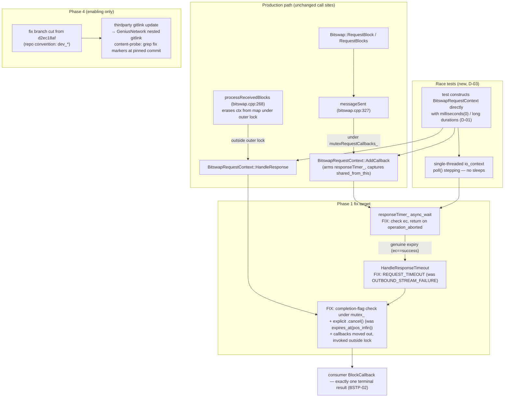

# Phase 1: Bitswap Timer Correctness - Research

**Researched:** 2026-10-12
**Domain:** Boost.Asio `deadline_timer` cancel/expiry semantics in `thirdparty/ipfs-bitswap-cpp` (C++17, MSVC 2022, static runtime), deterministic single-threaded `io_context` race testing, standalone GTest harness configure on Windows
**Confidence:** HIGH

<user_constraints>
## User Constraints (from CONTEXT.md)

### Locked Decisions

- **D-01:** Constructor default parameter — `BitswapRequestContext(boost::asio::io_context&, boost::posix_time::time_duration = boost::posix_time::seconds(5))`. Production call sites are unchanged (default applies); tests construct the context directly with millisecond-class durations. Mirrors how `ContentRequestContext` keeps its duration as a ctor-initialized member. — **Reversibility:** reversible — additive default parameter, no call-site changes.
- **D-02:** Duration-only injection — the real `boost::asio::deadline_timer` stays; no timer abstraction, factory, or mock type enters the production header. Determinism comes from tiny injected durations plus controlled stepping of a single-threaded `io_context` (`poll()`/`run_one()` ordering). — **Reversibility:** reversible — no production abstraction to unwind.
- **D-03:** The four race-ordering tests live in ipfs-bitswap-cpp's own test suite (new test file under `thirdparty/ipfs-bitswap-cpp/test/`), shipping on the fix branch — self-contained upstream contribution and a Phase-4 content-probe marker in the same submodule as the fix. **Research MUST verify this suite actually builds and runs on Windows in this workspace** (its test CMake is not wired into the thirdparty build); the AsyncIOManager test suite (`thirdparty/AsyncIOManager/test/`) is the documented fallback path if it cannot.
- **D-04:** Restructure `HandleResponse` once in Phase 1 — the full in-file port: under lock (completion-flag check, explicit `.cancel()`, callbacks moved out, request marked complete), outside lock (invoke callbacks). This is the exact `ContentRequestContext` shape at bitswap.cpp:575-600. Phase 2 then owns the reentrancy guarantees (context kept alive via `shared_from_this()` during dispatch, cancel-own-request-from-callback), the TEST-01 extension, and BSTP-04 verification — Phase 2 still verifies the move-out even though the code lands in Phase 1. Rationale: two sequential fork branches rewriting the same ten lines creates avoidable merge friction on the branch chain Phase 4 pins. — **Reversibility:** reversible — single-function restructure.
- **D-05:** `BitswapRequestContext` only. `ContentRequestContext`'s residual races (see Deferred Ideas) are explicitly out of scope. — **Reversibility:** reversible — scope declaration, no code.
- **D-06:** The genuine-timeout path maps to the existing `BitswapError::REQUEST_TIMEOUT` (bitswap.hpp:94-106). The current `HandleResponseTimeout` → `OUTBOUND_STREAM_FAILURE` mapping (bitswap.cpp:91-94) is wrong and switches to an existing enum value — no public-header change, no new enum entry. — **Reversibility:** reversible — consumers already compile against the full enum.

### the agent's Discretion

- Fork-branch naming for the ipfs-bitswap-cpp branch cut from `d2ec18af` (Phase 4 records the final pins by content probe)
- Exact race-test file name and GTest case naming within the ipfs-bitswap-cpp suite
- `io_context` stepping mechanics (`poll()` vs `run_one()`) used to realize the four orderings, as long as no sleeps are introduced

### Deferred Ideas (OUT OF SCOPE)

- **ContentRequestContext hardening** — `checkContentRequestComplete` (bitswap.cpp:925-940) reads `ctx->timedOut` and invokes `ctx->callback` outside `mutexContentRequests_`, a residual race with the locked timeout handler (possible success/timeout double-fire in a narrow window). Source-level concern, not a reproduced runtime failure, and outside BSTP-01..03. Candidate for a v2 fix on its own branch.
- **TEST-01 full race suite extension** — reentrant-callback-cancels-own-request and the callback-move-out verification belong to Phase 2 per D-04's split.

### Reviewed Todos (not folded)

- "Fix Vulkan capability-probe deadlock/crash in ProcessingManager::Create path" — spurious keyword match; unrelated.
</user_constraints>

<phase_requirements>
## Phase Requirements

| ID | Description | Research Support |
|----|-------------|------------------|
| BSTP-01 | A canceled Bitswap request timer never fires the failure path — the `async_wait` handler checks `ec` and returns on `operation_aborted` | Boost 1.85 in-tree header documents cancelled handlers receive `boost::asio::error::operation_aborted`; the in-file porting template (`setupContentRequest`, bitswap.cpp:576-600) shows the exact `if (ec) return;` shape. See [Timer Semantics](#timer-semantics-verified-against-the-in-tree-boost-185-headers) |
| BSTP-02 | Each Bitswap block request yields exactly one terminal result — a completion flag checked under the mutex makes success and timeout paths mutually exclusive even when an already-expired handler fires with success after cancel | Boost docs' return-count idiom (`expires_from_now() > 0` vs `0` = "too late, handler … will soon be executed") proves the late handler can run with `ec == success`, so only a flag under `mutex_` closes the window. Deterministic repro recipe found (0 ms injected duration + pre-posted completion lambda + single `poll()`). See [Race-Test Mechanics](#race-test-mechanics-the-four-orderings-deterministically) |
| BSTP-03 | Consumer-initiated cancellation or success produces no error callback; only a genuine timeout produces exactly one failure callback (`REQUEST_TIMEOUT`-class) | `BitswapError::REQUEST_TIMEOUT` verified verbatim in bitswap.hpp:94-106 (3rd enum value); `OUTCOME_CPP_DEFINE_CATEGORY` message verified at bitswap.cpp:31-32. **Gap found:** no public cancel API exists on `BitswapRequestContext` or `Bitswap` — see Open Question Q1 |
</phase_requirements>

## Summary

The fix is a small, well-templated port inside `thirdparty/ipfs-bitswap-cpp/src/bitswap.cpp`: give `BitswapRequestContext` an injectable timeout duration (D-01), make the `async_wait` handler check `ec` and bail on `operation_aborted` (BSTP-01), replace the `expires_at(pos_infin)` disarm with explicit `.cancel()` plus a completion flag checked under `mutex_` (BSTP-02), move callback invocation outside the lock (D-04), and switch the genuine-timeout error from `OUTBOUND_STREAM_FAILURE` to the already-existing `REQUEST_TIMEOUT` (D-06). Every one of these patterns already exists in the same file (`setupContentContext`'s timeout handler at bitswap.cpp:576-600 and `checkContentRequestComplete`'s explicit `ctx->timeout.cancel()` at bitswap.cpp:932); the phase is porting, not inventing. All source claims below were verified by reading the working tree at `d2ec18af` this session — the workspace checkout is exactly the pinned commit, clean, on branch `dev_lockaudit`.

The D-03 harness question is **answered affirmatively and empirically**: the ipfs-bitswap-cpp test suite was configured, built, and run on Windows in this session. The prior session's failed configure (visible in terminal history, exit 1) had four missing ingredients, all now identified: `-DBoost_DIR` pointing at the Boost 1.85 CONFIG package, `-DBoost_USE_STATIC_RUNTIME=ON -DCMAKE_MSVC_RUNTIME_LIBRARY=MultiThreadedDebug` (thirdparty boost is static-CRT `mt-sgd`), `-DSQLiteModernCpp_DIR` (libp2p dependency), and zlib on `CMAKE_PREFIX_PATH` (protobuf's exported target links `ZLIB::ZLIBSTATIC`). With the full flag recipe, `bitswap_server_client_test` compiled, linked, and passed (exit 0) on MSVC 19.44. The AsyncIOManager fallback is not needed — and its helpers are sleep-based (`pollUntil` with `std::this_thread::sleep_for`), i.e., it offers no deterministic-stepping precedent anyway.

**One hard environment blocker was discovered: the W: drive is 100% full (931.5 GB used, ~582 KB free).** This — not the code — is why the initial on-W: test build died with `C1033: cannot open program database` (PDB write failure). The proof build was relocated to `C:\gnus-research\ipfs-bitswap-cpp-test-probe` (C: has 187.9 GB free; deps read from W:, outputs on C:) and succeeded. The plan MUST begin with a disk-space decision: free ≥1 GB (ideally several GB) on W: so the production test tree can live at `thirdparty/build/Windows/Debug/ipfs-bitswap-cpp-test` per the TESTING.md convention, or explicitly accept a cross-drive build tree as this phase's harness location.

**Primary recommendation:** Cut the fix branch from the current clean `d2ec18af` checkout (naming follows the repo's `dev_*` convention, e.g. `dev_timer_correctness` — agent discretion), port the C-5+C-7 shape into `BitswapRequestContext`, add the four race tests as a new GTest file in `test/` using the existing `addtest()` macro (it links `gtest_main` — the three existing tests are plain-`main()`, so the new file establishes the GTest pattern), gate the whole phase on freeing disk space first, and drive the orderings with 0 ms / long injected durations plus single-`poll()` stepping — no sleeps.

## Architectural Responsibility Map

| Capability | Primary Tier | Secondary Tier | Rationale |
|------------|-------------|----------------|-----------|
| Timer cancel/expiry correctness (BSTP-01..03) | ipfs-bitswap-cpp library (`src/bitswap.cpp`) | — | The bug and its fix live entirely in `BitswapRequestContext`; no SuperGenius/SDK code change exists in this phase |
| Timeout-duration injection (D-01/D-02) | `BitswapRequestContext` constructor | — | Default parameter keeps the two production call sites (bitswap.cpp:353) unchanged |
| Race regression tests (SC4) | ipfs-bitswap-cpp test suite (`test/`) | — | D-03 locked; suite proven buildable/runnable on Windows this session |
| Build/test tree provisioning | Developer machine (W: / C: drives) | thirdparty `build/Windows/Debug` | Standalone configure consumes prebuilt thirdparty installs; W: disk-full is a machine-level concern |
| Branch + repin plumbing (enabling Phase 4) | thirdparty git repo (gitlink) | GeniusNetwork superproject (nested gitlink) | `ipfs-bitswap-cpp` is a submodule of `thirdparty`, which is itself a submodule of `GeniusNetwork` — two-level pin update, content-probed |

## Standard Stack

No new packages are installed in this phase. Everything comes from the existing workspace.

### Core
| Library | Version | Purpose | Why Standard |
|---------|---------|---------|--------------|
| Boost.Asio (`basic_deadline_timer`) | 1.85.0 (in-tree install at `thirdparty/build/Windows/Debug/boost/build`, verified `lib/cmake/Boost-1.85.0/BoostConfig.cmake`) | The request timer being fixed | The existing idiom in bitswap.cpp; D-02 locks it in (no timer abstraction) `[VERIFIED: thirdparty/build/Windows/Debug/boost/build/lib/cmake/Boost-1.85.0/BoostConfig.cmake exists — checked this session]` |
| Google Test | thirdparty GTest install (`thirdparty/build/Windows/Debug/GTest/lib/cmake/GTest`) | Race-test framework | `cmake/test.cmake`'s `addtest()` macro already links `GTest::gtest_main`/`gmock_main`; found at configure time when `TESTING=ON` `[VERIFIED: thirdparty/ipfs-bitswap-cpp/CMakeLists.txt L57-61, cmake/test.cmake L8-31]` |
| CMake + MSVC | CMake 3.29.2 (Strawberry), VS 17 2022 / MSVC 19.44.35209, MSBuild 17.14 | Build toolchain | Verified by the successful probe build this session `[VERIFIED: probe configure/build/run all exit 0]` |

### Supporting
| Library | Version | Purpose | When to Use |
|---------|---------|---------|-------------|
| `boost::posix_time` | 1.85.0 | Duration type for the injection seam (D-01) | `time_duration` ctor default `seconds(5)`; tests pass `milliseconds(0)` / long durations |
| libp2p, ipfs-lite-cpp, protobuf, etc. | prebuilt installs under `thirdparty/build/Windows/Debug/` | Link dependencies of the test executables | Read-only inputs; exact `-D*_DIR` hints in the [verified configure recipe](#verified-build-and-test-recipe) |

### Alternatives Considered
| Instead of | Could Use | Tradeoff |
|------------|-----------|----------|
| `boost::asio::deadline_timer` + `posix_time` | `boost::asio::basic_waitable_timer` (steady_timer) | Modern Asio style, but a type swap contradicts D-02 (keep the real deadline_timer) and touches more of the file than the port needs. Wrong choice for this phase |
| New GTest race file via `addtest()` | Plain-`main()` test like the 3 existing ones | Plain-main matches local convention but cannot `--gtest_filter` individual orderings; `addtest()` exists in-repo (`cmake/test.cmake`) and GTest is already found when `TESTING=ON`. Recommended: GTest |
| ipfs-bitswap-cpp test suite (D-03 primary) | AsyncIOManager test suite (documented fallback) | **Fallback NOT needed** — primary verified working. Fallback costs a full libp2p-host fixture, its helpers are sleep-based (`asio_helpers.hpp` `pollUntil` uses `sleep_for`), and its `BitswapNode` destructor has the known member-order trap. Keep as documented fallback only |

**Installation:** none — no package manager involved. The harness build is a CMake configure against existing installs (full command below).

## Package Legitimacy Audit

No external packages are installed by this phase (C++ static libs from the in-tree thirdparty build only).

| Package | Registry | Age | Downloads | Source Repo | Verdict | Disposition |
|---------|----------|-----|-----------|-------------|---------|-------------|
| (none) | — | — | — | — | — | N/A — no installs |

**Packages removed due to [SLOP]:** none
**Packages flagged as suspicious [SUS]:** none

## Architecture Patterns

### System Architecture Diagram



### Recommended Project Structure
```
thirdparty/ipfs-bitswap-cpp/          # fix branch cut from d2ec18af (agent names it, dev_* convention)
├── src/
│   ├── bitswap.cpp                   # THE fix: BitswapRequestContext ctor + AddCallback + HandleResponse + HandleResponseTimeout
│   └── bitswap.hpp                   # ctor default param (D-01); class already enable_shared_from_this
└── test/
    └── bitswap_request_timer_race_test.cpp   # NEW (agent names it): four deterministic orderings

thirdparty/build/Windows/Debug/
└── ipfs-bitswap-cpp-test/            # standalone test build tree (after W: disk is freed)
```

### Pattern 1: C-5+C-7 port shape (from `ContentRequestContext`, same file)
**What:** Timer handler checks `ec`; terminal state transitions under mutex; callback extracted under lock, invoked outside lock.
**When to use:** This is the locked D-04 restructure for `BitswapRequestContext::HandleResponse` + the `async_wait` handler.
**Example (verbatim, the in-file template to port):**
```cpp
// Source: thirdparty/ipfs-bitswap-cpp/src/bitswap.cpp L576-600 (read this session at d2ec18af)
        ctx->timeout.async_wait(
            [this, cid]( const boost::system::error_code &ec )
            {
                if ( ec )
                {
                    return;
                }

                // Erase context from map under lock, invoke callback outside lock
                // to prevent re-entrancy deadlock (same pattern as C-7 fix in
                // processReceivedBlocks).
                ContentCallback callback;
                {
                    std::lock_guard<std::mutex> guard( mutexContentRequests_ );
                    auto                        it = contentRequests_.find( cid );
                    if ( it != contentRequests_.end() && !it->second->timedOut )
                    {
                        it->second->timedOut = true;
                        callback             = std::move( it->second->callback );
                        contentRequests_.erase( it );
                    }
                }
                if ( callback )
                {
                    callback( BitswapError::CONTENT_REQUEST_TIMEOUT );
                }
            } );
```

### Pattern 2: Explicit `.cancel()` precedent
**What:** Disarm by cancel, not by pushing the deadline to infinity.
**Example (verbatim):**
```cpp
// Source: thirdparty/ipfs-bitswap-cpp/src/bitswap.cpp L931-934 (checkContentRequestComplete, read this session)
        UnixFSContent content = assembleContent( ctx );
        ctx->timeout.cancel();
        ctx->callback( std::move( content ) );
```

### Pattern 3: The broken code being replaced (verbatim, for the executor's diff)
```cpp
// Source: thirdparty/ipfs-bitswap-cpp/src/bitswap.cpp L65-99 (read this session at d2ec18af)
    BitswapRequestContext::BitswapRequestContext( boost::asio::io_context &context ) :
        responseTimer_( context ), responseTimeout_( boost::posix_time::seconds( 5 ) )
    {
    }

    void BitswapRequestContext::AddCallback( BlockCallback callback )
    {
        std::lock_guard<std::mutex> guard( mutex_ );
        responseTimer_.expires_from_now( responseTimeout_ );
        // Capture shared_from_this so the armed timer keeps the context
        // alive until it fires — ...
        responseTimer_.async_wait(
            [self = shared_from_this()]( const boost::system::error_code & ) {   // <-- ec IGNORED (BSTP-01 bug)
                self->HandleResponseTimeout();
            } );
        callbacks_.emplace_back( std::move( callback ) );
    }

    void BitswapRequestContext::HandleResponse( libp2p::outcome::result<std::string> block )
    {
        std::lock_guard<std::mutex> guard( mutex_ );
        responseTimer_.expires_at( boost::posix_time::pos_infin );               // <-- disarm-by-infinity (SC1: must become .cancel())
        for ( auto &callback : callbacks_ )                                       // <-- callbacks invoked UNDER mutex_ (D-04 move-out)
        {
            callback( block );
        }
        callbacks_.clear();                                                       // <-- no completion flag (BSTP-02 bug)
    }

    void BitswapRequestContext::HandleResponseTimeout()
    {
        HandleResponse( BitswapError::OUTBOUND_STREAM_FAILURE );                  // <-- wrong error (D-06: REQUEST_TIMEOUT)
    }
```

**Constructor declaration to change (verbatim):**
```cpp
// Source: thirdparty/ipfs-bitswap-cpp/src/bitswap.hpp L111-114 (read this session)
    class BitswapRequestContext : public std::enable_shared_from_this<BitswapRequestContext>
    {
    public:
        BitswapRequestContext( boost::asio::io_context &context );
```
D-01 target shape (derivation, values from locked decision): `BitswapRequestContext( boost::asio::io_context &context, boost::posix_time::time_duration responseTimeout = boost::posix_time::seconds( 5 ) );` — member init `responseTimeout_( responseTimeout )`. The single production construction site `std::make_shared<BitswapRequestContext>( *context_ )` (bitswap.cpp:353, read this session) compiles unchanged with the default `[VERIFIED: bitswap.cpp:353]`.

### Anti-Patterns to Avoid
- **Disarm via `expires_at(pos_infin)` instead of `.cancel()`** — it does cancel the pending wait (expiry change cancels; see Timer Semantics), but semantically claims "no terminal event" while leaving a handler that cannot distinguish cancel from expiry. Also, the replacement of the expiry STILL makes the pending handler run with `operation_aborted` — the ec check is mandatory either way.
- **Invoking consumer callbacks under `mutex_`** — the D-04 move-out exists so a callback can re-enter; leaving invocation under the lock is the Phase 2 deadlock (landed now per D-04).
- **Relying on `ec` alone for the late-expired window** — an already-dequeued genuinely-expired handler runs with `ec == success` (no error). Only the completion flag closes BSTP-02. The Boost doc's return-count (`0` = "too late") is the tell.
- **Sleeps or wall-clock waits in the race tests** — violates SC4 and D-02; use 0 ms / long durations + `poll()` stepping (below).
- **Standalone scratch builds that skip the real toolchain** — TESTING.md convention: build inside `build/<Platform>/<Config>` against the real `find_package` wiring. The C: probe was research-only evidence; the phase's own tree should live on W: once space is freed (or the cross-drive location is consciously accepted).

## Don't Hand-Roll

| Problem | Don't Build | Use Instead | Why |
|---------|-------------|-------------|-----|
| Timer cancel/expiry distinction | Custom timer state machine, mock timer interface | `boost::system::error_code` check (`operation_aborted`) + completion flag under `mutex_` (in-file C-5 pattern) | Asio already delivers the cancel signal; D-02 explicitly forbids a timer abstraction |
| "Too late to cancel" detection | Race-prone booleans set outside the lock | `expires_from_now()`/`cancel()` return count (0 = handler already queued/executed) — informational only; the flag remains the guarantee | Documented Boost semantics (header quote below); the return count explains the window but the flag is what survives it |
| Deterministic race scheduling | Threads + `sleep_for` orchestration | Single-threaded `io_context` + injected 0 ms/long durations + `poll()` stepping | SC4 requires determinism; the AsyncIOManager `pollUntil` helper (sleep-based, `asio_helpers.hpp:56-70`) is the anti-example |
| Test macro wiring | Hand-rolled `add_executable`/`add_test` GTest glue | In-repo `addtest()` from `cmake/test.cmake` (links `gtest_main`+`gmock_main`, outputs to `test_bin/`, registers ctest) | Already shipped in the submodule; matches SuperGenius conventions |

**Key insight:** Every mechanism this phase needs — ec check, flag-under-lock, cancel-then-invoke-outside-lock, injectable duration — already exists as a working pattern in this exact file or the Boost headers the build uses. The phase's risk is concentrated in build/test plumbing (disk space, flag recipe), not algorithm design.

## Common Pitfalls

### Pitfall 1: W: drive is FULL — builds fail with misleading compiler errors
**What goes wrong:** MSVC fails `error C1033: cannot open program database '...pdb'` on every TU; configure succeeds, build dies.
**Why it happens:** W: has ~582 KB free (931.5 GB used). PDB writes are the first casualty. Observed live this session.
**How to avoid:** Free ≥1 GB on W: before Phase 1's first build (candidates measured this session: `SuperGenius/build` = 166.6 GB, `thirdparty/build` = 23.9 GB, `GeniusSDK/build` = 11.1 GB — which parts are safe is the operator's call). Alternatively consciously relocate the phase's test tree to another drive (C: probe proven: 508 MB tree, deps still read from W:).
**Warning signs:** `C1033` on many files at once; `Get-PSDrive W` free ≈ 0.

### Pitfall 2: The naive test-suite configure fails four ways (prior session's exit 1, diagnosed)
**What goes wrong:** `find_package(Boost CONFIG)` inside `libp2pConfig.cmake:29` cannot find `BoostConfig.cmake`; then Boost variant rejection (`mt-sgd` static runtime); then `SQLiteModernCpp` not found; then protobuf's exported `ZLIB::ZLIBSTATIC` target missing at generate time.
**Why it happens:** The thirdparty install layout needs explicit CONFIG hints: `-DBoost_DIR`, `-DBoost_USE_STATIC_RUNTIME=ON` + `-DCMAKE_MSVC_RUNTIME_LIBRARY=MultiThreadedDebug` (+ `CMP0091=NEW`), `-DSQLiteModernCpp_DIR`, and zlib on `CMAKE_PREFIX_PATH`. `BOOST_ROOT`/`BOOST_INCLUDEDIR` alone are ignored by CONFIG-mode `find_dependency`.
**How to avoid:** Use the exact verified recipe below. It mirrors `_ZLIB_PACKAGE_ARGS`/`_CMAKE_COMMON_CACHE_ARGS` from `thirdparty/build/CommonTargets.cmake` + `CommonCompilerOptions.cmake:70-73,100-126`.
**Warning signs:** "Could not find a package configuration file provided by Boost"; "No suitable build variant has been found … mt-sgd"; "ZLIB::ZLIBSTATIC … target was not found".

### Pitfall 3: Orphaned MSBuild nodes lock PDBs
**What goes wrong:** `--parallel` build killed mid-flight leaves MSBuild worker nodes holding PDB handles; the next build gets `C1033` even with space free.
**Why it happens:** MSBuild node reuse (`/nr`) keeps workers alive; a failed invocation doesn't always tear them down. Observed: three MSBuild processes from the failed attempt.
**How to avoid:** Kill stray `MSBuild` processes before rebuilding after a failure; keep `--parallel` moderate (4-8 worked on C:).
**Warning signs:** `C1033` immediately after a previously interrupted build.

### Pitfall 4: Existing tests are plain-`main()`, not GTest
**What goes wrong:** Copying `bitswap_server_client_test.cpp`'s structure yields a hand-rolled main with printf assertions; no per-ordering filtering, no xunit output.
**Why it happens:** All three existing test executables define `int main()` and link no GTest (verified: `int main()` at `bitswap_content_test.cpp:467`, `bitswap_persistence_test.cpp:380`, `bitswap_server_client_test.cpp:929`); `test/CMakeLists.txt` never links GTest targets. GTest is nevertheless FOUND when `TESTING=ON` (top-level CMakeLists L57-58) and `cmake/test.cmake`'s `addtest()` links it — the wiring is present, just unused.
**How to avoid:** New race test uses `addtest(bitswap_request_timer_race_test bitswap_request_timer_race_test.cpp)` + explicit `target_link_libraries(... ipfs-bitswap-cpp ipfs-bitswap-proto ipfs-unixfs-proto ipfs-merkledag-proto)` (addtest links only GTest). Note `addtest()` places the exe in `${CMAKE_BINARY_DIR}/test_bin` (VS multi-config: `test_bin/Debug/`).

### Pitfall 5: `AddCallback` runs under the outer `mutexRequestCallbacks_`
**What goes wrong:** A fix that has `AddCallback` (or the timer-arming path) invoke callbacks, or a test that assumes `mutex_` is the only lock held, breaks the documented lock order.
**Why it happens:** `messageSent` (bitswap.cpp:345-355) calls `AddCallback` while holding `mutexRequestCallbacks_`; `AddCallback` then takes `mutex_`. Lock order is strictly `mutexRequestCallbacks_ → mutex_`. Conversely `processReceivedBlocks` calls `HandleResponse` AFTER releasing the outer lock (bitswap.cpp:299-304) — so `HandleResponse` may not assume the outer lock either way.
**How to avoid:** Keep the restructure entirely within `BitswapRequestContext` (`mutex_` only); never acquire `mutexRequestCallbacks_` inside it. The hpp contract comment (L116-120) documents this.
**Warning signs:** Any new `lock_guard` in the port beyond `mutex_`.

### Pitfall 6: ctest on VS multi-config needs `-C Debug`
**What goes wrong:** `ctest --test-dir <tree>` finds 0 tests or fails to run exes.
**Why it happens:** VS generators append per-config dirs; test COMMANDs resolve only with the config flag.
**How to avoid:** `ctest --test-dir <tree> -C Debug` (verified: lists `BitswapContentRetrievalTest`, `BitswapServerClientTest`, `BitswapPersistenceTest`) or run the exe directly with `--gtest_filter`.

### Pitfall 7: `origin/develop` contains rebased duplicates of main's commits (repo memory)
**What goes wrong:** Rebase/merge confusion when pushing the fix branch or when Phase 4 pins by SHA.
**How to avoid:** Branch is cut from `d2ec18af` (current clean HEAD) and never rebased onto develop; Phase 4 pins the commit SHA and greps content, never trusts branch names.

## Timer Semantics (verified against the in-tree Boost 1.85 headers)

All quotes verbatim from `thirdparty/build/Windows/Debug/boost/build/include/boost-1_85/boost/asio/basic_deadline_timer.hpp` (read this session) — the exact header the test build compiles against:

- Changing the expiry while a wait is pending CANCELS that wait — so today's `expires_at(pos_infin)` disarm does cancel the pending handler (with `operation_aborted`); the bug is purely that the handler ignores `ec` `[VERIFIED: basic_deadline_timer.hpp L90-91]`:
```cpp
 * Changing the expiry time of a timer while there are pending asynchronous
 * waits causes those wait operations to be cancelled.
```
- Cancelled handlers receive `operation_aborted` — the BSTP-01 contract `[VERIFIED: basic_deadline_timer.hpp L124-125]`:
```cpp
 * @li If a wait handler is cancelled, the boost::system::error_code passed to
 * it contains the value boost::asio::error::operation_aborted.
```
- The too-late window — why a completion flag is REQUIRED (an already-dequeued genuinely-expired handler is NOT cancelled and runs with success; `ec` alone cannot detect it) `[VERIFIED: basic_deadline_timer.hpp L119-123]`:
```cpp
 * @li The boost::asio::basic_deadline_timer::expires_from_now() function
 * cancels any pending asynchronous waits, and returns the number of
 * asynchronous waits that were cancelled. If it returns 0 then you were too
 * late and the wait handler has already been executed, or will soon be
 * executed. If it returns 1 then the wait handler was successfully cancelled.
```
- `.cancel()` forces pending waits to complete with `operation_aborted` `[VERIFIED: basic_deadline_timer.hpp L326-328, L356-358]`:
```cpp
 * This function forces the completion of any pending asynchronous wait
 * ... be invoked with the boost::asio::error::operation_aborted error code.
```
- The canonical ec-check idiom, straight from the header example `[VERIFIED: basic_deadline_timer.hpp L111, L105-116]`:
```cpp
 * void on_timeout(const boost::system::error_code& e)
 * {
 *   if (e != boost::asio::error::operation_aborted)
 *   {
 *     // Timer was not cancelled, take necessary action.
 *   }
 * }
```

Boost version note: the workspace thirdparty build is Boost **1.85.0** (`lib/cmake/Boost-1.85.0`, and `CommonCompilerOptions.cmake` pins `1.85.0` via `BOOST_MAJOR_VERSION`/`BOOST_MINOR_VERSION` cache vars, read this session) — the AGENTS.md stack note "Boost ~1.89 SuperGenius/thirdparty" is stale for this Windows tree. GeniusSDK's separate cmake pins 1.85.0 as well. No 1.89 headers are in play for this phase `[VERIFIED: CommonCompilerOptions.cmake L14-16, L27; build dir name Boost-1.85.0]`.

## Race-Test Mechanics: The Four Orderings Deterministically

No workspace precedent exists for sleep-free deterministic io_context stepping — the AsyncIOManager helpers run the context on a background thread and poll with `std::this_thread::sleep_for` (`test/testutil/asio_helpers.hpp` L56-70, read this session), which is exactly what SC4 forbids. The new race tests establish the pattern. Recipe (single-threaded, no sleeps):

- **Injected durations (D-01):** construct the context with `boost::posix_time::milliseconds(0)` (or negative — deadline already past) for "must-expire" arms, and a long duration (e.g. `hours(1)` / `seconds(60)`) for "must-not-expire" arms. Zero/past deadlines make expiry deterministic without waiting.
- **Stepping:** `io_context::poll()` (runs all ready handlers) and `poll_one()`/`run_one()` for single-step control; `restart()` between test cases if a context was run to exhaustion.
- **Ordering control within one `poll()` batch:** handlers run FIFO in the ready queue; timer expiries are moved to the ready queue at the start of a `poll()` iteration, BEFORE ready handlers run. Therefore a completion lambda **posted before** `poll()` runs **before** an already-expired timer's handler dequeued in that same iteration — deterministic "cancel happens while the expired handler sits ready" (the BSTP-02 window). `[ASSUMED — A1]` (FIFO across the timer-queue/ready-queue boundary is Asio implementation behavior, not documented contract; the ec/flag guarantees above are the documented part. Executor should assert the ordering empirically in the first test and adjust stepping — e.g. two `poll_one()` calls — if the platform disagrees.)

The four orderings as concrete drives (public API only: ctor, `AddCallback`, `HandleResponse`):
1. **cancel before expiry:** long duration; `AddCallback(cb)`; `HandleResponse(success)` (fix's `.cancel()` under lock, flag set, cb invoked outside lock); `poll()` → canceled handler runs with `operation_aborted` → ec-check returns. Assert: cb exactly once, with success; zero error callbacks.
2. **expiry dequeued, then cancel (BSTP-02 window):** 0 ms duration; `AddCallback(cb)`; `io.post([&]{ ctx->HandleResponse(success); })`; `poll()` → posted lambda runs first (flag set, `.cancel()` returns 0 — too late), expired handler then runs with `ec == success` → flag check drops it. Assert: exactly one success callback.
3. **response then canceled timer fires:** long duration; `AddCallback(cb)`; `HandleResponse(success)`; `poll()` until io_context has no work (proves the aborted handler actually ran and no-oped). Assert: no failure callback ever.
4. **genuine timeout then late response:** 0 ms duration; `AddCallback(cb)`; `poll()` → handler runs with `ec == success`, flag set, cb invoked once with `REQUEST_TIMEOUT`; then `HandleResponse(success)` → flag check drops. Assert: exactly one failure callback, error is `REQUEST_TIMEOUT`, zero success callbacks.

**Gap:** orderings 1/3 exercise "cancel" via the completion path. A pure consumer-initiated cancel (BSTP-03 wording) has no driving API today — see Open Question Q1 (recommendation: small additive public `Cancel()`). Note `HandleResponseTimeout` is private (hpp L117) so tests must reach the timeout through the timer itself, which the 0 ms recipe does naturally.

## Verified Build and Test Recipe

Configure (verified this session, exit 0; PowerShell, from any cwd — the W: tree `ipfs-bitswap-cpp-test` was left partially built by the disk-full failure and re-runs cleanly once space is freed; the C: probe tree `C:\gnus-research\ipfs-bitswap-cpp-test-probe` is the working proof and can be kept or deleted):

```powershell
$D='W:/gnus/GeniusNetwork/thirdparty/build/Windows/Debug'
$B="$D/ipfs-bitswap-cpp-test"   # or 'C:/gnus-research/ipfs-bitswap-cpp-test-probe'
cmake -S W:/gnus/GeniusNetwork/thirdparty/ipfs-bitswap-cpp -B $B `
  -G "Visual Studio 17 2022" -A x64 -DTESTING=ON `
  "-DCMAKE_INSTALL_PREFIX=$B" `
  "-DCMAKE_POLICY_DEFAULT_CMP0091=NEW" "-DCMAKE_MSVC_RUNTIME_LIBRARY=MultiThreadedDebug" `
  "-DCMAKE_FIND_PACKAGE_PREFER_CONFIG=ON" `
  "-DBoost_USE_STATIC_LIBS=ON" "-DBoost_USE_STATIC_RUNTIME=ON" `
  "-DBoost_DIR=$D/boost/build/lib/cmake/Boost-1.85.0" `
  "-DCMAKE_PREFIX_PATH=$D/zlib" "-Dzlib_DIR=$D/zlib/lib/cmake/zlib" `
  "-DZLIB_DIR=$D/zlib/lib/cmake/zlib" "-DZLIB_USE_STATIC_LIBS=ON" `
  "-DGTest_DIR=$D/GTest/lib/cmake/GTest" `
  "-Dyaml-cpp_DIR=$D/yaml-cpp/lib/cmake/yaml-cpp" `
  "-Dlibp2p_DIR=$D/libp2p/lib/cmake/libp2p" `
  "-Dipfs-lite-cpp_DIR=$D/ipfs-lite-cpp/lib/cmake/ipfs-lite-cpp" `
  "-Dipfs-lite-cpp_INCLUDE_DIR=$D/ipfs-lite-cpp/include" `
  "-DProtobuf_DIR=$D/protobuf/lib/cmake/protobuf" `
  "-DProtobuf_INCLUDE_DIR=$D/protobuf/include" `
  "-DProtobuf_PROTOC_EXECUTABLE=$D/protobuf/bin/protoc.exe" `
  "-Dabsl_DIR=$D/protobuf/lib/cmake/absl" `
  "-Dutf8_range_DIR=$D/protobuf/lib/cmake/utf8_range" `
  "-DBoost.DI_DIR=$D/Boost.DI/lib/cmake/Boost.DI" `
  "-Dc-ares_DIR=$D/cares/lib/cmake/c-ares" `
  "-Dfmt_DIR=$D/fmt/lib/cmake/fmt" `
  "-Dsoralog_DIR=$D/soralog/lib/cmake/soralog" `
  "-Dspdlog_DIR=$D/spdlog/lib/cmake/spdlog" `
  "-Dtsl_hat_trie_DIR=$D/tsl_hat_trie/lib/cmake/tsl_hat_trie" `
  "-DSQLiteModernCpp_DIR=$D/SQLiteModernCpp/lib/cmake/SQLiteModernCpp" `
  "-Dsqlite3_DIR=$D/sqlite3/cmake" `
  "-DGSL_INCLUDE_DIR=$D/Microsoft.GSL/include" `
  "-DOPENSSL_ROOT_DIR=$D/openssl/build"
```
`[VERIFIED: configure exit 0 this session — both W: (after fixes) and C: probe trees; generates src\ipfs-bitswap-cpp.vcxproj, test\bitswap_{content,server_client,persistence}_test.vcxproj, RUN_TESTS.vcxproj]`

```powershell
# Build (verified: bitswap_server_client_test links and runs, exit 0)
cmake --build $B --config Debug --target bitswap_server_client_test --parallel 4
# New race test target, once added:
cmake --build $B --config Debug --target bitswap_request_timer_race_test --parallel 4

# Run (verified exit 0 on the C: probe: "[COMPLETE] All tests passed!")
& "$B/test/Debug/bitswap_server_client_test.exe"                      # plain-main tests
& "$B/test_bin/Debug/bitswap_request_timer_race_test.exe" --gtest_filter="*CancelBeforeExpiry*"   # addtest() output dir
ctest --test-dir $B -C Debug -R bitswap_request_timer_race_test --output-on-failure
```
Build-size data point: full Debug tree with the library + one test exe ≈ **508 MB**; budget ≥1 GB on W: for all three existing exes + the new race test `[VERIFIED: measured on the C: probe this session]`.

Parallel note: pass MSBuild args through cmake (`--parallel 4`) — raw `-m:4` after `--` gets mangled by PowerShell and fails with `MSB1031` (observed). Warning noise that is EXPECTED and non-fatal on this suite: `C4834` (nodiscard discard in existing tests), `getThreadName() is not implemented`, `Boost toolset is unknown (compiler MSVC 19.44)` dev warnings.

## Branch Mechanics (verified git state)

- **Current submodule state:** `thirdparty/ipfs-bitswap-cpp` is clean at `d2ec18afd1ed397c7f5f79945a3da76fca49c1f6` (commit "Fix use-after-free in BitswapRequestContext::AddCallback timer handler: capture shared_from_this") on local branch `dev_lockaudit` — i.e., HEAD is exactly the pin the fix branch cuts from; `git switch -c <name>` from here IS the cut `[VERIFIED: git log/status run this session]`.
- **Nesting (two levels):** `GeniusNetwork` (.gitmodules lists SuperGenius, GeniusWallet, GeniusSDK, TestVMs, TokenContracts, thirdparty, GithubReleaseDownloader, zkLLVM) → `thirdparty` (own repo, its .gitmodules has `path = ipfs-bitswap-cpp`, `url = ../ipfs-bitswap-cpp.git`) → `ipfs-bitswap-cpp`. Phase 4's repin updates: (1) the submodule commit inside thirdparty, (2) thirdparty's own gitlink inside GeniusNetwork — both commits, with content probes (grep for fix markers at the pinned commit) per ROADMAP Phase 4 SC1-2 `[VERIFIED: .gitmodules at both levels + thirdparty submodule status d2ec18af (heads/dev_lockaudit), this session; ROADMAP.md L56-64]`.
- **Existing branches** (naming precedent for the agent-discretion pick): `dev_elmbridge`, `dev_err`, `dev_lockaudit`, `dev_threadsafety`, `develop`, `master` → e.g. `dev_timer_correctness` fits `[VERIFIED: git branch run this session]`.
- **Remote:** `origin = git@github.com:GeniusVentures/ipfs-bitswap-cpp.git` (SSH) — pushing the fix branch needs the operator's SSH key; a local branch + commit is enough for local verification, push is a checkpoint before Phase 4's cross-machine pin `[VERIFIED: git remote -v this session]`.
- **The `d2ec18a` shared_from_this capture stays:** AddCallback's timer lambda already captures `self = shared_from_this()` (bitswap.cpp:78-84 read this session) — the fix builds on it; the race tests get their late-handler-safety partly from it (armed timer keeps the context alive even after the test drops its shared_ptr).

## State of the Art

| Old Approach | Current Approach | When Changed | Impact |
|--------------|------------------|--------------|--------|
| `deadline_timer` + `posix_time` | `basic_waitable_timer` (`steady_timer`) with `std::chrono` in new Asio code | Asio 1.14+/Boost 1.70+ era | Not adopted here — D-02 locks the existing idiom; a type swap would widen the diff for zero phase value |
| `io_context::work` | `executor_work_guard` | Boost 1.66+ | AsyncIOManager's helpers still use deprecated `io_context::work` (`asio_helpers.hpp:20`) — do not copy from the fallback |

**Deprecated/outdated:** none of the deprecated APIs enter the new code (`poll()`, `run_one()`, `restart()` are all current).

## Environment Availability

| Dependency | Required By | Available | Version | Fallback |
|------------|------------|-----------|---------|----------|
| Disk space on W: (≥1 GB) | Production test tree per TESTING.md | ✗ (~582 KB free; 931.5 GB used) | — | Build tree on C: (probe proven, 187.9 GB free) — needs explicit decision |
| Visual Studio 17 2022 / MSVC | Compiler | ✓ | MSVC 19.44.35209 | — |
| CMake ≥ 3.22 | Configure | ✓ | 3.29.2 | — |
| thirdparty prebuilt installs (boost 1.85, GTest, libp2p, ipfs-lite-cpp, protobuf, zlib, SQLiteModernCpp, …) | Link deps | ✓ | `thirdparty/build/Windows/Debug/*` | — |
| SSH key for `git@github.com:GeniusVentures` | Pushing fix branch (Phase 4 prep) | ? (untested this session) | — | Local-only branch until push checkpoint |
| ctest | Test runner | ✓ | bundled with CMake 3.29.2 | Direct exe invocation |

**Missing dependencies with no fallback:**
- **W: disk space — the phase's gating environment blocker.** Nothing code-side blocks; every build/test action this phase needs was proven end-to-end on C:. The planner must make freeing W: space (or accepting a C:/other-drive tree) the first task/checkpoint. `SuperGenius/build` (166.6 GB) is the dominant reclaim candidate — operator decision.

**Missing dependencies with fallback:**
- SSH push auth → keep the branch local; push becomes an explicit checkpoint before Phase 4.

## Security Domain

`security_enforcement: true` in `.planning/config.json` (checked this session). This phase changes no crypto, auth, input parsing, or wire format — it corrects timer-to-callback semantics in an internal request context.

### Applicable ASVS Categories

| ASVS Category | Applies | Standard Control |
|---------------|---------|-----------------|
| V2 Authentication | no | unchanged |
| V3 Session Management | no | unchanged |
| V4 Access Control | no | unchanged |
| V5 Input Validation | no | no new inputs; `HandleResponse` payload type unchanged |
| V6 Cryptography | no | unchanged |
| V12 File Handling | no | unchanged (disk-index code untouched) |

### Known Threat Patterns for this change

| Pattern | STRIDE | Standard Mitigation |
|---------|--------|---------------------|
| Remote peer triggers double-consumer-callback / spurious `OUTBOUND_STREAM_FAILURE` via block-response + timeout race (the bug being fixed) | Tampering / DoS (denial of correctness) | Completion flag under `mutex_` — exactly-once terminal result (BSTP-02); correct `REQUEST_TIMEOUT` classification (BSTP-03) |
| Use-after-free if request context dies while timer pending | Elevation (memory corruption) | Already mitigated at `d2ec18af` (`shared_from_this` capture) — fix preserves it `[VERIFIED: bitswap.cpp:78-84]` |
| Consumer callback re-entrancy deadlock | DoS (self) | Callbacks moved outside `mutex_` (D-04, lands this phase; full guarantees Phase 2) |

## Assumptions Log

| # | Claim | Section | Risk if Wrong |
|---|-------|---------|---------------|
| A1 | Within one `io_context::poll()` batch, a handler posted before `poll()` runs before an already-expired timer's handler (ready-queue FIFO across the timer-queue → ready-queue boundary) — the deterministic driver for the BSTP-02 window | Race-Test Mechanics | Ordering 2's test might not reproduce the window as written; executor falls back to two `poll_one()` steps or asserts ordering empirically first. Low risk — the ec/flag guarantees themselves are documented (see Timer Semantics) |
| A2 | A small additive public `Cancel()` on `BitswapRequestContext` (flag + `.cancel()` + clear callbacks, no invocation) is in-scope under D-05 and is the right way to make BSTP-03's "consumer-initiated cancellation" independently drivable | Open Questions / BSTP-03 | If planner rejects it, orderings 1/3 cover cancel only via the completion path; BSTP-03's consumer-cancel clause is then tested indirectly (still honest — the current integration has no consumer-cancel flow) |
| A3 | `milliseconds(0)` (or past) deadline arms a wait whose handler is immediately ready with `ec == success` on MSVC/Asio 1.85 | Race-Test Mechanics | If a zero deadline needs one clock tick, use a small negative duration (`milliseconds(-1)`), which is unambiguously past; executor verifies in the first ordering-4 test |
| A4 | Full three-exe Debug test tree ≈ 0.8–1.2 GB (extrapolated from measured 508 MB for lib + 1 exe) | Verified Build Recipe | W: free target slightly off; free 2 GB to be safe |

## Open Questions

1. **Does BSTP-03's "consumer-initiated cancellation" require a public `Cancel()` API?** *(RESOLVED in 01-01-PLAN.md — planner decision: YES; Task 3 step 1 adds the additive public `Cancel()` exactly per A2; recorded in the plan objective.)*
   - What we know: no cancel API exists on `BitswapRequestContext` or `Bitswap` (verified against the full hpp public surface this session). The four ROADMAP orderings can all be driven through ctor/`AddCallback`/`HandleResponse` + timer. BSTP-03/SC3 phrase cancellation as a first-class outcome ("Consumer-initiated cancellation and success produce no error callback").
   - What's unclear: whether the phase's acceptance reads "consumer cancel" as the disarm-inside-completion only, or demands an explicit cancel entry point.
   - Recommendation: add the small additive public `Cancel()` (A2) — reversible, within D-05's class scope, makes orderings 1 and BSTP-03 directly testable, and gives Phase 2 a reentrancy probe target. Planner decides.
2. **Disk space: free W: or relocate the test tree?** *(RESOLVED in 01-01-PLAN.md — Task 1 is a blocking-human `checkpoint:decision` gate with options free-w / use-c; the chosen path becomes $B for every build command in Tasks 2-3.)*
   - What we know: W: full (~582 KB); C: probe proven end-to-end; TESTING.md prefers the real `build/<Platform>/<Config>` tree.
   - Recommendation: first task = operator checkpoint to free ≥1–2 GB on W: (candidates listed above); the C: probe remains the fallback if the operator declines.
3. **Push the fix branch now or at Phase 4?** *(RESOLVED in 01-01-PLAN.md — no push in Phase 1: plan prohibition #4 keeps the branch local-only until Phase 4's content-probed pin, overriding the push-early recommendation above.)*
   - What we know: remote is SSH; auth untested this session; Phase 4 pins by content probe, not branch name, so local commits suffice until then.
   - Recommendation: push after Phase 1 verification as a `checkpoint:human-verify` (auth may need the operator), so Phases 2–4 branch from a shared tip.

## Sources

### Primary (HIGH confidence — read/executed this session in the workspace)
- `thirdparty/ipfs-bitswap-cpp/src/bitswap.cpp` L65-99 (broken context), L268-304 (`processReceivedBlocks`), L327-365 (`messageSent`), L558-600 (`setupContentRequest` porting template), L625-638 (`failContentRequest`), L925-940 (`checkContentRequestComplete`)
- `thirdparty/ipfs-bitswap-cpp/src/bitswap.hpp` L94-106 (`BitswapError` enum, verbatim quote in BSTP-03 row), L108-128 (`BitswapRequestContext` + mutex contract)
- `thirdparty/build/Windows/Debug/boost/build/include/boost-1_85/boost/asio/basic_deadline_timer.hpp` L85-125, L326-358 (timer semantics quotes)
- `thirdparty/ipfs-bitswap-cpp/CMakeLists.txt` (TESTING option, GTest find), `test/CMakeLists.txt` (3 plain-main exes), `cmake/test.cmake` (`addtest()` macro)
- `thirdparty/build/CommonTargets.cmake` L565-600 (wired bitswap ExternalProject incl. `-DTESTING:BOOL=${TESTING}`), `CommonCompilerOptions.cmake` L14-27, L70-73, L100-126 (runtime/static flags)
- Live commands this session: git state (log/status/remote/branches), cmake configure (exit 0), build `bitswap_server_client_test` (success), run (exit 0), `ctest -N` (3 tests listed), disk measurements
- `.planning/workstreams/ipfs-improve/ROADMAP.md` Phase 4 (L56-64, repin/content-probe), `REQUIREMENTS.md`, `STATE.md`, `01-CONTEXT.md`
- `.planning/research/gnus_libp2p_comparison.md` L60-62 (audit origin, P0 "Canceled timers treated as timeouts")
- `.planning/codebase/TESTING.md` (build-tree verification convention)

### Secondary (MEDIUM confidence)
- None — no external sources needed; all claims are in-tree

### Tertiary (LOW confidence)
- None

## Metadata

**Confidence breakdown:**
- Fix/port shape: HIGH — every pattern quoted verbatim from the same file; target lines re-read at the pinned commit this session
- Test harness (D-03): HIGH — configured, built, ran, ctest-listed end-to-end this session (C: probe); W: blocked only by disk, recipe identical
- Race-test stepping mechanics: MEDIUM — documented timer semantics are HIGH (header quotes), but the FIFO-across-queues detail is implementation behavior (A1); executor verifies empirically
- Environment: HIGH — measured directly (disk full, sizes, versions)

**Research date:** 2026-10-12
**Valid until:** 2026-11-12 (stable domain; re-verify disk state and submodule cleanliness before execution)
