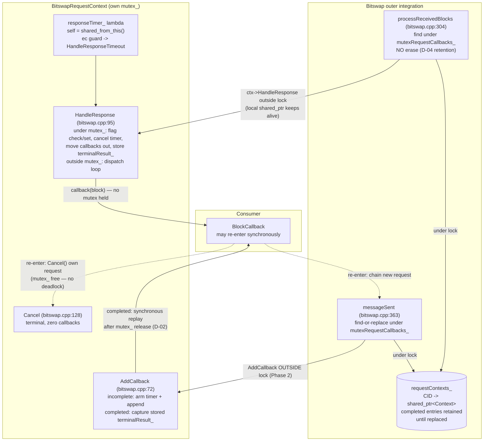

# Phase 2: Bitswap Callback Reentrancy - Research

**Researched:** 2026-10-12
**Domain:** C++17 concurrency restructure — callback dispatch lock discipline, async lifetime (`shared_from_this`), map lifecycle policy, deterministic single-threaded `io_context` race testing, ASan-on-WSL evidence pipeline
**Confidence:** HIGH (code-level claims read at HEAD `e2dc906` this session; WSL environment probed this session; only the exact WSL compile/link line and two semantic edge cases remain [ASSUMED])

## Summary

Phase 2 lands on top of the Phase 1 shape (`BitswapRequestContext::HandleResponse` already moves callbacks out under `mutex_` and dispatches after release at bitswap.cpp:95-118). The remaining work is the **outer integration**: (1) `messageSent` currently calls `AddCallback` **while holding `mutexRequestCallbacks_`** (bitswap.cpp:381-391) — harmless today because `AddCallback` never invokes callbacks, but D-02's synchronous replay makes it a dispatch-under-outer-mutex hazard, so registration must move outside the lock; (2) `processReceivedBlocks` erases the map entry on success (bitswap.cpp:331, the **only** erase site in the file) while the timeout path **never erases** — producing a live latent bug today: after a timeout, the completed entry is retained forever, and a subsequent same-CID request that reaches `messageSent`'s find-branch calls `AddCallback` on a completed context, where the callback is **appended but can never fire** (silently lost) and a stray timer is armed (violating SC3's second clause before Phase 2 even starts). D-04 until-replaced retention plus D-01..D-03 replay close exactly this hole. (3) `BitswapRequestContext` already inherits `enable_shared_from_this` (bitswap.hpp:108) and the timer lambda already captures `shared_from_this()` — the BSTP-05 lifetime proof reduces to showing every dispatch path holds a `shared_ptr` for the duration (timer-lambda `self`; `processReceivedBlocks`'s local `ctx`; the map itself once D-04 retention lands).

The D-10 read-only inventory (mandatory deliverable, below) found **21 direct consumer-callback invocation sites** in bitswap.cpp at `e2dc906`: 12 on block-request paths, 3 on content paths, 6 on publish paths. **Zero sites dispatch a consumer callback while holding a mutex today**; the one hazardous site is the `messageSent` *registration* under `mutexRequestCallbacks_` that becomes a dispatch under D-02. The 3 content-path sites dispatch lock-free but carry the known unlocked-`timedOut`-flag races already logged as v2 candidates.

The WSL ASan environment (D-07) is **feasible — verified by probe**: `~/gnus/GeniusNetwork/thirdparty` exists with all ipfs/libp2p repos, a fully configured Unix-Makefiles Debug build tree at `build/Linux/Debug/x86_64` containing prebuilt static libs (`libipfs-bitswap-cpp.a`, libp2p, GTest, boost artifacts), `clang++ 14.0.0`, `g++ 11.4.0`, `rsync`, `cmake 3.22.1`, and `/mnt/w` mounting the Windows source drive. The WSL bitswap checkout sits at the base SHA `d2ec18a` (not the fix branch), so fix-branch sources must be synced as file copies per D-07.

**Primary recommendation:** Land three surgical changes — (a) `AddCallback` gains a completed-branch that stores/replays a terminal result synchronously after releasing `mutex_` and never arms the timer; (b) `messageSent` finds-or-replaces under `mutexRequestCallbacks_` and calls `AddCallback` **outside** it; (c) `processReceivedBlocks` keeps the entry (no erase), letting the completion flag select the single winner — then extend the race suite with the reentrant/replay cases and run the supplementary WSL ASan pass.

<user_constraints>
## User Constraints (from CONTEXT.md)

### Locked Decisions (D-01..D-11 — copied from 02-CONTEXT.md)

**Late-registration semantics (SC3)**
- **D-01:** Replay terminal result — a request that reached terminal state remembers its outcome (success blocks or error code); a callback registered afterwards is invoked with the stored result. Consumers never silently miss a result.
- **D-02:** Replay runs synchronously at registration — the callback fires before `AddCallback` returns, invoked after any held mutex (including the outer `mutexRequestCallbacks_` in `messageSent`) is released. Matches SC3's "immediately"; the registering caller tolerates its callback running on its own stack — the same reentrancy guarantee BSTP-05 gives consumers.
- **D-03:** Both outcomes are replayable — symmetric contract: a late subscriber to a timed-out request receives the stored `REQUEST_TIMEOUT` error exactly as an on-time subscriber would; a late subscriber to a completed request receives the stored blocks.
- **D-04:** Completed entries are retained until replaced — the completed request stays in `requestContexts_` marked complete (timer disarmed, no fresh timer ever armed on it per SC3), and is replaced when a new request for the same CID arrives. No sweep machinery, no retention timers; map size bounded by distinct requested CIDs.

**Reentrancy test breadth (BSTP-05 / TEST-01)**
- **D-05:** Both flavors get deterministic tests — (a) a callback cancels its own request inline: no deadlock, no UAF, exactly the BSTP-03 outcome semantics; (b) a callback issues a new block request that then completes: chaining works and the new request's callback fires. Nested depth-2 reentrancy was considered and not selected.
- **D-06:** "Without deadlock" is a bounded-step assertion — after driving the reentrant scenario, the test asserts the `io_context` drains (`poll()==0`) and all expected handlers ran within a bounded number of steps. A lock inversion becomes a red, diagnosable assertion; no wall-clock sleeps, no hang-until-CI-timeout.
- **D-07:** UAF evidence = ASan run in WSL — build and run the race suite under ASan in WSL at `~/gnus/GeniusNetwork/thirdparty`. **NO git inside WSL** (SSH passphrase broken) — fix-branch source synced Windows→WSL as file copies (throwaway); every git operation stays on the Windows side. Windows deterministic suite remains the primary acceptance evidence; WSL ASan is supplementary.
- **D-08:** One cross-test covers the SC3×BSTP-05 collision — a live callback reentrantly registers a new callback on an already-completed request; the replayed terminal result must be delivered synchronously inside that callback without deadlock.

**Fix surface breadth (BSTP-04 / SC1)**
- **D-09:** Block-request paths only — the fix surface is `BitswapRequestContext` plus its outer integration: `requestContexts_` erase-under-lock/dispatch-after-unlock, `messageSent` timer-arming/`AddCallback` path, `processReceivedBlocks` → `HandleResponse`. The D-05 v2 deferral of `ContentRequestContext` is honored.
- **D-10:** Read-only dispatch-site inventory as evidence — inventory every other consumer-callback dispatch site in bitswap.cpp recording which hold a mutex at dispatch. Findings land as v2 candidates; no fixes, no scope growth.
- **D-11:** Phase 2 lands on `dev_timer_correctness` — commits continue on the existing fix branch (HEAD `e2dc906`), single linear chain from `d2ec18af`. Never pushed.

### The agent's Discretion (research may recommend)
- `shared_from_this()` lifetime mechanics during dispatch
- Exact lock-scoping shape of request-map erase vs dispatch (erase under map lock, dispatch after release)
- How the terminal result is stored for replay (retained context entry vs separate completed-record) provided until-replaced semantics hold
- Test case naming and placement within `bitswap_request_timer_race_test.cpp` (extend) or a sibling file (new `addtest` target)
- WSL sync mechanics (rsync/scp/copy) and ASan toolchain choice (clang/gcc)
- `io_context` stepping mechanics (`poll()` vs `run_one()`) — no sleeps either way

### Deferred Ideas (OUT OF SCOPE)
- Non-block-request dispatch-site fixes — anything the D-10 inventory finds (ContentRequestContext paths, `checkContentRequestComplete`, etc.) is recorded as v2 candidates; fixed in a future milestone
- ContentRequestContext hardening (carry-forward from Phase 1) — `checkContentRequestComplete` reads `ctx->timedOut` and invokes `ctx->callback` outside `mutexContentRequests_`, a residual success/timeout double-fire race; v2 candidate
</user_constraints>

<phase_requirements>
## Phase Requirements

| ID | Description | Research Support |
|----|-------------|------------------|
| BSTP-04 | Consumer callbacks dispatched outside all internal mutexes — state mutated under lock (callbacks moved out, request marked complete, erased from the request map), callbacks invoked after unlock | D-10 inventory (all 21 sites mapped with lock state); `messageSent` restructure seam (§Architecture Patterns, Pattern 2); `processReceivedBlocks` retention seam (Pattern 3); HandleResponse already-safe evidence at bitswap.cpp:95-118 |
| BSTP-05 | Consumer callback may synchronously re-enter Bitswap — cancel its own request or issue new requests — without deadlock or use-after-free (context kept alive via `shared_from_this()` during dispatch) | Lifetime-mechanics analysis (§shared_from_this During Dispatch); `enable_shared_from_this` verified at bitswap.hpp:108; three dispatch paths each holding a owning reference; reentrant-`Cancel()` walk-through |
| TEST-01 | Race-ordering regression tests exist and pass — the four Phase 1 orderings plus reentrant callback canceling its own request without deadlock | Test-extension map (§Test Extension Points): 7 existing cases catalogued with harness mechanics; 6-7 new cases specified incl. D-08 cross-test, replay both outcomes, no-fresh-timer, bounded-step drain idiom; MSVC 19.44/Boost 1.85 platform-deviation tolerance note |
</phase_requirements>

## Architectural Responsibility Map

| Capability | Primary Tier | Secondary Tier | Rationale |
|------------|-------------|----------------|-----------|
| Per-request terminal state machine (complete-once, timer disarm, callback list) | `BitswapRequestContext` (bitswap.cpp:65-136) | — | Owns `mutex_`, `completed_`, `callbacks_`, `responseTimer_`; only tier allowed to mutate request state |
| Terminal-result storage + synchronous replay (D-01..D-03) | `BitswapRequestContext::AddCallback` (bitswap.cpp:72-93) | — | Replay is a context-level contract; the registration site must merely avoid holding outer locks |
| Request-map lifecycle (find-or-replace, retention-until-replaced) | `Bitswap` outer integration: `messageSent` / `processReceivedBlocks` (bitswap.cpp:304-341, 363-405) | — | `requestContexts_` + `mutexRequestCallbacks_` live at the Bitswap tier; single-lock discipline: context methods never touch outer locks |
| Winner selection (exactly one dispatch per terminal result) | `BitswapRequestContext::HandleResponse` completion flag (bitswap.cpp:100-107) | map find (today) | Under D-04 the flag becomes the sole winner selector; map erase no longer arbitrates |
| Reentrancy lifetime guarantee (BSTP-05) | Owning references at each dispatch path (timer lambda `self`, `processReceivedBlocks` local `ctx`, map entry) | — | `enable_shared_from_this` (bitswap.hpp:108) already in place; no new mechanism needed |
| Deterministic acceptance evidence | Windows race suite (`bitswap_request_timer_race_test.cpp`, ctest) | — | Primary evidence per D-07; single-threaded `io_context`, injected durations, stepped execution |
| Supplementary UAF evidence | WSL ASan run (D-07) | — | Evidence-only; throwaway WSL copy; no production or build-tree change mandated |
| Dispatch-site audit evidence (D-10) | This RESEARCH.md inventory | — | Read-only; findings → v2 candidates |

## Standard Stack

No new packages. This phase uses only the existing in-tree toolchain.

### Core
| Component | Version | Purpose | Why Standard |
|-----------|---------|---------|--------------|
| Boost.Asio (`deadline_timer`, `io_context`) | 1.85 (Windows build) | Timer arming/cancel, stepped test loops | Already the file-wide idiom; D-02 (Phase 1 carry-forward) forbids a timer abstraction |
| GTest | via `addtest()` in test/CMakeLists.txt:115-117 | Race-suite framework | Phase 1 harness is GTest; 7 cases already green |
| CMake (Unix Makefiles / MSVC) | 3.22.1 in WSL [VERIFIED: WSL probe]; MSVC 19.44 on Windows [VERIFIED: 01-VERIFICATION.md deviation 1] | Build | Existing `thirdparty/build/<Platform>/<Config>` convention |
| clang++ (WSL ASan) | 14.0.0 [VERIFIED: WSL probe — `Ubuntu clang version 14.0.0-1ubuntu1.1`] | `-fsanitize=address` supplementary run | D-07; available alongside g++ 11.4.0 |

### Supporting
| Component | Version | Purpose | When to Use |
|-----------|---------|---------|-------------|
| rsync (WSL) | present at `/usr/bin/rsync` [VERIFIED: WSL probe] | Windows→WSL file sync over `/mnt/w` | D-07 sync (verified: `/mnt/w/gnus/GeniusNetwork/thirdparty/ipfs-bitswap-cpp/src/bitswap.cpp` visible from WSL) |
| Prebuilt WSL static libs | `build/Linux/Debug/x86_64/**` [VERIFIED: WSL probe] | Link set for the ASan run (`libipfs-bitswap-cpp.a`, GTest, boost, libp2p, protobuf, spdlog present) | Avoids rebuilding the 48-lib tree |

### Alternatives Considered
| Instead of | Could Use | Tradeoff |
|------------|-----------|----------|
| `terminalResult_` member in the context (recommended) | Separate completed-record struct in the map entry | Member is simpler and serves both map-retained and unit-test-direct usage; separate record duplicates state — discretion explicitly allows either |
| Extending `bitswap_request_timer_race_test.cpp` (recommended) | Sibling `addtest()` target | Same file keeps the suite cohesive and the content-probe surface single; sibling only if compile time becomes an issue |

**Installation:** none — no packages installed by this phase.

## Package Legitimacy Audit

No external packages are installed by this phase (in-tree C++ fix + existing GTest/Boost toolchain). Not applicable — no registry lookups needed.

## D-10 Dispatch-Site Inventory (MANDATORY — read-only evidence)

Every direct consumer-callback invocation site in `thirdparty/ipfs-bitswap-cpp/src/bitswap.cpp` at HEAD `e2dc906`, verified by file read this session. "Mutex at dispatch" = any Bitswap mutex held at the moment the callback invocation executes.

### Block-request paths (IN SCOPE per D-09)

| # | Site (verbatim invocation) | Location | Mutex held at dispatch | Verdict |
|---|----------------------------|----------|------------------------|---------|
| 1 | `callback( block );` — `HandleResponse` dispatch loop | bitswap.cpp:116 | **none** — `mutex_` scope closes at :110 before the loop | Safe (Phase 1 landed shape). BSTP-04 anchor; Phase 2 adds the lifetime proof |
| 2 | `onBlockCallback( BitswapError::MESSAGE_SENDING_FAILURE );` — `messageSent` write-failure | bitswap.cpp:376 | none — precedes the lock at :381 | Safe; in-scope path |
| 3 | `itCallbacks->second->AddCallback( std::move( onBlockCallback ) );` and `requestContext->AddCallback( std::move( onBlockCallback ) );` — `messageSent` registration | bitswap.cpp:385, :390 | **`mutexRequestCallbacks_` HELD** (:381 `std::lock_guard<std::mutex> callbacksGuard( mutexRequestCallbacks_ );` spans :380-393) | **The Phase 2 restructure site.** Today `AddCallback` never invokes callbacks, so no dispatch occurs under the lock; D-02 replay makes `AddCallback` a synchronous dispatcher → registration must move **outside** the outer lock |
| 4 | `onBlockCallback( BitswapError::OUTBOUND_STREAM_FAILURE );` — `RequestBlockWithRetry` CAN_NOT_CONNECT | bitswap.cpp:478 | none — any lock taken after (:483 `mutexActiveStreams_`) | Safe |
| 5 | `onBlockCallback( BitswapError::OUTBOUND_STREAM_FAILURE );` — retry-timer `ec` branch | bitswap.cpp:550 | none | Safe |
| 6 | `onBlockCallback( BitswapError::OUTBOUND_STREAM_FAILURE );` — retries exhausted | bitswap.cpp:557 | none — `mutexActiveStreams_` scope closed at :541 | Safe |
| 7 | `onBlockCallback( BitswapError::OUTBOUND_STREAM_FAILURE );` — `requestBlockWithProviders` attempt cap | bitswap.cpp:1867 | none | Safe |
| 8 | `onBlockCallback( std::move( result ) );` — provider-failover success relay | bitswap.cpp:1893 | none | Safe |
| 9 | `onBlockCallback( BitswapError::NO_PROVIDERS_AVAILABLE );` — providers exhausted | bitswap.cpp:1903 | none | Safe |
| 10 | `onBlockCallback( BitswapError::OUTBOUND_STREAM_FAILURE );` — `requestBlockWithProvidersFromRoot` attempt cap | bitswap.cpp:1918 | none | Safe |
| 11 | `onBlockCallback( std::move( result ) );` — FromRoot success relay | bitswap.cpp:1948 | none | Safe |
| 12 | `onBlockCallback( BitswapError::NO_PROVIDERS_AVAILABLE );` — FromRoot exhausted | bitswap.cpp:1959 | none | Safe |

### Content-request paths (OUT OF SCOPE — v2 candidates, D-05 carry-forward + D-10)

| # | Site (verbatim invocation) | Location | Mutex held at dispatch | Verdict |
|---|----------------------------|----------|------------------------|---------|
| 13 | `callback( BitswapError::CONTENT_REQUEST_TIMEOUT );` — `setupContentRequest` timeout handler | bitswap.cpp:635 | none at dispatch — `mutexContentRequests_` scope closes at :633 (move-out pattern pre-exists) | Dispatch safe; residual: unlocked `timedOut` flag interplay with sites 14/15 → **v2 candidate** |
| 14 | `ctx.callback( error );` — `failContentRequest` | bitswap.cpp:653 | none at dispatch — lock taken **after** at :655 | `ctx.timedOut` check-then-set (:646-652) is unlocked → double-fire window vs the locked timeout handler → **v2 candidate** (deferred from Phase 1) |
| 15 | `ctx->callback( std::move( content ) );` — `checkContentRequestComplete` | bitswap.cpp:970 | none at dispatch — lock taken after at :971-973 | Unlocked `ctx->timedOut` read at :962 vs locked timeout writer → the named success/timeout double-fire race → **v2 candidate** |

### Publish paths (OUT OF SCOPE — record only)

| # | Site (verbatim invocation) | Location | Mutex held at dispatch | Verdict |
|---|----------------------------|----------|------------------------|---------|
| 16 | `callback( BitswapError::ENCODING_FAILURE );` — `PublishFile` posted handler | bitswap.cpp:1455 | none — precedes `mutexBlockStore_` scope | Safe |
| 17 | `callback( rootCID );` — `PublishFile` success | bitswap.cpp:1477 | none — `mutexBlockStore_` scope closed at :1475 | Safe |
| 18 | `callback( BitswapError::ENCODING_FAILURE );` — `PublishDirectory` | bitswap.cpp:1492 | none | Safe |
| 19 | `callback( rootCID );` — `PublishDirectory` success | bitswap.cpp:1520 | none | Safe |
| 20 | `onPublishCallback( BitswapError::ENCODING_FAILURE );` — `PublishData` | bitswap.cpp:1531 | none | Safe |
| 21 | `onPublishCallback( rootCID );` — `PublishData` success | bitswap.cpp:1553 | none — `mutexBlockStore_` scope closed at :1551 | Safe |

### Inventory verdict

- **21 direct invocation sites** (12 block-request, 3 content-request, 6 publish).
- **0 sites dispatch a consumer callback while holding a mutex today** — Phase 1's `HandleResponse` restructure plus the pre-existing move-out shapes in the content timeout handler and publish paths cover every direct dispatch.
- **1 hazardous registration site:** `messageSent` bitswap.cpp:381-391 arms callbacks under `mutexRequestCallbacks_`. Not a dispatch today; becomes a synchronous dispatch-under-outer-mutex the moment D-02 replay lands, unless registration moves outside the lock. **This is the single SC1 integration gap Phase 2 exists to close.**
- **3 v2 candidates** (sites 13-15): lock-free dispatch but unlocked `timedOut` flag races — exactly matching the deferred-items list in 01-CONTEXT.md and 02-CONTEXT.md.
- Ingress-only call sites (not dispatch): `handle()` → `processReceivedBlocks` at bitswap.cpp:206 and :260, and `messageSent`'s response read at :403 — no locks held at any of them.

**Latent bug found during inventory (motivates D-01..D-04):** `requestContexts_.erase` occurs at exactly one site in the file — bitswap.cpp:331 (success path). The timeout path (`HandleResponseTimeout` → `HandleResponse`, bitswap.cpp:120-122) never erases. Therefore a timed-out entry is retained *unmarked* today, and a later same-CID request reaching `messageSent`'s find-branch (bitswap.cpp:383-386) calls `AddCallback` on a completed context: the callback is appended at :92 but can never fire (`completed_` gate at :100-106 drops every later terminal attempt), and a fresh timer is armed at :74-75 in defiance of SC3. The consumer's retry callback is silently lost. [VERIFIED: bitswap.cpp:72-93, 100-107, 331, 381-391 — read this session]

## Architecture Patterns

### System Architecture Diagram



A reader traces the primary use case: response arrives → `processReceivedBlocks` finds entry under the map lock (no erase) → `HandleResponse` completes-under-`mutex_`/dispatch-after → consumer callback runs with every mutex released → consumer may synchronously call `Cancel()` (no-op: already complete) or chain a new request through `messageSent`.

### Recommended Change Shape

Three files touched (mirroring Phase 1's footprint): `src/bitswap.hpp` (context members + accessor), `src/bitswap.cpp` (three seams), `test/bitswap_request_timer_race_test.cpp` (new cases) + `test/CMakeLists.txt` only if a sibling target is chosen.

### Pattern 1: Terminal-result storage + synchronous replay in `AddCallback` (D-01..D-03, SC3)
**What:** `AddCallback` checks `completed_` under `mutex_`; the completed branch captures the stored terminal outcome and skips timer arming entirely; the replay invocation happens after the lock scope closes.
**When to use:** exactly this method — no other registration site exists (verified: the only `AddCallback` production callers are bitswap.cpp:385 and :390, both in `messageSent`).
**Example (recommended shape — planner may refine):**
```cpp
// bitswap.hpp — add alongside `bool completed_ = false;` (bitswap.hpp:139)
std::optional<libp2p::outcome::result<std::string>> terminalResult_;  // D-01 replay store

// bitswap.cpp — AddCallback restructure
void BitswapRequestContext::AddCallback( BlockCallback callback )
{
    std::optional<libp2p::outcome::result<std::string>> replayResult;
    {
        std::lock_guard<std::mutex> guard( mutex_ );
        if ( completed_ )
        {
            replayResult = terminalResult_;  // set for success/REQUEST_TIMEOUT (D-03);
            // canceled requests store nothing — late registration is dropped (see Open Q1)
        }
        else
        {
            responseTimer_.expires_from_now( responseTimeout_ );   // SC3: never on completed
            responseTimer_.async_wait(
                [self = shared_from_this()]( const boost::system::error_code &ec ) {
                    if ( ec ) { return; }
                    self->HandleResponseTimeout();
                } );
            callbacks_.emplace_back( std::move( callback ) );
        }
    }
    // D-02: synchronous replay, invoked only after every mutex (incl. outer) is released
    if ( replayResult && callback )
    {
        callback( *replayResult );
    }
}
```
`HandleResponse` sets `terminalResult_ = block;` inside the lock where it sets `completed_` (bitswap.cpp:104-107 today); `Cancel()` sets `completed_` without storing (BSTP-03: no callback of any kind).

### Pattern 2: `messageSent` find-or-replace, registration outside the outer lock (BSTP-04/D-04)
**What:** Under `mutexRequestCallbacks_`: find the entry; reuse it only if incomplete, else create a fresh context and **assign** (insert-or-replace). `AddCallback` itself moves outside the lock scope.
**Example (recommended shape):**
```cpp
std::shared_ptr<BitswapRequestContext> ctx;
{
    std::lock_guard<std::mutex> callbacksGuard( mutexRequestCallbacks_ );
    auto itCallbacks = requestContexts_.find( cid );
    if ( itCallbacks != requestContexts_.end() && !itCallbacks->second->IsCompleted() )
    {
        ctx = itCallbacks->second;                       // pending request — join it
    }
    else
    {
        ctx = std::make_shared<BitswapRequestContext>( *context_ );
        requestContexts_[cid] = ctx;                     // D-04: insert or replace completed
    }
}
// Outside every mutex: AddCallback may now synchronously replay (D-02) into
// consumer code — safe because no Bitswap lock is held on this stack.
ctx->AddCallback( std::move( onBlockCallback ) );
```
Requires a new public accessor on the context, e.g. `bool IsCompleted() const;` acquiring `mutex_` — a fork-internal hpp addition, same class of change as Phase 1's `Cancel()` (bitswap.hpp:124). The accessor read under `mutex_` followed by `AddCallback` re-checking under `mutex_` is TOCTOU-by-design: `AddCallback`'s own completed-branch remains authoritative; the outer check only decides map reuse vs replacement.

### Pattern 3: `processReceivedBlocks` retention, flag selects the winner (D-04/SC1)
**What:** Keep the find + `markProviderSuccess` under `mutexRequestCallbacks_`; **delete the `requestContexts_.erase( itContext );` line** (bitswap.cpp:331); keep `ctx->HandleResponse( block );` outside the lock (already at :336-341).
**Why winner selection stays correct:** two concurrent deliveries for one CID both leave the lock with the same `ctx`; `HandleResponse`'s `completed_` check-and-set under `mutex_` (bitswap.cpp:100-107) admits exactly one — SC1's "state mutated under lock with exactly one winner". Duplicate/late blocks hit the completed gate and dispatch nothing.
**Memory bound:** map size = distinct requested CIDs — identical bound class to today's timeout-path retention; D-04 accepts this explicitly ("No sweep machinery, no retention timers").

### Anti-Patterns to Avoid
- **Dispatching or replaying under any outer mutex** — the entire point of BSTP-04; `AddCallback` under `mutexRequestCallbacks_` (current :381-391) must not survive Phase 2.
- **Arming the timer in the completed branch of `AddCallback`** — direct SC3 clause-2 violation (today's latent bug, bitswap.cpp:74-75 runs unconditionally).
- **Erasing on completion then trying to replay from a side table** — splits one state machine across two structures; the retained context entry already holds the terminal outcome (discretion allows either, but the member is strictly simpler).
- **Re-adding `requestContexts_.erase` "for hygiene"** — any erase-on-complete reintroduces the silent-miss hole D-04 closes and re-couples winner selection to map mutation.
- **Taking any outer Bitswap mutex inside `BitswapRequestContext`** — single-lock discipline (Phase 1 prohibition 6, carried forward).

## Don't Hand-Roll

| Problem | Don't Build | Use Instead | Why |
|---------|-------------|-------------|-----|
| Keeping the context alive across async dispatch | Raw `this` captures / intrusive refcounts | `enable_shared_from_this` + `shared_from_this()` capture (already in place, bitswap.hpp:108) | The d2ec18af UAF fix is the precedent; a second mechanism would race the first |
| Winner selection under concurrency | Map-erase arbitration (current) or generation counters | The `completed_` flag check-and-set under `mutex_` (bitswap.cpp:100-107) | Already landed in Phase 1; erase-arbitration is what D-04 removes |
| Replay delivery | Queued/posted replay tasks | Synchronous invocation after lock release (D-02) | Posting breaks SC3's "immediately" and re-introduces io-thread coupling |
| Deadlock detection in tests | Watchdog threads / wall-clock timeouts | Bounded-step `poll()` drain + count assertions (D-06, Phase 1 idiom) | SC4 forbids worker threads and sleeps; watchdogs violate both |

**Key insight:** every mechanism Phase 2 needs — completion flag, move-out dispatch, `shared_from_this` capture — already landed in Phase 1 or at `d2ec18af`. Phase 2 is integration + policy, not new machinery.

## Runtime State Inventory

> Phase 2 changes in-memory request-map lifecycle policy (erase-on-success → retain-until-replaced). Categories assessed:

| Category | Items Found | Action Required |
|----------|-------------|------------------|
| Stored data | None — `requestContexts_` is purely in-memory; no persistence touches it (verified: no datastore/blockstore interaction in the request path) | None |
| Live service config | None — no external services hold Bitswap request state | None |
| OS-registered state | None | None |
| Secrets/env vars | None | None |
| In-memory live state (adapted category) | Completed-by-timeout entries already linger in `requestContexts_` today (only :331 erases, on success). Phase 2 makes retention the *uniform* policy and adds terminal-result storage | Code edit only — no migration possible or needed (state is per-process) |
| Build artifacts | Windows test build tree `thirdparty/build/Windows/Debug/ipfs-bitswap-cpp-test` [VERIFIED: 01-VERIFICATION.md]; WSL prebuilt tree at base SHA `d2ec18a` — fix sources must be synced as file copies | Rebuild Windows tree incrementally; rsync fix files to WSL throwaway copy (D-07) |

## Common Pitfalls

### Pitfall 1: Replay delivered while an outer mutex is held
**What goes wrong:** `AddCallback` gains a synchronous replay but `messageSent` still calls it inside the `mutexRequestCallbacks_` scope — a reentrant consumer (or the replayed callback itself) that touches the request map self-deadlocks on a non-recursive `std::mutex`.
**Why it happens:** The current registration site (bitswap.cpp:380-393) was safe only because `AddCallback` never invoked anything.
**How to avoid:** Pattern 2 — registration strictly outside the lock scope.
**Warning signs:** Reentrant-chain test hangs on first run; WSL ASan run reports deadlock/TSan-style stall.

### Pitfall 2: MSVC 19.44 / Boost 1.85 timer-extraction deviation
**What goes wrong:** New tests assume a retired timer handler arrives with a success `error_code` (flag-drop path); on this platform it arrives `operation_aborted` (ec-guard drop) — documented Phase 1 deviation 1.
**Why it happens:** `poll()` cannot deterministically extract expired timers on this toolchain; `run_one()` stepping is the proven idiom.
**How to avoid:** New replay/reentrancy assertions must not depend on timer ec identity at all — replay is synchronous and timer-free; "no fresh timer" is asserted via bounded drain + `EXPECT_EQ(io.poll(), 0)` (the `TerminalTransitionWithZeroCallbacksIsSafe` idiom, test file L318-341).
**Warning signs:** Order-dependent flakes in full-suite runs (the Phase 1 A3 note).

### Pitfall 3: True lock inversion manifests as a hang, not a red assert
**What goes wrong:** D-06 says "a lock inversion becomes a red, diagnosable assertion" — but on a single-threaded `io_context`, a reintroduced dispatch-under-`mutex_` self-deadlocks *inline*: the reentrant `Cancel()` blocks inside the callback, `poll()` never returns, and no assertion executes.
**Why it happens:** `std::mutex` is non-recursive; same-thread reentry cannot be caught by post-hoc asserts.
**How to avoid:** Accept the split honestly: every **non-hang** regression (wrong counts, wrong order, missing replay, extra timer fire) IS red under the bounded-step drain; the hang case is covered by the code-shape checks (verifier greps that the dispatch loop sits outside the lock scope) and the WSL ASan run. A watchdog thread would violate SC4's no-worker-threads constraint — do not add one.
**Warning signs:** Test suite timeout rather than assertion failure — treat timeout as a red lock-inversion signal during verification triage.

### Pitfall 4: Replay applied where replacement is required (and vice versa)
**What goes wrong:** `messageSent` replays the stored terminal outcome to a *new* request for a CID whose old entry completed — the retry receives a stale `REQUEST_TIMEOUT` from the previous attempt and never actually requests. Conversely, replacing when a *late subscriber* registers breaks SC3.
**Why it happens:** Both flows funnel through the same map.
**How to avoid:** The distinction is structural, not heuristic: `messageSent` = new request → replace completed entries with a fresh context (Pattern 2); `AddCallback`-on-completed-context = late registration → replay (Pattern 1). At the Bitswap tier only `messageSent` creates/replaces; at the context tier the completed-branch replays.

### Pitfall 5: Scope creep into the v2 content paths
**What goes wrong:** While inventorying D-10 sites 13-15, "just fixing" the unlocked `timedOut` races doubles the diff and breaks D-05/D-09 confinement.
**How to avoid:** The inventory is READ-ONLY evidence. Prohibition 1 (below) is checkable by the verifier via `git diff --stat d2ec18af..HEAD` confining hunks to the block-request seams.

### Pitfall 6: WSL git contamination
**What goes wrong:** Running git inside WSL (it exists there — `/usr/bin/git` [VERIFIED: WSL probe]) against the SSH remote hangs on the broken passphrase, or a WSL-side commit forks the history D-11 keeps linear.
**How to avoid:** All git on the Windows side only; WSL receives `rsync`-over-`/mnt/w` file copies into a throwaway path.

## Code Examples

### The exact current shapes Phase 2 modifies (read this session at e2dc906)

```cpp
// bitswap.cpp:72-93 — AddCallback today: arms timer + appends, unconditionally.
// A completed context silently swallows the callback (completed_ gate at :100-106).
void BitswapRequestContext::AddCallback( BlockCallback callback )
{
    std::lock_guard<std::mutex> guard( mutex_ );
    responseTimer_.expires_from_now( responseTimeout_ );
    responseTimer_.async_wait(
        [self = shared_from_this()]( const boost::system::error_code &ec ) {
            if ( ec ) { return; }
            self->HandleResponseTimeout();
        } );
    callbacks_.emplace_back( std::move( callback ) );
}

// bitswap.cpp:95-118 — HandleResponse: Phase 1 landed shape (KEEP AS-IS except
// adding terminalResult_ storage under the lock).
{
    std::lock_guard<std::mutex> guard( mutex_ );
    if ( completed_ ) { return; }
    completed_         = true;
    responseTimer_.cancel();
    callbacksToInvoke  = std::move( callbacks_ );
    callbacks_.clear();
}
for ( auto &callback : callbacksToInvoke ) { callback( block ); }   // :116 — no mutex held

// bitswap.cpp:320-341 — processReceivedBlocks today: erase under lock (the ONLY
// erase site in the file), dispatch outside. Phase 2 deletes the erase line.
std::shared_ptr<BitswapRequestContext> ctx;
{
    std::lock_guard<std::mutex> callbacksGuard( mutexRequestCallbacks_ );
    auto itContext = requestContexts_.find( cid.value() );
    if ( itContext != requestContexts_.end() ) { /* markProviderSuccess... */ 
        ctx = itContext->second;
        requestContexts_.erase( itContext );        // :331 — REMOVE for D-04
    }
}
if ( ctx ) { ctx->HandleResponse( block ); }        // :336-341 — keep (outside lock)

// bitswap.cpp:380-393 — messageSent today: registration under the outer lock.
// Phase 2 moves the AddCallback call outside this scope (Pattern 2).
{
    std::lock_guard<std::mutex> callbacksGuard( mutexRequestCallbacks_ );
    auto itCallbacks = requestContexts_.find( cid );
    if ( itCallbacks != requestContexts_.end() ) {
        itCallbacks->second->AddCallback( std::move( onBlockCallback ) );      // :385
    } else {
        auto requestContext = std::make_shared<BitswapRequestContext>( *context_ );
        requestContext->AddCallback( std::move( onBlockCallback ) );           // :390
        requestContexts_.emplace( cid, std::move( requestContext ) );
    }
}
```

### Test-extension skeletons (Phase 1 harness idiom)

```cpp
// D-05(a) + D-06 — reentrant cancel, bounded-step drain
TEST( RequestContextRaceTest, ReentrantCancelOwnRequestNoDeadlock )
{
    boost::asio::io_context io;
    auto context = std::make_shared<BitswapRequestContext>( io, boost::posix_time::seconds( 60 ) );
    int successCount = 0;
    int cancelReturnSteps = 0;
    auto weak = std::weak_ptr( context );
    context->AddCallback( [&]( libp2p::outcome::result<std::string> result ) {
        if ( result ) { ++successCount; }
        if ( auto c = weak.lock() ) { c->Cancel(); ++cancelReturnSteps; } // returns: mutex_ free
    } );
    context->HandleResponse( std::string( "block-data" ) );
    for ( int step = 0; step < 100 && io.poll() > 0; ++step ) {}   // bounded drain (D-06)
    EXPECT_EQ( successCount, 1 );          // the one terminal result stands
    EXPECT_EQ( cancelReturnSteps, 1 );     // reentry returned — no deadlock
    EXPECT_EQ( io.poll(), 0 );             // drained; no fresh timer fired
}

// D-01..D-03 + SC3 — late registration replays synchronously, both outcomes
TEST( RequestContextRaceTest, LateRegistrationOnCompletedReplaysStoredSuccess )
{
    boost::asio::io_context io;
    auto context = std::make_shared<BitswapRequestContext>( io, boost::posix_time::seconds( 60 ) );
    int first = 0, replayed = 0; std::string replayedValue;
    bool returnedBeforeReplay = false;
    context->AddCallback( [&]( auto ) { ++first; } );
    context->HandleResponse( std::string( "block-data" ) );
    context->AddCallback( [&]( libp2p::outcome::result<std::string> r ) {   // completed context
        if ( r ) { ++replayed; replayedValue = r.value(); }
        returnedBeforeReplay = ( first == 1 );   // proves synchronous, ordered delivery
    } );
    for ( int step = 0; step < 100 && io.poll() > 0; ++step ) {}
    EXPECT_EQ( first, 1 );  EXPECT_EQ( replayed, 1 );
    EXPECT_EQ( replayedValue, "block-data" );    // stored blocks replayed (D-03)
    EXPECT_EQ( io.poll(), 0 );                   // SC3: no fresh timer armed
}
// Mirror with a -1 ms genuine timeout asserting the replayed error VALUE equals
// static_cast<int>( BitswapError::REQUEST_TIMEOUT ) (D-03 symmetry; ordering-4 idiom).
```

## WSL ASan Run (D-07) — Mechanics and Feasibility

### Verified environment (probed this session, `wsl -e bash`)

| Fact | Value | Status |
|------|-------|--------|
| `~/gnus/GeniusNetwork/thirdparty` | exists; all ipfs-*/libp2p repos present | [VERIFIED: WSL probe] |
| `ipfs-bitswap-cpp` checkout in WSL | at base SHA `d2ec18a` (`Fix use-after-free in BitswapRequestContext::AddCallback timer handler: capture shared_from_this`) — **not** the fix branch | [VERIFIED: WSL probe] |
| `clang++` | `/usr/bin/clang++` — `Ubuntu clang version 14.0.0-1ubuntu1.1` | [VERIFIED: WSL probe] |
| `g++` | 11.4.0 (`/usr/bin/g++`) | [VERIFIED: WSL probe] |
| `rsync`, `cmake 3.22.1`, `ninja`, `make` | all present | [VERIFIED: WSL probe] |
| Linux build tree | `thirdparty/build/Linux/Debug/x86_64` fully configured (Unix Makefiles, `/usr/bin/c++`, Debug) with prebuilt static libs: `libipfs-bitswap-cpp.a`, `libipfs-bitswap-proto.a`, `libipfs-unixfs-proto.a`, `libipfs-merkledag-proto.a`, GTest (`libgtest_main.a` et al.), libp2p, boost, protobuf, spdlog, ipfs-lite-cpp | [VERIFIED: WSL probe] |
| Bitswap test dir in WSL build | `ipfs-bitswap-cpp-build/test/` empty/absent — tests not configured in that build | [VERIFIED: WSL probe] |
| `/mnt/w` → Windows drive | mounted, fix-branch source visible (`/mnt/w/gnus/GeniusNetwork/thirdparty/ipfs-bitswap-cpp/src/bitswap.cpp` stat-OK) | [VERIFIED: WSL probe] |
| git in WSL | installed (`/usr/bin/git`) but UNUSABLE per D-07 (SSH passphrase); all git stays Windows-side | [VERIFIED: WSL probe] + [VERIFIED: 02-CONTEXT.md D-07] |
| Distro | Ubuntu 22.04, WSL2 kernel 5.15.167.4 | [VERIFIED: WSL probe] |

### Recommended route (primary): throwaway copy + direct ASan compile

Sync the three changed source trees into a throwaway path (e.g. `~/gsd-asan/bitswap/`) via `rsync -a /mnt/w/gnus/GeniusNetwork/thirdparty/ipfs-bitswap-cpp/ ~/gsd-asan/bitswap/`, then compile the race-suite TU **plus a fresh ASan-instrumented `bitswap.cpp`** with `clang++ -fsanitize=address -g -std=c++17`, pointing includes at the synced `src/`, the WSL thirdparty headers (libp2p, boost, protobuf), and linking the prebuilt `.a` set from `build/Linux/Debug/x86_64`. Instrumenting the test TU + `bitswap.cpp` covers 100% of the code the race suite executes (`BitswapRequestContext` lives entirely in bitswap.cpp:65-136); prebuilt non-instrumented libs only satisfy link-time symbols. The exact include/link flag set is **[ASSUMED]** until first executed — the Phase 1 Windows `target_link_libraries` list (test/CMakeLists.txt:118-133) is the authoritative dependency list to replicate.

### Fallback route: separate small CMake configure
A standalone CMakeLists in the throwaway dir referencing the prebuilt artifacts (or reconfiguring a TESTING=ON copy of the bitswap subproject) trades a longer setup for reproducible flags. The full thirdparty tree reconfigure is **not** recommended (48-lib rebuild; the existing cache is Makefiles/g++ and would fight the ASan flag injection).

### Feasibility verdict
**FEASIBLE.** Every hard prerequisite is verified present (compilers, rsync path, prebuilt link set, mounted source). Remaining unknowns are one-time script details, not blockers; the Windows deterministic suite is the primary acceptance evidence regardless (D-07), so a WSL stumble cannot block the phase.

## Test Extension Points

### Existing harness structure (bitswap_request_timer_race_test.cpp, 342 lines, 7 cases)
- Every test constructs `BitswapRequestContext` **directly** (`std::make_shared<BitswapRequestContext>( io, duration )`) — no libp2p host, no `Bitswap` object. The harness tier is the context class; all Phase 2 unit tests slot in at the same tier.
- Stepping idioms (proven): `while ( io.poll() > 0 ) {}` drain; `io.run_one()` for genuine-expiry extraction (`-1 ms` deadlines); `io.post(...)` to pre-queue completions. Durations injected: `seconds(60)` (never fires) / `milliseconds(-1)` (already expired).
- Existing cases: `CancelBeforeExpiryYieldsExactlyOneSuccess`, `ExpiryDequeuedThenCompletionYieldsSingleResult`, `ResponseThenCanceledTimerFiresNoFailure`, `GenuineTimeoutThenLateResponseSingleTimeout`, `ConsumerCancelProducesNoCallback`, `MultipleCallbacksDispatchedInRegistrationOrder`, `TerminalTransitionWithZeroCallbacksIsSafe`. None may be weakened; all must stay green.
- Registration: `addtest( bitswap_request_timer_race_test bitswap_request_timer_race_test.cpp )` at test/CMakeLists.txt:115-117 — extension of the same file needs **zero** CMake changes.

### New cases → decision/requirement map

| New case (names illustrative — discretion) | Covers | Key assertions |
|---|---|---|
| `ReentrantCancelOwnRequestNoDeadlock` | D-05(a), D-06, BSTP-05, TEST-01 | callback body calls `Cancel()` and returns; successCount==1 (BSTP-03 semantics: cancel after terminal changes nothing); bounded drain; `io.poll()==0` |
| `ReentrantChainNewRequestCallbackFires` | D-05(b), BSTP-05 | callback constructs ctx2 + `AddCallback`, delivers `HandleResponse` to ctx2 (inline or posted); ctx2's callback fired exactly once; bounded drain |
| `LateRegistrationOnCompletedReplaysStoredSuccess` | D-01, D-03, SC3 | synchronous replay of stored blocks (asserts before `AddCallback` returns); no fresh timer (drain + `poll()==0`) |
| `LateRegistrationOnTimedOutReplaysRequestTimeout` | D-01, D-03 | replayed error VALUE `== static_cast<int>( BitswapError::REQUEST_TIMEOUT )` (ordering-4 assert idiom) |
| `ReentrantAddCallbackOnCompletedDeliversReplayInline` | D-08 (SC3×BSTP-05 collision) | inside a live callback, `AddCallback` on the same completed context; replay delivered synchronously *within* the outer callback's stack; no deadlock; total invocations exact |
| (fold into the two replay cases) no-fresh-timer-on-completed | SC3 clause 2 | drain to `poll()==0` after late registration |

### Platform-deviation tolerance (mandatory)
On MSVC 19.44/Boost 1.85 a retired timer handler arrives `operation_aborted` (ec-guard drop) rather than success-ec (flag-drop) — [VERIFIED: 01-VERIFICATION.md, deviation 1 + A1/A3 notes]. New tests must not assert on timer ec identity; replay is timer-free and the no-fresh-timer check uses drain-to-zero only.

### Bitswap-tier map-policy coverage (open)
`messageSent`'s find-or-replace and `processReceivedBlocks`' retention are not unit-reachable in this harness (they need a `Bitswap` + libp2p host). Coverage options: (a) code-shape verification + `bitswap_server_client_test` regression [recommended baseline]; (b) optionally extend `bitswap_server_client_test` with a duplicate-block or same-CID-second-request scenario if cheap. See Open Questions Q2.

## Content-Probe Markers for Phase 4

Phase 4 pins by content probe (INTG-02). Phase 1 markers: `completed_`, `REQUEST_TIMEOUT` (greppable at e2dc906). Phase 2 should add same-style greppable identifiers (exact names are planner discretion; recommended set):

| Marker | Where | Proves |
|---|---|---|
| `terminalResult_` | bitswap.hpp member + AddCallback/HandleResponse | D-01 replay store exists |
| `IsCompleted` | bitswap.hpp accessor + messageSent | D-04 find-or-replace seam |
| `ReentrantCancelOwnRequestNoDeadlock` / `LateRegistration` test names | race test file | TEST-01 extension present |
| A `D-04` or `until-replaced` comment at the `requestContexts_[cid] = ctx;` replace-site | messageSent | retention policy landed |

## Prohibitions / Constraints Inventory (collected from 02-CONTEXT.md, 01-CONTEXT.md carry-forwards, 01-VERIFICATION.md)

| # | Prohibition | Source |
|---|-------------|--------|
| 1 | No ContentRequestContext / content-path fixes (incl. `checkContentRequestComplete`, `failContentRequest`, `setupContentRequest`, `processRequestQueue`) — D-10 inventory is read-only | 02-CONTEXT D-09/D-10 + deferred; 01-CONTEXT D-05; P1 prohibition 1 |
| 2 | No timer abstraction, factory, or mock in production headers — duration-only injection stays | 01-CONTEXT D-02 carry-forward; P1 prohibition 2 |
| 3 | No wall-clock sleeps, no worker threads, no hang-by-design in tests | SC4; D-06; P1 prohibition 3 |
| 4 | Never push; never rebase; commits only on `dev_timer_correctness` (linear from `d2ec18af`) | D-11; P1 prohibition 4 (verified: no `origin/dev_timer_correctness` exists) |
| 5 | No new `BitswapError` enum values without need — replay uses existing values (`REQUEST_TIMEOUT` at bitswap.hpp:100) | 01-CONTEXT D-06 carry-forward |
| 6 | Only `mutex_` acquired inside `BitswapRequestContext` — never an outer Bitswap mutex | P1 prohibition 6; single-lock discipline |
| 7 | No fresh `responseTimer_` armed on a completed request | SC3 clause 2; D-04 |
| 8 | No map sweep machinery, no retention timers | D-04 |
| 9 | No nested depth-2 reentrancy tests | D-05 (considered, not selected) |
| 10 | WSL run is evidence-only: no production or build-tree change mandated; no git in WSL; WSL copy throwaway; Windows suite is primary evidence | D-07 |
| 11 | No weakening of the 7 existing race cases; all four Phase 1 orderings must stay green | TEST-01; 02-CONTEXT specifics |
| 12 | Replay must be synchronous at registration (no posted replay) | D-02 |
| 13 | Retained entries released only by same-CID replacement (no eager erase reintroduction) | D-04 |

## State of the Art

Not applicable in the ecosystem sense — this is repo-internal concurrency hardening against this fork's own audit findings. The relevant "current approach" is the landed Phase 1 shape, which Phase 2 extends rather than replaces (no deprecated APIs introduced or consumed).

## Assumptions Log

| # | Claim | Section | Risk if Wrong |
|---|-------|---------|---------------|
| A1 | The exact WSL direct-compile include/link flag set compiles first try (headers/lib paths exist and are verified; the assembled command is untested) | WSL ASan Run | Iteration cost only — fallback CMake route exists; Windows suite is primary evidence, so no acceptance risk |
| A2 | Late registration on a **canceled** (not success/timeout) context is dropped silently (no replay, no error) — recommended reading of D-01×BSTP-03; D-03 names only success and `REQUEST_TIMEOUT` as replayable | Pattern 1, Open Q1 | If user wants an error instead, a decision is needed (new enum value is prohibited without need; could replay `REQUEST_TIMEOUT` as closest-existing-value) |
| A3 | Bitswap-tier map policy (messageSent replace, processReceivedBlocks retention) is adequately covered by code-shape verification + `bitswap_server_client_test` regression, without a new Bitswap-level unit test | Test Extension Points, Open Q2 | If verifier demands unit coverage, a small Bitswap-level test (server_client harness pattern) must be added — scope decision for planner |
| A4 | A reintroduced dispatch-under-lock in the reentrant tests manifests as a hang (not a red assert) and is accepted as such per Pitfall 3 — D-06's "red assertion" language read as covering non-hang regressions | Pitfall 3 | If stricter interpretation is wanted, only a watchdog-thread design could catch it, which SC4 forbids — would need a user decision — **RESOLVED BY DESIGN** (02-01-PLAN FLAGGED ASSUMPTIONS #4): every non-hang regression asserts red under the bounded-step drain; a suite hang is triaged at verification as a red lock-inversion signal |
| A5 | `libgtest.a` (beyond the probed `libgtest_main.a`/`libgmock*.a`) is present in the WSL GTest prebuilt dir — sibling listing strongly implies it but it was not individually stat-ed | WSL ASan Run | Trivial: link main() manually or re-probe |
| A6 | Retention does not observably regress memory in real deployments (bound = distinct requested CIDs, same class as today's timeout-path retention) | Pattern 3 | If a long-running node requests unbounded distinct CIDs the map grows — D-04 explicitly accepts this; flagged for the verifier's awareness only |

## Open Questions (RESOLVED)

All three questions were resolved at planning time; each resolution is codified in `02-01-PLAN.md` (FLAGGED ASSUMPTIONS, must_haves, tasks). Original text kept verbatim for traceability.

1. **Late registration on a *canceled* context — drop or error?** — **RESOLVED: drop silently (planner adoption of the recommendation, A2).**
   - What we know: D-01/D-03 enumerate success blocks and `REQUEST_TIMEOUT` as the replayable outcomes; BSTP-03 mandates zero callbacks for consumer cancel; new enum values are prohibited without need.
   - What's unclear: whether a late registrant on a canceled request should get silence (recommended — consistent with "cancel produces no callback of any kind") or an error.
   - Recommendation: drop silently; document in the AddCallback doc comment. Confirm at plan review (A2).
   - Resolution: zero invocations, zero timers armed; codified in 02-01-PLAN FLAGGED ASSUMPTIONS #1, must_haves truth 3, and the dedicated case `LateRegistrationOnCanceledContextIsDroppedNoTimerArmed` (Task 2).
2. **Bitswap-tier map-policy test coverage** — **RESOLVED by adoption: baseline evidence scope.**
   - What we know: the race harness is context-level; `messageSent`/`processReceivedBlocks` need a `Bitswap` + host. `bitswap_server_client_test` exercises the real path end-to-end and is already a Phase 1 regression gate.
   - What's unclear: whether the verifier will accept shape+regression evidence for the two outer seams or demand a dedicated Bitswap-level test.
   - Recommendation: baseline = shape verification + server_client regression; add a server_client extension (duplicate-block delivery, same-CID re-request) only if cheap (A3).
   - Resolution: baseline accepted — code-shape criteria + grep probes + `bitswap_server_client_test` regression; the server_client extension was considered and NOT selected (02-01-PLAN FLAGGED ASSUMPTIONS #2 — the context-tier suite covers the semantics; a host-tier duplicate-delivery test adds flake surface). Recorded as a consciously accepted evidence-scope choice for the verifier.
3. **Is one WSL ASan run per suite sufficient, or per-ordering?** — **RESOLVED by adoption: single full-suite run.**
   - What we know: D-07 asks for the race suite under ASan; ASan has no ordering sensitivity knob — one full-suite run covers all cases.
   - Recommendation: single full-suite ASan run; record output as supplementary evidence.
   - Resolution: adopted — Task 3 executes one full-suite run (`--gtest_filter='RequestContextRaceTest.*'`), log preserved at ~/gsd-asan/bitswap/asan_run.log as supplementary evidence per D-07.

## Environment Availability

| Dependency | Required By | Available | Version | Fallback |
|------------|------------|-----------|---------|----------|
| Windows test build tree (`thirdparty/build/Windows/Debug/ipfs-bitswap-cpp-test`) | TEST-01 primary | ✓ [VERIFIED: 01-VERIFICATION.md] | MSVC 19.44 / Boost 1.85 | — |
| git (Windows side) | D-11 branch discipline | ✓ [VERIFIED: probe — branch `dev_timer_correctness`, HEAD `e2dc906`, tree clean, no remote branch] | — | — |
| WSL2 Ubuntu 22.04 | D-07 ASan | ✓ [VERIFIED: WSL probe] | kernel 5.15.167.4 | — |
| clang++ (WSL) | D-07 ASan | ✓ [VERIFIED: WSL probe] | 14.0.0 | g++ 11.4.0 also present |
| rsync over `/mnt/w` | D-07 sync | ✓ [VERIFIED: WSL probe — source stat-OK] | — | robocopy to `\\wsl$` |
| Prebuilt WSL static libs | D-07 link set | ✓ [VERIFIED: WSL probe] | Debug/x86_64 | fresh ASan compile of bitswap.cpp (recommended anyway) |
| cmake 3.22.1 + make + ninja (WSL) | D-07 fallback route | ✓ [VERIFIED: WSL probe] | 3.22.1 | — |

**Missing dependencies with no fallback:** none.
**Missing dependencies with fallback:** none — all present.

## Security Domain

ASVS level 1 (`security_enforcement: true`, `security_asvs_level: 1` in `.planning/config.json`). This phase is an internal concurrency-correctness fix in a thirdparty C++ library; no new attack surface is introduced.

| ASVS Category | Applies | Standard Control |
|---------------|---------|-----------------|
| V2 Authentication | no | unchanged libp2p transport security |
| V3 Session Management | no | no session concepts touched |
| V4 Access Control | no | no authorization surface |
| V5 Input Validation | no | no new inputs parsed; received blocks already CID-validated (bitswap.cpp:311-318) |
| V6 Cryptography | no | no crypto changes |

| Pattern | STRIDE | Standard Mitigation |
|---------|--------|---------------------|
| DoS-via-map-growth (retained completed entries) | DoS | D-04's bound = distinct requested CIDs (accepted by locked decision; same class as today's timeout retention — A6) |
| UAF on request context during reentrant dispatch | Tampering/Elevation of fault | `shared_from_this` ownership on every dispatch path (BSTP-05) + WSL ASan evidence (D-07) |
| Consumer-controlled reentry stalling io_context | DoS | Callbacks run on caller's stack (io/libp2p threads); no new lock coupling — reentry depth bounded by consumer, deadlock-freedom guaranteed by lock-free dispatch |

## Sources

### Primary (HIGH confidence — read this session)
- `thirdparty/ipfs-bitswap-cpp/src/bitswap.cpp` at `dev_timer_correctness` HEAD `e2dc906` — all cited line ranges (65-136, 145-260, 304-341, 347-405, 462-575, 591-660, 925-1010, 1010-1130, 1445-1560, 1855-1965)
- `thirdparty/ipfs-bitswap-cpp/src/bitswap.hpp` — context declaration L108-141, `AddCallback` L115, `Cancel()` L124, `completed_` L139, mutex-contract comment, concurrency-model comment
- `thirdparty/ipfs-bitswap-cpp/test/bitswap_request_timer_race_test.cpp` — all 7 cases, harness idioms, A1/A3 platform notes
- `thirdparty/ipfs-bitswap-cpp/test/CMakeLists.txt` — addtest registration L115-133
- `.planning/workstreams/ipfs-improve/phases/02-bitswap-callback-reentrancy/02-CONTEXT.md` — D-01..D-11
- `.planning/workstreams/ipfs-improve/phases/01-bitswap-timer-correctness/01-CONTEXT.md` + `01-VERIFICATION.md` — carry-forwards, landed shape, prohibition table, MSVC deviation, content probes
- `.planning/workstreams/ipfs-improve/REQUIREMENTS.md` (BSTP-04/05, TEST-01) and `ROADMAP.md` §Phase 2 (SC1-SC4)
- `.planning/research/gnus_libp2p_comparison.md` §Bitswap Source-review concerns finding 2 (~L63) — the C-7 P0 origin
- WSL environment probe (this session, `wsl -e bash`) — all facts in the WSL ASan section

### Secondary (MEDIUM confidence)
- None required — all findings verified against in-repo source or live probes

### Tertiary (LOW confidence)
- None — no web/registry claims made

## Metadata

**Confidence breakdown:**
- Dispatch-site inventory / current-code analysis: HIGH — every site read at HEAD `e2dc906` with line-precise citations
- Seam design (Patterns 1-3): HIGH — mechanically derived from the landed Phase 1 shape and locked decisions; code examples are recommendations, planner refines
- WSL ASan feasibility: HIGH for environment facts (live probe), MEDIUM for the untested compile command (A1)
- Test-extension design: HIGH — harness idioms taken verbatim from the green 7-case suite

**Research date:** 2026-10-12
**Valid until:** 2026-11-12 (stable — repo-internal; invalidate earlier only if `dev_timer_correctness` gains commits beyond e2dc906 or WSL tree changes)
