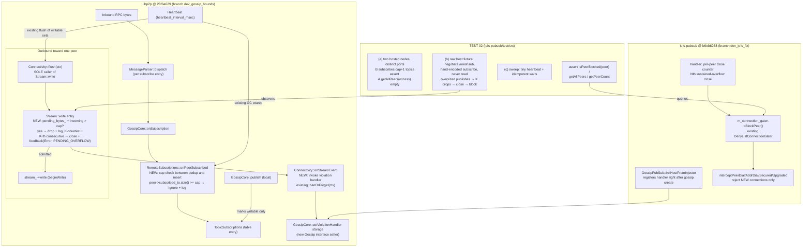

# Phase 3: GossipSub Resource Bounds - Research

**Researched:** 2026-10-13
**Domain:** libp2p GossipSub protocol hardening (C++17) — per-peer subscription bounds, outbound byte caps, escalation wiring into ipfs-pubsub's connection gater
**Confidence:** HIGH (all enforcement points read at the pinned SHAs; test harness configure+build+run executed this session on Windows)

## Summary

Phase 3's two-submodule shape is fully mapped. On the libp2p side (`28f6a629`), the enforcement points are exactly where CONTEXT.md predicted and are single-door choke points: `RemoteSubscriptions::onPeerSubscribed` is the sole ingress for remote subscribe state (dedup via `peer->subscribed_to.insert(topic).second` happens *before* any table mutation, so a cap check slots cleanly between dedup and insert), and `Stream::write()` is the sole egress admission point with exactly one caller (`Connectivity::flush`). Two findings materially simplify the plan: (1) **the heartbeat GC sweep D-04 calls for already exists** — `RemoteSubscriptions::onHeartbeat` erases entries where `TopicSubscriptions::empty()` is true, and `empty()` already means "not self-subscribed, no fanout, no subscribed peers, no mesh peers", so D-03's cap rejection composes with the *existing* sweep with zero new sweep code; (2) **the error funnel for the K-drops close already exists** — `Connectivity::onStreamEvent` routes every stream error to `banOrForget()` and carries an in-file TODO ("ban incoming peers for protocol violations etc. - v.1.1") exactly where the violation callback belongs. On the ipfs-pubsub side (`b6eb6268`), `GossipPubSub` holds `m_gossip` directly as the `Gossip` interface, so the D-08 `setViolationHandler` setter is trivially reachable, and the gater-observability seam the CONTEXT left to research **already exists as public API** (`IsPeerBlocked`/`GetBlockedPeers`).

The D-11 MUST-verify was executed live this session: the ipfs-pubsub test tree at `thirdparty/build/Windows/Debug/ipfs-pubsub-test` (a 9/29 configure that was interrupted mid-probe on a `pthread.lib` TryCompile) was reconfigured standalone with explicit dependency paths, **built successfully** (`test_bin/Debug/ipfs-pubsub-test.exe`), and **run: 12 tests, 11 passed, 1 pre-existing failure, 1 pre-existing disabled, ~7 s wall time**. The one failure (`MutipleGossipSubObjectsOnSingleChannel`) is a pre-existing test-shape defect at the pinned SHA — both nodes call `Start(40001, …)` on the same fixed port; the distinct-ports variant (`MutipleGossipSubObjectsOnDifferentChannels`) passes. TEST-02's two-node tests must use distinct ports (or port 0 + `GetInterfaceAddress()` as `pubsub_counts` does).

The biggest determinism finding: **local publishes do not flush immediately** — `GossipCore::publish` only marks peers writable; the actual `Stream::write()` happens at the next heartbeat flush (or on inbound-RPC end / new-peer connect). So the D-11(b) "K writes → K drops" test must be heartbeat-paced (publish oversized → idempotent-wait for the observable → repeat), not burst-paced. With `heartbeat_interval_msec` shrunk in test config this stays deterministic in D-11's documented sense (entry-point checks + idempotent waits). Also: a non-mesh subscribed peer receives IHAVE (not the message body); the test node must itself subscribe to the topic (mesh route) or the fixture must send IWANT, for full-size RPCs to flow toward the raw peer.

**Primary recommendation:** Land libp2p changes on a fresh branch cut from `master@28f6a629` (e.g. `dev_gossip_bounds`); continue ipfs-pubsub on `dev_ipfs_fix` (already at `b6eb6268`, matching the Phase 1/2 continue-existing-branch precedent). Additive `Config` knobs (D-01/D-02), cap check between dedup and insert in `onPeerSubscribed`, admission check at `Stream::write()` entry with K-consecutive-drop close flowing through a new additive `Error` enum value into the existing `onStreamEvent → banOrForget` path, `setViolationHandler` on `Gossip` stored in `GossipCore` and forwarded to `Connectivity`, registered by `GossipPubSub::InitHostFromInjector` right after gossip creation. TEST-02 lives in `gossip_pubsub_test.cpp`-style files in ipfs-pubsub's suite with distinct ports; assert escalation via `IsPeerBlocked`.

<user_constraints>
## User Constraints (from CONTEXT.md)

### Locked Decisions

**Config surface (GOSS-01/02)**
- **D-01:** Minimal 3-knob set in `Gossip::Config` — `max_remote_subscriptions_per_peer`, `max_pending_bytes_per_stream`, and the overflow-close threshold (K consecutive drops). Exactly what GOSS-01/02 name; further knobs (per-RPC subscribe-entry cap, queue-length cap) can be added later without breakage since additive config fields carry defaults. — **Reversibility:** reversible — additive struct fields with defaults; existing SuperGenius/GeniusSDK builds unchanged.
- **D-02:** `max_pending_bytes_per_stream` default = `max_message_size` (16 MiB) — a single legitimate RPC (large CRDT broadcast) never trips the cap; only queued backlog beyond one in-flight message does. — **Reversibility:** reversible — default value choice.

**Subscription bound (GOSS-01)**
- **D-03:** Receiver-side cumulative cap — `RemoteSubscriptions::onPeerSubscribed` checks the peer's counted topic count; entries beyond the cap are ignored and logged (GOSS-04). One choke point; bounds drip-flooding across many small RPCs (a parser-side per-RPC cap cannot see cumulative state and would need a 4th knob — rejected by D-01). Per-peer counting placement (incremental in `PeerContext` vs computed in `RemoteSubscriptions`) is agent discretion. — **Reversibility:** reversible — internal bookkeeping.
- **D-04:** Heartbeat sweep = GC empty topics — the sweep removes table entries with zero counted remote subscribers that we are not locally subscribed to and that carry no mesh/graft state. Composes with D-03 into a full table bound: a flooder's ignored subscriptions never populate topics, so excess topics stay empty and get collected. Trivially never evicts state a live remote subscriber depends on (SC1's Graft/Prune/IHAVE clause). The in-file TODO's LRU idea and a hard total-table ceiling were considered and rejected as unneeded given cap+sweep composition. — **Reversibility:** reversible — sweep policy internal to `RemoteSubscriptions`.

**Outbound bound (GOSS-02)**
- **D-05:** Drop-new-only at `write()` entry — when `pending_bytes_` cannot admit the arriving RPC, that RPC is dropped and logged; queued buffers are never evicted and order is preserved. Exactly GOSS-02's wording ("the RPC is dropped (logged, not silently buffered)"); avoids mesh-control-message reordering and does not creep toward the v2-deferred two-lane queue. — **Reversibility:** reversible — drop policy in `Stream`.
- **D-06:** Sustained overflow = K consecutive cap-hit drops with no intervening full drain → close the stream. Counter resets on drain; K default (~8) left to research/discretion. Note: once drops fire at entry, `pending_bytes_` cannot grow past the cap, so a byte-level "higher threshold" is unreachable by construction — K defines SC2's "distinct higher threshold" instead. — **Reversibility:** reversible — counter + threshold.
- **D-07:** Cap check semantics: the entry check is `pending_bytes_ + incoming > cap` (admission control), so an RPC larger than the cap alone is dropped deterministically at entry — this is also what makes the TEST-02 outbound tests deterministic (D-12). `writing_bytes_`/`pending_bytes_` accounting details are agent discretion. — **Reversibility:** reversible.

**Escalation wiring (GOSS-03)**
- **D-08:** Violation callback seam — libp2p `Gossip` grows a setter (e.g. `setViolationHandler(fn(peer_id, violation_type))`); ipfs-pubsub's `GossipPubSub` registers a handler that calls `m_connection_gater->BlockPeer()`. Explicit, unit-testable in both repos, minimal API surface. (Extending the internal `Stream::Feedback` chain and a counters+poll design were rejected — feedback is internal plumbing that still needs a new external surface; polling is laggy.) Exact callback signature/payload is agent discretion. — **Reversibility:** reversible — additive setter, no existing-signature change.
- **D-09:** Escalation criterion = Nth sustained-overflow stream close — a peer whose outbound stream was closed for sustained overflow `K_close` times (default 2–3, research/discretion) is blocked. Catches reconnect-and-reoffend while tolerating one legitimately-slow episode (e.g. one large CRDT burst). — **Reversibility:** reversible.
- **D-10:** Block is permanent until `UnblockPeer()` — existing `DenyListConnectionGater` semantics, zero new policy machinery (GOSS-03 verbatim). TTL auto-unblock is v2's PSCG-02 and stays deferred. — **Reversibility:** reversible — no new machinery to unwind.

**TEST-02 harness**
- **D-11:** All TEST-02 tests live in **ipfs-pubsub's own suite** (`thirdparty/ipfs-pubsub/test/src/`, extending `gossip_pubsub_test.cpp` patterns) — operator preference: ipfs-pubsub is "our" code, while libp2p's own test build is documented broken (audit: CI failing on Python environment setup; deferred-items report: outdated mocks and test-build problems). Determinism comes from config, not mock scheduler: (a) subscribe-cap test = two hosted `GossipPubSub` nodes, B subscribes to `cap+1` topics via public `Subscribe()`, assert A's table bounded via `getAllPeers()` on excess topics — zero timing; (b) outbound cap/K-drops/close/violation test = a small raw libp2p-host fixture (public libp2p APIs only: negotiate `/meshsub`, subscribe, then never read) with test config making each serialized publish exceed `max_pending_bytes_per_stream`, so every `write()` entry check fails deterministically (D-07) — K writes → K drops → close → violation; (c) heartbeat sweep = `heartbeat_interval_msec` set tiny in test config + short idempotent waits. **This is a conscious, documented deviation from SC5's "(mock scheduler)" parenthetical and from the Phase 1–2 no-sleeps discipline — no sleep-dependent orderings exist here (drops are entry-point checks; the sweep is idempotent).** Consequence: the libp2p pinned commit carries code-marker probes only (INTG-02 explicitly allows grep markers — roadmap-compliant, weaker than Phases 1–2's co-located tests). Research MUST verify ipfs-pubsub's suite actually builds and runs on Windows in this workspace; documented fallback = a SuperGenius `pubsub_counts`-style host (`SuperGenius/test/src/pubsub_counts/pubsub_counts.cpp` pattern, Windows-proven in this workspace). — **Reversibility:** reversible — test placement only.
- **D-12:** Repeat the Phase 2 D-07 WSL ASan supplementary run for the new suite — stream close-during-pending-writes and violation-callback dispatch are lifetime-adjacent (`shared_from_this` during close). Windows deterministic suite remains primary evidence; WSL ASan supplementary. Same WSL constraints: `~/gnus/GeniusNetwork/thirdparty`, no git inside WSL, file-copy sync, every git operation on the Windows side. — **Reversibility:** reversible — evidence-only.

### the agent's Discretion
- Per-peer subscription counting placement (incremental counter in `PeerContext` vs computed in `RemoteSubscriptions`)
- K (consecutive drops to close) and `K_close` (closes to block) defaults; sweep/heartbeat interaction details
- Violation callback exact signature and payload (peer id + violation type at minimum)
- `writing_bytes_`/`pending_bytes_` accounting shape at the cap check
- Branch names for the libp2p and ipfs-pubsub fix branches (cut from `28f6a629` / `b6eb6268`; Phase 4 records final pins by content probe)
- Test file naming/placement within ipfs-pubsub's suite; raw-peer fixture design (as long as public libp2p APIs only)
- Gater-observability seam for asserting the block reached `DenyListConnectionGater` (research verifies whether an existing query path exists or the close/callback outcome is the assertion point)

### Deferred Ideas (OUT OF SCOPE)
- **Two-lane outbound queue** (urgent control lane, Go `UrgentPush` parity) — v2 QUER-01; D-05's drop-new-only deliberately avoids creeping toward it
- **TTL auto-unblock / decay graylist** — v2 PSCG-02 (`ban_interval_msec` precedent); D-10 keeps blocks permanent to honor "no new policy machinery"
- **Behavior-based peer scoring** — v2 PSCG-01; D-09's simple Nth-close criterion deliberately avoids it
- **Per-RPC subscribe-entry parser cap + queue-length cap knobs** — rejected for D-01 minimalism; additive later if needed
- **LRU topic-table eviction / hard total-table cap** — superseded by D-03+D-04 composition; revisit only if coordinated many-peer topic floods become real
- **Idle stream recycling, CRDT-burst-aware tuning** — v2 QUER-02/03
</user_constraints>

<phase_requirements>
## Phase Requirements

| ID | Description | Research Support |
|----|-------------|------------------|
| GOSS-01 | Per-peer remote subscription table bounded; excess subscribe entries ignored; heartbeat sweep prunes non-live entries without evicting live-subscriber state | Choke point + exact insertion slot verified at `remote_subscriptions.cpp` L41-59; existing GC sweep verified (`onHeartbeat` L165-178 + `TopicSubscriptions::empty()` L43-47); graft-safety verified (`onGraft` contains-check L200-203). Per-peer count = `peer->subscribed_to.size()` — no new counter needed |
| GOSS-02 | Outbound per-peer pending bytes capped at `write()` entry via `Gossip::Config` knob; cap hit drops the RPC (logged); sustained overflow beyond a distinct higher threshold closes the stream | `Stream::write()` admission slot verified (stream.cpp L128-149) with exactly one caller; existing accounting (`pending_bytes_` excludes in-flight `writing_bytes_`) matches D-07's formula; close path can reuse the existing error funnel `onStreamEvent → banOrForget` (connectivity.cpp L414-428); new additive `Error` enum value safe (`default:` guard in common.cpp category) |
| GOSS-03 | Persistent violators escalate through existing `DenyListConnectionGater::BlockPeer()` — no new policy machinery | `GossipPubSub` holds `m_gossip` as the `Gossip` interface (registration site verified at `InitHostFromInjector`, gossip_pubsub.cpp L301-307); `m_connection_gater` created earlier in `Init()` (L269); `BlockPeer()` chain verified (L237-241 → gater L30-36). Block semantics: new-connection rejection only, live connections NOT terminated (documented in hpp L107-111) — TEST-02 must assert `IsPeerBlocked`, not connection death |
| GOSS-04 | Every bound-enforcement event observable via existing `log::SubLogger` — peer, topic/count, bytes; no silent drops | Existing patterns verified in `RemoteSubscriptions` (`log_.debug("peer {} subscribing to {}", peer->str, topic)`); **gap found:** `Stream` has no logger member (TRACE-only) — plan must add a `SubLogger&` to the internal `Stream` ctor (2 construction sites, internal impl header, no public API break) |
| TEST-02 | Bound-enforcement tests pass deterministically: subscription cap per peer, outbound cap drops at threshold (not buffers, not disconnects), sustained overflow closes stream, violations reach peer-block escalation | Harness verified live this session: standalone configure + build + run of `ipfs-pubsub-test.exe` on Windows (11/12 green; 1 pre-existing failure is the test's own double-port shape — distinct ports required); determinism mechanics mapped (heartbeat-paced flush cadence, idempotent-wait patterns, `rw_timeout_msec` must be raised in test config); assertion surfaces verified (`getAllPeers`/`getPeerCount` public on `GossipPubSub`; `IsPeerBlocked` public) |
</phase_requirements>

## Architectural Responsibility Map

| Capability | Primary Tier | Secondary Tier | Rationale |
|------------|-------------|----------------|-----------|
| Remote-subscription ingress bound (GOSS-01) | libp2p `RemoteSubscriptions` | — | Single protocol-semantic choke point; the table and its mutex live there; counting data (`peer->subscribed_to`) is owned by `PeerContext` in the same layer |
| Topic-table GC sweep (GOSS-01 clause 2) | libp2p `RemoteSubscriptions`/`TopicSubscriptions` | — | Sweep already exists on the heartbeat cadence owned by `GossipCore` |
| Outbound byte admission + K-drops close (GOSS-02) | libp2p `Stream` | `Connectivity` (close propagation) | `write()` is the single egress door; close must flow through `Feedback → onStreamEvent → banOrForget` so the existing disconnect cleanup (table removal, connected-set erase) runs |
| Violation callback seam (D-08) | libp2p `Gossip` interface → `GossipCore` → `Connectivity` | — | Public interface grows the setter; emission site is `onStreamEvent` where every stream error already funnels (and where the in-file v1.1 TODO sits) |
| Escalation policy (Nth close → block) (GOSS-03, D-09) | ipfs-pubsub `GossipPubSub` | `DenyListConnectionGater` | Policy is deployment-level, not protocol-level; the gater is ipfs-pubsub-owned machinery — "no new policy machinery" honored |
| Observability events (GOSS-04) | libp2p (`RemoteSubscriptions`, `Stream`) + ipfs-pubsub (`GossipPubSub` logger) | — | Drop events happen inside libp2p where the counts/bytes live; escalation event logged at registration site (existing `m_logger->info` on BlockPeer) |
| TEST-02 tests | ipfs-pubsub test suite | raw libp2p-host fixture (inside the same test binary) | D-11 locked placement; fixture uses public libp2p APIs only |

## Standard Stack

No new external packages. The phase compiles inside two existing submodule build graphs.

### Core
| Library | Version | Purpose | Why Standard |
|---------|---------|---------|--------------|
| libp2p (GeniusVentures fork) | pinned `28f6a629` (= `master` tip) | Enforcement internals: `Config`, `Stream`, `RemoteSubscriptions`, `Connectivity`, `Gossip` interface | The code under fix; already integrated through the thirdparty pin chain [VERIFIED: `git -C thirdparty/libp2p rev-parse HEAD` → `28f6a629389019c70ef8f06facb387384c8b9088`, executed this session] |
| ipfs-pubsub (GeniusVentures) | pinned `b6eb6268` (= `dev_ipfs_fix` = `main` tip) | Escalation wiring (`GossipPubSub` + `DenyListConnectionGater`) and TEST-02 suite | "Our" code per operator preference (D-11) [VERIFIED: `git -C thirdparty/ipfs-pubsub rev-parse HEAD` → `b6eb6268b9500e0dc441eab368f78f24616fa57e`, executed this session] |
| GTest | prebuilt at `thirdparty/build/Windows/Debug/GTest` | TEST-02 test framework | Suite already uses gtest via the `addtest()` macro (`ipfs-pubsub/cmake/test.cmake`) [VERIFIED: cmake/test.cmake read this session] |
| Protocol Buffers | prebuilt `thirdparty/build/Windows/Debug/protobuf` | RPC wire format context (no new protos needed) | Existing dependency of both submodules |

### Supporting
| Library | Version | Purpose | When to Use |
|---------|---------|---------|-------------|
| `log::SubLogger` (libp2p) | in-tree (`include/libp2p/log/sublogger.hpp`) | GOSS-04 event logging | Already used by `RemoteSubscriptions`/`Connectivity`; needs adding to `Stream` |
| `multi::UVarint` (libp2p) | in-tree public header | Hand-encoding the raw fixture's subscribe RPC length prefix | Fixture cannot include internal `rpc.pb.h` (not installed — see Pitfall 5) |
| libp2p host injector (`libp2p/injector/host_injector.hpp`) | in-tree | Building the raw gossip-speaking peer fixture host | Public API; same injector family `gossip_pubsub.cpp` uses |

### Alternatives Considered
| Instead of | Could Use | Tradeoff |
|------------|-----------|----------|
| Continue `dev_ipfs_fix` for ipfs-pubsub | Fresh branch from `b6eb6268` | None functionally — `dev_ipfs_fix` already sits exactly at the pin with zero commits beyond `main`; continuing matches Phase 1/2 precedent (continued `dev_timer_correctness`) |
| New libp2p branch (e.g. `dev_gossip_bounds`) from `master` | Continue on `master` directly | A named branch keeps `master` clean for Phase 4 content-probe comparisons; never pushed either way |
| Hand-encoded subscribe RPC in fixture | Include libp2p's generated `rpc.pb.h` | Rejected: the generated header lives only at `thirdparty/libp2p/build/pb/p2p_gossip_proto/generated/...`, is not installed into the public include tree, and coupling the test to libp2p's internal build layout is fragile [VERIFIED: `Get-ChildItem ... libp2p/include -Recurse -Filter rpc.pb.h` → empty; source hit only under `thirdparty/libp2p/build/pb/`, executed this session] |

## Package Legitimacy Audit

No external packages are installed by this phase — all work is inside two existing vendored submodules and their prebuilt dependency tree. Not applicable.

## Architecture Patterns

### System Architecture Diagram



### Recommended Branch/Change Structure
```
thirdparty/libp2p  (branch dev_gossip_bounds, cut from master@28f6a629, never pushed)
├── include/libp2p/protocol/gossip/gossip.hpp        # Config: 3 additive knobs; Gossip: setViolationHandler
├── src/protocol/gossip/impl/common.hpp / common.cpp # additive Error value (default-guarded category switch)
├── src/protocol/gossip/impl/remote_subscriptions.cpp# cap check in onPeerSubscribed (choke point)
├── src/protocol/gossip/impl/stream.hpp / stream.cpp # admission check + K-counter + close+feedback; SubLogger&
└── src/protocol/gossip/impl/connectivity.{hpp,cpp}  # violation emission in onStreamEvent; logger/ctor wiring

thirdparty/ipfs-pubsub (branch dev_ipfs_fix @ b6eb6268 → new commits, never pushed)
├── src/ipfs_pubsub/gossip_pubsub.{hpp,cpp}          # register violation handler after gossip create; close counter
└── test/src/gossip_pubsub_bounds_test.cpp (or extend existing files)  # TEST-02 a/b/c + raw fixture
```

### Pattern 1: Cap check between dedup and insert (GOSS-01)
**What:** The per-peer subscription cap rides the existing dedup seam — the `insert().second` return already distinguishes new-vs-duplicate subscriptions *before* any state changes.
**When to use:** Exactly this phase; no other ingress exists.
**Example** (current code, the insertion slot is between these two steps):
```cpp
// Source: thirdparty/libp2p/src/protocol/gossip/impl/remote_subscriptions.cpp L41-59 (read this session)
  void RemoteSubscriptions::onPeerSubscribed(const PeerContextPtr &peer,
                                             const TopicId &topic) {
    if (!peer->subscribed_to.insert(topic).second) {
      // request from wire, already subscribed, ignoring double subscription
      log_.debug("peer {} already subscribed to {}", peer->str, topic);
      return;
    }
    log_.debug("peer {} subscribing to {}", peer->str, topic);
    // ← CAP CHECK GOES HERE (D-03): if peer->subscribed_to.size() > cap →
    //    log_.warn(peer, topic, count) and `return` BEFORE table mutation.
    //    Must first undo the dedup insert (peer->subscribed_to.erase(topic))
    //    so the count reflects admitted subscriptions only — or check
    //    `subscribed_to.size() >= cap` BEFORE the insert and keep the dedup
    //    insert as the final admission step.
```
**Counting placement (discretion item, resolved):** computed, not incremental — `PeerContext::subscribed_to` is already `std::set<TopicId>` (`peer_context.hpp` L31-32: `/// Set of topics this peer is subscribed to` / `std::set<TopicId> subscribed_to;`), so `size()` is the count. An incremental counter would duplicate bookkeeping the set already provides. Note the check must count only *admitted* topics — the planner should pick one of the two orderings above explicitly (check-then-insert is cleaner; the dedup early-return then needs its own re-check).

### Pattern 2: Admission check at `Stream::write` entry (GOSS-02, D-05/D-07)
**What:** One check before the pending/beginWrite fork covers both branches; D-07's formula matches the existing accounting exactly.
**Example** (current code at the enforcement point):
```cpp
// Source: thirdparty/libp2p/src/protocol/gossip/impl/stream.cpp L128-149 (read this session)
  void Stream::write(outcome::result<SharedBuffer> serialization_res) {
    if (closed_) { return; }
    if (stream_->isClosedForWrite()) { asyncPostError(Error::WRITER_DISCONNECTED); return; }
    if (!serialization_res) { asyncPostError(Error::MESSAGE_SERIALIZE_ERROR); return; }
    auto &buffer = serialization_res.value();
    if (buffer->empty()) { return; }
    // ← ADMISSION CHECK (D-07): if (pending_bytes_ + buffer->size() > max_pending_bytes_) {
    //      log (GOSS-04: peer, bytes, pending, cap); consecutive_drop_counter_++;
    //      if (counter >= K) { close(); asyncPostError(Error::PENDING_OVERFLOW); }
    //      return;   // drop-new-only (D-05): queued buffers untouched, order preserved
    //    } else consecutive_drop_counter_ = 0;   // admitted write resets? NO — see below
    if (writing_bytes_ > 0) {
      pending_bytes_ += buffer->size();
      pending_buffers_.emplace_back(std::move(buffer));
    } else {
      beginWrite(std::move(buffer));
    }
  }
```
**Counter-reset semantics (D-06 "resets on drain"):** reset when the queue fully drains, not on mere admission — the right site is `onMessageWritten` (stream.cpp L204-210) where `endWrite()` completes and `pending_buffers_` is found empty (the existing `if (!pending_buffers_.empty())` needs an `else` branch). Resetting on admission would let an interleaved small admitted RPC break a consecutive-drop streak that a still-overflowing queue should have preserved.
**Accounting fact the check relies on:** `pending_bytes_` counts only *queued* bytes — the popped buffer's bytes are subtracted when it moves from pending to writing (`pending_bytes_ -= buffer->size()` at L206 before `beginWrite`), and an in-flight write's bytes live in `writing_bytes_`, decremented to 0 by `endWrite()` (L224-227). So `pending_bytes_ + incoming > cap` is exactly "would the queued backlog exceed the cap" [VERIFIED: stream.cpp L186-215, L224-227 read this session].

### Pattern 3: Close flows through the existing error funnel (GOSS-02 close + D-08 emission)
**What:** The K-th drop should not invent a new cleanup path — post a new additive error through the existing `Feedback` so `Connectivity::onStreamEvent` runs the established `banOrForget` cleanup (closes streams, erases connected-set, `connected_cb_(false, ctx)` → `onPeerDisconnected` → table cleanup), and hook the violation handler emission right there.
**Example** (the funnel as it exists, including the TODO that anticipated exactly this work):
```cpp
// Source: thirdparty/libp2p/src/protocol/gossip/impl/connectivity.cpp L414-428 (read this session)
  void Connectivity::onStreamEvent(const PeerContextPtr &from,
                                   outcome::result<Success> event) {
    if (!started_) { return; }
    if (event) { return; }
    // TODO(artem): ban incoming peers for protocol violations etc. - v.1.1
    banOrForget(from);
    // ← VIOLATION EMISSION (D-08): if (violation_handler_ && event.error() ==
    //    Error::PENDING_OVERFLOW) violation_handler_(from->peer_id, type)
  }
```
**Async-safety precedent:** `Stream::asyncPostError` (L212-219) already marshals errors onto the scheduler with a `weak_from_this()` guard — the K-th-drop error must use the same pattern (or fire after `close()` returns), never call `feedback_` inline from `write()` in a foreign thread context.

### Pattern 4: Violation registration at construction time (D-08 wiring)
**What:** `GossipPubSub` creates the gossip object in `InitHostFromInjector`; both the gater and the gossip instance exist before `Start()` runs `m_gossip->start()` — registration order is safe.
**Example** (registration site, read this session):
```cpp
// Source: thirdparty/ipfs-pubsub/src/ipfs_pubsub/gossip_pubsub.cpp L301-307
        // Create gossip node
        m_gossip = libp2p::protocol::gossip::create(
            injector.template create<std::shared_ptr<libp2p::basic::Scheduler>>(),
            m_host,
            injector.template create<std::shared_ptr<libp2p::peer::IdentityManager>>(),
            injector.template create<std::shared_ptr<libp2p::crypto::CryptoProvider>>(),
            injector.template create<std::shared_ptr<libp2p::crypto::marshaller::KeyMarshaller>>(),
            config_ );
        // ← register m_gossip->setViolationHandler(...) here; m_connection_gater
        //   already exists (created in Init() L269 before the injector ran)
```
**Where the handler lives in libp2p:** `Gossip::setViolationHandler` (new pure virtual or default-implemented — prefer a default empty impl so the interface stays source-compatible for any other embedder) stores into `GossipCore`; `Connectivity` is created inside `GossipCore::start()` (gossip_core.cpp L126-136), so either pass the stored handler as an extra ctor arg or give `Connectivity` a small setter called from `start()`. `RemoteSubscriptions` never needs it — subscription-cap drops are log-only per D-09 (escalation is exclusively the Nth sustained-overflow close).

### Pattern 5: TEST-02 assertion surfaces (all verified public)
| Assert | API | Verified at |
|--------|-----|-------------|
| A learned B's subscription on topic T (within cap) | `GossipPubSub::getAllPeers(topic)` / `getPeerCount(topic)` | gossip_pubsub.hpp (`size_t getPeerCount(const std::string &topic) const;` / `std::vector<libp2p::peer::PeerId> getAllPeers(const std::string &topic) const;`), delegating to `m_gossip` (gossip_pubsub.cpp L705-710) |
| Escalation reached the gater | `GossipPubSub::IsPeerBlocked(peerId)` (and `GetBlockedPeers()`) | gossip_pubsub.cpp L255-263 → `DenyListConnectionGater::IsPeerBlocked` (deny_list_connection_gater.hpp) |
| Stream closed for sustained overflow | violation callback fired (test registers its own handler? NO — `GossipPubSub` owns registration) → assert via `IsPeerBlocked` after `K_close` cycles, and per-cycle via the drop/close being observable through… see Open Question 2 | — |

### Anti-Patterns to Avoid
- **Per-RPC parser caps for subscriptions:** `MessageParser::dispatch` loops `pb_msg_->subscriptions()` (message_parser.cpp L47-52) but has no cumulative peer state; a cap there needs a 4th knob and misses drip-flooding — rejected by D-01/D-03 [VERIFIED: message_parser.cpp L45-52].
- **Evicting queued buffers on cap hit (drop-oldest):** would reorder mesh control messages relative to data and creeps toward the v2 two-lane queue — D-05 explicitly drops-new-only.
- **Byte-level "higher threshold":** unreachable by construction once entry admission exists (`pending_bytes_` can never exceed cap) — D-06's K-consecutive-drops IS the higher threshold; do not add a byte threshold knob.
- **Asserting escalation by connection death:** the gater does not terminate live connections — `DenyListConnectionGater` rejects at dial/secured/upgraded stages only (hpp comment: "Existing connections are not terminated; the block applies to new connection attempts"). The gossip-layer `banOrForget` does close gossip streams, but the *gater* assert must be `IsPeerBlocked`.
- **Testing with both nodes on the same fixed port:** the pre-existing failure (see Pitfall 1) is exactly this shape.

## Don't Hand-Roll

| Problem | Don't Build | Use Instead | Why |
|---------|-------------|-------------|-----|
| Peer disconnect cleanup after close | New teardown in `Stream` | Existing `banOrForget(from)` via `onStreamEvent` | Already closes all streams, erases connected/connectable sets, fires `connected_cb_(false, ctx)` → `onPeerDisconnected` → subscription-table cleanup (connectivity.cpp L362-395) |
| Topic-table sweeping | New LRU/ceiling machinery | Existing heartbeat GC (`onHeartbeat` erase of `empty()` entries) | `empty()` already encodes D-04's exact safety condition; D-03 composition makes new machinery redundant (D-04 decision) |
| Per-peer topic counting | New counter member | `peer->subscribed_to.size()` | The `std::set` already maintains admission-dedup state; a parallel counter is a drift bug waiting to happen |
| Escalation policy engine | Score/decay/graylist | `DenyListConnectionGater` deny-set + `K_close` counter in the handler | GOSS-03 verbatim "no new policy machinery"; PSCG-01/02 deferred |
| Error-to-string for new error code | Custom formatting | Extend the existing `OUTCOME_CPP_DEFINE_CATEGORY` switch (common.cpp L11-38, `default:`-guarded) | Additive enum case is compile-safe; no other switch over `Error` exists |

**Key insight:** every piece of lifecycle machinery this phase needs (disconnect cleanup, table GC, error funnel, blocklist) already exists — the phase's net code is: 3 config fields, 1 enum value, 2 boolean-ish checks, 1 counter + threshold pair, 1 setter + registration, and logging.

## Common Pitfalls

### Pitfall 1: The pre-existing failing test and the two-node port hazard
**What goes wrong:** `GossipPubSubTest.MutipleGossipSubObjectsOnSingleChannel` fails at the pinned SHA on this machine — 11/12 pass, this one fails at `peer_seen` (gossip_pubsub_test.cpp L439: `Value of: peer_seen / Actual: false`).
**Why it happens:** Both nodes call `Start(40001, …)` — an in-process double-bind on the same port; pubs2's dial to `pubs1.GetLocalAddress()` cannot reliably reach pubs1's listener. The distinct-ports variant (`MutipleGossipSubObjectsOnDifferentChannels`, 40001+40002) passes.
**How to avoid:** TEST-02 two-node tests use distinct ports per node, or the `pubsub_counts` pattern: `Start(0, {})` (ephemeral) + `AddPeers({other->GetInterfaceAddress()})` [VERIFIED: SuperGenius/test/src/pubsub_counts/pubsub_counts.cpp L86-96].
**Warning signs:** `peer_seen` assertion timing out; "Failed to get addresses from peer repository: not found" warnings (also seen in this failing run).
**Baseline discipline:** the planner should record 11/12 + 1 disabled (`DISABLED_SecondStartFailed`, gossip_pubsub_test.cpp L508) as the pre-change baseline; Phase 3 must not regress the 11 and must not "fix" the failing one in-place (out of scope; note it for the executor's expectations).

### Pitfall 2: Local publishes are NOT flushed immediately (determinism)
**What goes wrong:** A test that publishes K oversized messages back-to-back and expects K entry-check drops will see ONE combined serialized RPC per heartbeat flush (drops counted once), because `GossipCore::publish` (gossip_core.cpp L195-218) only calls `remote_subscriptions_->onNewMessage`, which marks peers writable (`peerIsWritable`) — the actual `flush(ctx) → Stream::write` happens on the heartbeat (`Connectivity::onHeartbeat`, connectivity.cpp L491-500), on inbound-RPC end (`GossipCore::onMessageEnd` → `connectivity_->flush()`, gossip_core.cpp L367-371), or on new-peer connect (L415-418).
**Why it happens:** MessageBuilder accumulates per peer; writability is a set, not a push.
**How to avoid:** Pace the test by observables: publish one oversized message → idempotent-wait for the cycle's observable (drop → close → block) → repeat K times. Shrink `heartbeat_interval_msec` in the test `Config` (ctor-injectable; `GetDefaultConfig()` uses 100 ms; tests may go lower). This is D-11(c)'s documented deviation shape — idempotent waits, no order-sensitivity.
**Warning signs:** Tests that assert an exact drop count after a burst; green locally at 100 ms heartbeat then flaky under load.

### Pitfall 3: IHAVE vs full-message routing to the raw peer
**What goes wrong:** The raw fixture subscribes to topic T; the test node publishes to T; the raw peer receives small IHAVE control gossip, not the oversized message — because full-message forwarding goes to `mesh_peers_` only (`TopicSubscriptions::onNewMessage`: mesh gets `addMessage`, `subscribed_peers_` get `addIHave`, topic_subscriptions.cpp L70-90).
**Why it happens:** GossipSub forwards data within the mesh; non-mesh subscribers get announcements.
**How to avoid:** Have the test node ALSO subscribe to T (public `Subscribe()`), so mesh formation grafts the raw peer within 1-2 heartbeats (`onHeartbeat` → `addToMesh` from `subscribed_peers_` when `self_subscribed_`, topic_subscriptions.cpp L99-116) — then publishes forward as full messages to the mesh peer. Alternative: fixture answers IHAVE with IWANT (hand-encoded like the subscribe) — `onIWant` → `addMessage` → `peerIsWritable(true)` (gossip_core.cpp L268-277) — avoids mesh-timing but adds a second hand-encoded message. Recommend subscribe+mesh as primary.
**Warning signs:** Cap never trips because the RPCs toward the raw peer are tiny.

### Pitfall 4: `rw_timeout` racing the K-drops close
**What goes wrong:** If any small RPC gets admitted (`beginWrite` runs toward the never-reading peer), the write may stall until `rw_timeout_msec` (default 10 s) fires `WRITER_TIMEOUT` → `banOrForget` — a close that LOOKS like sustained-overflow close but is a different error, breaking the violation-type assert.
**Why it happens:** `beginWrite` arms `timeout_handle_` (stream.cpp L179-184); yamux window is enlarged to 64 MB at both stream-creation sites (`adjustWindowSize(64 * 1024 * 1024)`), so small writes usually complete, but a stalled one eventually times out.
**How to avoid:** Test config sets `rw_timeout_msec` large (e.g. 60 s) so the only close path in the test's window is the K-drops close; the admission check then guarantees no oversized write ever begins.
**Warning signs:** Close observed with WRITER_TIMEOUT in logs during TEST-02 runs.

### Pitfall 5: The fixture cannot include libp2p's generated `rpc.pb.h`
**What goes wrong:** Compile error or fragile include path when the fixture tries to build RPC protos with libp2p's generated headers.
**Why it happens:** `rpc.pb.h` is generated into libp2p's internal build tree (`thirdparty/libp2p/build/pb/p2p_gossip_proto/generated/protocol/gossip/protobuf/rpc.pb.h`) and is NOT installed into the public include prefix [VERIFIED: recursive search of the install include found zero `rpc.pb.h`; the only hit is the internal build path — executed this session].
**How to avoid:** Hand-encode the minimal subscribe RPC in the fixture — wire format is `UVarint(total_len) || protobuf bytes` where the RPC message is `repeated SubOpts subscriptions = 1` and SubOpts is `{optional bool subscribe = 1; optional string topicid = 2;}` — a ~15-line encoder using public `libp2p::multi::UVarint` (`include/libp2p/multi/uvarint.hpp` exists [VERIFIED: Test-Path]). The length-prefix convention is visible in `MessageBuilder::serialize` (varint prefix + payload, message_builder.cpp L83-95).
**Warning signs:** Any plan step adding `-I` paths into `thirdparty/libp2p/build/pb/...`.

### Pitfall 6: libp2p changes invisible to ipfs-pubsub tests (stale prebuilt libp2p)
**What goes wrong:** ipfs-pubsub's standalone test tree links the PREBUILT libp2p install prefix (`-Dlibp2p_DIR=$D/libp2p/lib/cmake/libp2p`); if libp2p isn't rebuilt after the fix branch lands, TEST-02 exercises old code and the new Config knobs don't exist (compile error at best, silently-old behavior at worst).
**Why it happens:** ExternalProject install prefix (`thirdparty/build/Windows/Debug/libp2p/lib`, `p2p.lib` dated 9/29) predates the fix.
**How to avoid:** Build order in every verify step: (1) `cmake --build $D --config Debug --target libp2p` (outer tree — `libp2p.vcxproj` exists there [VERIFIED: directory listing this session]) to rebuild+reinstall libp2p from the current submodule checkout (incremental — MSBuild recompiles only changed sources), then (2) build/run `ipfs-pubsub-test`. Alternatively configure a dedicated libp2p build, but the outer-tree target is the proven minimal path.
**Warning signs:** ipfs-pubsub-test compiles without the libp2p rebuild having run; `p2p.lib` mtime older than the libp2p source edits.

### Pitfall 7: Workspace-state anomalies (flagged, not blocking)
**What goes wrong:** (a) `thirdparty/ipfs-bitswap-cpp` working tree is DIRTY at HEAD `f899393` on `dev_timer_correctness` — `git diff --stat` shows the Phase 1+2 changes REVERTED in the working tree (`src/bitswap.cpp | 102 +-`, `src/bitswap.hpp | 35 +-`, `test/bitswap_request_timer_race_test.cpp | 358 ----`) — i.e., someone checked out pre-Phase-1 file contents over the branch; HEAD commits are intact [VERIFIED: executed this session]. (b) libp2p has untracked `Testing/` and `.planning/research/.cache/` dirs [VERIFIED: `git status --short`].
**Why it happens:** Post-Phase-2 manual intervention; untracked build/research artifacts.
**How to avoid:** Phase 3 works in libp2p + ipfs-pubsub, so nothing here blocks; but Phase 4 (repin) MUST restore `dev_timer_correctness` working tree to HEAD (`git -C thirdparty/ipfs-bitswap-cpp checkout -- .`) before content-probing, and the libp2p untracked dirs should be cleaned or ignored before cutting the fix branch so `git status` discipline (clean-tree asserts) stays meaningful.
**Warning signs:** Any Phase 3 verify step asserting on bitswap state.

## Code Examples

### GOSS-01 sweep is already implemented (D-04 evidence)
```cpp
// Source: thirdparty/libp2p/src/protocol/gossip/impl/remote_subscriptions.cpp L165-178 (read this session)
  void RemoteSubscriptions::onHeartbeat() {
    std::lock_guard<std::mutex> lock(table_mutex_);
    auto now = scheduler_.now();
    for (auto it = table_.begin(); it != table_.end();) {
      it->second.onHeartbeat(now);
      if (it->second.empty()) {
        // fanout interval expired - clean up
        log_.debug("deleted entry for topic {}", it->first);
        it = table_.erase(it);
      } else { ++it; }
    }
  }

// Source: thirdparty/libp2p/src/protocol/gossip/impl/topic_subscriptions.cpp L43-47
  bool TopicSubscriptions::empty() const {
    return (!self_subscribed_)
        && (fanout_period_ends_ == std::chrono::milliseconds::zero())
        && subscribed_peers_.empty() && mesh_peers_.empty();
  }
```
D-04's "removes entries with zero counted remote subscribers not locally subscribed and no mesh/graft state" is `empty()` verbatim (graft state = mesh membership; backoff map `dont_bother_until_` lives inside a retained entry only). A rejected (over-cap) subscription never inserts into `subscribed_to`/`subscribed_peers_`, so the topic stays empty and is collected — **D-04 needs documentation and possibly a marker comment, not new sweep code.**

### GOSS-01 graft-safety (SC1's Graft/Prune/IHAVE clause)
```cpp
// Source: thirdparty/libp2p/src/protocol/gossip/impl/topic_subscriptions.cpp L198-210 (read this session)
    if (!subscribed_peers_.contains(p->peer_id)) {   // onGraft
      onPeerSubscribed(p);                            // late graft treated as subscribe
      ...
```
Graft only promotes existing subscribers (or first admits the peer as a subscriber); a peer whose subscriptions were capped out was never in `subscribed_peers_`, so no graft-dependent state of a *live* subscriber can be evicted by the sweep. IHAVE caches live in `msg_cache_` (GossipCore, heartbeat `shift()`), not the topic table.

### Config knob insertion point (D-01/D-02)
```cpp
// Source: thirdparty/libp2p/include/libp2p/protocol/gossip/gossip.hpp L64-79 (read this session)
    /// Max RPC message size
    size_t max_message_size = 1 << 24;

    /// Protocol version
    std::string protocol_version = "/meshsub/1.0.0";
```
New knobs follow this style, e.g. `max_remote_subscriptions_per_peer`, `max_pending_bytes_per_stream` (default: `1 << 24`, mirroring `max_message_size` per D-02), `overflow_close_threshold` — plus the value flows to `Stream` via its ctor which already copies `config.max_message_size` and `config.rw_timeout_msec` (stream.cpp L20-33).

### Violation handler signature (discretion item, recommendation)
```cpp
// Recommended shape (fits both call sites; peer id by value, type enum by value):
namespace libp2p::protocol::gossip {
  enum class ViolationType { RemoteSubscriptionCapExceeded /*future*/, SustainedWriteOverflow };
  class Gossip {
    ...
    using ViolationHandler = std::function<void(const peer::PeerId &, ViolationType)>;
    virtual void setViolationHandler(ViolationHandler handler) {
      // default no-op keeps the interface source-compatible for embedders
      (void)handler;
    }
  };
}
```
Emission is only `SustainedWriteOverflow` this phase (D-09); the enum leaves room without a signature change. Alternatively skip the subscription-cap enum value until needed — minimal-surface reading of D-01.

### Gater semantics (GOSS-03/TEST-02 assert basis)
```cpp
// Source: thirdparty/ipfs-pubsub/src/ipfs_pubsub/gossip_pubsub.hpp L106-111 (read this session)
        /** Adds a peer to the connection gater deny list.
 * Blocked peers are rejected at every stage of the connection upgrade
 * pipeline (dial, secured, upgraded). Existing connections are not
 * terminated; the block applies to new connection attempts.
```
The gossip layer's own close (`banOrForget`) ends the gossip streams; the gater then prevents re-dial. TEST-02's reconnect-and-reoffend cycle (D-09) therefore works at the gossip layer until the Nth close trips `BlockPeer`, after which a re-dial attempt fails the gater — assertable as `IsPeerBlocked(raw_peer_id) == true` (and, if desired, that a post-block reconnect attempt fails).

## State of the Art

Not applicable — no fast-moving external ecosystem in this phase; the "art" is the vendored fork at the pinned SHAs. For orientation only: upstream libp2p-go GossipSub v1.1 hardening (peer scoring, IPC-standards) remains the v2 reference the workstream defers (PSCG-01/02).

## Assumptions Log

| # | Claim | Section | Risk if Wrong |
|---|-------|---------|---------------|
| A1 | `K` default 8 consecutive drops and `K_close` default 2-3 closes are sane defaults (CONTEXT gave ranges; no traffic data consulted) | D-06/D-09 discretion | Low — both are config knobs with defaults; tests use explicit small values |
| A2 | Hand-encoding the subscribe RPC (~15 lines) is preferable to adding a protoc step to ipfs-pubsub's test build | Pitfall 5, fixture design | Low — if the encoder mis-encodes, the test node logs a parse error immediately (visible failure, not silent) |
| A3 | The outer-tree `cmake --build … --target libp2p` incremental rebuild works for the gossip changes without reconfiguring the ExternalProject | Pitfall 6 | Medium — if the stamp logic doesn't pick up source changes, fall back to deleting the libp2p ExternalProject stamps or re-running the target with `--clean-first` on the inner tree; first execution will reveal it |
| A4 | Two hosted `GossipPubSub` nodes with distinct ports exchange subscriptions reliably on this machine (based on the distinct-ports test passing; the failing test is the same-port variant) | TEST-02(a) | Medium — if localhost mesh formation proves flaky, `pubsub_counts`' `Start(0,{})` + `AddPeers(GetInterfaceAddress())` + `ASSERT_WAIT_FOR_CONDITION` pattern is the Windows-proven alternative |
| A5 | WSL full-suite ASan build (D-12) is feasible with apt boost 1.74 / libssl-dev + source builds of libp2p/ipfs-lite-cpp/ipfs-pubsub | D-12 | Medium — boost version gap (project pins 1.85) may break the libp2p build under clang-14; the scoped-harness fallback in Open Question 3 covers this |
| A6 | Violation-handler dispatch can safely call user code from `onStreamEvent` context (scheduler/gossip strand) — the handler (`GossipPubSub`'s) only increments a counter and calls the mutex-protected gater | Pattern 3/4 | Low-medium — if dispatch context is a concern, marshal via the scheduler like `asyncPostError` does; D-12 ASan run specifically watches this dispatch |

## Open Questions

1. **How does TEST-02 observe intermediate drops/closes before the block fires (per-cycle observability)?**
   - What we know: final escalation is assertable via `IsPeerBlocked`; the stream close is visible indirectly (gossip cleanup, reconnection behavior). Per-drop events are log lines (GOSS-04).
   - What's unclear: whether the test needs a programmatic per-cycle signal beyond logs. `GossipPubSub` owns the single `setViolationHandler` registration — the handler CAN update an atomic counter/flag that a test-friendly accessor exposes (e.g. a test-only counter getter or the handler writing to a promise set by the test through a seam in the registration). But adding test hooks to production `GossipPubSub` is surface the CONTEXT didn't ask for.
   - Recommendation: assert per-cycle via observable state that already exists — after each K-drops close, the peer disconnects and (on reconnect attempt by the fixture) re-establishes; the cleanest per-cycle signal without new API is a per-cycle **timeout-bounded `IsPeerBlocked==false` then final `==true`** check plus logs. If the planner wants a hard per-close signal, prefer threading a counting wrapper INSIDE the test's own registration is impossible (GossipPubSub registers internally) — so option: give `GossipPubSub` a protected/test-visible violation counter accessor (1-line, log-only semantics), documented as test observability, not policy.
2. **Default virtual vs pure virtual for `setViolationHandler`:**
   - What we know: `GossipCore` is the only implementer of `Gossip` in-tree [VERIFIED: `git grep "public Gossip,"` → gossip_core.hpp only, executed this session]; SuperGenius/GeniusSDK consume via `GossipPubSub`, never implementing `Gossip`.
   - Recommendation: pure virtual is in-convention (every other method is) and no external implementer exists; default-impl is only safer for hypothetical out-of-tree embedders. Either is compatible; planner picks (low stakes).
3. **D-12 scope: full-suite WSL ASan vs scoped harness:**
   - What we know: Phase 2's ASan was a direct single-TU compile (`~/gsd-asan/bitswap/` holds `bitswap_asan.o`, `race_test_asan`, `asan_run.log`) — no dependency build. The WSL source tree exists (`~/gnus/GeniusNetwork/thirdparty` incl. libp2p/ipfs-pubsub/ipfs-lite-cpp) but the Linux build tree has NO built libraries (scaffolding only) [VERIFIED: `find … -name '*.a'` empty, executed this session]. apt has boost 1.74 dev + libssl-dev, cmake 3.22, clang 14; no libprotobuf-dev observed.
   - What's unclear: whether libp2p compiles under clang-14/boost-1.74 without patching (project pins Boost 1.85 on Windows).
   - Recommendation: plan D-12 as its own late task with a decision gate — attempt the full chain (protobuf via apt or source, then ASan libp2p + ipfs-pubsub + test); if the build fights for more than a bounded effort, fall back to a scoped ASan harness that directly constructs the lifetime-adjacent scenario (close-during-pending-writes on a `Stream` over an in-memory connection) in the Phase 2 single-TU style, documented as a deviation. Either way Windows remains primary evidence (D-12).
4. **Heartbeat-interval floor for tests:** shrinking `heartbeat_interval_msec` speeds cycles but also speeds mesh maintenance/churn. Recommend test values around 20-50 ms (default in `GossipPubSub::GetDefaultConfig()` is 100 ms [VERIFIED: gossip_pubsub.hpp `GetDefaultConfig()` read this session]) — low enough for fast cycles, far from timer-resolution floors.

## Environment Availability

| Dependency | Required By | Available | Version | Fallback |
|------------|------------|-----------|---------|----------|
| MSVC + VS2022 | Windows builds | ✓ | 19.44 (from configure log) | — |
| CMake | configure | ✓ | 3.29.2 | — |
| Prebuilt thirdparty deps (boost 1.85, protobuf, GTest, yaml-cpp, libp2p install, ipfs-lite-cpp, soralog, spdlog, tsl_hat_trie, Boost.DI, fmt, cares, sqlite3, SQLiteModernCpp, openssl, zlib, GSL) | ipfs-pubsub-test standalone configure | ✓ | install prefixes under `thirdparty/build/Windows/Debug/*` | — |
| ipfs-pubsub-test build tree | TEST-02 primary harness | ✓ **built+run this session** | exe at `thirdparty/build/Windows/Debug/ipfs-pubsub-test/test_bin/Debug/ipfs-pubsub-test.exe` | SuperGenius `pubsub_counts`-style host (Windows-proven) |
| Outer-tree libp2p target (`libp2p.vcxproj`) | libp2p rebuild after fix | ✓ | install prefix `…/Debug/libp2p` (`p2p.lib` 9/29) | dedicated libp2p build tree |
| WSL (Ubuntu 22.04) | D-12 ASan | ✓ | clang 14, gcc 11.4, cmake 3.22.1, boost 1.74 dev, libssl-dev | scoped single-TU harness |
| WSL prebuilt Linux deps | D-12 full-suite ASan | ✗ (no built libs; source tree present) | — | apt deps + source build, or scoped harness (Open Question 3) |
| Local network loopback, distinct ports | TEST-02 two-node/raw-fixture tests | ✓ (distinct-ports test passes; same-port test fails — Pitfall 1) | — | port 0 + `GetInterfaceAddress()` |

**Missing dependencies with no fallback:** none — primary harness verified working.

**Missing dependencies with fallback:** WSL prebuilt Linux dep chain (D-12) — fallback documented in Open Question 3.

### Verified harness commands (executed this session, PowerShell)

Configure (idempotent; the `-B` tree may pre-exist):
```
$D='W:/gnus/GeniusNetwork/thirdparty/build/Windows/Debug'; $B="$D/ipfs-pubsub-test";
cmake -S W:/gnus/GeniusNetwork/thirdparty/ipfs-pubsub -B $B -G "Visual Studio 17 2022" -A x64 -DBUILD_TESTING=ON "-DCMAKE_INSTALL_PREFIX=$B" "-DCMAKE_POLICY_DEFAULT_CMP0091=NEW" "-DCMAKE_MSVC_RUNTIME_LIBRARY=MultiThreadedDebug" "-DCMAKE_FIND_PACKAGE_PREFER_CONFIG=ON" "-DBoost_USE_STATIC_LIBS=ON" "-DBoost_USE_STATIC_RUNTIME=ON" "-DBoost_DIR=$D/boost/build/lib/cmake/Boost-1.85.0" "-DCMAKE_PREFIX_PATH=$D/zlib" "-Dzlib_DIR=$D/zlib/lib/cmake/zlib" "-DZLIB_DIR=$D/zlib/lib/cmake/zlib" "-DZLIB_USE_STATIC_LIBS=ON" "-DGTest_DIR=$D/GTest/lib/cmake/GTest" "-Dyaml-cpp_DIR=$D/yaml-cpp/lib/cmake/yaml-cpp" "-Dlibp2p_DIR=$D/libp2p/lib/cmake/libp2p" "-Dipfs-lite-cpp_DIR=$D/ipfs-lite-cpp/lib/cmake/ipfs-lite-cpp" "-Dipfs-lite-cpp_INCLUDE_DIR=$D/ipfs-lite-cpp/include" "-DProtobuf_DIR=$D/protobuf/lib/cmake/protobuf" "-DProtobuf_INCLUDE_DIR=$D/protobuf/include" "-DProtobuf_PROTOC_EXECUTABLE=$D/protobuf/bin/protoc.exe" "-Dabsl_DIR=$D/protobuf/lib/cmake/absl" "-Dutf8_range_DIR=$D/protobuf/lib/cmake/utf8_range" "-DBoost.DI_DIR=$D/Boost.DI/lib/cmake/Boost.DI" "-Dc-ares_DIR=$D/cares/lib/cmake/c-ares" "-Dfmt_DIR=$D/fmt/lib/cmake/fmt" "-Dsoralog_DIR=$D/soralog/lib/cmake/soralog" "-Dspdlog_DIR=$D/spdlog/lib/cmake/spdlog" "-Dtsl_hat_trie_DIR=$D/tsl_hat_trie/lib/cmake/tsl_hat_trie" "-DSQLiteModernCpp_DIR=$D/SQLiteModernCpp/lib/cmake/SQLiteModernCpp" "-Dsqlite3_DIR=$D/sqlite3/cmake" "-DGSL_INCLUDE_DIR=$D/Microsoft.GSL/include" "-DOPENSSL_ROOT_DIR=$D/openssl/build"
```
Build: `cmake --build $B --config Debug --target ipfs-pubsub-test --parallel 8`
Run: `& "$B/test_bin/Debug/ipfs-pubsub-test.exe"` (baseline: 11 passed / 1 failed `MutipleGossipSubObjectsOnSingleChannel` / 1 disabled `DISABLED_SecondStartFailed`, ~7 s)
libp2p rebuild (before ipfs-pubsub-test after libp2p source changes — Pitfall 6): `cmake --build $D --config Debug --target libp2p --parallel 8`

Note: the ipfs-pubsub project's test gate is `option(BUILD_TESTING …)` while the outer `CommonTargets.cmake` passes `-DTESTING` — a flag-name mismatch that keeps the ExternalProject path lib-only [VERIFIED: ipfs-pubsub/CMakeLists.txt L31 `option(BUILD_TESTING "Build tests" OFF)` vs CommonTargets.cmake L558 `-DTESTING:BOOL=${TESTING}`]. The standalone configure above uses `-DBUILD_TESTING=ON` and works; do NOT rely on the outer ExternalProject to build these tests. (Aligning the flag names inside ipfs-pubsub is optional and out of scope.)

## Security Domain

`security_enforcement: true`, ASVS level 1. This phase IS a security-remediation phase: it closes a remote-peer resource-exhaustion vector (DoS) in the gossip protocol.

### Applicable ASVS Categories

| ASVS Category | Applies | Standard Control |
|---------------|---------|-----------------|
| V2 Authentication | no | No identity-handshake changes (Noise/pnet untouched) |
| V3 Session Management | no | No session lifecycle changes beyond closing an offending stream (resource management, not authn sessions) |
| V4 Access Control | yes | `DenyListConnectionGater` deny-list enforcement at dial/secured/upgraded stages is the existing blocklist control; Phase 3 only feeds it (GOSS-03). Blocks persist until `UnblockPeer()` (D-10) |
| V5 Input Validation | yes | Bounds on remote-driven state are exactly input validation for a P2P protocol: subscription-count cap (GOSS-01) and outbound-byte admission (GOSS-02). Existing precedent in the same file: `msg_len > max_message_size_` rejection in `Stream::onLengthRead` (stream.cpp L74-77) |
| V6 Cryptography | no | No crypto changes (`sign_messages` untouched) |

### Known Threat Patterns for C++ P2P protocol stacks

| Pattern | STRIDE | Standard Mitigation |
|---------|--------|---------------------|
| Resource-exhaustion via unbounded remote-driven tables (subscription flooding) | DoS (Spoofing-assisted) | GOSS-01 cap + existing GC sweep; drop-and-log, never crash |
| Slow-reader memory exhaustion (peer never reads; unbounded outbound queueing) | DoS | GOSS-02 admission cap + K-drops close (this is the vulnerability class of the phase) |
| Reconnect-and-reoffend after enforcement | DoS/Elevation of persistence | D-09 Nth-close escalation → gater block; D-10 permanence |
| Silent drops masking an ongoing attack (operator blindness) | Repudiation | GOSS-04 mandatory logging with peer/topic/count/bytes; no silent drop paths added |
| Violation-handler dispatch UAF (callback into destroyed owner during close) | Tampering (memory corruption) | Follow `weak_from_this`/`shared_from_this` discipline already in `asyncPostError`/`banOrForget`; D-12 ASan run is the targeted evidence |
| Log injection via remote-controlled topic strings | Spoofing (log forgery) | Topics arrive as protobuf strings; soralog fmt formatting does not interpret content — but keep peer/topic values as data, never format-strings (fmt-style `{}` placeholders only, matching existing `log_.debug("peer {} subscribing to {}", peer->str, topic)` usage) |

## Sources

### Primary (HIGH confidence — code read at pinned SHAs + commands executed this session)
- `thirdparty/libp2p/include/libp2p/protocol/gossip/gossip.hpp` — `Config` struct (L26-79: `max_message_size = 1 << 24`, `rw_timeout_msec{seconds(10)}`, `heartbeat_interval_msec{1000}`, `ban_interval_msec{minutes(1)}`), `Gossip` interface, `create()` factory
- `thirdparty/libp2p/src/protocol/gossip/impl/remote_subscriptions.{hpp,cpp}` — table, cap insertion slot (L41-59), existing sweep (L165-178), in-file bound TODO (hpp L75-77: `// TODO(artem): bound table size (which may grow!)`)
- `thirdparty/libp2p/src/protocol/gossip/impl/stream.{hpp,cpp}` — unbounded-queue TODO (hpp L64-70: `// TODO(artem): limit pending bytes and close slow streams that way`), `write()` (L128-149), `beginWrite`/`onMessageWritten`/`endWrite`/`close` accounting, `asyncPostError` pattern
- `thirdparty/libp2p/src/protocol/gossip/impl/connectivity.{hpp,cpp}` — sole `write` caller (L154), stream construction sites, `onStreamEvent` funnel + v1.1 TODO (L414-428), `banOrForget` cleanup (L362-395), heartbeat flush (L468-502)
- `thirdparty/libp2p/src/protocol/gossip/impl/{gossip_core.cpp, topic_subscriptions.cpp, message_parser.cpp, common.hpp, common.cpp, peer_context.hpp, message_builder.cpp}` — publish path, empty() semantics, dispatch loops, `Error` enum + `default:`-guarded category, `subscribed_to` set, RPC serialization (varint prefix)
- `thirdparty/ipfs-pubsub/src/ipfs_pubsub/{gossip_pubsub.hpp, gossip_pubsub.cpp, deny_list_connection_gater.hpp}` — injector + gossip create (L301-307), gater creation (L269), BlockPeer family (L237-263), `GetDefaultConfig()` (100 ms heartbeat), gater intercept stages + live-connection semantics
- `thirdparty/ipfs-pubsub/test/{CMakeLists.txt, src/CMakeLists.txt, cmake/test.cmake, src/gossip_pubsub_test.cpp, src/gossip_pubsub_topic_test.cpp}` — addtest macro, config-via-ctor patterns, port usage, pre-existing failure/disabled tests
- `thirdparty/build/CommonTargets.cmake` L535-566 — ipfs-pubsub ExternalProject args (`-DTESTING` flag mismatch)
- Executed this session: submodule SHA/branch/status checks; standalone configure, build, and run of `ipfs-pubsub-test` (11/12 baseline); WSL probes (source tree, empty Linux build, toolchain, `~/gsd-asan/bitswap` recipe artifacts); install-prefix searches (`rpc.pb.h` absence)

### Secondary (MEDIUM confidence)
- `SuperGenius/test/src/pubsub_counts/pubsub_counts.cpp` — fallback host pattern (port 0, `AddPeers`, `ASSERT_WAIT_FOR_CONDITION`, pnet keys) — read this session but its "Windows-proven" status is inherited from CONTEXT/D-11, not re-executed here
- Phase 2 artifacts (`.planning/workstreams/ipfs-improve/phases/02-*`): 02-CONTEXT D-07 (WSL constraints), 02-01-PLAN L229 (standalone configure precedent), 02-VERIFICATION (ctest/evidence patterns) — read this session

### Tertiary (LOW confidence)
- None — no web/training-data claims load-bearing for this phase

## Metadata

**Confidence breakdown:**
- Standard stack: HIGH — pinned SHAs verified by command; no external packages
- Architecture: HIGH — every enforcement point, wiring site, and cleanup path read in source with line anchors; harness built and run live
- Pitfalls: HIGH — Pitfall 1 and the harness commands are directly evidenced by this session's execution; Pitfalls 2-4 derive from code paths read in full (flush cadence, IHAVE routing, timeout arming)
- D-12 (WSL ASan): MEDIUM — environment probed, recipe artifacts inspected, but the ipfs-pubsub-scale ASan build was not executed (deliberately left as a planned task with fallback)

**Research date:** 2026-10-13
**Valid until:** 2026-11-13 (stable — vendored pins; only workspace state can drift; re-verify the 11/12 baseline if the build tree changes)
