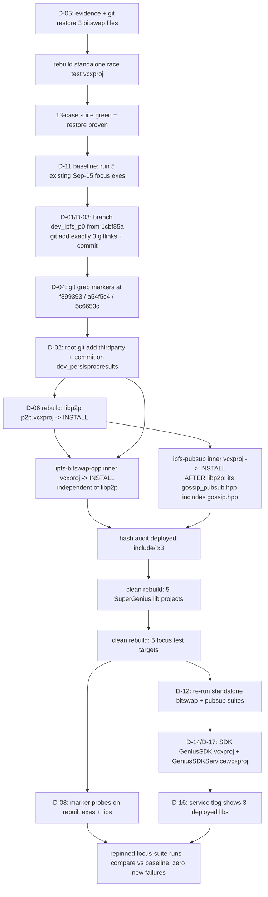

# Phase 4: Repin & Cross-Repo Verification - Research

**Researched:** 2026-10-14
**Domain:** Git submodule pin-chain plumbing + MSVC/CMake integrated-tree rebuild + cross-repo build/test verification (no new protocol code)
**Confidence:** HIGH (every load-bearing claim verified by a command run this session in this workspace; commands and outputs quoted)

## Summary

Phase 4 is a pin-and-verify phase: land the three fix-branch SHAs as thirdparty gitlink bumps on a dedicated integration branch, refresh the integrated Debug build tree, prove SuperGenius focus suites add zero failures against a pre-repin baseline, and prove GeniusSDK builds and links against the repinned tree. Research this session verified the entire mechanical chain end-to-end against the live workspace: the exact git found-state (thirdparty `develop` @ `1cbf85a`, three fix HEADs checked out, root on `dev_persisprocresults`), the exact inner-vcxproj paths for all three packages (two of which differ from the pattern assumed in CONTEXT D-06), the exact focus-suite ctest targets and — via link tlogs — which deployed libs each consumes, the exact tlog path for the SDK link-input audit, and the exact binary marker strings for D-08 probes (validated with positive and negative controls against stale and fix-built binaries).

Three findings materially change the plan's shape. **First**, the D-05 bitswap rollback is now fully characterized: the three dirty files are byte-identical to Phase-1 HEAD `e2dc906` (empty `git diff e2dc906 -- <files>`), so zero novel content hides in the worktree and `git restore` is unconditionally safe — but the standalone bitswap test tree was **already rebuilt from the rolled-back source** on Oct 13 19:51 (its exe contains Phase-1 case names and lacks all Phase-2 case names), so restore → rebuild → 13-case re-verify is mandatory, not precautionary. **Second**, the deployed thirdparty tree is in a *mixed* state: libp2p deployed libs (incl. `p2p_gossip.lib`, Oct 13 18:45) and deployed `gossip.hpp` already carry fix content (both marker strings byte-grepped True), while `ipfs-pubsub.lib` (Oct 2) and `ipfs-bitswap-cpp.lib` (Sep 29) are pre-fix — the deployed-header ABI split D-06 warns about is **live right now** and the phase's clean rebuild heals it. **Third**, the pre-repin baseline needs no rebuild at all: the five focus-suite exes in `SuperGenius\build\Windows\Debug\test_bin\Debug\` date from Sep 15 and statically embed pre-fix lib content, so running them as-is is the exact D-11 baseline.

**Primary recommendation:** Sequence as D-05 reconcile → D-11 baseline (run existing exes) → D-01/D-03/D-04 pin commits + content probes → D-06 ordered rebuild (libp2p → bitswap ∥ → pubsub → INSTALL ×3 → hash audit → 5 SuperGenius lib projects → 5 focus test targets) → D-12 standalone re-runs → D-08 marker probes → D-14/D-16/D-17 SDK build + tlog audit. Never `git add -A` in thirdparty; stage exactly the three gitlinks.

<user_constraints>
## User Constraints (from CONTEXT.md)

### Locked Decisions

**Pin landing & branch strategy (INTG-01/02)**
- **D-01:** Dedicated thirdparty integration branch — cut a new branch (name agent discretion, e.g. `dev_ipfs_p0`) from thirdparty `develop` HEAD `1cbf85a`; the three gitlink bumps (ipfs-bitswap-cpp `f899393`, libp2p `a54f5c4`, ipfs-pubsub `5c6653c`) land as commit(s) there. thirdparty `develop` stays untouched until a reviewed merge; never pushed.
- **D-02:** Root gitlink committed on the current root branch — the root repo's `thirdparty` pointer is bumped in a commit on `dev_persisprocresults` (already carrying this workstream's docs commits), recording the full chain in git: fix branches → thirdparty integration branch → root pointer. Never pushed.
- **D-03:** Surgical staging — the thirdparty pin commit stages exactly the three gitlinks (`git add ipfs-bitswap-cpp libp2p ipfs-pubsub`); unrelated worktree drift (`gnus_upnp` modified, `MNN`/`fmt` untracked-pointer noise) is left untouched and never swept in. Untracked junk inside libp2p (`Testing/`, `.planning/research/.cache/`) is cleaned or ignored, never committed.
- **D-04:** Content probes recorded with transcript — INTG-02's grep probes run at each pinned SHA with the exact marker list from the carry-forward vocabulary; the SHA→marker evidence lands in VERIFICATION.md. Branch names appear only as provenance notes, never as trust anchors.

**Pre-pin reconciliation (blocking pre-task)**
- **D-05:** Investigate the bitswap worktree rollback BEFORE touching it — establish origin (WSL-sync residue vs verification probe vs other) and confirm nothing uncommitted-and-valuable hides there; then `git restore` the three files and re-verify (13-case suite green at the restored tree) before pinning. Any build run before this would compile pre-fix code.

**Integrated-tree rebuild (INTG-03 prerequisite)**
- **D-06:** Full deployed-header ABI recipe — for each repinned package: MSBuild the inner vcxproj, run INSTALL.vcxproj to refresh deployed `include/` + `lib/`, then hash-audit every deployed header vs source. Then CLEAN (not incremental) rebuild of dependent packages and of every SuperGenius target whose TUs include a changed header (include-grep enumeration). Incremental is rejected: stale-TU links against the new Config layout are the documented 0xC0000374 heap-corruption trap.
- **D-07:** Debug only — the existing `thirdparty/build/Windows/Debug` + `SuperGenius/build/Windows/Debug` trees; Release is not rebuilt this phase. Disk headroom on W: constrains clean-rebuild breadth.
- **D-08:** Marker-probe binaries at the SuperGenius layer — after linking, byte-grep the built focus-suite test exes for a fix-marker string proving the fixed code actually entered the binary; this catches the documented MSBuild incremental-link-skip trap.
- **D-09:** SuperGenius rebuild breadth = focus-suite targets + their internal deps only (clean per D-06); broad link health is the GeniusSDK build's job (D-14).

**Focus suites & pass bar (INTG-03)**
- **D-10:** Focus set = the roadmap's three named paths mapped to suites — CRDT/PubSub → `SuperGenius/test/src/crdt` + `pubsub_counts`; DAG-syncer → the suite(s) containing the DAG syncer (crdt/graphsync side); AccountMessenger → its suite. Research pins the exact ctest targets; the all-five widening (securecrdt, transaction_sync) was not selected.
- **D-11:** Pass bar = no-new-failures vs a fresh pre-repin baseline — the same focus suites run on the pre-repin integrated tree FIRST (ordering constraint: baseline must complete before the D-06 rebuild replaces the old libs); the repinned run must add zero failures. Pre-existing reds are documented, not blocking.
- **D-12:** TEST-01 and TEST-02 both re-run at pin time in their existing standalone trees — proves the exact pinned SHAs green at the moment of pinning; both suites are deterministic so cost is minutes.
- **D-13:** Flake policy = retry once + document — contradictory results on identical inputs are investigated, not retried away.

**GeniusSDK verification (INTG-03)**
- **D-14:** SDK core target + one example/service target — the library link check plus a real-consumer embedding proof; not the full solution, not lib-only.
- **D-15:** Strictly build-only — compile + link success is the entire claim; nothing is executed.
- **D-16:** SDK link evidence = tlog + hash audit — `link.read.1.tlog` must show the freshly rebuilt thirdparty libs were consumed, combined with the deployed-lib hash audit from D-06. Byte-grepping the SDK binary for fix markers is NOT the SDK's evidence standard.
- **D-17:** Existing `GeniusSDK/build/Windows` Debug tree, reconfigured in place against the repinned thirdparty; a fresh configure dir is a documented fallback only.

**Failure contingency**
- **D-18:** Fix-forward if trivial — a trivial, local adaptation is fixed inside Phase 4 and recorded. Anything structural stops and reports back to the operator.

### The agent's Discretion
- Integration branch name (e.g. `dev_ipfs_p0`) and commit message shape in thirdparty and root
- Exact ctest target enumeration for the three paths (D-10) and which suite owns DAG-syncer / AccountMessenger
- Which GeniusSDK example/service target serves as the consumer proof (D-14)
- The concrete marker strings probed (from the carry-forward vocabulary) and the grep mechanics
- MSBuild invocation details (full exe path, `/m`, per-project ordering) within the D-06 recipe
- Phase-internal ordering of pin-commit vs baseline vs rebuild (only hard constraint: baseline before the D-06 rebuild clobbers old libs; pin commit before content probes)
- How the D-05 rollback investigation is evidenced (file mtimes, reflog, sync timestamps) as long as it is bounded and concludes before restore
- VERIFICATION.md internal structure

### Deferred Ideas (OUT OF SCOPE)
- **Release-tree rebuild + verification** — D-07 scopes to Debug
- **GeniusSDK example smoke run** — rejected for this phase (D-15)
- **CI-side verification of the repinned chain** — out of scope per the milestone's explicit CI exclusion
- Reviewed todo "Fix Vulkan capability-probe deadlock/crash in ProcessingManager::Create path" — unrelated; left for its natural owner
</user_constraints>

<phase_requirements>
## Phase Requirements

| ID | Description | Research Support |
|----|-------------|------------------|
| INTG-01 | Fixes land on the actual integrated submodule SHAs and are verified against those SHAs — not branch tips — before pinning | Found-state verified: fix HEADs `f899393` / `a54f5c4` / `5c6653c` are linear descendants of the recorded integrated gitlinks `d2ec18af` / `28f6a629` / `b6eb6268` (commit chains re-confirmed this session); D-05 restore + 13-case re-verify procedure fully specified |
| INTG-02 | `thirdparty` pins updated with content-probed verification (markers present at pinned commit, never branch-name trust) | Exact probe commands + verified marker vocabulary (§ Code Examples E5); exact git staging sequence for the three gitlinks (§ E1); recorded gitlink SHAs captured for before/after diff |
| INTG-03 | SuperGenius focus suites pass on repinned tree; GeniusSDK builds cleanly against it | Focus-suite target set + tlog-verified lib consumption matrix (§ Focus Suites); baseline-without-rebuild discovery; 5-project SuperGenius rebuild breadth; SDK targets + tlog audit path all verified |
</phase_requirements>

## Project Constraints (from AGENTS.md / workspace conventions)

- **Stack:** C++17/C++20, CMake, Boost.Asio, libp2p — this phase writes no C++ beyond possible D-18 trivial adaptations
- **Submodule commit discipline:** innermost-first — submodule commits (already done, Phases 1–3) → thirdparty gitlink commit → root gitlink commit. Matches D-01→D-02 ordering
- **Standing operator rule (reaffirmed in CONTEXT):** nothing is ever pushed to remotes; all git operations local
- **Verification convention (TESTING.md):** build/test inside the existing `build/<Platform>/<Config>` trees; never stand up scratch builds — D-06/D-09/D-17 all comply
- **Compatibility constraint:** no proto/API changes — the three fix branches are additive-only (verified in phase verifications); Phase 4 adds none
- **Workflow enforcement:** nyquist_validation = false → no Validation Architecture section; security_enforcement = true (L1) → Security Domain section included below (minimal surface)

## Architectural Responsibility Map

This phase has no browser/API tiers; the "tiers" are the pin chain and build layers:

| Capability | Primary Tier | Secondary Tier | Rationale |
|------------|-------------|----------------|-----------|
| Gitlink pin commits (INTG-01/02) | thirdparty repo (integration branch) | root repo (gitlink bump on `dev_persisprocresults`) | Gitlinks are recorded in the parent tree; the chain fix-branch → thirdparty → root is exactly D-01/D-02 |
| Worktree reconciliation (D-05) | submodule `ipfs-bitswap-cpp` worktree | standalone test tree rebuild | Dirty files live in the submodule; proof of restore lives in the 13-case suite |
| Thirdparty lib rebuild + deploy (D-06) | `thirdparty\build\Windows\Debug\<pkg>\src\<pkg>-build\` inner vcxproj + INSTALL.vcxproj | deployed `<pkg>\include` + `<pkg>\lib` | MSVC static libs are built by inner projects; deployment is the INSTALL target's job |
| Focus-suite rebuild + run (D-09/D-10/D-11) | `SuperGenius\build\Windows\Debug` (5 lib projects + 5 test targets) | ctest 3.29.2 | Tests live in SuperGenius's tree; baseline = existing Sep-15 exes |
| SDK build+link proof (D-14..D-17) | `GeniusSDK\build\Windows\Debug` (GeniusSDK.vcxproj + GeniusSDKService.vcxproj) | tlog link-input audit | Broad link health is proven here, not by widening SuperGenius breadth |
| Evidence recording (D-04/D-08/D-16) | VERIFICATION.md + probe transcripts | binary byte-greps, hash audits, tlogs | All evidence is mechanical and reproducible by command |

## Standard Stack

### Core (all versions verified this session)

| Tool | Version | Purpose | Why Standard |
|------|---------|---------|--------------|
| git (Windows) | shipped with repo workflow | pin chain, restore, content probes | gitlinks are the existing pin mechanism (HEAD `1cbf85a` is itself a pin-bump commit) |
| MSBuild | 17.14.10.27608 at `C:\Program Files\Microsoft Visual Studio\2022\Community\MSBuild\Current\Bin\MSBuild.exe` | all vcxproj builds (multi-config: `/p:Configuration=Debug /p:Platform=x64`) | the integrated trees are VS-generator CMake builds; TESTING.md forbids scratch toolchains |
| ctest | 3.29.2 | suite runner (`-C Debug` mandatory — multi-config tree) | same runner the phases 1–3 used; 147 tests registered in the SG tree |
| PowerShell 5.1 | host shell | hash audits, byte-greps, transcript capture | proven techniques from prior phases (see § Code Examples E4) |

### Supporting

| Tool | Purpose | When to Use |
|------|---------|-------------|
| `Get-FileHash -Algorithm MD5` | deployed-header hash audit (D-06) | after each INSTALL.vcxproj run |
| ASCII-decode byte-grep (§ E4) | D-08 marker probes in libs/exes | after each link step; `Select-String` directly on binaries is unreliable (validated — see Pitfall 6) |
| `git grep <marker> <SHA> -- <path>` | D-04 content probes at pinned SHAs | pin-commit time, before trust is granted |
| link tlog `Select-String` | D-16 SDK link-input audit | after SDK link |

No external packages are installed by this phase → **Package Legitimacy Audit: not applicable** (no registry lookups needed; no new dependencies).

## Package Legitimacy Audit

No external packages are installed, downloaded, or added by this phase (pin-and-verify; tooling is pre-installed and verified above). Packages removed due to SLOP verdict: none. Packages flagged as suspicious: none.

## Architecture Patterns

### Pin & Rebuild Pipeline (the phase's one diagram)



Entry point is the found-state (dirty bitswap worktree); the decision point is the baseline-vs-repinned comparison; the boundary is "nothing leaves the machine" (no push anywhere).

### Found-State (verified 2026-10-14, this session)

| Item | State | Evidence |
|------|-------|----------|
| thirdparty repo | `develop` @ `1cbf85a` (local-only; `origin/develop` = `e8e650c`); no stashes | `git branch --show-current`, `git log --oneline -3`, `git stash list` (empty) |
| thirdparty status | ` M gnus_upnp` (new commits; submodule itself clean inside), ` M ipfs-bitswap-cpp`, ` M ipfs-pubsub`, ` M libp2p` (new commits vs recorded gitlinks), `?? MNN`, `?? fmt` | `git status --short` |
| Recorded gitlinks in thirdparty HEAD | `d2ec18af…` (bitswap), `b6eb6268…` (pubsub), `28f6a629…` (libp2p) | `git ls-tree HEAD ipfs-bitswap-cpp libp2p ipfs-pubsub` |
| Root repo | `dev_persisprocresults`; root records `thirdparty` @ `1cbf85a9e982b35aad5e1c983d182cb7e33c26e3`, `SuperGenius` @ `73eba12e…`, `GeniusWallet` @ `58ef1973…`; dirty: `M GeniusWallet`, `M SuperGenius`, `m thirdparty` | `git branch --show-current`, `git ls-tree HEAD …`, `git status --short` |
| ipfs-bitswap-cpp | `dev_timer_correctness` @ `f899393`; 7 linear commits from `d2ec18af`; dirty: ` M src/bitswap.cpp`, ` M src/bitswap.hpp`, ` M test/bitswap_request_timer_race_test.cpp` | `git log`, `git status --short` |
| libp2p | `dev_gossip_bounds` @ `a54f5c4`; untracked `?? .planning/research/.cache/`, `?? Testing/` | `git status --short` |
| ipfs-pubsub | `dev_ipfs_fix` @ `5c6653c`; clean | `git status --short` |

### Pattern 1: Surgical gitlink staging (D-01/D-03)
**What:** stage exactly three submodule gitlinks on a new branch cut from the pin-commit parent.
**When to use:** the only commit in thirdparty this phase.
**Why it's safe:** `git add <submodule>` stages only the submodule's current HEAD SHA as the gitlink. Untracked files inside libp2p (`Testing/`, `.planning/research/.cache/`) cannot enter the parent commit; `gnus_upnp`'s local advance is untouched because it is never named. The danger is `git add -A` / `git add .` — it would sweep `gnus_upnp` and possibly the untracked-pointer noise (D-03 prohibition).

### Pattern 2: Ordered inner-project rebuild (D-06)
**What:** build inner vcxproj, then per-package INSTALL.vcxproj, in dependency order.
**When to use:** every repinned package.
**Verified inner-project paths** (Test-Path'd this session; **two differ from the `<pkg>\src\<pkg>-build\src\<pkg>.vcxproj` pattern assumed in D-06**):

| Package | Inner library vcxproj | INSTALL (top per-package) |
|---------|----------------------|---------------------------|
| ipfs-bitswap-cpp | `thirdparty\build\Windows\Debug\ipfs-bitswap-cpp\src\ipfs-bitswap-cpp-build\src\ipfs-bitswap-cpp.vcxproj` | `…\ipfs-bitswap-cpp-build\INSTALL.vcxproj` |
| libp2p | `…\libp2p\src\libp2p-build\src\p2p.vcxproj` ← target is **`p2p`**, not "libp2p" | `…\libp2p-build\INSTALL.vcxproj` |
| ipfs-pubsub | `…\ipfs-pubsub\src\ipfs-pubsub-build\src\ipfs_pubsub\ipfs-pubsub.vcxproj` ← extra `ipfs_pubsub` dir level | `…\ipfs-pubsub-build\INSTALL.vcxproj` |

**Dependency order (verified by include scan):** ipfs-pubsub's `src\ipfs_pubsub\gossip_pubsub.hpp` includes libp2p's `protocol/gossip/gossip.hpp` → **libp2p first, ipfs-pubsub after**. ipfs-bitswap-cpp includes none of the changed libp2p headers (independent; can build in either slot). **ipfs-lite-cpp includes none of the three changed headers → no rebuild needed** (verified: zero matches for `bitswap.hpp|protocol/gossip/gossip.hpp|gossip_pubsub.hpp` under `ipfs-lite-cpp\{src,include}`).

### Pattern 3: Baseline without rebuild (D-11 economy)
**What:** the five focus-suite exes in `SuperGenius\build\Windows\Debug\test_bin\Debug\` are Sep-15, 2026 builds — they statically embed pre-fix lib content (all deployed libs at that date were pre-fix). Running them as-is IS the pre-repin baseline; no rebuild required.
**Constraint honored:** baseline must complete before the D-06 rebuild — specifically before the focus test targets are rebuilt (their outputs are overwritten in `test_bin\Debug\`). Rebuilding deployed thirdparty libs alone does not alter already-linked exes, but the plan should still finish the baseline before touching the tree (cheapest correct ordering).

### Focus Suites (D-10) — tlog-verified consumption matrix

Link inputs read from each target's existing `link.read.1.tlog` (this session):

| Test target (ctest name = target name) | Suite dir | gossip (`P2P_GOSSIP.LIB`) | pubsub (`IPFS-PUBSUB.LIB`) | bitswap (`IPFS-BITSWAP-CPP.LIB`) | Roadmap path |
|----------------------------------------|-----------|:---:|:---:|:---:|--------------|
| `pubsub_counts_test` | test\src\pubsub_counts | ✓ | ✓ | ✗ | CRDT/PubSub |
| `globaldb_integration_test` | test\src\crdt | ✓ | ✓ | ✗ | CRDT/PubSub (the crdt suite's pubsub consumer) |
| `pubsub_graphsync_test` | test\src\graphsync | ✓ | ✓ | ✓ | DAG-syncer (constructs `sgns::ipfs_pubsub::GossipPubSub` directly; only graphsync suite) |
| `transaction_sync_test` | test\src\transaction_sync | ✓ | ✓ | ✓ | AccountMessenger (includes `account/GeniusNode.hpp`; TransactionManager→AccountMessenger path) |
| `genius_node_bootstrap_reconnect_test` | test\src\transaction_sync | ✓ | ✓ | ✓ | AccountMessenger (optional 5th — planner discretion) |
| `crdt_test` | test\src\crdt | ✗ | ✗ | ✗ | — links only base libp2p (`P2P_CID`, `P2P_MULTIHASH`); **not a repin consumer** |

**Recommendation:** focus set = `pubsub_counts_test`, `globaldb_integration_test`, `pubsub_graphsync_test`, `transaction_sync_test` (+ `genius_node_bootstrap_reconnect_test` optional). Note CONTEXT D-10 says "test/src/crdt" — within that suite, `globaldb_integration_test` is the repin-relevant member; `crdt_test` consumes none of the three libs (its DAGSyncer exercise via `crdt_custom_dagsyncer.cpp` links no changed code). All six vcxprojs exist in the build tree; five exes exist in `test_bin\Debug` (Sep 15). ctest names = target names; run with `ctest -C Debug -R "<name>"` (multi-config tree; 147 tests registered).

### SuperGenius Rebuild Breadth (D-06/D-09) — include-grep → project map

Changed deployed headers: libp2p `include\libp2p\protocol\gossip\gossip.hpp` (Config layout change — the dangerous one), ipfs-pubsub `src\ipfs_pubsub\gossip_pubsub.hpp`, ipfs-bitswap-cpp `src\bitswap.hpp`. SuperGenius TU includers (verified by recursive grep of `SuperGenius\src`):

| Changed header | Including SuperGenius TUs | Owning vcxproj (verified by vcxproj grep) |
|----------------|---------------------------|-------------------------------------------|
| gossip.hpp (via header-only `base\gossip_auth.hpp`) | `account\GeniusNode.cpp`; `crdt\globaldb\pubsub_broadcaster_ext.cpp`; `processing\processing_service.cpp`; `processing\processing_subtask_queue_accessor_impl.cpp`; `processing\processing_subtask_queue_channel_pubsub.cpp` | `account\genius_node.vcxproj`; `crdt\globaldb\crdt_globaldb.vcxproj`; `processing\processing_service.vcxproj` |
| gossip_pubsub.hpp | `account\AccountMessenger.{hpp,cpp}`; `account\GeniusAccount.cpp`; `blockchain\Consensus.{hpp,cpp}`; `crdt\globaldb\GlobalDbNetworkComposition.cpp`; `transaction\TransactionManager.cpp` | `account\sgns_genius_account.vcxproj`; `blockchain\impl\blockchain_genesis.vcxproj`; `crdt\globaldb\crdt_globaldb.vcxproj` |
| bitswap.hpp | `account\GeniusNode.cpp`; `processing\processing_subtask_queue_accessor_impl.cpp` | `account\genius_node.vcxproj`; `processing\processing_service.vcxproj` |

**Union of affected SuperGenius lib projects (5):**
```
src\account\sgns_genius_account.vcxproj
src\account\genius_node.vcxproj
src\blockchain\impl\blockchain_genesis.vcxproj
src\crdt\globaldb\crdt_globaldb.vcxproj
src\processing\processing_service.vcxproj
```
(all relative to `SuperGenius\build\Windows\Debug\`; note the repo has **55** src lib projects — the 5-project set is what makes D-09's bounded clean affordable)

**Critical mechanic (verified):** the focus test vcxprojs do **not** ProjectReference the SuperGenius src libs — e.g. `pubsub_counts_test.vcxproj` references only `ZERO_CHECK.vcxproj` and `src\base\logger.vcxproj`; everything else arrives as plain prebuilt `.lib` link inputs (see its tlog: `CRDT_DATASTORE.LIB`, `ROCKSDB.LIB`, …). **Building a test target does NOT rebuild its lib dependencies — the 5 lib projects must be built explicitly, before the test targets.** (`TransactionManager.cpp`'s exact owning project was not individually pinned this session; the same one-line vcxproj grep used above resolves it at plan time — expected to land in `sgns_genius_account` or a sibling account project already inside the 5-project set's ProjectReference closure.)

### GeniusSDK Targets (D-14/D-16/D-17)

Verified target inventory in `GeniusSDK\build\Windows\Debug`:

| Target | Path | Role |
|--------|------|------|
| `GeniusSDK.vcxproj` | `src\GeniusSDK.vcxproj` | static lib (no link step → **no link.read tlog**; D-16 evidence cannot come from this target) |
| `GeniusSDK_shared.vcxproj` | `src\GeniusSDK_shared.vcxproj` | DLL + import lib |
| `GeniusSDKService.vcxproj` | `services\GeniusSDKService.vcxproj` | real-consumer EXE — **recommended D-14 consumer proof** (alternate: `example\SDKExample.vcxproj`) |
| `SDKExample.vcxproj` / `SDKIdleExample.vcxproj` | `example\` | example consumers |

- `GeniusSDKService.vcxproj` ProjectReferences only `ZERO_CHECK` + `src\GeniusSDK.vcxproj` → **one MSBuild invocation on the service target builds lib + service** (chain is automatic here, unlike SuperGenius).
- Tree state: fully built Sep 2, 2026 (`GeniusSDK\lib\GeniusSDK.lib`, `GeniusSDK\bin\GeniusSDKService.exe`, `GeniusSDK_shared.dll` all present) — a clean rebuild-in-place has a known-good reference point.
- **D-16 tlog (verified exists, verified contains all three deployed libs):** `GeniusSDK\build\Windows\Debug\services\GeniusSDKService.dir\Debug\GeniusSDKService.tlog\link.read.1.tlog` — greps True for `P2P_GOSSIP`, `IPFS-PUBSUB`, `IPFS-BITSWAP-CPP` (entries like `W:\GNUS\…\THIRDPARTY\BUILD\WINDOWS\DEBUG\IPFS-BITSWAP-CPP\LIB\IPFS-BITSWAP-CPP.LIB`).
- **D-17 "reconfigure in place":** cache binds `CMAKE_HOME_DIRECTORY=W:/gnus/GeniusNetwork/GeniusSDK/build/Windows` (the build-entry CMakeLists), `SUPERGENIUS_DIR=W:/gnus/GeniusNetwork/SuperGenius`, and all deps to the thirdparty Debug deployed tree. The repin changes **no paths**, so a plain rebuild usually suffices; re-running CMake in the same dir is the in-place reconfigure; a fresh dir is fallback only.

## Don't Hand-Roll

| Problem | Don't Build | Use Instead | Why |
|---------|-------------|-------------|-----|
| Fresh pre-repin baseline | Rebuild old libs into a scratch tree | Run the existing Sep-15 `test_bin\Debug` exes | They statically embed pre-fix content; a rebuild cannot reproduce that once libs are repinned — the existing binaries ARE the baseline |
| Binary marker search | ad-hoc `Select-String` on exes | ASCII-decode byte-grep (E4) | `Select-String` returned False on a known-good exe this session (encoding detection); the byte-decode function passed all 4 controls |
| Deployed-header comparison | Manual diff lists | `Get-FileHash -Algorithm MD5` per header, source vs deployed | Proven technique; deterministic |
| Link-input proof | Parsing .vcxproj AdditionalDependencies | tlog `link.read.1.tlog` grep | tlogs record the actual link command inputs (what the linker truly consumed), not what CMake declared |
| Test registration | Guessing ctest names | ctest name = addtest target name; confirm via `CTestTestfile.cmake` / `ctest -N -C Debug` | 147 tests registered; verified pattern in both standalone and SG trees |
| Content probes | Trusting branch names | `git grep <marker> <pinned-SHA> -- <path>` | INTG-02's whole point; markers verified greppable at all three SHAs this session |

**Key insight:** every verification artifact this phase needs (baseline exes, tlogs, standalone trees, inner projects, markers) already exists and was validated this session — the phase is orchestration of proven mechanics, not invention.

## Runtime State Inventory

This is a pin/migration phase — the categories that matter are build artifacts and git state:

| Category | Items Found | Action Required |
|----------|-------------|------------------|
| Stored data | None — no databases/keystores touched by repinning (verified: phase touches only gitlinks + build trees) | None — verified by scope inspection |
| Live service config | None — no running services depend on the thirdparty pins; CI explicitly out of scope | None |
| OS-registered state | None | None |
| Secrets/env vars | None — no secret names change; pins are SHAs | None |
| Build artifacts (the live category) | (1) Deployed thirdparty libs in **mixed state**: `p2p_gossip.lib` et al. rebuilt Oct 13 18:00–18:45 WITH fix markers, but `ipfs-pubsub.lib` (Oct 2) and `ipfs-bitswap-cpp.lib` (Sep 29) pre-fix; deployed `gossip.hpp` already fix-content → **header/lib ABI split is live** (2) Standalone bitswap tree binaries (exe+lib, Oct 13 19:51) built from ROLLED-BACK source — exe has 7-case suite, lacks all 6 Phase-2 case names (3) Five focus exes Sep 15 = baseline snapshots — must run before any rebuild overwrites them (4) libp2p untracked `Testing\`, `.planning\research\.cache\` | (1)+(2): code-edit-equivalent (rebuild per D-06/D-12 recipe) — no data migration; (3): ordering constraint only; (4): leave or `git clean -fd` those two paths inside libp2p (never commit) |

## Common Pitfalls

### Pitfall 1: Wrapper-project trap
**What goes wrong:** building the top-level thirdparty `<pkg>.vcxproj` (or the superproject-level wrappers) compiles nothing; the lib never refreshes.
**Why:** ExternalProject-style layout — the real compile happens in the inner build dir (paths in § Pattern 2).
**How to avoid:** build the exact inner vcxproj paths listed above; verify success by checking the inner `.lib` mtime AND the deployed `<pkg>\lib\*.lib` mtime after INSTALL.
**Warning signs:** build "succeeds" in seconds with zero compiler output.

### Pitfall 2: Deployed-header ABI split (live NOW)
**What goes wrong:** TUs compiled against new `gossip.hpp` (Config grew 3 knobs) link against stale libs, or vice versa → 0xC0000374 heap corruption at runtime, far from the build.
**Why:** INSTALL.vcxproj refreshes headers independently of lib rebuilds; the current tree already has fix-content `gossip.hpp` deployed beside pre-fix `ipfs-pubsub.lib`/`ipfs-bitswap-cpp.lib`.
**How to avoid:** D-06's strict order per package (inner rebuild → INSTALL → hash audit) and CLEAN rebuild of all dependents (the 5 SG lib projects + SDK) — never incremental across the header change.
**Warning signs:** any link whose inputs mix pre-Oct-13 and post-rebuild lib mtimes; D-08 probe failing on a exe that "built fine".

### Pitfall 3: MSBuild does not rebuild dependents on third-party header change — and SG test targets don't even reference the libs
**What goes wrong:** rebuilding only the test exes relinks stale SG lib objects compiled against the old Config layout.
**Why (verified):** test vcxprojs ProjectReference only `ZERO_CHECK` + occasional base projects; SG src libs enter as plain `.lib` inputs. MSBuild's dependency graph cannot see header changes inside another package's deployed include dir.
**How to avoid:** explicitly `/t:Clean;Build` (or `/t:Rebuild`) the 5 SG lib projects first, then the test targets.
**Warning signs:** test-target build finishes but only re-links (no compile output for account/crdt/blockchain/processing TUs).

### Pitfall 4: Incremental-link skip / stale lib member
**What goes wrong:** a refreshed `.lib` member never gets pulled into the exe; the binary silently contains old gossip code.
**Why:** documented MSVC incremental-link behavior (prior-phase memory: msbuild-incremental-link-skip).
**How to avoid:** clean link for focus targets + D-08 marker probe as the tripwire — that is the probe's exact purpose.
**Warning signs:** marker probe False on an exe linked after a lib rebuild.

### Pitfall 5: Standalone-tree contamination (already happened once)
**What goes wrong:** building the standalone bitswap tree against the rolled-back worktree produced 7-case binaries on Oct 13 19:51 — a "green" run of the wrong code.
**How to avoid:** D-05 restore BEFORE any bitswap build anywhere; after restore, rebuild `ipfs-bitswap-cpp-test\test\bitswap_request_timer_race_test.vcxproj` and require `[==========] Running 13 tests` in the output (count the cases, don't trust the exe name).
**Warning signs:** case count < 13; Phase-2 case names absent from the exe (byte-grep any of `ReentrantCancelOwnRequestNoDeadlock`, `LateRegistrationOnTimedOutReplaysRequestTimeout`).

### Pitfall 6: `Select-String` on binary files is unreliable
**What goes wrong:** marker greps silently return False on exes that contain the string (observed this session on the race-test exe).
**Why:** encoding detection on binary content.
**How to avoid:** the ASCII-decode byte-grep (§ E4) — passed all controls; use it for every D-08/D-16 probe.

### Pitfall 7: PowerShell 5.1 quirks
BOM: `Set-Content -Encoding UTF8` writes a BOM — use `-Encoding ascii` for JSON/temp probes. Interpolation: `${VAR}` expands inside double quotes — escape with backtick when embedding in command strings. Multi-line tool payloads: prefer absolute paths (a cwd reset mid-session bit this research run).

### Pitfall 8: Disk budget
**What goes wrong:** full-tree cleans or over-broad rebuilds exhaust W:.
**Verified numbers:** W: free **17.6 GB** (the "~4.8 GB" in older memory is stale — but re-check at execution); `SuperGenius\build\Windows\Debug` = **162.4 GB**, `thirdparty\…\Debug` = 19.2 GB, `GeniusSDK\…\Debug` = 10.2 GB.
**How to avoid:** D-09's bounded set only (5 lib projects + 5 test targets ≈ low single-digit GB of fresh objs/exes); never clean the whole SG tree; the baseline exes must NOT be deleted (they are irreplaceable evidence — no rebuild can recreate them after repin).

### Pitfall 9: Accidental staging sweep
`git add -A` / `git add .` in thirdparty would stage `gnus_upnp`'s local advance (and could touch `MNN`/`fmt` pointers) — D-03 violation. Stage by exact path only.

### Pitfall 10: ctest regex over-match + missing exes
The SG tree registers 147 tests, some referencing never-built exes (e.g. `securecrdt_candidate_test` — `ctest -N` prints "Could not find executable"). Use exact `-R "^<name>$"` anchors for the focus set so the widening D-10 rejected (securecrdt, transaction_sync's other members) isn't accidentally pulled in — unless the planner deliberately includes `genius_node_bootstrap_reconnect_test`.

## Code Examples

All commands verified or validated this session on this workspace (PowerShell 5.1, cwd `W:\gnus\GeniusNetwork` unless noted).

### E1 — D-05: rollback evidence + restore + re-verify
```powershell
cd W:\gnus\GeniusNetwork\thirdparty\ipfs-bitswap-cpp
# Evidence (bounded; conclusion before restore):
git status --short            # ' M' the three files (index == HEAD => restore-from-index is correct)
git diff --stat               # "3 files changed, 32 insertions(+), 463 deletions(-)"
git diff e2dc906 --stat -- src/bitswap.cpp src/bitswap.hpp test/bitswap_request_timer_race_test.cpp
                              # EMPTY output = worktree byte-identical to Phase-1 HEAD e2dc906 => zero novel content
git stash list                # empty
git reflog --date=iso -5      # last events are the Oct-13 commits; no checkout since Oct-12
Get-Item src/bitswap.cpp, src/bitswap.hpp, test/bitswap_request_timer_race_test.cpp |
  Select-Object Name, LastWriteTime   # all 10/13/2026 1:36 PM (post-verification write)
# Restore (index holds f899393 content, so plain restore suffices; --source is explicit):
git restore --source=f899393 -- src/bitswap.cpp src/bitswap.hpp test/bitswap_request_timer_race_test.cpp
git status --short            # must be empty for these files
# Re-verify: rebuild standalone tree + run 13-case suite
& "C:\Program Files\Microsoft Visual Studio\2022\Community\MSBuild\Current\Bin\MSBuild.exe" `
  W:\gnus\GeniusNetwork\thirdparty\build\Windows\Debug\ipfs-bitswap-cpp-test\test\bitswap_request_timer_race_test.vcxproj `
  /t:Rebuild /p:Configuration=Debug /p:Platform=x64 /m
W:\gnus\GeniusNetwork\thirdparty\build\Windows\Debug\ipfs-bitswap-cpp-test\test_bin\Debug\bitswap_request_timer_race_test.exe
# Expect: "[==========] Running 13 tests" and "[  PASSED  ] 13 tests."
```

### E2 — D-01/D-02/D-03: pin chain commits
```powershell
cd W:\gnus\GeniusNetwork\thirdparty
git switch -c dev_ipfs_p0                    # from develop HEAD 1cbf85a (verified parent)
git add ipfs-bitswap-cpp libp2p ipfs-pubsub  # exactly the three gitlinks (stages f899393 / a54f5c4 / 5c6653c)
git status --short                           # verify ONLY the three are staged; gnus_upnp/MNN/fmt untouched
git commit -m "chore(pins): repin ipfs stack to P0 fix branches (bitswap f899393, libp2p a54f5c4, ipfs-pubsub 5c6653c)"
cd W:\gnus\GeniusNetwork
git add thirdparty                           # root gitlink: 1cbf85a -> dev_ipfs_p0 head
git commit -m "chore(thirdparty): bump thirdparty to dev_ipfs_p0 (ipfs P0 remediation pins)"
# never push (standing rule)
```

### E3 — D-04: content probes at pinned SHAs (all verified greppable this session)
```powershell
cd W:\gnus\GeniusNetwork\thirdparty
git -C ipfs-bitswap-cpp grep -c "terminalResult_" f899393 -- src                       # 2 + 2 (cpp+hpp)
git -C ipfs-bitswap-cpp grep -c "TEST( RequestContextRaceTest" f899393 -- test/bitswap_request_timer_race_test.cpp  # 13
git -C libp2p          grep -c "max_remote_subscriptions_per_peer" a54f5c4 -- include/libp2p/protocol/gossip/gossip.hpp  # 1
git -C libp2p          grep -l -E "setViolationHandler|asyncPostViolation" a54f5c4 -- src  # 5 files
git -C ipfs-pubsub     grep -c "BlockPeer" 5c6653c -- src/ipfs_pubsub/gossip_pubsub.cpp  # 8
git -C ipfs-pubsub     grep -c "kSustainedOverflowClosesToBlock" 5c6653c -- src          # 3 hits across cpp/hpp
```

### E4 — D-08/D-16: binary marker probes (ASCII-decode byte-grep — the reliable form)
```powershell
function Test-BinMarker($path, $marker) {
  $b = [IO.File]::ReadAllBytes($path)
  $t = [Text.Encoding]::ASCII.GetString($b)
  $t.Contains($marker)
}
# Gossip markers (string literals; work in BOTH .lib and .exe — validated):
#   egress drop  (stream.cpp L153):        'dropping oversized outbound RPC'
#   ingress cap  (remote_subscriptions L64): 'exceeded remote subscription cap'
#   error text   (common.cpp):             'sustained outbound pending-bytes overflow'
Test-BinMarker "SuperGenius\build\Windows\Debug\test_bin\Debug\pubsub_graphsync_test.exe" 'dropping oversized outbound RPC'
# Bitswap marker (SYMBOL level — .lib ONLY; PE exes strip mangled names — validated):
Test-BinMarker "thirdparty\build\Windows\Debug\ipfs-bitswap-cpp\lib\ipfs-bitswap-cpp.lib" '?Cancel@BitswapRequestContext'
#   stale lib: False (verified)  =>  post-rebuild: must flip True; '?AddCallback@BitswapRequestContext' stays True (control)
```
Control results captured this session: stale `ipfs-bitswap-cpp.lib` → Cancel=False, AddCallback=True; fix-built standalone `p2p_gossip.lib` → egress=True, ingress=True; fix-built `ipfs-pubsub-test.exe` → egress=True.

### E5 — D-06: per-package rebuild + install + hash audit (order: libp2p → bitswap ∥ → pubsub)
```powershell
$MB = "C:\Program Files\Microsoft Visual Studio\2022\Community\MSBuild\Current\Bin\MSBuild.exe"
$D  = "W:\gnus\GeniusNetwork\thirdparty\build\Windows\Debug"
& $MB "$D\libp2p\src\libp2p-build\src\p2p.vcxproj"                       /t:Rebuild /p:Configuration=Debug /p:Platform=x64 /m
& $MB "$D\libp2p\src\libp2p-build\INSTALL.vcxproj"                       /p:Configuration=Debug /p:Platform=x64 /m
& $MB "$D\ipfs-bitswap-cpp\src\ipfs-bitswap-cpp-build\src\ipfs-bitswap-cpp.vcxproj" /t:Rebuild /p:Configuration=Debug /p:Platform=x64 /m
& $MB "$D\ipfs-bitswap-cpp\src\ipfs-bitswap-cpp-build\INSTALL.vcxproj"   /p:Configuration=Debug /p:Platform=x64 /m
& $MB "$D\ipfs-pubsub\src\ipfs-pubsub-build\src\ipfs_pubsub\ipfs-pubsub.vcxproj"     /t:Rebuild /p:Configuration=Debug /p:Platform=x64 /m
& $MB "$D\ipfs-pubsub\src\ipfs-pubsub-build\INSTALL.vcxproj"             /p:Configuration=Debug /p:Platform=x64 /m
# Hash audit (deployed header vs source), e.g. gossip.hpp:
(Get-FileHash W:\gnus\GeniusNetwork\thirdparty\libp2p\include\libp2p\protocol\gossip\gossip.hpp -Algorithm MD5).Hash
(Get-FileHash "$D\libp2p\include\libp2p\protocol\gossip\gossip.hpp"      -Algorithm MD5).Hash   # must be equal
# NOTE (deploy-path quirk): bitswap deploys FLAT — compare thirdparty\ipfs-bitswap-cpp\src\bitswap.hpp
# against $D\ipfs-bitswap-cpp\include\bitswap.hpp (deployed include root, no ipfs/ subdir).
```

### E6 — D-09/D-11: SuperGenius bounded rebuild, baseline + repinned runs
```powershell
$SG = "W:\gnus\GeniusNetwork\SuperGenius\build\Windows\Debug"
$targets = 'pubsub_counts_test','globaldb_integration_test','pubsub_graphsync_test','transaction_sync_test'  # (+ 'genius_node_bootstrap_reconnect_test' optional)
# BASELINE FIRST (existing Sep-15 exes; before any rebuild):
cd $SG
foreach ($t in $targets) { & ".\test_bin\Debug\$t.exe" *>&1 | Tee-Object -FilePath "W:\gnus\GeniusNetwork\.planning\workstreams\ipfs-improve\phases\04-repin-cross-repo-verification\baseline-$t.log" }
# (or ctest -C Debug -R "^(pubsub_counts_test|globaldb_integration_test|pubsub_graphsync_test|transaction_sync_test)$")
# Rebuild libs then tests (libs FIRST — test targets do not reference them):
$libs = 'src\account\sgns_genius_account.vcxproj','src\account\genius_node.vcxproj',
        'src\blockchain\impl\blockchain_genesis.vcxproj','src\crdt\globaldb\crdt_globaldb.vcxproj',
        'src\processing\processing_service.vcxproj'
foreach ($l in $libs) { & $MB "$SG\$l" /t:Rebuild /p:Configuration=Debug /p:Platform=x64 /m }
foreach ($t in $targets) { & $MB "$SG\test\src\<suitedir>\$t.vcxproj" /t:Rebuild /p:Configuration=Debug /p:Platform=x64 /m }
# Repinned runs: same commands as baseline; compare per-case pass/fail sets — zero NEW failures (D-11/D-13)
```

### E7 — D-12: standalone pin-time re-runs
```powershell
ctest --test-dir W:\gnus\GeniusNetwork\thirdparty\build\Windows\Debug\ipfs-bitswap-cpp-test -C Debug -R "^bitswap_request_timer_race_test$"
ctest --test-dir W:\gnus\GeniusNetwork\thirdparty\build\Windows\Debug\ipfs-pubsub-test     -C Debug -R "^ipfs-pubsub-test$"
# (bitswap tree MUST be rebuilt first per E1 — its current binaries are the contaminated Oct-13 19:51 set)
# ctest names verified from CTestTestfile.cmake add_test entries this session
```

### E8 — D-14/D-16/D-17: SDK build + link-input audit
```powershell
& $MB "W:\gnus\GeniusNetwork\GeniusSDK\build\Windows\Debug\services\GeniusSDKService.vcxproj" /t:Rebuild /p:Configuration=Debug /p:Platform=x64 /m
# chains src\GeniusSDK.vcxproj automatically via ProjectReference (verified)
$tlog = "W:\gnus\GeniusNetwork\GeniusSDK\build\Windows\Debug\services\GeniusSDKService.dir\Debug\GeniusSDKService.tlog\link.read.1.tlog"
foreach ($m in 'P2P_GOSSIP','IPFS-PUBSUB','IPFS-BITSWAP-CPP') { "{0}: {1}" -f $m, (Select-String -Path $tlog -Pattern $m -Quiet) }
# all three verified True against the pre-rebuild tlog; post-rebuild they must remain True with fresh lib mtimes
```

## State of the Art

Not applicable in the library sense — this phase uses only the workspace's established pin-and-verify mechanics. One practice note: content-addressed pinning (INTG-02's grep-marker probes) is the supply-chain-correct pattern vs branch-name trust; the workspace already encodes it (prior pin commit `1cbf85a` style + this milestone's carry-forward vocabulary).

## Assumptions Log

| # | Claim | Section | Risk if Wrong |
|---|-------|---------|---------------|
| A1 | Bounded rebuild fits in current disk headroom (fresh objs/exes ≈ low-single-digit GB vs 17.6 GB free) | Environment / Pitfall 8 | Build aborts mid-phase; mitigate by re-checking free space at execution and, if needed, deleting only the rebuilt targets' `.dir` intermediates |
| A2 | Bounded clean rebuild wall-clock ≈ 1–3 h (5 lib projects + 5 test targets + 3 thirdparty libs) — NOT measured | Patterns | Time-boxing only; no correctness impact |
| A3 | Sep-15 baseline exes still run on current OS state (static CRT `mt-sgd` per lib names; no external deps observed) | Pattern 3 | If an exe fails to launch, fall back to ctest for that target or document as pre-existing environment red (D-11 allows documented pre-existing reds) |
| A4 | Gossip `Config` change is source-compatible to SuperGenius/SDK (additive fields with defaults; no consumer found doing positional Config init) | Patterns | A compile error surfaces during D-06 → D-18 trivial-fix or stop-and-report path |
| A5 | 17.6 GB free figure drifts by execution time | Environment | Re-check before starting; cheap guard |
| A6 | `TransactionManager.cpp`'s owning project falls inside the 5-project set's closure (not individually pinned this session) | Rebuild breadth | A sixth lib project needs clean rebuild — same one-line vcxproj grep used in research resolves it in seconds at plan/execute time |

## Open Questions (RESOLVED at planning — dispositions inline)

1. **Origin of the Oct-13 13:36 rollback** — evidence gathered (mtimes 13:36, content == `e2dc906` exactly, no stash, no checkout in reflog since Oct 12 19:49, standalone-tree rebuild 19:51 from rolled-back source). Attribution (WSL-sync residue vs manual restore vs probe) remains undetermined; because the worktree contains zero bytes not present in committed history, this is non-blocking. D-05 requires the investigation be bounded and documented — recommend recording exactly the evidence above in VERIFICATION.md and proceeding.
   - What we know: rollback shape is a clean revert to Phase-1 HEAD content, unstaged (index untouched).
   - What's unclear: which actor wrote the files at 13:36.
   - Recommendation: document evidence; restore; move on.
   - **[RESOLVED — bounded per D-05: evidence recorded in `d05-rollback-evidence.txt` (04-01 Task 1); the diff-vs-e2dc906 emptiness proof is the safety gate; attribution intentionally not required]**
2. **Pre-existing reds in the focus suites** — unknown until the D-11 baseline runs (transaction_sync-family exes are 161 MB node-level tests; some may have existing failures or long runtimes). The no-new-failures bar handles either; capture per-case results, not just exit codes.
   - Recommendation: run baseline with per-test output (`--gtest_filter` default full run; parse `[  FAILED  ]` lines) so the repinned comparison is per-case.
   - **[RESOLVED — per-case capture at baseline: per-target `baseline-*.log` + pre-existing-red ledger in `baseline-summary.md` (04-01 Task 2); the D-11 zero-new-failures comparison (04-03) measures against it]**
3. **Whether to include `genius_node_bootstrap_reconnect_test`** — planner discretion (D-10); it consumes all three libs (tlog-verified) but duplicates `transaction_sync_test`'s AccountMessenger coverage at higher runtime cost.
   - Recommendation: include only if baseline shows `transaction_sync_test` cannot run to completion.
   - **[RESOLVED — conditional substitute only: `genius_node_bootstrap_reconnect_test` enters the set ONLY if `transaction_sync_test` cannot run to completion (the A3 contingency rule, 04-01 Task 2; D-10 discretion) — otherwise never included]**

## Environment Availability

| Dependency | Required By | Available | Version | Fallback |
|------------|------------|-----------|---------|----------|
| MSBuild (VS2022 Community) | all rebuilds | ✓ | 17.14.10.27608 (`C:\Program Files\Microsoft Visual Studio\2022\Community\MSBuild\Current\Bin\MSBuild.exe`) | — |
| ctest | D-10/D-11/D-12 runs | ✓ | 3.29.2 | direct exe invocation (E6) |
| git | pin chain, probes | ✓ | repo workflow standard | — |
| W: disk headroom | rebuilds | ✓ (17.6 GB free; re-check at exec) | — | bounded D-09 set; delete rebuilt-target intermediates only |
| `thirdparty\build\Windows\Debug` integrated tree | D-06 | ✓ (19.2 GB; inner projects + INSTALL verified for all 3 pkgs) | — | — |
| `SuperGenius\build\Windows\Debug` | D-09/D-11 | ✓ (162.4 GB; 55 src libs; 5-project affected set; 147 ctest tests; 5 focus exes prebuilt) | — | — |
| Standalone test trees ×2 | D-05/D-12 | ✓ (both ctest-registered; bitswap tree currently contaminated — rebuild per E1) | — | — |
| `GeniusSDK\build\Windows\Debug` | D-14..D-17 | ✓ (10.2 GB; fully built Sep 2; targets + tlog verified) | — | fresh configure dir (documented fallback, D-17) |

**Missing dependencies with no fallback:** none.
**Missing dependencies with fallback:** none.

## Security Domain

ASVS L1 relevance for a pin-and-verify build phase (no new inputs, auth, or crypto):

| ASVS Category | Applies | Standard Control |
|---------------|---------|------------------|
| V2 Authentication | no | nothing changed |
| V3 Session Management | no | nothing changed |
| V4 Access Control | no | local-only operations |
| V5 Input Validation | no | no new input surface (VERIFICATION.md records command outputs only) |
| V6 Cryptography | no | no crypto code touched |
| V14 Config (adjacent) | yes (process control) | content-probed pinning (INTG-02) is the supply-chain control: trust SHAs by greppable markers, never branch names; no pushes; surgical staging prevents unreviewed code entering the pin commit |

| Pattern | STRIDE | Standard Mitigation |
|---------|--------|---------------------|
| Supply-chain substitution (wrong code pinned) | Tampering / Elevation | D-04 content probes at pinned SHAs + D-08 binary markers + D-06 hash audits (three independent content proofs) |
| Unreviewed drift entering commits | Tampering | D-03 surgical staging; `git status` verification before commit |
| ABI-split binaries reaching consumers | Tampering (runtime corruption) | D-06 clean-rebuild recipe + install-order discipline |

## Sources

### Primary (HIGH confidence — run in this workspace this session)
- `git status/log/ls-tree/reflog/stash` in `thirdparty`, the three submodules, and root — found-state, gitlinks, rollback shape (outputs quoted in § Found-State, E1)
- `Get-ChildItem`/`Test-Path` over `thirdparty\build\Windows\Debug\{libp2p,ipfs-pubsub,ipfs-bitswap-cpp,ipfs-bitswap-cpp-test,ipfs-pubsub-test}` — inner vcxprojs, INSTALLs, deployed include/lib, ctest registrations, exe inventory
- Deployed-lib mtimes + byte-grep probes with controls (4/4 behaved as predicted) — marker mechanics
- `SuperGenius\test\src\*` CMakeLists addtest inventory + build-tree vcxproj/exe/tlog checks — focus-suite matrix, rebuild breadth, ProjectReference behavior
- `GeniusSDK\build\Windows\Debug` cache + vcxprojs + service tlog — D-14/D-16/D-17 mechanics
- `git grep` at `f899393`/`a54f5c4`/`5c6653c` — marker vocabulary (counts quoted in E3)
- MSBuild/ctest version probes; disk free; build-tree sizes

### Secondary (MEDIUM confidence)
- Prior-phase artifacts (01/02/03 CONTEXT + VERIFICATION) — marker vocabulary, standalone-tree recipes, pre-existing-failure ledger (read this session; their behavioral claims were verified in their own phases)
- `.planning/codebase/TESTING.md`, `INTEGRATIONS.md` — build/test conventions

### Tertiary (LOW confidence)
- None relied upon. Memory notes that this session superseded: disk "~4.8 GB" (now 17.6 GB measured); generic `<pkg>.vcxproj` inner-path pattern (now exact per-package paths).

## Metadata

**Confidence breakdown:**
- Standard stack (git/MSBuild/ctest/PowerShell + exact paths): HIGH — every path and version probed this session
- Architecture (pin chain, rebuild order, suite mapping): HIGH — tlogs and include-greps prove the dependency claims
- Pitfalls: HIGH — five of the ten pitfalls were directly observed or controlled this session (wrapper paths, ABI split live state, missing ProjectReferences, standalone contamination, Select-String binary unreliability); the rest are prior-phase verified memories
- Estimates (time/disk consumption): LOW-MEDIUM — flagged as assumptions A1/A2

**Research date:** 2026-10-14
**Valid until:** 2026-11-13 (stable domain; but found-state facts are only valid until the first Phase-4 git/build action mutates them)
