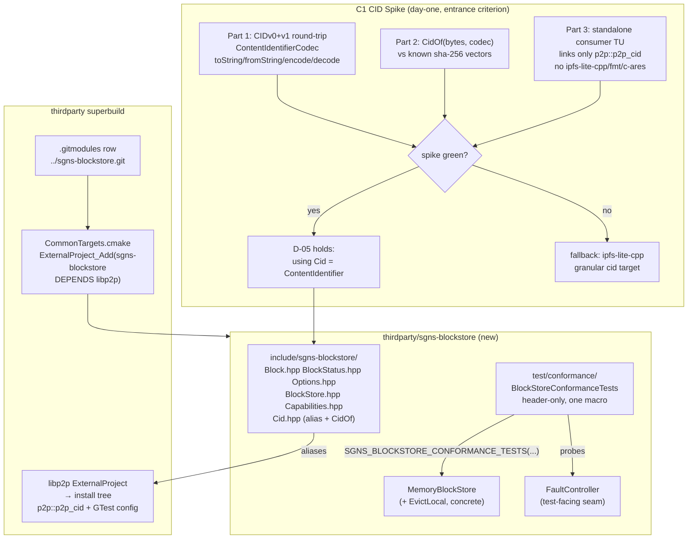

# Phase 1: BlockStore Contract, Memory Backend & Conformance Kit - Research

**Researched:** 2026-10-20
**Domain:** C++17 static library bootstrap in the thirdparty superbuild — frozen BlockStore contract (types + interface), hermetic memory backend, reusable GTest conformance kit, and the C1 CID-dependency spike (`p2p_cid` vs ipfs-lite-cpp granular `cid`)
**Confidence:** HIGH (every load-bearing codebase fact re-verified this session against source with line anchors; the C1 spike's API surface is fully confirmed green in advance; the only genuinely open items are decisions, not facts)

<user_constraints>
## User Constraints (from CONTEXT.md)

### Locked Decisions

**Result-type mechanics**
- **D-01:** All public ops carry results via the outcome envelope: `outcome::result<T, BlockStatus>` — the repo-wide convention; since C1 likely lands on `p2p_cid`, outcome ships with libp2p anyway, costing consumers nothing extra — **Reversibility:** one-way — this is the published v1.0.0 contract every header, conformance assertion, and consumer call site rides on; the phase exists to freeze it
- **D-02:** `BlockStatus` is a rich struct, not a bare enum: `{ StatusClass code; BlockSource source; std::string message; }` riding the outcome failure slot — source attribution (success criterion 3) is first-class and assertable by the conformance kit — **Reversibility:** one-way — published API shape; the conformance kit and Phase-5 fault matrix assert against it
- **D-03:** An authoritative miss is a failure value: `Get -> result<Block, BlockStatus>` with `code == NotFound` (the `EXPECT_OUTCOME_FALSE`-style pattern); one uniform pattern for all five classes, no `optional`-in-success second pattern — **Reversibility:** one-way — encoded in the kit's assertions and every consumer's miss handling
- **D-04:** `Put -> result<PutOutcome, BlockStatus>` where `PutOutcome { DurabilityLevel achieved; bool alreadyPresent; }` — Phase 4's conditional-put `412 -> AlreadyExists-as-success` just sets `alreadyPresent = true`; nothing re-frozen later; carries the "never return a DurabilityLevel not verified" invariant — **Reversibility:** one-way — Phase 4 semantics bind to this payload

**CID type surface**
- **D-05:** The CID type is a direct alias: `using Cid = libp2p::multi::ContentIdentifier;` in the public header; the library links `p2p_cid` and re-exports it in its CMake package config — one CID definition everywhere, zero conversion friction for SuperGenius CRDT call sites — **Reversibility:** costly — swapping the alias for a wrapper later touches every header and consumer; if the C1 spike fails, the alias still holds but points at the ipfs-lite-cpp granular `cid` target instead
- **D-06:** The C1 spike must pass a full 3-part bar before `p2p_cid` is adopted: (1) CIDv0 + CIDv1 round-trip bytes<->string using only `p2p_cid`, (2) `CidOf(bytes, codec)` verified against known vectors, (3) a standalone consumer TU includes every public header and links only `p2p_cid` — no ipfs-lite-cpp, no fmt/soralog/c-ares dragged in. Fallback on failure: ipfs-lite-cpp granular `cid` target — **Reversibility:** reversible — spike criterion only, cheap to adjust during Phase 1
- **D-07:** `sgns::blockstore::CidOf(bytes, codec)` ships as a public installed helper — future consumers (SuperGenius-side adapter, genius-tube) need exactly one verified CID constructor instead of hand-rolling multihash encoding — **Reversibility:** costly — removing a published helper is an API break
- **D-08:** v1 accepts any codec but restricts hashing to sha-256 multihash (what this repo's CRDT/IPLD pipeline produces); any other hash code is rejected at API entry as an invalid argument (programmer error) — the frozen 5-value runtime taxonomy stays untouched — **Reversibility:** reversible — widening to more hash functions later is additive

**Conformance kit shape**
- **D-09:** The kit is a header-only template suite instantiated by one macro: `SGNS_BLOCKSTORE_CONFORMANCE_TESTS(SuiteName, factory)` (S5 `StoreTests` style) — compiles into each backend's test binary, no extra CMake wiring, literally one step — **Reversibility:** costly — every backend's test TU binds to the macro and factory shape
- **D-10:** The kit defines the fault-injection seam NOW: an optional `FaultController` interface the kit probes for; backends implementing it get fault conformance tests (induced failure -> correct taxonomy class, no sticky negative cache) for free; backends without it get loud labelled skips — retrofitting suite shape in Phase 5 is what the research warns against — **Reversibility:** costly — kit shape plus every backend that implements the controller
- **D-11:** Suite bodies assert with plain GTest (`EXPECT_TRUE` + manual extraction) — zero macro surface; kit depends on GTest + outcome only — **Reversibility:** reversible — internal to the kit
- **D-12:** The conformance kit is build-time only (built with `TESTING=ON` inside the repo, not installed/exported) — all v1 backends live in this repo; revisit if an external consumer needs to run conformance against a wrapper — **Reversibility:** reversible — install/export can be added later without breaking anyone

**v1 contract breadth**
- **D-13:** Full P1 freeze: `Put`/`Get`/`Has`/`GetSize` + `PutMany` (naive impl) + `ReadOptions`/`WriteOptions` + `BlockStoreCapabilities` + 4-value `DurabilityLevel` all land in v1.0.0 — later phases implement behind the frozen header set; no signature changes ever — **Reversibility:** one-way — the published v1.0.0 header set is this phase's core deliverable
- **D-14:** `PutMany` returns per-block outcome vectors with explicitly NO all-or-nothing guarantee (a failed item never rolls back siblings) — the naive loop implementation is conformant; the future S3 backend streams without faking atomicity — **Reversibility:** one-way — the no-atomicity promise is a documented contract consumers rely on
- **D-15:** `ReadOptions { std::chrono::steady_clock::time_point deadline; bool verify = true; }` and `WriteOptions { deadline }` — deadline plus the CORE-04 verify toggle, nothing speculative; Memory backend ignores deadlines (never blocks), backends that can honor them do — **Reversibility:** costly — adding fields to exported structs later is an ABI break
- **D-16:** `EvictLocal(cid)` is a concrete method on backend types (`MemoryBlockStore` now, `LocalBlockStore` in Phase 2) — NEVER on the `BlockStore` interface. The guard test asserts both: the interface exposes no delete-shaped method, and `EvictLocal` exists only on backend types (cannot touch remote) — **Reversibility:** costly — guard test, backend types, and Phase-5 test levers bind this placement

### the agent's Discretion
- Exact `StatusClass`/`BlockSource` enum member naming and header file layout (`Block.hpp`, `BlockStatus.hpp`, `BlockStore.hpp`, etc. — research's proposed set is guidance, not law)
- Guard-test mechanics (compile-time checks vs CI grep) for "no delete-shaped method" and "no SDK types in headers" — as long as both criteria are provably enforced
- `MemoryBlockStore` internals (map type, locking) — thread-safety contract choice belongs to planning, but v1 need not promise more than single-threaded use unless planning finds a reason
- `BlockStoreCapabilities` field set beyond max-`DurabilityLevel` reporting
- Repo bootstrap details inside the AsyncIOManager precedent (test dir layout, `test/conformance/` target shape)

### Deferred Ideas (OUT OF SCOPE)
None — discussion stayed within phase scope.

Reviewed todo not folded: "Fix Vulkan capability-probe deadlock/crash in ProcessingManager::Create path" — unrelated to the BlockStore library; stays with base SuperGenius planning.
</user_constraints>

## Summary

Phase 1 is a greenfield C++17 library bootstrap whose entire risk lives in two places: the **C1 CID-dependency spike** (D-05/D-06) and the **superbuild integration mechanics** (BUILD-01). This session re-verified every codebase fact the spike and the build entry depend on, directly against source. The headline result: **the `p2p_cid` API surface is complete for all three spike parts and is already sitting built in the workspace's thirdparty install tree** — `thirdparty/build/Windows/Debug/libp2p/lib/cmake/libp2p/libp2pTargets.cmake` contains `add_library(p2p::p2p_cid STATIC IMPORTED)` and `lib/p2p_cid.lib` exists [VERIFIED: this session, install-tree inspection]. `ContentIdentifierCodec` provides the exact round-trip surface D-06 needs — `encode`/`decode`, `toString` (base58 v0 / base32 v1), `toStringOfBase`, `fromString`, plus `encodeCIDV0`/`encodeCIDV1` — and `CidOf(bytes, codec)` composes cleanly from `libp2p::crypto::sha256` → `Multihash::create` → the `ContentIdentifier` 3-arg constructor. Spike parts 1 and 2 are HIGH-confidence green before the spike even runs.

Two facts sharpen (not block) the spike's part-3 bar, and the planner must encode them into the assertion rather than discover them mid-spike: **(a)** the installed `libp2pConfig.cmake` hard-`find_dependency`s the full stack (c-ares, fmt, soralog, yaml-cpp, Boost.DI, tsl_hat_trie, SQLiteModernCpp, protobuf, OpenSSL, Boost) before exporting any target — invisible inside the superbuild install tree, but it means "no fmt/soralog/c-ares dragged in" cannot mean *configure-time absence of those config packages*; **(b)** the transitive *link* closure of `p2p_cid` includes `p2p_logger` → `soralog`/`yaml-cpp`/`Boost.DI` via `p2p_uvarint` [VERIFIED: `thirdparty/libp2p/src/multi/CMakeLists.txt` + `src/log/CMakeLists.txt`]. What the part-3 bar can and should assert literally: **no ipfs-lite-cpp header, target, or config anywhere; no direct `fmt`/`c-ares` edge on `p2p_cid` itself** (both verified true), with the uvarint→logger→soralog edge accepted as libp2p-family overhead identical to what every libp2p consumer already carries — strictly lighter than the ipfs-lite-cpp fallback, whose `cid` target links `c-ares::cares`, `soralog::soralog`, `fmt::fmt`, `blake2` *directly* [VERIFIED: `thirdparty/ipfs-lite-cpp/primitives/cid/CMakeLists.txt`]. Recommendation: adopt `p2p_cid` (D-05 holds) and record the refined part-3 wording in the spike's test comments.

The build side has one genuine trap this session discovered beyond the known landmines: **`_CMAKE_COMMON_CACHE_ARGS` forces `-DBUILD_TESTING:BOOL=OFF` into every ExternalProject** [VERIFIED: `thirdparty/build/CommonCompilerOptions.cmake:100-130`], and the AsyncIOManager precedent names its test gate `option(BUILD_TESTING)` — so a copy of that precedent can never turn tests on through the superbuild. Name the new repo's option `TESTING` (the libp2p/ipfs-lite-cpp/wallet-core convention) and pass `-DTESTING:BOOL=ON` after `${_CMAKE_COMMON_CACHE_ARGS}` (later cache args win). Related: neither the platform entry points nor thirdparty CI plumb any global test flag today, and SuperGenius CI consumes a *prebuilt* thirdparty release — so success criterion 4's "runs green in CI" needs a concrete lane decision (options in Open Questions). Also flagged: D-08's sha-256-only restriction collides with a verified fact — the repo's own CRDT CBOR path (`sgns::common::getCidOf`) produces **blake2b-256** CIDs; the decision stands (locked), but the boundary must be documented in the public headers so the future SuperGenius adapter isn't surprised (details in Pitfalls).

**Primary recommendation:** Bootstrap the repo first (submodule + AsyncIOManager-shape CMakeLists + superbuild entry), make the C1 spike its first green test target against the already-built `build/Windows/Debug` install tree, then freeze the type headers, then `MemoryBlockStore` + `FaultController`, then the conformance kit + guard tests — in that order, with the spike assertion wording pre-refined as above.

<phase_requirements>
## Phase Requirements

| ID | Description | Research Support |
|----|-------------|------------------|
| CORE-01 | `BlockStore` interface (`Put`/`Get`/`Has`/`GetSize`) with structured results; installed headers carry only CID/bytes/strings | D-01..D-04 signatures locked; `Cid` alias verified against real `ContentIdentifier` API; hygiene check mechanics (compile TU + grep) defined; `p2p::p2p_cid` target verified present in build tree |
| CORE-02 | 5-value status taxonomy; transport failures never surface as `NotFound` | D-02/D-03 locked; conformance kit fault tests via `FaultController` (D-10); `MemoryBlockStore` implements the controller so taxonomy classes are provable in Phase 1 |
| CORE-03 | `DurabilityLevel` enum + capability struct in v1 API | 4-value enum verified verbatim from the architecture doc; `BlockStoreCapabilities` field set is agent discretion beyond max-durability |
| CORE-04 | CID verification at facade boundary; corrupt results rejected with source attribution | `CidOf` composition path fully verified (`sha256` → `Multihash::create` → ctor); kit's corruption test design defined (flip byte → `Corrupt` + `source` set) |
| CORE-05 | No delete-shaped API; `EvictLocal` local-only | D-16 locked; C++17-compatible guard-test mechanics documented (SFINAE/`void_t`, NOT `requires` — repo pins C++17) |
| CORE-06 | Enumeration only on a separate tooling/audit interface; core stays List-free | C4 reconciliation verified; guard test asserts no `List`-shaped member on `BlockStore` |
| BACK-01 | `MemoryBlockStore` hermetic reference implementation | Map-key fact verified: `ContentIdentifier` has `operator<` but NO `std::hash` — key by encoded CID bytes; `EvictLocal` concrete method per D-16 |
| BACK-02 | Reusable `BlockStoreConformanceTests` kit, one-step instantiation | Macro shape locked (D-09); header-only; GTest-only assertions (D-11); build-time-only (D-12); `addtest` precedent verified |
| BUILD-01 | New thirdparty submodule, CMake static-lib target, installed public headers | AsyncIOManager precedent fully mapped (CMakeLists shape, export layout, `addtest`, test gating); `.gitmodules` row verified; `ExternalProject_Add` entry template written; `BUILD_BYPRODUCTS` + `TESTING`-naming traps documented |
</phase_requirements>

## Project Constraints (from AGENTS.md / copilot-instructions / repo conventions)

No root-level `copilot-instructions.md` exists in this workspace (only `GeniusWallet/.github/copilot-instructions.md`, Flutter-specific, not applicable). The binding project directives for this phase, from `AGENTS.md`, `Coding Standards.md`, and `thirdparty/AGENTS.md`:

- **GSD workflow enforcement:** all file changes flow through GSD commands — this research runs under `/gsd-plan-phase`; subsequent edits stay in GSD tasks. Innermost-first commit order, exact-path staging, never push without instruction (thirdparty/AGENTS.md + pitfall 8.8).
- **C++17 floor:** `CommonCompilerOptions.cmake` pins `CMAKE_CXX_STANDARD 17` — guard tests must use SFINAE/`void_t` detection, not C++20 `requires` expressions [VERIFIED: `_CMAKE_COMMON_CACHE_ARGS` carries `-DCMAKE_CXX_STANDARD:STRING=${CMAKE_CXX_STANDARD}` and AGENTS.md declares C++17/C++20 stack].
- **Coding standard (Corelinux-derived):** Ulman brace style ("Braces shall be aligned using Ulman style where the braces … [are] always on a line by" themselves, `Coding Standards.md:219-221`), PascalCase types/headers, `m_`/trailing-underscore member prefix, Doxygen-style `@brief`/`@param` on public interfaces, block comments preferred over trailing comments.
- **Thirdparty conventions:** `build/*/CMakeLists.txt` + `CommonTargets.cmake` + `CommonCompilerOptions.cmake` are source of truth; new targets keep aligned with `_CMAKE_COMMON_CACHE_ARGS`; submodules + `ExternalProject_Add` only (no package managers); `git submodule update --init --recursive` before any build; ninja is the preferred generator.
- **Namespace:** top-level `sgns`, sub-namespaces mirror directory structure → `sgns::blockstore`.
- **Security:** main-wallet/secret hygiene rules from the project constraints do not touch this phase (no credentials surface in v1 — but see Security Domain for the config-schema rule that does bind: no `secret_key:` field ever exists).

## Architectural Responsibility Map

| Capability | Primary Tier | Secondary Tier | Rationale |
|------------|-------------|----------------|-----------|
| Frozen type system (`BlockStatus`, `DurabilityLevel`, options, capabilities) | Library public headers (`include/sgns-blockstore/`) | — | Published v1.0.0 contract; installed standalone; every later phase implements behind it |
| CID type + hashing | libp2p `p2p_cid` (aliased, re-exported) | outcome (vendored inside libp2p headers) | One CID definition everywhere (D-05); verification composes existing crypto, never re-implements |
| `BlockStore` interface (Put/Get/Has/GetSize/PutMany) | Library public header (pure virtual) | — | Backends implement only this; decorators (future tiering) compose it |
| `MemoryBlockStore` + `EvictLocal` | Library backend TU | — | Hermetic reference backend; concrete methods never on the interface (D-16) |
| CID verification (CORE-04) | Facade/verify layer shared by backends | per-backend storage | S5 lesson: verify once in the facade, not per-backend |
| `FaultController` seam | Library test-facing internal header | backend opt-in | Kit probes via `dynamic_pointer_cast`; loud labelled skips otherwise (D-10) |
| Conformance kit | `test/conformance/` header-only templates (build-time only, D-12) | GTest + outcome | Instantiated into each backend's test binary by one macro (D-09) |
| Enumeration (tooling/audit) | Separate optional interface header | — | Never on `BlockStore` (CORE-06); v1 ships the header-level separation + guard test only |
| Superbuild orchestration | `thirdparty/build/CommonTargets.cmake` entry | `.gitmodules` row | BUILD-01; dependency direction enforced structurally (thirdparty builds before consumers) |
| CI execution of tests | Open — see Open Questions Q2 | standalone ctest in build tree | Neither SuperGenius CI (prebuilt thirdparty) nor thirdparty CI (build-only) runs tests today |
| Consumer wiring (`CommonBuildParameters.cmake`) | **NOT this milestone** | — | Deliberately excluded (dead config until a consumer exists) |

## Standard Stack

### Core (all pre-existing in the workspace superbuild — nothing new is installed)

| Component | Version/Pin | Purpose | Why Standard |
|-----------|-------------|---------|--------------|
| libp2p `p2p_cid` (imported target `p2p::p2p_cid`) | current thirdparty submodule pin | CID type (`ContentIdentifier`), CIDv0/v1 codecs, multibase, multihash, sha-256 | D-05/D-06; verified complete API surface; verified already built in `build/Windows/Debug` install tree |
| `p2p_sha` (transitive via `p2p_cid`) | same pin | OpenSSL-backed `libp2p::crypto::sha256` | Verified: `p2p_cid → p2p_sha → OpenSSL::SSL/Crypto` link edge exists in `src/crypto/sha/CMakeLists.txt` |
| outcome (vendored at `libp2p/include/libp2p/outcome/outcome.hpp`) | ships with libp2p | `outcome::result<T, BlockStatus>` envelope (D-01) | Verified header present; no extra dependency — arrives transitively with the CID alias |
| GTest (superbuild target, config at `<build>/GTest/lib/cmake/GTest`) | ~1.14.0 | Conformance kit + guard tests + spike assertions (D-11) | Verified: built unconditionally by `CommonTargets.cmake:4-12`; config dir present in the real build tree |
| Microsoft GSL (`gsl/span` in public headers) | superbuild pin | Span parameter types | `multihash.hpp` already includes `gsl/span`, so the alias drags it regardless; superbuild injects via `_FINDPACKAGE_GSL_INCLUDE_DIR` |
| CMake + Ninja | 3.29.2 / 1.12.0 (this machine) | Build | Verified this session; AsyncIOManager-style project requires `cmake_minimum_required(3.20+)` |
| Boost (headers) | superbuild ~1.85/1.89 | `boost/operators.hpp`, `boost/assert` (transitive via libp2p headers) | `content_identifier.hpp` inherits `boost::equality_comparable`; superbuild passes `${_BOOST_CACHE_ARGS}` |

### Alternatives Considered (CID dependency — the C1 decision, facts only)

| Instead of | Could Use | Tradeoff (verified this session) |
|------------|-----------|----------------------------------|
| `p2p_cid` | ipfs-lite-cpp granular `cid` target (`ipfs-lite-cpp::cid`) | Fallback per D-06. Verified heavier: `cid` links `c-ares::cares`, `soralog::soralog`, `fmt::fmt`, `blake2`, `p2p::p2p_cid` directly. Also drags the whole ipfs-lite-cpp config package (which bans `ipfs_lite/ipfs/*` includes becomes harder to enforce). |
| `p2p_cid` | Self-contained CID implementation | Rejected: duplicates varint/multihash/multibase domain knowledge in exactly the code path that verifies content integrity |
| `p2p_cid` | `sgns::CID` subclass from ipfs-lite-cpp | Rejected: it *is* a `ContentIdentifier` subclass adding only default-ctor/CBOR conveniences + `std::hash`; the library deliberately does not need CBOR conveniences; `std::hash` gap is solved cheaply by encoding-CID-byte keys (see BACK-01 support) |

**Installation:** none — no package manager, no new external dependency. BUILD-01 is a *new GNUS-authored repo* added as a submodule: `git submodule add ../sgns-blockstore.git sgns-blockstore` mirroring `[submodule "AsyncIOManager"] path = AsyncIOManager url = ../AsyncIOManager.git` [VERIFIED: `thirdparty/.gitmodules:96-98`].

## Package Legitimacy Audit

**No external packages are installed by this phase.** The only new repository is GNUS-authored (`sgns-blockstore`), consumed as an in-workspace submodule exactly like `AsyncIOManager`. All libraries linked (libp2p/p2p_cid, GTest, Boost, OpenSSL, GSL) are existing superbuild components already built in this workspace's install tree [VERIFIED: install-tree inspection this session]. No registry, npm/PyPI/crates, or `cargo search`/`npm view` verification applies.

## Architecture Patterns

### System Architecture Diagram



### Recommended Project Structure

```
thirdparty/sgns-blockstore/          # new GNUS repo (BUILD-01), AsyncIOManager shape
├── CMakeLists.txt                   # cmake_minimum_required(3.20); CXX17; GNUInstallDirs;
│                                    #   find_package(libp2p CONFIG REQUIRED); option(TESTING);
│                                    #   install(TARGETS ... EXPORT sgns-blockstoreTargets)
├── cmake/
│   ├── functions.cmake              # addtest() helper (AsyncIOManager precedent, verified)
│   └── config.cmake.in              # @PACKAGE_INIT@ + include Targets.cmake (one line)
├── include/sgns-blockstore/         # installed public headers — CID/bytes/strings only
│   ├── Cid.hpp                      # using Cid = libp2p::multi::ContentIdentifier; CidOf()
│   ├── Block.hpp                    # { Cid cid; std::vector<uint8_t> bytes; }
│   ├── BlockStatus.hpp              # StatusClass + BlockSource enums, BlockStatus struct
│   ├── Options.hpp                  # ReadOptions / WriteOptions (D-15 fields verbatim)
│   ├── Durability.hpp               # 4-value DurabilityLevel + PutOutcome (D-04/D-13)
│   ├── Capabilities.hpp             # BlockStoreCapabilities
│   ├── BlockStore.hpp               # pure virtual: Put/Get/Has/GetSize/PutMany — no List, no Remove
│   └── MemoryBlockStore.hpp         # reference backend + EvictLocal (concrete)
├── src/
│   ├── Cid.cpp                      # CidOf impl (sha256 → Multihash::create → ctor)
│   └── MemoryBlockStore.cpp
├── test/
│   ├── conformance/                 # header-only kit (NOT installed — D-12)
│   │   ├── BlockStoreConformanceTests.hpp   # SGNS_BLOCKSTORE_CONFORMANCE_TESTS(suite, factory)
│   │   └── FaultController.hpp               # optional seam (D-10)
│   ├── cid_spike_test.cpp           # C1 spike: parts 1-3 (first green test)
│   ├── memory_block_store_test.cpp  # instantiates the kit + backend-specific cases
│   ├── api_hygiene_test.cpp         # guard: no delete/List on interface; EvictLocal on backend only
│   └── CMakeLists.txt               # gated by option(TESTING)
└── .gitattributes                   # line-ending hygiene (gsd-windows-crlf memory)
```

### Pattern 1: Frozen contract, outcome-envelope results (D-01..D-04)

**What:** every public op returns `outcome::result<T, BlockStatus>`; a miss is a *failure* value with `code == NotFound`; `Put` carries `PutOutcome { DurabilityLevel achieved; bool alreadyPresent; }`.

**When to use:** all five operations, uniformly — including `Has` and `GetSize`.

**Derived implication the kit must assert (from D-01 + CORE-02):** `Has` cannot return bare `bool` (the architecture doc's sketch `virtual bool Has(const CID& cid) = 0;` [VERIFIED: `supergenius-sharded-ipld-cache-architecture.md:230`] would conflate authoritative-absence with backend-down). Conformant shape: `Has(cid) -> outcome::result<bool, BlockStatus>` — under induced failure the kit asserts a *failure* result (`TemporarilyUnavailable`), never `false`.

**Note on the architecture doc's sketch:** the doc's `GetBlockResult { status; optional<Block>; diagnostic }`, bare-enum `BlockStatus`, and `virtual DeleteResult Remove(const CID&)` are **superseded by D-02/D-03/D-16** — the CONTEXT decisions win; header docs restate the eviction invariants instead.

### Pattern 2: One-macro conformance instantiation (D-09/D-10/D-11)

**What:** header-only template suite; each backend's test TU does:
```cpp
SGNS_BLOCKSTORE_CONFORMANCE_TESTS(MemoryBlockStoreConformance, [] {
  return std::make_shared<sgns::blockstore::MemoryBlockStore>();
})
```
The macro defines a GTest fixture + TEST_F bodies that call `factory()` per case (or per suite — planner's choice, per-case is hermetic-r). Fault tests probe for the seam:
```cpp
auto fc = std::dynamic_pointer_cast<sgns::blockstore::FaultController>(store);
if (fc == nullptr) { GTEST_SKIP() << "[fault-conformance] backend does not implement FaultController"; }
```

**When to use:** every backend, forever (Phase 2 LocalBlockStore, Phase 4 S3BlockStore-with-fake inherit it for free).

### Pattern 3: ExternalProject entry through the superbuild (BUILD-01)

**What:** mirror the AsyncIOManager entry [VERIFIED: `thirdparty/build/CommonTargets.cmake:742-785`] with three deliberate deviations (see Code Examples for the full template): `DEPENDS libp2p` only, `BUILD_BYPRODUCTS` present (AsyncIOManager's entry has none — wallet-core's does [VERIFIED: `:727-730`]; ninja one-pass determinism is the repo-documented rule), and `-DTESTING:BOOL=ON` placed **after** `${_CMAKE_COMMON_CACHE_ARGS}`.

### Anti-Patterns to Avoid

- **`option(BUILD_TESTING)` + `${_CMAKE_COMMON_CACHE_ARGS}`:** the common args force `-DBUILD_TESTING:BOOL=OFF` [VERIFIED: `CommonCompilerOptions.cmake:108`] — a copy of AsyncIOManager's option name can never enable tests through the superbuild. Use `option(TESTING "Build tests" OFF)` (libp2p/ipfs-lite-cpp convention) or order an explicit override after the common args.
- **`requires`-expression guard tests:** C++20 only; the superbuild pins C++17. Use SFINAE `void_t` detection.
- **Bare-`bool` `Has`:** conflates taxonomy classes (see Pattern 1).
- **Verifying per-backend:** verification belongs in the facade path every backend funnels through (S5 lesson) — Memory included; `verify=false` in `ReadOptions` toggles it, never `#ifdef NDEBUG`.
- **Hand-rolled multibase/multihash/varint:** the exact bug class CID verification exists to catch.
- **Headers including `ipfs_lite/ipfs/*` or anything SuperGenius/GeniusSDK-shaped:** CI-greppable ban; the hygiene TU + grep enforce it.

## Don't Hand-Roll

| Problem | Don't Build | Use Instead | Why |
|---------|-------------|-------------|-----|
| CID construction from bytes | Custom multihash/base32/base58/varint encoding | `CidOf` composed from `libp2p::crypto::sha256` + `Multihash::create` + `ContentIdentifier` ctor + `ContentIdentifierCodec` | Verified complete surface; hand-rolling multicodec tables guarantees drift in the integrity-verification path |
| CID string/bytes round-trip | Custom serializers | `ContentIdentifierCodec::toString/fromString/encode/decode/toStringOfBase` | Verified: "Base58 for CID v0 / Base32 for CID v1" semantics implemented and error-typed |
| Result envelope | Custom expected/optional variant | vendored `outcome::result<T, BlockStatus>` | Repo-wide convention (D-01); ships with libp2p headers already |
| Test registration | Custom test main/runner | GTest via superbuild + `addtest()` helper (AsyncIOManager `cmake/functions.cmake:8-28`) | Verified precedent incl. xunit XML output + `test_bin` layout |
| Package config export | Hand-written Config.cmake | `configure_package_config_file` + `write_basic_package_version_file` + `install(EXPORT ... NAMESPACE sgns-blockstore::)` | AsyncIOManager precedent, verified end-to-end |
| sha-256 | Any hashing code | `libp2p::crypto::sha256` (OpenSSL-backed, via `p2p_sha`) | Verified signature: `outcome::result<libp2p::common::Hash256> sha256(gsl::span<const uint8_t> input)` |

**Key insight:** Phase 1 writes zero crypto, zero codecs, zero build machinery beyond declarative CMake — all novelty is in the *shape* of types and tests, which is exactly what the phase exists to freeze.

## Runtime State Inventory

> Greenfield phase — new repo + additive superbuild entry. Omitted per protocol (no renames, no migrations, no stored/live/OS state touched). The one stateful side effect is the new git submodule pointer in `thirdparty/` (innermost-first commit order applies — see Pitfalls).

## Common Pitfalls

### Pitfall 1: The spike's part-3 bar reads false-negative if interpreted literally
**What goes wrong:** D-06 part 3 says "links only `p2p_cid` — no ipfs-lite-cpp, no fmt/soralog/c-ares dragged in." Two verified facts make the literal reading unachievable while the *intent* is fully satisfiable:
1. The installed `libp2pConfig.cmake` (generated from `libp2pConfig.cmake.in` [VERIFIED: `thirdparty/libp2p/cmake/libp2pConfig.cmake.in:3-19`]) runs `find_dependency(... REQUIRED)` on `Boost`, `OpenSSL`, `Protobuf`, `Threads`, `c-ares`, `fmt`, `yaml-cpp`, `soralog`, `tsl_hat_trie`, `Boost.DI`, `SQLiteModernCpp` **before** `include("...libp2pTargets.cmake")`. Any consumer of ANY libp2p target needs those config packages *findable* — inside the superbuild install tree they always are.
2. The link closure of `p2p_cid` includes logging: `p2p_cid → p2p_uvarint → p2p_logger → soralog::soralog, soralog::fallback_configurator, soralog::configurator_yaml, yaml-cpp::yaml-cpp, Boost::Boost.DI` [VERIFIED: `src/multi/CMakeLists.txt:18-27` + `src/log/CMakeLists.txt:6-13`].
**Why it happens:** libp2p is a monolithic package; granular targets limit *link* weight, not *configure* weight, and `p2p_uvarint`'s logger edge is invisible until you trace it.
**How to avoid:** pre-refine the assertion in the spike test: (a) compile+link a TU against `p2p::p2p_cid` alone; (b) assert NO `ipfs-lite-cpp::*` target appears on the link line and no `ipfs_lite/` include appears (grep the build); (c) assert no *direct* `fmt`/`c-ares` edge on `p2p_cid` itself (true — verified); (d) record the uvarint→logger→soralog transitive edge as accepted libp2p-family overhead in the spike comment. Compare against the fallback (`ipfs-lite-cpp::cid`) which adds `c-ares::cares`/`fmt::fmt`/`blake2` *directly* [VERIFIED].
**Warning signs:** a spike "failure" whose evidence is `ldd`/link-line noise from soralog; someone proposing to fork libp2p to drop the logger edge (out of scope — record, don't fix).

### Pitfall 2: `_CMAKE_COMMON_CACHE_ARGS` silently disables tests
**What goes wrong:** the new entry includes `${_CMAKE_COMMON_CACHE_ARGS}` (required — compilers, static/PIC, libdir pinning) which forces `-DBUILD_TESTING:BOOL=OFF` [VERIFIED: `CommonCompilerOptions.cmake:108`]. If the repo gates tests on `BUILD_TESTING` (the AsyncIOManager name), the superbuild can never build the conformance kit; success criterion 4 dies quietly.
**How to avoid:** name the gate `option(TESTING "Build tests" OFF)` (libp2p `:358`, ipfs-lite-cpp `:42`, wallet-core all use `TESTING`), pass `-DTESTING:BOOL=ON` (or `${TESTING}` once plumbed) in the entry AFTER `${_CMAKE_COMMON_CACHE_ARGS}` (later `CMAKE_CACHE_ARGS` win the initial-cache FORCE). The repo should still default `TESTING` ON for standalone dev builds — the superbuild entry is the toggle.
**Warning signs:** green superbuild with zero test binaries in `<build>/sgns-blockstore/test_bin/`.

### Pitfall 3: D-08's sha-256 restriction vs the repo's blake2b CRDT CIDs
**What goes wrong:** D-08 (locked) restricts v1 BlockStore hashing to sha-256 multihash, with the parenthetical "what this repo's CRDT/IPLD pipeline produces." Verified fact: the repo's own CBOR CRDT value path produces **blake2b-256** CIDs — `sgns::common::getCidOf` is literally `auto hash_raw = crypto::blake2b::blake2b_256( bytes ); ... Multihash::create( HashType::blake2b_256, hash_raw ); return CID( CID::Version::V1, CID::Multicodec::DAG_CBOR, hash );` [VERIFIED: `thirdparty/ipfs-lite-cpp/primitives/cid/cid.cpp:129-136`], used by the datastore CBOR path [VERIFIED: `datastore.hpp:74`]. sha-256 covers graphsync/bitswap-fetched dag-pb/dag-cbor blocks (and CIDv0 is definitionally sha-256/DAG_PB [VERIFIED: `content_identifier_codec.cpp:63-77` rejects V0 otherwise]), but CRDT-internal blake2b blocks would be rejected at BlockStore API entry.
**Why it happens:** two CID populations coexist in this ecosystem; "what the pipeline produces" is true for network IPLD blocks, not for CRDT CBOR values.
**How to avoid:** the decision stands — but the public headers must *document the boundary explicitly* (v1 = sha-256 multihash only; blake2b/dag-cbor CRDT-value CIDs are a documented non-goal pending widening, which D-08 marks additive/reversible). The planner should surface this in the header Doxygen + the kit's invalid-argument test (a blake2b CID is rejected as invalid argument, not as a runtime status).
**Warning signs:** any test vector in the kit built via `sgns::common::getCidOf` (they will all be blake2b and fail D-08's gate); Phase-2 planning assuming CRDT blocks flow through unmodified.

### Pitfall 4: `ContentIdentifier` has no `std::hash` — map keys need the encoded-bytes form
**What goes wrong:** `MemoryBlockStore` naturally wants `std::unordered_map<Cid, ...>`; `sgns::CID` (ipfs-lite) added `std::hash` but the raw `libp2p::multi::ContentIdentifier` D-05 aliases has none — only `operator==` and `operator<` [VERIFIED: `content_identifier.hpp:40-46`].
**How to avoid:** key storage by the CID's encoded bytes (`ContentIdentifierCodec::encode(cid)` → `std::vector<uint8_t>` or a string view over it) — which also matches Phase 2's RocksDB `cid.toBytes()`-style keying and the doc's "physical keys derived from CIDs" rule; or use `std::map` with `operator<`. Decide once in planning; the kit's put/get/has round-trips make either provable.
**Warning signs:** a hand-written hash over struct members (version/content_type/content_address) that forgets multihash buffer equivalence.

### Pitfall 5: Superbuild landmines inherited from pitfall research (P8 family)
**What goes wrong (verified repo history, from PITFALLS-2026-10-19):** wrapper-vcxproj builds compile nothing (real project is the inner vcxproj in `<pkg>-build/`); MSBuild incremental-link staleness (green build, stale binary); no dependent rebuild on header change; ninja two-pass without `BUILD_BYPRODUCTS`; CRLF rewrites in the new submodule.
**How to avoid:** canonical `ExternalProject_Add` with `DEPENDS libp2p` + `BUILD_BYPRODUCTS`; after any rebuild on Windows verify inner `.lib` mtime + deployed-tree hashes before trusting green; `/t:Rebuild` dependents after header changes; `.gitattributes` in the new repo from commit one; innermost-first commits (sgns-blockstore repo → thirdparty pointer → root).
**Warning signs:** a build finishing in seconds with no compiler output; test exe failing a marker byte-grep.
**Mitigating fact this session:** W: has 137.7 GB free (probe below) — the historical 17.6 GB crisis has cleared; still budget before Debug+Release full-tree builds.

### Pitfall 6: Guard tests that prove nothing (C++17 edition)
**What goes wrong:** a "guard" that greps the header for the literal string `Delete` passes while a `Remove(cid)`, `Erase`, or `erase` method ships; or a `static_assert` using C++20 `requires` fails to compile under the pinned C++17.
**How to avoid:** assert *behavioral shape* with SFINAE detection (`std::void_t` member-detection for ANY of a banned-name set: `Remove/Erase/Delete/erase/remove/List/ForEach/Enumerate` on `BlockStore`), plus the positive assertion that `EvictLocal` IS detected on `MemoryBlockStore` and is NOT on `BlockStore`; pair with the include-hygiene TU (compiles every installed header standalone) + a grep step for banned includes (`ipfs_lite/ipfs/`, `SuperGenius/`, `GeniusSDK/`, `minio`). Both mechanics are agent discretion (CONTEXT) but must both be *provable* — this combination is.
**Warning signs:** guard tests that only assert documentation strings.

## Code Examples

### C1 spike part 1+2: round-trip and CidOf composition (verified API surface)

```cpp
// All symbols verified this session:
//   thirdparty/libp2p/include/libp2p/multi/content_identifier.hpp
//   thirdparty/libp2p/include/libp2p/multi/content_identifier_codec.hpp
//   thirdparty/libp2p/include/libp2p/multi/multihash.hpp
//   thirdparty/libp2p/include/libp2p/crypto/sha/sha256.hpp
#include <libp2p/multi/content_identifier_codec.hpp>
#include <libp2p/crypto/sha/sha256.hpp>

using libp2p::multi::ContentIdentifier;
using libp2p::multi::ContentIdentifierCodec;
using libp2p::multi::Multihash;
using libp2p::multi::MulticodecType;

// --- sgns::blockstore::CidOf (D-07/D-08) — composition, zero codecs hand-rolled ---
outcome::result<ContentIdentifier> CidOf(
    gsl::span<const uint8_t> bytes, MulticodecType::Code codec) {
  // libp2p::crypto::sha256 returns outcome::result<common::Hash256>,
  // where `using Hash256 = std::array<uint8_t, 32u>;`  (common/types.hpp:30)
  OUTCOME_TRY(auto digest, libp2p::crypto::sha256(bytes));
  OUTCOME_TRY(auto mh, Multihash::create(libp2p::multi::HashType::sha256,
                                          gsl::span<const uint8_t>(digest.data(),
                                                                   digest.size())));
  return ContentIdentifier(ContentIdentifier::Version::V1, codec,
                           std::move(mh));
}

// --- Part 1: round-trip (CIDv0 is base58, CIDv1 base32 — codec handles both) ---
// known vector: sha256("hello world") CIDv1 raw:
//   bafkreifzjut3te2nhyekklss27nh3k72wsco7y32koao5eei66wof36n5e
auto cid = CidOf(bytes, MulticodecType::Code::RAW).value();
OUTCOME_TRY(auto str, ContentIdentifierCodec::toString(cid));      // → base32 v1
auto back = ContentIdentifierCodec::fromString(str).value();
ASSERT_TRUE(back == cid);
OUTCOME_TRY(auto wire, ContentIdentifierCodec::encode(cid));
auto back2 = ContentIdentifierCodec::decode(wire).value();
ASSERT_TRUE(back2 == cid);

// --- CIDv0 path (dag-pb only; encode() enforces: V0 requires DAG_PB +
//     HashType::sha256 + 32-byte digest, else EncodeError — verified
//     content_identifier_codec.cpp:63-77) ---
// ContentIdentifierCodec::encodeCIDV0(data, sz) hashes sha-256 internally
// and returns the 34-byte multihash wire form (0x12 0x20 + digest).
```

**Discrete values the kit/spike will assert against, quoted verbatim:**

- `MulticodecType::Code` [VERIFIED: `libp2p/multi/multicodec_type.hpp:23-37`]:
  `IDENTITY = 0x00, SHA1 = 0x11, SHA2_256 = 0x12, SHA2_512 = 0x13, SHA3_512 = 0x14, SHA3_384 = 0x15, SHA3_256 = 0x16, SHA3_224 = 0x17, RAW = 0x55, DAG_PB = 0x70, DAG_CBOR = 0x71, FILECOIN_COMMITMENT_UNSEALED = 0xf101, FILECOIN_COMMITMENT_SEALED = 0xf102`
- `HashType` [VERIFIED: `libp2p/multi/hash_type.hpp:13-22`]:
  `identity = 0x0, sha1 = 0x11, sha256 = 0x12, sha512 = 0x13, blake2b_256 = 0xb220, blake2s128 = 0xb250, blake2s256 = 0xb260, sha2_256_trunc254_padded = 0x1012, poseidon_bls12_381_a1_fc1 = 0xb401`
- `MultibaseCodec::Encoding` [VERIFIED: `libp2p/multi/multibase_codec.hpp:30-37`]:
  `BASE16_LOWER = 'f', BASE16_UPPER = 'F', BASE32_LOWER = 'b', BASE32_UPPER = 'B', BASE58 = 'z', BASE64 = 'm'`
- `Multihash` cap [VERIFIED: `multihash.hpp:36`]: `static constexpr uint8_t kMaxHashLength = 127;` — sha-256's 32 bytes is comfortably inside.

### The frozen contract headers (shape derived from D-01..D-16)

```cpp
// include/sgns-blockstore/BlockStatus.hpp (names are agent discretion; shape is locked)
namespace sgns::blockstore {
  enum class StatusClass {       // CORE-02 — exactly five, never conflated
    NotFound,                    //   authoritative absence ONLY
    TemporarilyUnavailable,      //   transport/outage/timeout — never NotFound
    Corrupt,                     //   bytes do not hash to the requested CID
    Unauthorized,                //   auth failure
  };                             //   (Found is the success slot, not a failure class)
  enum class BlockSource {       // D-02 — source attribution for the kit to assert
    Memory, Local, Remote, Peer, Unknown   // exact member set is planning's call
  };
  struct BlockStatus {           // D-02 verbatim shape
    StatusClass code;
    BlockSource source;
    std::string message;
  };
}
```

```cpp
// include/sgns-blockstore/BlockStore.hpp — List-free (CORE-06), delete-free (CORE-05/D-16)
class BlockStore {
 public:
  virtual ~BlockStore() = default;
  virtual outcome::result<PutOutcome, BlockStatus> Put(
      const Cid& cid, gsl::span<const uint8_t> bytes,
      const WriteOptions& options = {}) = 0;                    // D-04
  virtual outcome::result<Block, BlockStatus> Get(
      const Cid& cid, const ReadOptions& options = {}) = 0;     // D-03: miss = failure
  virtual outcome::result<bool, BlockStatus> Has(const Cid& cid) = 0;   // see Pattern 1
  virtual outcome::result<uint64_t, BlockStatus> GetSize(const Cid& cid) = 0;
  virtual outcome::result<std::vector<outcome::result<PutOutcome, BlockStatus>>,
                          BlockStatus> PutMany(/* pairs, opts */) = 0;  // D-14: no atomicity
};
// NO List/Enumerate (separate tooling header only) — NO Remove/Delete/Erase — ever.
```

```cpp
// Durability — verbatim from the architecture doc (verified :323-328):
enum class DurabilityLevel { LocalCommitted, PeerReplicated,
                             ObjectStoreAccepted, ObjectStoreDurable };
struct PutOutcome { DurabilityLevel achieved; bool alreadyPresent; };  // D-04
// Options — D-15 verbatim:
struct ReadOptions { std::chrono::steady_clock::time_point deadline;
                     bool verify = true; };
struct WriteOptions { std::chrono::steady_clock::time_point deadline; };
```

**Header-doc invariant to restate verbatim in `BlockStore.hpp`/`MemoryBlockStore.hpp`** [VERIFIED: `supergenius-sharded-ipld-cache-architecture.md:359-361`]:
> "Eviction removes only local cached bytes. It does not delete the object from Sia, remove the path-to-CID mapping, or imply a CRDT deletion."

### C++17 guard test (SFINAE detection — no `requires` expressions)

```cpp
template <class T, class = void>
struct HasEvictLocal : std::false_type {};
template <class T>
struct HasEvictLocal<T, std::void_t<decltype(std::declval<T&>().EvictLocal(
    std::declval<const sgns::blockstore::Cid&>()))>> : std::true_type {};

// API shape is safe (CORE-05/CORE-06, success criterion 5):
static_assert(!HasEvictLocal<sgns::blockstore::BlockStore>::value,
              "BlockStore must expose no eviction/delete-shaped method");
static_assert(HasEvictLocal<sgns::blockstore::MemoryBlockStore>::value,
              "EvictLocal lives on backend types only");
// Repeat the void_t probe for Remove/Delete/Erase/List/Enumerate/ForEach on
// BlockStore — all must be false_type. Compile failure of the assert = guard fires.
```

### The superbuild entry (BUILD-01 — full template)

```cmake
# thirdparty/build/CommonTargets.cmake — placed after the libp2p entry
# (which exports _FINDPACKAGE_libp2p_CONFIG_DIR at :355)
ExternalProject_Add(sgns-blockstore
    PREFIX sgns-blockstore
    SOURCE_DIR "${THIRDPARTY_DIR}/sgns-blockstore"
   CMAKE_CACHE_ARGS
    -DCMAKE_INSTALL_PREFIX:PATH=<INSTALL_DIR>
    -DGSL_INCLUDE_DIR:PATH=${_FINDPACKAGE_GSL_INCLUDE_DIR}
    -DGTest_DIR:PATH=${_FINDPACKAGE_GTEST_CONFIG_DIR}
    -Dlibp2p_DIR:PATH=${_FINDPACKAGE_libp2p_CONFIG_DIR}
    -DTESTING:BOOL=ON          # MUST come AFTER ${_CMAKE_COMMON_CACHE_ARGS} would be
                                # wrong here — order below matters; keep it after.
    ${_BOOST_CACHE_ARGS}       # boost/operators.hpp etc. in libp2p headers
    ${_OPENSSL_CACHE_ARGS}     # p2p_sha -> OpenSSL::SSL/Crypto
    ${_CMAKE_COMMON_CACHE_ARGS}
    -DTESTING:BOOL=ON          # re-asserted after common args (they force
                                # BUILD_TESTING=OFF; TESTING is our own name)
    DEPENDS libp2p
    BUILD_BYPRODUCTS
    "${CMAKE_CURRENT_BINARY_DIR}/sgns-blockstore/lib/${CMAKE_STATIC_LIBRARY_PREFIX}sgns-blockstore${CMAKE_STATIC_LIBRARY_SUFFIX}"
)
set(_FINDPACKAGE_SGNS_BLOCKSTORE_CONFIG_DIR
    "${CMAKE_CURRENT_BINARY_DIR}/sgns-blockstore/lib/cmake/sgns-blockstore")
# NOTE (verified): the AsyncIOManager entry (:742-785) has NO BUILD_BYPRODUCTS;
# wallet-core (:727-730) does. Ninja is the preferred generator (thirdparty/AGENTS.md)
# — include them.
```

```cmake
# thirdparty/sgns-blockstore/CMakeLists.txt — AsyncIOManager shape, deviated where marked
cmake_minimum_required(VERSION 3.20)
project(sgns-blockstore LANGUAGES CXX)
include(GNUInstallDirs)
set(CMAKE_CXX_STANDARD 17)
set(CMAKE_CXX_STANDARD_REQUIRED ON)
set(CMAKE_CXX_EXTENSIONS OFF)

find_package(libp2p CONFIG REQUIRED)      # brings p2p::p2p_cid (+ outcome headers)
if(GSL_INCLUDE_DIR)                       # header-only; injected by superbuild
  include_directories(${GSL_INCLUDE_DIR})
endif()

option(TESTING "Build tests" ON)          # NOT BUILD_TESTING — see Pitfall 2
if(TESTING)
  enable_testing()
  find_package(GTest CONFIG REQUIRED)
endif()

add_subdirectory(src)                     # links p2p::p2p_cid
install(DIRECTORY "${CMAKE_CURRENT_SOURCE_DIR}/include/"
        DESTINATION "${CMAKE_INSTALL_INCLUDEDIR}" FILES_MATCHING PATTERN "*.hpp")
install(TARGETS sgns-blockstore
        EXPORT sgns-blockstoreTargets DESTINATION "${CMAKE_INSTALL_LIBDIR}")
install(EXPORT sgns-blockstoreTargets
        FILE sgns-blockstoreTargets.cmake
        NAMESPACE sgns-blockstore::
        DESTINATION lib/cmake/sgns-blockstore)
# + configure_package_config_file / write_basic_package_version_file
#   (AsyncIOManager CMakeLists.txt:77-100 precedent, verified)
```

```cmake
# test target — AsyncIOManager addtest() precedent (cmake/functions.cmake:8-28, verified):
#   add_executable + GTest::gtest_main + xunit XML + add_test + test_bin/ output dir.
addtest(cid_spike_test cid_spike_test.cpp)
target_link_libraries(cid_spike_test sgns-blockstore p2p::p2p_cid)
```

## State of the Art

| Old Approach | Current Approach | When Changed | Impact |
|--------------|------------------|--------------|--------|
| Architecture doc sketch: `GetBlockResult{status, optional, diagnostic}` + `bool Has` + `Remove` | D-02/D-03 outcome envelope with rich `BlockStatus` failure, `result<bool>` `Has`, delete-free API | This phase (CONTEXT 2026-10-20) | Doc's sketch is historical; CONTEXT wins; headers document why |
| ipfs-lite `RocksdbDatastore` no-verification (FIL-117 TODO) | Verify-at-facade on every Put + default-on Get | This phase (CORE-04) | The new library's core additive value vs the existing stack |
| Per-project bespoke CMake | AsyncIOManager-shape repo + `ExternalProject_Add` + `p2p::` granular targets | Established in this repo | Bootstrap is copy-with-deviations, not design |

**Deprecated/outdated:** none new this phase; the `sgns::CID` subclass path and `getCidOf`'s blake2b default are *existing* behaviors the library deliberately does not inherit (D-05 alias + D-08 sha-256 + Pitfall 3 documentation duty).

## Validation Architecture

> Config note: `workflow.nyquist_validation` is `false` in `.planning/config.json`, but this phase's deliverable IS test architecture (the conformance kit), and the caller explicitly requested this section — included.

### Test Framework
| Property | Value |
|----------|-------|
| Framework | GTest ~1.14.0 (+ gmock available via `GTest::gmock_main` in the `addtest` precedent) |
| Config file | `thirdparty/sgns-blockstore/test/CMakeLists.txt` (new; gated by `option(TESTING)`) |
| Quick run command | `ctest --test-dir thirdparty/build/Windows/Debug/sgns-blockstore -C Debug -R cid_spike` (spike only) |
| Full suite command | `ctest --test-dir thirdparty/build/Windows/Debug/sgns-blockstore -C Debug --output-on-failure` |

Per the repo's verification rule (`.planning/codebase/TESTING.md`): build and test **inside the existing `build/<Platform>/<Config>` thirdparty tree** — never a scratch build — so the real `find_package`/install-tree wiring is what gets exercised. The libp2p + GTest install trees already exist there [VERIFIED this session].

### Phase Requirements → Test Map
| Req ID | Behavior | Test Type | Automated Command | File Exists? |
|--------|----------|-----------|-------------------|-------------|
| CORE-01 | Headers compile standalone; CID/bytes/strings only | compile (hygiene TU) + grep | `ctest -R api_hygiene` | ❌ Wave 0 (`test/api_hygiene_test.cpp`) |
| CORE-02 | 5-class taxonomy; failures never NotFound | unit (kit, fault-seam) | `ctest -R Conformance.*Fault` | ❌ Wave 0 (`test/conformance/`) |
| CORE-03 | DurabilityLevel/PutOutcome/capabilities present | unit (compile + asserts) | `ctest -R memory_block_store` | ❌ Wave 0 |
| CORE-04 | Corrupt bytes → `Corrupt` + `source` set | unit (kit corruption case) | `ctest -R Conformance.*Corrupt` | ❌ Wave 0 |
| CORE-05 | No delete-shaped API; `EvictLocal` backend-only | compile-time guard (SFINAE) + unit | build of `api_hygiene_test` | ❌ Wave 0 |
| CORE-06 | No List on `BlockStore` | compile-time guard | same file | ❌ Wave 0 |
| BACK-01 | Memory Put/Get/Has/GetSize/PutMany correct | unit (kit happy paths + backend extras) | `ctest -R memory_block_store` | ❌ Wave 0 |
| BACK-02 | Kit instantiable in one step; green vs Memory | unit | `ctest` full suite | ❌ Wave 0 |
| BUILD-01 | Builds via superbuild; installs package config | integration (build + find_package smoke) | `cmake --build thirdparty/build/Windows/Debug --target sgns-blockstore` then ctest | ❌ Wave 0 (CommonTargets entry) |
| C1 spike | Round-trip + CidOf vectors + standalone TU | unit | `ctest -R cid_spike` | ❌ Wave 0 — **entrance criterion, run first** |

### Sampling Rate
- **Per task commit:** `ctest -R cid_spike` (or the touched suite) inside the build tree — seconds, hermetic.
- **Per wave merge:** full `ctest` for the sgns-blockstore prefix + a clean configure of the thirdparty tree target.
- **Phase gate:** full suite green + hygiene/guard tests green + installed-header grep clean before `/gsd-verify-work`.

### Wave 0 Gaps
- [ ] `test/cid_spike_test.cpp` — C1 spike (3 parts, pre-refined part-3 assertion per Pitfall 1)
- [ ] `test/conformance/BlockStoreConformanceTests.hpp` + `FaultController.hpp` — the kit (D-09..D-12)
- [ ] `test/memory_block_store_test.cpp` — kit instantiation + backend-specific cases (EvictLocal, D-08 invalid-argument incl. blake2b rejection)
- [ ] `test/api_hygiene_test.cpp` — include-everything TU + SFINAE guards + (script) banned-include grep
- [ ] `cmake/functions.cmake` with `addtest()` — copy from AsyncIOManager (`:8-28`)
- [ ] CommonTargets.cmake entry + `.gitmodules` row — no framework install needed (GTest already a superbuild target)

## Security Domain

ASVS level 1 (`.planning/config.json`: `security_enforcement: true`, `security_asvs_level: 1`, block-on high).

### Applicable ASVS Categories

| ASVS Category | Applies | Standard Control |
|---------------|---------|-----------------|
| V2 Authentication | no | Nothing in v1 authenticates (S3 creds are Phase 3+) |
| V3 Session Management | no | Stateless library |
| V4 Access Control | no (partially later) | Phase 3 adapter config carries keys; v1 only *reserves* the shape — no `secret_key:` field may ever exist in any config/test fixture this phase creates (PITFALLS P11 design rule) |
| V5 Input Validation | **yes** | CID/hash-type validation at API entry (D-08): non-sha-256 hash code rejected as invalid argument; malformed CID input surfaces as error results, never UB. Multihash length cap (`kMaxHashLength = 127`) enforced by libp2p, verified |
| V6 Cryptography | **yes (use-only)** | sha-256 exclusively via `libp2p::crypto::sha256` (OpenSSL) — never hand-rolled; CID verification is the integrity control (CORE-04) |
| V7 Error Handling/Logging | yes | `BlockStatus.message` must never embed secrets (nothing to leak in v1 — set the convention now) |
| V8 Data Protection | no | No persisted data in Phase 1 (memory backend) |

### Known Threat Patterns for this stack

| Pattern | STRIDE | Standard Mitigation |
|---------|--------|---------------------|
| Corrupt/malicious bytes accepted as a block | Tampering | Verify-at-facade (CORE-04): every Put verifies `CidOf(bytes) == cid` before accept; kit's byte-flip test |
| Transport failure masked as absence → CRDT corruption | Tampering/Denial | 5-class taxonomy (CORE-02); fault conformance tests; never negative-cache non-authoritative misses (D-10 kit case) |
| Delete-shaped API later wired to CRDT purge | Repudiation/Destruction | CORE-05/D-16 structural absence + guard test — the attack is *accidental misuse*, and the mitigation is API shape |
| Secrets in committed config/fixtures | Disclosure | No credential fields exist in v1 headers/tests; convention set now (P11) |
| Unbounded input at API entry | DoS | Multihash cap enforced by libp2p (`kMaxHashLength = 127`, verified); options structs carry deadlines (D-15) even though Memory ignores them |

## Assumptions Log

| # | Claim | Section | Risk if Wrong |
|---|-------|---------|---------------|
| A1 | `soralog`'s own config transitively pulls `fmt` (the fmt-in-closure edge) | Pitfall 1 | Minor — the accepted-overhead list shifts one name; the hard exclusions (ipfs-lite-cpp, direct c-ares/fmt on `p2p_cid`) are independently verified |
| A2 | Later `CMAKE_CACHE_ARGS` win under ExternalProject's initial-cache FORCE semantics (TESTING-after-common-args ordering) | Pitfall 2 / Code Examples | If wrong, tests silently stay off — detected immediately by the Wave-0 check for `test_bin/` artifacts; fallback = rename gate or drop common-args inheritance for that one flag |
| A3 | Known sha-256 CIDv1 test vector strings (e.g. `bafkrei…` for "hello world") used in the spike | Code Examples | None — vectors must be regenerated/verified during the spike itself (that is literally spike part 2's job vs known-answer vectors) |
| A4 | `MemoryBlockStore` v1 documented single-threaded (no internal mutex) is acceptable per CONTEXT discretion | Validation/backends | Low — if planning wants thread safety, a mutex + a conformance case is additive within the phase |
| A5 | GeniusVentures remote `../sgns-blockstore.git` will exist (repo creation is a Wave-0 prerequisite, like the Phase-3 inih fork note) | Structure/BUILD-01 | Blocks the submodule add; local-first development with `git submodule add` against a local path is the fallback until the remote is pushed |

## Open Questions

1. **Where does "runs green in CI" actually run? (success criterion 4)**
   - What we know: SuperGenius CI downloads a *prebuilt* thirdparty release (`gh release download … --repo GeniusVentures/thirdparty`, `SuperGenius/.github/workflows/cmake.yml:318-331` — verified); thirdparty's own workflows (`thirdparty/.github/workflows/build.yml`, `build-targets.yml`) build per-platform with toggles but contain **no ctest/TESTING step** (verified by grep); no global `TESTING` option is plumbed at platform level (verified — neither `build/Windows/CMakeLists.txt` nor `build/Linux/CMakeLists.txt` defines one).
   - What's unclear: which lane the conformance suite belongs to.
   - Recommendation: keep it cheap and hermetic — (a) the suite always runs via ctest in any configured thirdparty build tree (`-DTESTING:BOOL=ON` on the sgns-blockstore entry), and (b) add a minimal test step to the thirdparty build-targets workflow for this one project (build → ctest the sgns-blockstore prefix). Escalate to the user only if touching thirdparty CI is out of bounds this phase.
2. **Exact `StatusClass`/`BlockSource` member sets and header file layout** — agent discretion per CONTEXT; this research proposes the split in Recommended Project Structure; planning finalizes.
3. **Kit factory granularity** (fresh store per TEST_F vs per suite) — affects hermeticity of fault tests; recommend per-case for fault/corruption suites, per-suite acceptable for happy paths. Planning decision, no user input needed.
4. **`PutMany` exact composite signature** (outer `BlockStatus` failure allowed for wholesale invalid-argument vs vector-only) — D-14 locks per-block semantics; the outer-envelope shape is planning's to finalize.

## Environment Availability

| Dependency | Required By | Available | Version | Fallback |
|------------|------------|-----------|---------|----------|
| CMake | repo bootstrap + superbuild | ✓ | 3.29.2 | — |
| Ninja | preferred generator | ✓ | 1.12.0 | MSVC generator (Windows precedent) |
| Git | submodule management | ✓ | 2.48.1.windows.1 | — |
| Built libp2p install tree (`p2p::p2p_cid` + config) | C1 spike + link | ✓ | current pin | — (verified: `thirdparty/build/Windows/Debug/libp2p/lib/cmake/libp2p` with `p2p_cid.lib`) |
| Built GTest config | conformance kit | ✓ | ~1.14.0 (superbuild) | — (verified present in same tree) |
| W: free space | full-tree builds | ✓ | 137.7 GB free | — (historical crisis cleared; still budget before Debug+Release) |
| PowerShell | Windows tooling | ✓ | 5.1 (no `??` operator — scripts must be PS5.1-compatible) | — |

**Missing dependencies with no fallback:** none.
**Missing dependencies with fallback:** none.

## Sources

### Primary (HIGH confidence — read this session, line-anchored)
- `thirdparty/libp2p/src/multi/CMakeLists.txt` — `p2p_cid` target + exact link closure (incl. `p2p_uvarint → p2p_logger`)
- `thirdparty/libp2p/src/log/CMakeLists.txt:6-13` — `p2p_logger → soralog/yaml-cpp/Boost.DI`
- `thirdparty/libp2p/include/libp2p/multi/content_identifier.hpp` — struct, `Version` enum, ctor, `operator<`/`==`, no `std::hash`
- `thirdparty/libp2p/include/libp2p/multi/content_identifier_codec.hpp` — full codec surface incl. `toString`/`fromString`/`toStringOfBase`
- `thirdparty/libp2p/src/multi/content_identifier_codec.cpp:45-110` — V0 constraints (DAG_PB+sha256+32B), `encodeCIDV0` sha-256 internals, decode's 34-byte 0x12 0x20 special case
- `thirdparty/libp2p/include/libp2p/multi/multihash.hpp` — `Multihash::create(type, span)`, `kMaxHashLength = 127`
- `thirdparty/libp2p/include/libp2p/multi/multicodec_type.hpp:23-37`, `hash_type.hpp:13-22`, `multibase_codec.hpp:30-37` — enum values verbatim
- `thirdparty/libp2p/include/libp2p/crypto/sha/sha256.hpp` — `sha256(gsl::span<const uint8_t>) → result<Hash256>`; `common/types.hpp:30` — `using Hash256 = std::array<uint8_t, 32u>;`
- `thirdparty/libp2p/cmake/libp2pConfig.cmake.in` + `cmake/install.cmake` — full `find_dependency` list; `p2p::` namespace export
- `thirdparty/ipfs-lite-cpp/primitives/cid/cid.cpp:127-137` — `getCidOf` is **blake2b_256/DAG_CBOR** (Pitfall 3 evidence); `primitives/cid/CMakeLists.txt` — fallback `cid` target's direct fmt/c-ares/soralog/blake2 links; `CMakeLists.txt:59-75,100-103` — granular export + `ipfs-lite-cpp::` namespace
- `thirdparty/build/CommonTargets.cmake:4-12` (GTest), `:331-357` (libp2p entry + config-dir exports), `:694-785` (libssh2 + AsyncIOManager entries — no BUILD_BYPRODUCTS), `:713-730` (wallet-core — has BUILD_BYPRODUCTS + `-DTESTING:BOOL=${TESTING}`)
- `thirdparty/build/CommonCompilerOptions.cmake:100-130` — `_CMAKE_COMMON_CACHE_ARGS` incl. forced `-DBUILD_TESTING:BOOL=OFF`, libdir pin, compiler propagation
- `thirdparty/AsyncIOManager/CMakeLists.txt` — bootstrap shape (cxx17, GNUInstallDirs, BUILD_TESTING option, install/export layout `lib/cmake/AsyncIOManager`); `cmake/functions.cmake:8-28` — `addtest()`; `src/CMakeLists.txt` — granular `p2p::` target consumption precedent; `test/` layout
- `thirdparty/.gitmodules:96-98` — `../AsyncIOManager.git` relative-URL submodule precedent
- `supergenius-sharded-ipld-cache-architecture.md:197-263` (interface sketch), `:318-328` (`DurabilityLevel` verbatim), `:359-361` (eviction invariants verbatim), `:363-377` (CRDT correctness)
- `SuperGenius/.github/workflows/cmake.yml:318-331` — prebuilt thirdparty release download; `thirdparty/.github/workflows/build-targets.yml` — per-platform toggles, no test step
- `.planning/codebase/TESTING.md` — GTest conventions, verification-inside-build-tree rule
- Terminal probe (this session): cmake 3.29.2 / ninja 1.12.0 / git 2.48.1 / PS 5.1 / W: 137.7 GB free / `p2p::p2p_cid` imported target + `p2p_cid.lib` + GTest config present in `thirdparty/build/Windows/Debug`

### Secondary (MEDIUM confidence — milestone research, 2026-10-19, spot-verified)
- `.planning/research/SUMMARY-|ARCHITECTURE-|PITFALLS-|STACK-rocksdb-backup-2026-10-19.md` — C1–C5 conflict analysis, S5 patterns, superbuild landmine history (P8 items are repo memory, not re-verified this session beyond the CMake facts above)

### Tertiary (LOW confidence)
- None material to Phase 1

## Metadata

**Confidence breakdown:**
- Standard stack (C1 CID decision facts): HIGH — every API surface and link edge re-verified against source this session; the built install tree was inspected directly
- Architecture (repo bootstrap + superbuild entry): HIGH — AsyncIOManager precedent read end-to-end; two deviations (TESTING naming, BUILD_BYPRODUCTS) grounded in verified cache-args facts
- Pitfalls: HIGH — Pitfalls 1/2/3/4 are new this session from source; 5 inherits repo-memory history (MEDIUM for the MSVC-specific behaviors, which are historical observations, not re-triggered)

**Research date:** 2026-10-20
**Valid until:** 2026-11-20 (stable domain — in-repo facts; re-check only if libp2p submodule pin moves)
