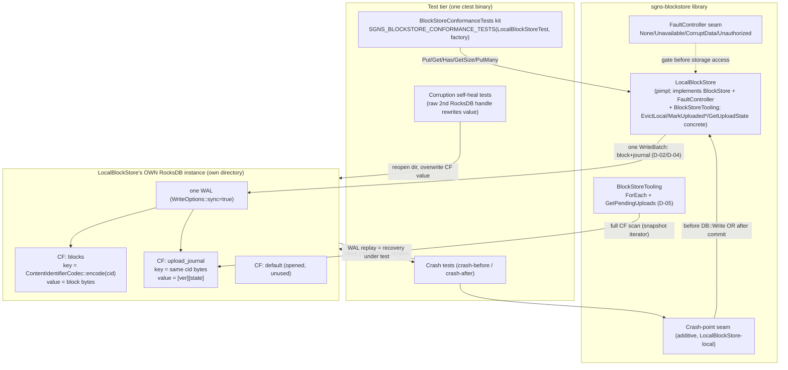

# Phase 2: LocalBlockStore (RocksDB Cold Tier) - Research

**Researched:** 2026-10-20
**Domain:** C++17 RocksDB-backed durable backend for the frozen Phase-1 BlockStore contract (`thirdparty/sgns-blockstore`)
**Confidence:** HIGH (every RocksDB API claim verified against the pinned in-tree 9.4.0 headers; every build claim verified against `CommonTargets.cmake`/`CommonCompilerOptions.cmake` AND the already-built `thirdparty/build/Windows/Debug` tree; 11.x-side claims are the only [ASSUMED] items)

## Summary

Phase 2 implements `LocalBlockStore` — the durable local tier — over the pinned RocksDB 9.4.0 already built in this workspace's thirdparty superbuild. The full API surface the implementation needs is present and stable in the in-tree headers: the column-family-vector `DB::Open`, `WriteBatch::Put/Delete(ColumnFamilyHandle*, …)` composed into one atomic `DB::Write`, `Get` with a CF handle, `NewIterator` over a CF, `DB::Close`, `DestroyColumnFamilyHandle`, and `WriteOptions::sync`. D-02's write atomicity (block bytes + journal record in one WriteBatch) is guaranteed by RocksDB's own contract — "WriteBatch holds a collection of updates to apply atomically to a DB" — and the crash-window model (before-commit ⇒ nothing exists; after-commit ⇒ block + `PendingUpload` both exist; no intermediate state) follows from that single atomicity point plus WAL recovery on reopen.

The crash-simulation mechanics (D-07, in-process, no subprocess kills) resolve cleanly and are the most important findings for the planner. Three verified header facts pin the design: (1) `DB::Close()` "will not fsync the WAL files", so committed-but-unflushed data survives close only via WAL replay — exactly the recovery path a real crash exercises; (2) `WriteOptions::sync` docs state "if it is just the process that crashes…, no writes will be lost even if sync==false" — meaning in-process reopen tests prove WAL *replay semantics* (the meaningful in-process assertion), while `sync=true` in production code carries the actual fsync durability claim; (3) setting `DBOptions::avoid_flush_during_shutdown = true` makes close-then-reopen deterministically replay the WAL instead of flushing memtables at close, removing an ambiguity in the 9.4 header text about WAL-enabled flush-on-close. A second subtle interaction the planner must encode: the conformance kit's `CorruptData` fault must corrupt a *copy* of the returned bytes (never the stored bytes, never trigger self-heal eviction) because the kit asserts non-sticky behavior after the fault clears, while genuine on-disk corruption (stored bytes fail verification, no fault set) triggers D-09's evict-and-surface self-heal.

Build integration is low-risk and fully precedented: the Debug tree already contains `rocksdb.lib`, `RocksDBConfig.cmake` (`PACKAGE_VERSION "9.4.0"`, target `RocksDB::rocksdb`), and the Snappy config. The two mandatory wiring facts: `RocksDBConfig.cmake` runs `find_dependency(Snappy CONFIG)` when built `WITH_SNAPPY=ON` (this superbuild does), so the sgns-blockstore `ExternalProject_Add` entry needs `-DSnappy_DIR` **in addition to** `-DRocksDB_DIR` — exactly the precedent the ipfs-lite-cpp entry already sets; and RocksDB's config version file is `COMPATIBILITY SameMajorVersion`, so sgns-blockstore's `find_package(RocksDB CONFIG REQUIRED)` must specify **no version** or a genius-tube 11.1.2 install will fail to match a `9.4` request. MSVC CRT is consistent by construction: the superbuild forces `MultiThreaded` (static /MT) on every sub-build and RocksDB is built `WITH_MD_LIBRARY:BOOL=OFF` (also static CRT) — no mismatch.

**Primary recommendation:** Pimpl `LocalBlockStore` (zero RocksDB types in the published header), two column families (`blocks`, `upload_journal`) beside the default CF opened with `create_if_missing = true` + `create_missing_column_families = true`, one sync WriteBatch per mutation, `avoid_flush_during_shutdown = true` for deterministic crash-faithful close/reopen, crash points as an additive LocalBlockStore-local test seam (do NOT touch the frozen `FaultKind` enum), and journal records encoded `[version-byte][state-byte]` under `ContentIdentifierCodec::encode(cid)` keys.

<user_constraints>
## User Constraints (from CONTEXT.md)

### Locked Decisions (D-01..D-10 — LOCKED, research does not explore alternatives)

- **D-01:** Block bytes live **inside RocksDB as values** under `cid.toBytes()` keys (byte-compatible with `RocksdbDatastore` — future migration aid) in the store's own instance/directory. No app-level blob files, no second storage substrate
- **D-02:** Write atomicity = **one WriteBatch** committing block bytes + journal record together. An interrupted write leaves NOTHING (Get → `NotFound`, journal has no record). BACK-03's "(temp + fsync + rename)" is satisfied by RocksDB's own WAL commit machinery. Criterion 4's "sweeps stale temp files" is **vacuous by design** (no temp files exist); startup sweep = journal reconciliation only
- **D-03:** Journal is **active from day one**: every `Put` atomically records `state=PendingUpload` in the same WriteBatch as the block. Records persist until explicitly transitioned; nothing auto-drains them in this phase
- **D-04:** Journal lives in a **column family of the same RocksDB instance** (a WriteBatch cannot span databases); one WAL covers block+journal atomicity
- **D-05:** Restart reconciliation surfaces the pending set through **enumeration on the tooling/audit interface** (CORE-06 placement). Synchronous scan at open; NO callback machinery in v1
- **D-06:** State transitions are **concrete methods on `LocalBlockStore`** (e.g. `MarkUploadedAccepted(cid)` / `MarkUploadedDurable(cid)`) plus a state-reading accessor — never on the `BlockStore` interface
- **D-07:** Crash simulation = **in-process reopen through the `FaultController` seam**: tests inject failure points, then close-without-clean-shutdown and reopen — RocksDB WAL recovery does the real work. No subprocess-kill machinery
- **D-08:** Phase-2 crash scope = **minimal proof of the two success criteria**: crash-before-commit → `NotFound`; crash-after-commit → block + pending record both present and reconciled; plus corruption rejection via the conformance kit
- **D-09:** Corrupt-on-read = **evict + surface**: the detecting `Get` returns `Corrupt` for THAT call, and atomically removes the bad entry (block bytes + journal record) so subsequent Gets → `NotFound` and a re-Put repairs. `Get` becomes write-capable only on the corruption path
- **D-10:** `EvictLocal` is **unconditional**: atomically removes block bytes + journal record regardless of journal state; the caller owns eviction policy. Data-loss-when-pending caveat documented in the header

### the agent's Discretion (research recommends; planner finalizes)
- Column-family layout details (blocks CF vs journal CF naming, options)
- Journal record value schema (state encoding, any timestamps/counts)
- RocksDB options/tuning and the shape of any `LocalBlockStoreOptions` beyond the directory path
- RocksDB error → taxonomy mapping specifics (IO/lock/corruption errors → `TemporarilyUnavailable`/`Corrupt` per frozen CORE-02 rules)
- `FaultController` fault-point granularity for LocalBlockStore
- Test-file layout inside the repo's `test/` conventions
- Exact transition-method and accessor names (the D-06 surface, not its placement)

### Deferred Ideas (OUT OF SCOPE — ignored completely)
- Durability-gated eviction policy (refuse `EvictLocal` on non-`UploadedDurable`)
- Subprocess-kill crash tests (Phase 5 may add)
- Startup callback hand-off for pending uploads
- (Reviewed todo not folded: Vulkan capability-probe crash fix — unrelated)
</user_constraints>

<phase_requirements>
## Phase Requirements

| ID | Description | Research Support |
|----|-------------|------------------|
| BACK-03 | `LocalBlockStore` opens its own RocksDB instance (consumer-provided; API-compatible with both RocksDB 9.4 and 11.1), never the GlobalDB handle; writes are atomic (temp + fsync + rename) | Standalone-instance mandate grounded in ARCHITECTURE anti-patterns 1/6; own-directory open recipe verified against `db.h` (`DB::Open` CF-vector overload, `create_if_missing`); "(temp + fsync + rename)" → `WriteBatch` + `WriteOptions::sync=true` + WAL commit mapping (Pitfall 2 section + D-02); dual-compat strategy = stable-API-only surface + no-version `find_package` (SameMajorVersion constraint verified) |
| BACK-04 | `LocalBlockStore` maintains a durable upload journal recording pending remote uploads, recoverable after crash | Journal CF design (D-03/D-04), one-batch atomicity (write_batch.h:9), WAL replay-on-reopen crash model, pending-set enumeration shape, journal record schema recommendation |
</phase_requirements>

## Architectural Responsibility Map

| Capability | Primary Tier | Secondary Tier | Rationale |
|------------|-------------|----------------|-----------|
| Durable block persistence (Put/Get/Has/GetSize) | Library storage tier — `LocalBlockStore` over its own RocksDB instance | — | The backend owns durability; the frozen `BlockStore` interface stays substrate-agnostic |
| Write atomicity + crash safety | Storage engine — RocksDB WAL/WriteBatch machinery | Library wraps it (one batch per mutation, `sync=true`) | RocksDB's documented atomic-batch + WAL-replay contract replaces hand-rolled temp+fsync+rename (D-02) |
| Upload-journal state machine | Library storage tier — journal CF in the same instance | Concrete transition methods on `LocalBlockStore` (D-06) | A WriteBatch cannot span databases, so journal locality is structural (D-04) |
| Pending-set enumeration / audit | Tooling interface — `BlockStoreTooling` (CORE-06) | — | Enumeration never on the data-path interface; synchronous scan, no callbacks (D-05) |
| Crash-simulation orchestration | Test tier — in-process close/reopen through fault seams | — | No subprocess kills on Windows (D-07); RocksDB recovery does the real work |
| Build orchestration (find_package/DEPENDS) | thirdparty superbuild — `CommonTargets.cmake` | `sgns-blockstore/CMakeLists.txt` | Consumer-provided RocksDB via CONFIG package; superbuild wires `RocksDB_DIR`+`Snappy_DIR` (BACK-03 consumer-provided mandate) |
| CID verification / self-heal | Library backend boundary (CORE-04) | — | Verify on every Get; evict+surface on stored-bytes corruption (D-09) |

## Standard Stack

### Core

| Library | Version | Purpose | Why Standard |
|---------|---------|---------|--------------|
| RocksDB (in-tree `thirdparty/rocksdb`) | 9.4.0 — `[VERIFIED: thirdparty/rocksdb/include/rocksdb/version.h` defines `ROCKSDB_MAJOR 9`, `ROCKSDB_MINOR 4`, `ROCKSDB_PATCH 0`; installed config file literally contains `set(PACKAGE_VERSION "9.4.0")`] | Durable local KV: block bytes CF + upload-journal CF, one WAL | Already built in this workspace's Debug superbuild tree; the exact target exists: `add_library(RocksDB::rocksdb STATIC IMPORTED)` `[VERIFIED: thirdparty/build/Windows/Debug/rocksdb/lib/cmake/rocksdb/RocksDBTargets.cmake:59]`; consumer-provided per BACK-03 |
| libp2p `p2p_cid` | current submodule pin (Phase-1 adoption) | `Cid` alias + `CidOf` + `ContentIdentifierCodec::encode` (RocksDB keys) | Frozen Phase-1 decision; encode returns `outcome::result<std::vector<uint8_t>>` `[VERIFIED: thirdparty/libp2p/include/libp2p/multi/content_identifier_codec.hpp:37-38]` |
| GTest | ~1.14 (superbuild) | Conformance kit instantiation + crash tests | Phase-1 `addtest()` pattern; `TESTING` gate (never `BUILD_TESTING`) `[VERIFIED: thirdparty/sgns-blockstore/CMakeLists.txt:15-20]` |
| std::filesystem (C++17) | — | Test temp dirs, DB-directory creation | sgns-blockstore links no Boost today (`src/CMakeLists.txt` links only `p2p::p2p_cid`); do NOT add a Boost dependency for test fixtures |

### Supporting

| Library | Version | Purpose | When to Use |
|---------|---------|---------|-------------|
| Snappy (transitive) | superbuild pin | RocksDB compression — resolved automatically by `RocksDBConfig.cmake`'s `find_dependency(Snappy CONFIG)` `[VERIFIED: thirdparty/rocksdb/cmake/RocksDBConfig.cmake.in:20-24]` | Always — its config dir must be on the sub-build's cache args |
| shlwapi.lib / rpcrt4.lib (Windows SDK) | — | RocksDB Windows system deps | Automatic — already in the imported target's `INTERFACE_LINK_LIBRARIES "\$<LINK_ONLY:Snappy::snappy>;\$<LINK_ONLY:shlwapi.lib>;\$<LINK_ONLY:rpcrt4.lib>"` `[VERIFIED: …/rocksdb/RocksDBTargets.cmake:63]` |

### Alternatives Considered

| Instead of | Could Use | Tradeoff |
|------------|-----------|----------|
| Own RocksDB instance (D-01) | GlobalDB handle / `RocksdbDatastore` | LOCKED OUT — anti-pattern 6 (lifecycle coupling, sync-only ceiling, genius-tube has no GlobalDB) |
| Block bytes as RocksDB values (D-01) | App-level blob files | LOCKED OUT — second substrate defeats single-WAL atomicity |
| Journal in same-instance CF (D-04) | Separate journal DB / separate file | LOCKED OUT — WriteBatch cannot span databases; same-instance CF is the only single-WAL shape |

**Installation:** none — no new submodules, no new external packages. RocksDB 9.4.0 + Snappy are already built at `thirdparty/build/Windows/Debug/rocksdb/` (`rocksdb.lib` + `RocksDBConfig.cmake` + Snappy config all present — verified on disk this session).

**Version verification:** performed on the installed tree, not the registry — this phase installs nothing. `PACKAGE_VERSION "9.4.0"` `[VERIFIED: …/rocksdb/RocksDBConfigVersion.cmake]`; config compatibility is `COMPATIBILITY SameMajorVersion` `[VERIFIED: thirdparty/rocksdb/CMakeLists.txt:1212-1216]` — a same-major-only matcher, which drives the no-version `find_package` rule below.

## Package Legitimacy Audit

> This phase installs **no external packages**. RocksDB and Snappy are pre-existing thirdparty submodules already built by the superbuild; libp2p/GTest are Phase-1 dependencies. The RocksDB 11.1.2 referenced by BACK-03 is *consumer-side* (genius-tube's own build) and is never downloaded or built here.

| Package | Registry | Age | Downloads | Source Repo | Verdict | Disposition |
|---------|----------|-----|-----------|-------------|---------|-------------|
| (none — no new packages) | — | — | — | — | — | N/A |

**Packages removed due to [SLOP] verdict:** none
**Packages flagged as suspicious [SUS]:** none

## Architecture Patterns

### System Architecture Diagram



Primary use case trace: `Put(cid, bytes)` → validate sha-256 CID (throw on non-sha256) → fault gate → `CidOf` verification (Corrupt+Caller on mismatch) → one WriteBatch{blocks.Put(key,bytes); journal.Put(key,PendingUpload)} → `DB::Write` (sync=true) → `PutOutcome{LocalCommitted, alreadyPresent}`. Crash before `DB::Write` ⇒ reopen sees NOTHING; crash (close) after commit ⇒ reopen replays WAL ⇒ block + PendingUpload both present — there is no intermediate state; that absence IS success criterion 3.

### Recommended Project Structure

```
thirdparty/sgns-blockstore/
├── include/sgns-blockstore/
│   ├── LocalBlockStore.hpp          # NEW - pimpl; NO rocksdb types in header
│   └── BlockStoreTooling.hpp        # EDITED - additive GetPendingUploads (D-05)
├── src/
│   ├── LocalBlockStore.cpp          # NEW - all rocksdb::* usage lives here
│   └── CMakeLists.txt               # + LocalBlockStore.cpp; link RocksDB::rocksdb
├── test/
│   ├── local_block_store_test.cpp   # NEW - behavior suite + kit instantiation
│   ├── local_block_store_crash_test.cpp # NEW - crash-before/after, self-heal
│   └── CMakeLists.txt               # + targets (tests MAY link RocksDB::rocksdb)
└── CMakeLists.txt                   # + find_package(RocksDB CONFIG REQUIRED) — NO version
thirdparty/build/CommonTargets.cmake # sgns-blockstore entry: + DEPENDS rocksdb,
                                     #   -DRocksDB_DIR, -DSnappy_DIR
```

### Pattern 1: Pimpl backend — zero RocksDB types in the published header

**What:** `LocalBlockStore.hpp` declares `class LocalBlockStore final : public BlockStore, public FaultController, public BlockStoreTooling` with a `std::unique_ptr<Impl> impl_;` member; `Impl` is forward-declared and defined only in `LocalBlockStore.cpp`. All `rocksdb/db.h`, `rocksdb/options.h`, `rocksdb/write_batch.h` includes stay in the `.cpp`.

**When to use:** always for this backend. The header-hygiene ctest bans only `ipfs_lite/ipfs/`, `SuperGenius/`, `GeniusSDK/`, `GeniusWallet/`, `minio` include shapes `[VERIFIED: thirdparty/sgns-blockstore/test/header_hygiene_check.cmake:22-27]` — rocksdb includes would *pass* the check — but CORE-01's spirit ("installed headers carry only CID/bytes/strings") and the dual-compat mandate (no RocksDB symbols at header level ⇒ 9.4↔11.1 differences can never break a consumer's compile) make pimpl strictly better. The out-of-line destructor (`~LocalBlockStore() override;` declared, defined in .cpp) is required for the incomplete-type unique_ptr.

**Why:** `api_hygiene_test.cpp` includes every public header linking "exactly sgns-blockstore + p2p::p2p_cid" — keep that proof pure.

### Pattern 2: Dual-inheritance for free fault conformance (Phase-1 D-10, unchanged)

**What:** publicly inherit `FaultController` so `std::dynamic_pointer_cast<FaultController>(store)` from the kit's separately-compiled TU succeeds — mirror `MemoryBlockStore`'s dual base exactly `[VERIFIED: include/sgns-blockstore/MemoryBlockStore.hpp:24-26]`. Gate order per operation: `ValidateCidHash` (throw `std::invalid_argument` for non-sha256) → `FaultGate` (Unavailable/Unauthorized → failure BEFORE touching RocksDB) → real op — the exact order `MemoryBlockStore.cpp` established.

### Pattern 3: One-mutation-one-batch with teardown discipline

**What:** every mutation = exactly one `rocksdb::WriteBatch` committed via `db_->Write(wo_, &batch)`; teardown = `DestroyColumnFamilyHandle(blocks)` → `DestroyColumnFamilyHandle(journal)` → `Close()` → `delete db` (never destroy the `DefaultColumnFamily()` handle — "Use this method to destroy column family handles (except for DefaultColumnFamily()!) before closing a DB" `[VERIFIED: thirdparty/rocksdb/include/rocksdb/db.h:447-451]`). The in-repo precedent wraps exactly this in a shared_ptr deleter (`ptr->Close(); delete ptr;` `[VERIFIED: SuperGenius/src/storage/rocksdb/rocksdb.cpp:60-69]`).

### Pattern 4: Factory + explicit Close for a fallible constructor

**What:** construction can fail (IO, lock held, corruption), so per the repo convention ("Factory methods return `outcome::result<std::shared_ptr<T>>`" — AGENTS.md Function Design): `static result<std::unique_ptr<LocalBlockStore>, BlockStatus> Open(const LocalBlockStoreOptions&)` plus explicit `result<void, BlockStatus> Close()` and idempotent destructor. Programmer-error arguments (empty path) throw `std::invalid_argument` at entry — consistent with the Phase-1 `ValidateCidHash` throw-for-programmer-error precedent; environment failures return mapped `BlockStatus` failures.

### Anti-Patterns to Avoid

- **GlobalDB handle reuse** — LOCKED OUT by D-01/ARCHITECTURE anti-pattern 6. Own directory, own instance, always.
- **Two-phase write (block now, journal later)** — violates D-02/D-03; creates exactly the local-commit/remote-upload gap PITFALLS #4 warns about. Journal is written in the SAME batch from the first Put.
- **Hand-rolled temp-file+rename around RocksDB** — RocksDB's WAL IS the atomic-commit machinery; wrapping it duplicates the guarantee and reintroduces torn-write windows.
- **Self-heal eviction on fault-induced corruption** — breaks the kit's `FaultCorruptDataRejectedCorruptWithBackendSource` + `FaultClearsNoStickyNegativeCache` (verified below, Pitfall 3).
- **`find_package(RocksDB 9.4 ...)`** — SameMajorVersion compatibility rejects an 11.1.2 install against a 9.x request. Never pass a version.
- **Newer RocksDB APIs** — `PutEntity`, `TimedPut`, user-defined-timestamp overloads, `WriteWithCallback`: skip all; not needed, narrower cross-version availability.

## Don't Hand-Roll

| Problem | Don't Build | Use Instead | Why |
|---------|-------------|-------------|-----|
| Atomic multi-key commit | Custom temp+fsync+rename | One `WriteBatch` → `DB::Write` | "WriteBatch holds a collection of updates to apply atomically to a DB" `[VERIFIED: write_batch.h:9]` — atomic across CFs of one DB; the exact D-02 mechanism |
| Crash recovery | Own replay/sweep logic | RocksDB WAL replay on `Open` | Recovery is RocksDB's; tests just close-without-flush and reopen |
| Byte-lexicographic ordering in enumeration | Sorting code | Default `BytewiseComparator` iteration order | RocksDB iterators yield keys in byte-lexicographic order over `ContentIdentifierCodec::encode(cid)` keys — satisfying `BlockStoreTooling`'s frozen ordering contract verbatim: "iteration proceeds in lexicographic order over the ENCODED CID bytes … over a SNAPSHOT of the store taken at iteration start" `[VERIFIED: include/sgns-blockstore/BlockStoreTooling.hpp:49-53]`; a CF iterator is implicitly snapshot-consistent |
| Error taxonomy mapping | String matching on `Status::ToString()` | `Status::code()`/`subcode()` switch | Enum values verified below; SuperGenius precedent `error_from_rocksdb` switches on `rocksdb::Status::Code` `[VERIFIED: SuperGenius/src/storage/database_error.cpp:52-96]` |
| CID bytes for keys | Re-encoding, `toHexString`, etc. | `ContentIdentifierCodec::encode(cid)` | One codec, byte-compatible with `RocksdbDatastore`'s `cid.toBytes()` keys (D-01 migration anchor) |

**Key insight:** everything durability-critical in this phase is already implemented inside RocksDB; the backend's job is *composition* (one batch per mutation, sync on, correct teardown order) plus *mapping* (Status → BlockStatus) plus *verification* (CID on read).

## Common Pitfalls

### Pitfall 1: Misreading what in-process crash tests prove (sync vs WAL replay)

**What goes wrong:** Tests claim "durability" but only prove replay; or production code skips `sync=true` because "tests pass without it."
**Why it happens:** The `WriteOptions::sync` doc: "if it is just the process that crashes (i.e., the machine does not reboot), no writes will be lost even if sync==false" `[VERIFIED: thirdparty/rocksdb/include/rocksdb/options.h:1885-1901 — verbatim: "bool sync = false;" default and the process-crash caveat]`. In-process close/reopen never evicts the OS page cache, so sync=false writes survive the simulated crash anyway.
**How to avoid:** Ship `sync = true` in production writes (it is the fsync half of BACK-03's "temp + fsync + rename" mapping); word crash-test assertions as WAL-recovery/replay-atomicity proofs (what reopen must show), not fsync proofs. Phase 5's subprocess-kill matrix is where OS-level durability gets exercised (deferred, per D-08).
**Warning signs:** a RESEARCH/PLAN claiming in-process tests prove fsync durability; `WriteOptions` left default (sync=false) in the Put path.

### Pitfall 2: Flush-on-close ambiguity — set `avoid_flush_during_shutdown` explicitly

**What goes wrong:** close-then-reopen tests silently take the *flush-on-close* path (memtable flushed to SST at close), so reopen replays nothing — the tests pass while never exercising WAL recovery.
**Why it happens:** `DB::Close()` "will not fsync the WAL files" `[VERIFIED: db.h:370-387 — verbatim: "This will not fsync the WAL files. If syncing is required, the caller must first call SyncWAL(), or Write() using an empty write batch with WriteOptions.sync=true."]`, but the header text for `avoid_flush_during_shutdown` (default `false` `[VERIFIED: options.h:1314 — verbatim: "bool avoid_flush_during_shutdown = false;"`] with doc "By default RocksDB will flush all memtables on DB close if there are unpersisted data (i.e. with WAL disabled)" `[VERIFIED: options.h:1308-1314]`) is ambiguous about the WAL-enabled case.
**How to avoid:** set `avoid_flush_during_shutdown = true` in `LocalBlockStoreOptions` defaults (dynamically changeable via SetDBOptions per the header). Then close NEVER flushes; reopen ALWAYS replays unflushed WAL tail — deterministic, crash-faithful, and the same code path a real crash takes. Combined with sync=true writes: crash-after-commit data is in the (synced) WAL, reopen replays it.
**Warning signs:** crash-after-commit test passing even when WAL replay is demonstrably skipped; tests that call `Flush()` anywhere.

### Pitfall 3: FaultController `CorruptData` vs D-09 self-heal — two different corruption sources

**What goes wrong:** implementing CorruptData by corrupting stored bytes, or triggering evict-and-surface on fault-induced corruption, fails the kit: `FaultCorruptDataRejectedCorruptWithBackendSource` requires the fault to clear and `ASSERT_TRUE(store_->Get(cid_a_)); /* non-sticky */` to pass — impossible if the block was evicted `[VERIFIED: test/conformance/BlockStoreConformanceTests.hpp — FaultCorruptData… and FaultClearsNoStickyNegativeCache cases]`.
**Why it happens:** two distinct sources map to one symptom. (a) *Fault-induced*: stored bytes are fine; the fault must flip a byte on the **returned copy** (exactly `MemoryBlockStore::Get`'s mechanic: "bytes[0] = static_cast<uint8_t>(~bytes[0]); // documented seam mechanic" `[VERIFIED: src/MemoryBlockStore.cpp:~117-121]`) — return Corrupt with `BlockSource::Local`, NO eviction. (b) *Real on-disk corruption*: pristine stored bytes fail `CidOf` verification with `fault_ != CorruptData` → D-09 evict+surface: return Corrupt+Local for THIS call AND commit a removal WriteBatch{block+journal} so later Gets → NotFound and a re-Put repairs.
**How to avoid:** gate the self-heal eviction on `fault_ != FaultKind::CorruptData`. Test (b) by reopening the directory with a *second raw rocksdb::DB handle inside the test binary* (tests may link `RocksDB::rocksdb`), overwriting the value under the published CF name constant, closing, then reopening `LocalBlockStore` — Get must yield Corrupt once, then NotFound, then a re-Put repairs.
**Warning signs:** `Evict` calls on the fault path; corruption tests that only use `SetFault(CorruptData)`.

### Pitfall 4: Conformance factory runs PER CASE — fresh unique dir per invocation

**What goes wrong:** one shared DB dir across kit cases → LOCK contention (`DB::Open` fails "if the DB is already open (read-write) by another DB object" `[VERIFIED: db.h:185-190]`) and cross-case state leakage (a block Put by case N appears in case N+1).
**Why it happens:** the kit's contract: "The factory is invoked PER CASE so every TEST_F sees a fresh store (hermetic fault cases)" `[VERIFIED: BlockStoreConformanceTests.hpp:9-11]`.
**How to avoid:** the test helper creates a NEW unique directory per factory call (monotonic counter; keep the path SHORT — Windows long-path risk; a relative dir under the test binary's build dir keeps it shortest). Handle `Open` failure in the helper with `ADD_FAILURE()` + nullptr rather than `.value()` (the `policy::terminate` alias terminates the whole binary on an unchecked failed `.value()`). Crash tests hold the *concrete* `std::shared_ptr<LocalBlockStore>` (they need concrete APIs), so their lifecycle is fixture-controlled.
**Warning signs:** a factory lambda with no per-call uniqueness; test dirs under deep `%TEMP%` hierarchies.

### Pitfall 5: `find_package(RocksDB)` transitive + version landmines

**What goes wrong:** (a) configure fails with "Snappy not found" — `RocksDBConfig.cmake` runs `find_dependency(Snappy CONFIG)` when built `WITH_SNAPPY` (this build: `-DWITH_SNAPPY:BOOL=ON` `[VERIFIED: CommonTargets.cmake:~163]`); (b) genius-tube's 11.1.2 install rejects the package — version file is `COMPATIBILITY SameMajorVersion` `[VERIFIED: thirdparty/rocksdb/CMakeLists.txt:1212-1216]`.
**How to avoid:** in `sgns-blockstore/CMakeLists.txt`: `find_package(RocksDB CONFIG REQUIRED)` — **no version argument**; link `RocksDB::rocksdb`. In the `CommonTargets.cmake` sgns-blockstore entry add BOTH `-DRocksDB_DIR:PATH=${_FINDPACKAGE_ROCKSDB_DIR}` AND `-DSnappy_DIR:PATH=${_FINDPACKAGE_SNAPPY_DIR}` — the exact precedent ipfs-lite-cpp sets (both vars adjacent) `[VERIFIED: CommonTargets.cmake:513-514]` — plus `DEPENDS libp2p rocksdb` (rocksdb itself `DEPENDS snappy`). Optionally add `find_dependency(RocksDB CONFIG)` to `cmake/config.cmake.in` (currently includes only the targets file `[VERIFIED: thirdparty/sgns-blockstore/cmake/config.cmake.in]`) so downstream `find_package(sgns-blockstore)` resolves the imported target.
**Warning signs:** passing `9.4` to find_package; adding RocksDB_DIR without Snappy_DIR.

### Pitfall 6: `alreadyPresent` semantics + journal-state regression on re-Put

**What goes wrong:** (a) `Put` always returns `alreadyPresent=false` (RocksDB Put overwrites silently) — fails `RePutIdenticalBytesIsAlreadyPresent` (kit asserts `alreadyPresent == true` and original bytes survive); (b) re-Put overwrites a journal record at `UploadedDurable` back to `PendingUpload` — a pointless-state regression that would trigger redundant re-uploads in Phase 4.
**Why it happens:** RocksDB has no read-modify-write; the batch can't read.
**How to avoid:** read-before-write on the blocks CF (`db_->Get(ro_, blocks_, key, &existing)`) to compute `alreadyPresent`; write journal `PendingUpload` only when NOT already present — content-addressing makes re-Put bytes necessarily identical (CID verification proved it), so the prior journal state remains valid. Single-threaded v1 contract (same as MemoryBlockStore) means no read/write race.
**Warning signs:** unconditional journal reset on every Put.

### Pitfall 7: Teardown order and reopen (LOCK release)

**What goes wrong:** reopen fails with an IO/lock error, or handles leak.
**Why it happens:** CF handles must be destroyed *before* the DB closes — "Before delete DB, you have to close All column families by calling DestroyColumnFamilyHandle() with all the handles" `[VERIFIED: db.h:199-201]` — but NOT the default handle. `Close()` returns a status yet "Regardless of the return status, the DB must be freed" `[VERIFIED: db.h:379-380]`.
**How to avoid:** destructor/`Close()`: destroy blocks+journal handles → `Close()` (ignore-but-log status) → `delete db`. Same-process reopen of the same dir then succeeds (LOCK released). Every crash test's "close" step is exactly this sequence — it IS the simulated crash because of Pitfall 2's no-flush guarantee.
**Warning signs:** `delete db` with live handles; leaking the DB to "simulate crash" (unnecessary and leaves the LOCK held, breaking the reopen).

### Pitfall 8: MSVC link surface — already consistent, keep it that way

**What:** the superbuild forces static CRT on everything: `-DCMAKE_MSVC_RUNTIME_LIBRARY:STRING=MultiThreaded$<$<CONFIG:Debug>:Debug>` `[VERIFIED: thirdparty/build/CommonCompilerOptions.cmake:69-72]` and RocksDB is built `-DWITH_MD_LIBRARY:BOOL=OFF` `[VERIFIED: CommonTargets.cmake rocksdb entry ~:165]` (also static CRT) — consistent /MT across sgns-blockstore, its tests, and librocksdb. Windows system libs ride the imported target automatically (`shlwapi.lib`, `rpcrt4.lib` `[VERIFIED: RocksDBTargets.cmake:63]`).
**How to avoid:** do nothing CRT-specific in sgns-blockstore's CMake (inherit the superbuild args); never set `/MD` locally. A consumer like genius-tube owns its own CRT consistency — out of scope.

## Code Examples

All examples verified against the pinned 9.4.0 headers this session. Note the library-local envelope: every new header uses `result<R, BlockStatus>` from `Cid.hpp` (the `policy::terminate` alias) — never bare `outcome::result<..., BlockStatus>` (Phase-1 landmine, re-verified in `Cid.hpp:22-34`).

### Open with column families (create-if-missing both directions)

```cpp
// Source: thirdparty/rocksdb/include/rocksdb/db.h:202-207 (CF-vector Open),
//         options.h:563-568 (create flags in DBOptions), db.h:70-79 (descriptor)
rocksdb::DBOptions db_options;
db_options.create_if_missing = true;              // fresh dir -> create DB
db_options.create_if_missing_column_families = true; // missing CF -> create
db_options.avoid_flush_during_shutdown = true;    // deterministic WAL replay on reopen
db_options.info_log_level = rocksdb::InfoLogLevel::ERROR_LEVEL; // SuperGenius precedent

std::vector<rocksdb::ColumnFamilyDescriptor> cf_descs = {
    {rocksdb::kDefaultColumnFamilyName, rocksdb::ColumnFamilyOptions()}, // must be opened too
    {kBlocksColumnFamilyName,        rocksdb::ColumnFamilyOptions()},     // "blocks"
    {kJournalColumnFamilyName,       rocksdb::ColumnFamilyOptions()},     // "upload_journal"
};
std::vector<rocksdb::ColumnFamilyHandle*> handles;
rocksdb::DB* db = nullptr;
rocksdb::Status s = rocksdb::DB::Open(db_options, path, cf_descs, &handles, &db);
// handles[i] corresponds to cf_descs[i]; "You need to open ALL column families"
// [VERIFIED: db.h:193-196]
```

### The atomic Put batch (D-02/D-03/D-04)

```cpp
// Source: write_batch.h:9 (atomic), :82-87 Put(CFHandle*,...), :128 Delete(CFHandle*,...),
//         db.h:587 (Write), options.h:1885-1901 (WriteOptions)
rocksdb::WriteOptions wo;   // member wo_.sync = true set once at Open
wo.sync = true;             // THE fsync half of "temp + fsync + rename"

const auto key = libp2p::multi::ContentIdentifierCodec::encode(cid).value();
// [VERIFIED: content_identifier_codec.hpp:37-38 -> outcome::result<std::vector<uint8_t>>]

rocksdb::WriteBatch batch;
batch.Put(blocks_, rocksdb::Slice(key.data(), key.size()),
          rocksdb::Slice(reinterpret_cast<const char*>(bytes.data()), bytes.size()));
if (!already_present) {  // Pitfall 6: no journal-state regression on re-Put
    batch.Put(journal_, rocksdb::Slice(key.data(), key.size()),
              rocksdb::Slice(JournalRecord{UploadState::PendingUpload}.Encode()));
}
auto s = db_->Write(wo, &batch);   // ONE atomic commit: block + journal or NEITHER
```

### Teardown (crash-simulation close + normal destruction)

```cpp
// Source: db.h:370-387 (Close), :447-451 (DestroyColumnFamilyHandle),
//         SuperGenius/src/storage/rocksdb/rocksdb.cpp:60-69 (deleter precedent)
result<void, BlockStatus> LocalBlockStore::Close()
{
    if (db_ == nullptr) { return outcome::success(); }  // idempotent
    db_->DestroyColumnFamilyHandle(blocks_);   // NEVER the DefaultColumnFamily() handle
    db_->DestroyColumnFamilyHandle(journal_);
    auto s = db_->Close();                     // "will not fsync the WAL files" - by design
    delete db_;                                // "Regardless of the return status, the DB must be freed"
    db_ = nullptr; blocks_ = journal_ = nullptr;
    return MapStatus(s);                       // log-only on close errors is acceptable
}
```

### Pending-set enumeration (D-05) — snapshot scan, contract-natural order

```cpp
// Source: db.h:999-1002 (NewIterator with CF), BlockStoreTooling.hpp:49-53 (ordering
// contract: lexicographic over ENCODED CID bytes, snapshot at start - both satisfied
// by a plain CF iterator with the default BytewiseComparator)
result<std::vector<Cid>, BlockStatus> LocalBlockStore::GetPendingUploads()
{
    std::vector<Cid> out;
    std::unique_ptr<rocksdb::Iterator> it(db_->NewIterator(ro_, journal_));
    for (it->SeekToFirst(); it->Valid(); it->Next())
    {
        const auto rec = JournalRecord::Decode(it->value());
        if (rec && rec->state == UploadState::PendingUpload)
        {
            if (auto cid = libp2p::multi::ContentIdentifierCodec::fromBytes(
                    gsl::span<const uint8_t>(
                        reinterpret_cast<const uint8_t*>(it->key().data()),
                        it->key().size())))
            {
                out.push_back(std::move(cid.value()));
            }
            // undecodable key: skip + count (audit surface, never crash the scan)
        }
    }
    if (!it->status().ok()) { return MapStatus(it->status()); }
    return out;
}
```

### Status → BlockStatus mapping (single place)

```cpp
// Source: status.h:76-97 (Code enum verbatim: kOk=0, kNotFound=1, kCorruption=2,
//   kNotSupported=3, kInvalidArgument=4, kIOError=5, ..., kTimedOut=9, kAborted=10,
//   kBusy=11, kExpired=12, kTryAgain=13, kCompactionTooLarge=14, kColumnFamilyDropped=15),
//   status.h:100-119 (SubCode incl. kNoSpace=4, kPathNotFound=9),
//   SuperGenius precedent: src/storage/database_error.cpp:52-96
BlockStatus MapStatus(const rocksdb::Status& s, std::string context)
{
    using SC = StatusClass;
    if (s.IsNotFound()) { return {SC::NotFound, BlockSource::Local, context}; }
    if (s.IsCorruption()) { return {SC::Corrupt, BlockSource::Local, context + ": " + s.ToString(); } }
    // kIOError (incl. kNoSpace/kPathNotFound/kIOFenced), kBusy/kTimedOut/kTryAgain/
    // kIncomplete/kShutdownInProgress/kCompactionTooLarge/kAborted/kColumnFamilyDropped:
    return {SC::TemporarilyUnavailable, BlockSource::Local, context + ": " + s.ToString()};
    // Unauthorized has no RocksDB source in this backend; only the FaultController induces it.
}
```

### Crash test skeleton (D-07/D-08 — the two criteria)

```cpp
// CrashPoint seam (LocalBlockStore-local, additive - FaultKind stays frozen):
// enum class CrashPoint { None, BeforeCommit, AfterCommit };
TEST(LocalBlockStoreCrashTest, CrashBeforeCommitLeavesNothing)
{
    auto dir = NextUniqueDir();
    {
        auto store = LocalBlockStore::Open(OptionsAt(dir)).value();
        store->SetCrashPointForTesting(CrashPoint::BeforeCommit);
        auto r = store->Put(cid_a, SpanOf(payload_a));
        ASSERT_FALSE(r);   // the "process died" before DB::Write - caller never saw success
        store->SetCrashPointForTesting(CrashPoint::None);
    }  // destruction: handles destroyed -> Close() -> delete db; NO flush (options), NO SyncWAL
    auto reopened = LocalBlockStore::Open(OptionsAt(dir)).value();  // WAL replay runs
    auto got = reopened->Get(cid_a);
    ASSERT_FALSE(got);
    EXPECT_EQ(got.error().code, StatusClass::NotFound);   // criterion 3: never torn
    auto pending = reopened->GetPendingUploads().value(); // journal reconciled: EMPTY
    EXPECT_TRUE(pending.empty());
}

TEST(LocalBlockStoreCrashTest, CrashAfterCommitRecoversBlockAndPending)
{
    auto dir = NextUniqueDir();
    {
        auto store = LocalBlockStore::Open(OptionsAt(dir)).value();
        ASSERT_TRUE(store->Put(cid_a, SpanOf(payload_a)));  // sync=true -> WAL durable
    }  // close without flush: committed batch exists ONLY in the WAL
    auto reopened = LocalBlockStore::Open(OptionsAt(dir)).value();  // replay recovers BOTH
    auto got = reopened->Get(cid_a);                             // CID-verified byte-identical
    ASSERT_TRUE(got);
    EXPECT_EQ(got.value().bytes, BytesOf(payload_a));
    auto pending = reopened->GetPendingUploads().value();        // criterion 4: reconciled
    ASSERT_EQ(pending.size(), 1u);
    EXPECT_TRUE(pending[0] == cid_a);
}
```

Semantics of the seam: `BeforeCommit` → Put returns a `TemporarilyUnavailable` failure WITHOUT calling `DB::Write` (models death before commit — "the caller never saw success"); `AfterCommit` is implicit (any normal committed Put + immediate close = crash-after-commit). A true in-process "kill" mid-`DB::Write` is impossible — and never needed: `DB::Write` is the atomicity boundary, so there is no mid-Write observable state (see State of the Art note). Torn-WAL-tail injection (appending garbage to WAL files) is Phase 5 territory.

### Kit instantiation factory

```cpp
// Source: BlockStoreConformanceTests.hpp:78-91 (macro; "invoked per case"),
//         memory_block_store_test.cpp:381-386 (two suites coexist in one binary precedent)
std::shared_ptr<sgns::blockstore::BlockStore> MakeFreshLocalStore()
{
    static std::atomic<uint64_t> next{0};
    const auto dir = "test-data/local-blockstore/case-" + std::to_string(next++);
    auto r = sgns::blockstore::LocalBlockStore::Open(LocalBlockStoreOptions{dir});
    if (!r) { ADD_FAILURE() << "LocalBlockStore::Open failed: " << r.error().message; return nullptr; }
    return r.value();  // shared_ptr<LocalBlockStore> -> shared_ptr<BlockStore>
}
SGNS_BLOCKSTORE_CONFORMANCE_TESTS(LocalBlockStoreTest, MakeFreshLocalStore())
```

## State of the Art

### RocksDB 9.4 (in-tree, compile target) vs 11.1.2 (consumer-side) — the used surface

| API used by this phase | 9.4.0 in-tree | Stability assessment |
|------------------------|---------------|----------------------|
| `DB::Open(DBOptions&, name, vector<ColumnFamilyDescriptor>&, vector<ColumnFamilyHandle*>*, DB**)` | `[VERIFIED: db.h:202-207]` | Ancient (pre-5.x), signature stable for a decade `[ASSUMED]` unchanged in 10.x/11.x |
| `WriteBatch::Put/Delete(ColumnFamilyHandle*, …)` | `[VERIFIED: write_batch.h:82-87, :128]` | Same — oldest CF API in the codebase |
| `DB::Write(WriteOptions&, WriteBatch*)` | `[VERIFIED: db.h:587 — pure virtual]` | Stable |
| `DB::Get(ReadOptions&, ColumnFamilyHandle*, key, std::string*)` | `[VERIFIED: db.h:656-660 — final inline overload]` | Stable (PinnableSlice/string variants both present in 9.4) |
| `DB::NewIterator(ReadOptions&, ColumnFamilyHandle*)` | `[VERIFIED: db.h:999-1002]` | Stable |
| `DB::Close()` | `[VERIFIED: db.h:370-387]` | Added ~6.x; stable `[ASSUMED]` in 11.x |
| `DestroyColumnFamilyHandle` / `DropColumnFamily` | `[VERIFIED: db.h:447-451, :436-437]` | Stable |
| `SyncWAL()` | `[VERIFIED: db.h:1689]` | Stable (not needed given sync=true) |
| `WriteOptions::sync` / `disableWAL` | `[VERIFIED: options.h:1902, :1910 — both default false]` | Stable |
| `DBOptions::create_if_missing` / `create_missing_column_families` / `avoid_flush_during_shutdown` / `wal_recovery_mode` (default `kPointInTimeRecovery` `[VERIFIED: options.h:1266]`) | `[VERIFIED: options.h:563-568, :1314, :1266]` | Stable |
| `Status::code()/subcode()/ToString()` | `[VERIFIED: status.h:76-121, :489]` | Enum append-only over time (`kMaxCode`/`kMaxSubCode` bound iteration; never enumerate — switch on named constants only, like the SuperGenius precedent) |
| `ReadOptions::iterate_lower_bound/upper_bound` | `[VERIFIED: options.h:1765, :1785]` | Available; NOT needed (full-CF scans) |
| CMake: `find_package(RocksDB CONFIG)` + `RocksDB::rocksdb` | `[VERIFIED: installed RocksDBTargets.cmake:59]` | Namespace stable since 6.x `[ASSUMED]` for 11.x |

**Deliberately NOT used (dual-compat risk surface):** `TransactionLogIterator`/`GetUpdatesSince` (exists un-deprecated in 9.4 `[VERIFIED: transaction_log.h:92]` but unneeded — journal enumeration reads current CF state, not WAL history); `PutEntity`/wide columns `[VERIFIED present: write_batch.h:114]`; `TimedPut` `[VERIFIED present: write_batch.h:108]`; user-defined-timestamp overloads; `WriteWithCallback`; multi-batch `Write` overloads. Nothing in this phase's surface post-dates ~6.x — the narrowest stable slice available.

**Why there is no mid-Write test point (clarification for the planner):** a `WriteBatch` is serialized as a single framed WAL record; recovery applies complete records and stops at an incomplete tail (`kPointInTimeRecovery` default). An interrupted `DB::Write` therefore leaves either the whole batch or none of it — the "torn block" state cannot be produced by any in-process injection point around `DB::Write`, only by mangling WAL files (Phase 5). The two D-08 points (before/after `DB::Write`) are complete.

## Assumptions Log

| # | Claim | Section | Risk if Wrong |
|---|-------|---------|---------------|
| A1 | The verified 9.4 API surface above is unchanged in RocksDB 10.x/11.1.2 (genius-tube's pin) | State of the Art | Compile failure in genius-tube's build only; mitigation = surface is the oldest, most conservative RocksDB API set; no 11.x headers exist in this workspace to verify against |
| A2 | Reopening a DB directory in the SAME process after handles-destroyed→Close()→delete releases the Windows LOCK file (RocksDB uses per-handle file locking; the cross-instance guarantee itself is header-verified, the Windows release timing is not) | Pitfall 7 / crash tests | Crash tests fail on reopen with lock errors; mitigation = teardown order is the documented sequence; if flaky, destroy fully before reopen and keep unique-per-case dirs (Pitfall 4) |
| A3 | Windows long-path (MAX_PATH) issues for test DB dirs are avoided by short relative paths under the sgns-blockstore build tree | Pitfall 4 | Deep build-tree nesting could still bite; mitigation = relative two-level path, no %TEMP% nesting |
| A4 | `DB::Open` with `create_if_missing=true` creates missing parent directories itself | Open recipe | Low — `LocalBlockStore::Open` should `std::filesystem::create_directories` explicitly first (recommended regardless) |
| A5 | RocksDB's default WAL recovery replays committed batches into memtables on reopen such that both CFs of one batch appear atomically (single-record WAL framing); the atomicity contract itself is header-verified (`write_batch.h:9`), the framing mechanism is training knowledge | Crash model | Core crash-after-commit test would fail immediately — cheap to discover in Wave 0 of the crash test |
| A6 | Journal value schema `[version-byte][state-byte]` with unknown-state records conservatively treated as `PendingUpload` (idempotent re-upload is safe; undecodable never silently dropped from the pending set) is the right fail-safe direction | Journal schema | Wrong direction would either lose pending uploads (treat-as-acked) or wedge uploads (treat-as-corrupt); planner may flip with Phase-4 input |

## Open Questions (RESOLVED)

All three questions were closed during Phase-2 planning — every recommendation below was adopted and is pinned in the phase plans; the inline **RESOLVED — ADOPTED** markers name the adopting plan.

1. **Should `GetPendingUploads()` be a pure virtual on `BlockStoreTooling` or carry a default "not supported" body?**
   - What we know: D-05 mandates the surface land on the tooling interface; no backend implements `BlockStoreTooling` yet (header says "no backend implements it yet" `[VERIFIED: BlockStoreTooling.hpp:41-42]`), so either shape breaks nothing today.
   - What's unclear: whether Phase 4's S3 backend will ever implement tooling.
   - Recommendation: pure virtual `= 0` (matches `ForEach`'s shape; only LocalBlockStore implements it in v1).
   - **RESOLVED — ADOPTED:** pure virtual `= 0` on `BlockStoreTooling`, per 02-01 Task 1 (the header gains `GetPendingUploads() = 0`; LocalBlockStore is the v1 implementer).
2. **Where does the `UploadState` enum live?**
   - What we know: D-06 puts transition methods on the concrete type; the tooling pending-set returns CIDs only (state is redundant in the pending set), so frozen headers need no new type beyond the D-05 method.
   - Recommendation: `LocalBlockStore.hpp` (concrete backend's header) — zero churn in frozen Phase-1 headers beyond the mandated tooling method.
   - **RESOLVED — ADOPTED:** `UploadState` lives in `LocalBlockStore.hpp` (namespace `sgns::blockstore`, beside the CF-name constants), per 02-01 Task 1 — frozen Phase-1 headers carry no new type.
3. **Re-Put journal behavior (no-regression recommendation) — confirm with Phase-4 expectations**
   - What we know: content-addressing makes re-Put bytes identical, so prior journal state stays valid (Pitfall 6).
   - Recommendation: adopt no-regression; revisit only if Phase 4's uploader wants an explicit "re-pin" primitive (additive later).
   - **RESOLVED — ADOPTED:** no-regression is pinned by 02-02 Task 1 Test 6 (`RePutDoesNotRegressJournalState`) plus the 02-02 re-Put must-have truth; a "re-pin" primitive stays additive-future if Phase 4 wants it.

## Environment Availability

| Dependency | Required By | Available | Version | Fallback |
|------------|------------|-----------|---------|----------|
| RocksDB static lib + CMake config (in Debug superbuild tree) | `find_package(RocksDB CONFIG)` in sgns-blockstore | ✓ | 9.4.0 (`rocksdb.lib`, `RocksDBConfig.cmake`, `RocksDBTargets.cmake` all present on disk) | — |
| Snappy config package | Transitive `find_dependency(Snappy CONFIG)` inside RocksDBConfig | ✓ | superbuild pin (`…/snappy/lib/cmake/Snappy` present) | — |
| sgns-blockstore configured in Debug tree | Incremental rebuild + ctest in-tree | ✓ | Phase-1 configured (`sgns-blockstore-build/CMakeCache.txt` present) | — |
| GTest config | test targets | ✓ | ~1.14 (Phase-1 tests ran) | — |
| MSVC toolchain + Windows SDK (shlwapi/rpcrt4) | Build + RocksDB Windows deps | ✓ | tree already builds | — |
| W: drive free space | Build output | ✓ | 137.5 GB free (historical disk-pressure pitfall resolved) | — |

**Missing dependencies with no fallback:** none.
**Missing dependencies with fallback:** none.

**Inner-tree verification recipe (Phase-1 established, unchanged this phase):** edit → build target `sgns-blockstore` under `thirdparty/build/Windows/Debug/sgns-blockstore/src/sgns-blockstore-build` → `ctest` there (add `-C Debug` if multi-config). Do not stand up scratch builds (`.planning/codebase/TESTING.md` convention).

## Security Domain

**Config:** `security_enforcement: true`, `security_asvs_level: 1`, `security_block_on: "high"` — no high-severity findings in this phase's surface.

### Applicable ASVS Categories

| ASVS Category | Applies | Standard Control |
|---------------|---------|-----------------|
| V2 Authentication | no | Local store; no auth surface (`Unauthorized` exists for future transports / fault conformance only) |
| V3 Session Management | no | — |
| V4 Access Control | partial | OS filesystem permissions on the DB directory (operator-managed); the store never accepts untrusted paths from remote input |
| V5 Input Validation | yes | CID verification on every Put/Get (`CidOf`, CORE-04); D-08 sha-256-only gate throwing `std::invalid_argument` at entry; journal record decode validates version/state bytes and never trusts unknown values (A6 fail-safe) |
| V6 Cryptography | yes (reuse only) | sha-256 via libp2p crypto (Phase-1 `CidOf`); RocksDB's built-in checksummed SST/WAL framing — never hand-rolled |
| V7 Error Handling | yes | `BlockStatus.message` "must NEVER embed secrets" `[VERIFIED: BlockStatus.hpp:56-58 note]`; raw RocksDB `ToString()` into messages carries file paths/status text only — no credentials exist in this backend |
| V8 Data Protection | partial | Data-at-rest is unencrypted RocksDB (documented v1 non-goal); tamper *detection* is the CID verify-on-read + evict-self-heal path (D-09) |

### Known Threat Patterns for this stack

| Pattern | STRIDE | Standard Mitigation |
|---------|--------|---------------------|
| On-disk bit rot / local tampering with block bytes | Tampering | Verify-on-read every Get (CORE-04); Corrupt + atomic evict-self-heal (D-09); re-Put repairs |
| Torn writes / partial commits | Tampering | Single WriteBatch atomicity (D-02) — no intermediate state exists to observe |
| WAL tail corruption after real crash | Tampering | `paranoid_checks` default true + `kPointInTimeRecovery` WAL mode (defaults kept `[VERIFIED: options.h:580, :1266]`) — recovery stops at the torn record, consistent prefix survives |
| Journal record corruption/unknown encoding | Tampering | Version byte + fail-safe state decode (A6): unknown → conservative `PendingUpload`, counted for audit |
| Test temp-dir predictability (symlink squatting on multi-user hosts) | Elevation | Low risk (dev/CI hosts); unique per-case dirs under the build tree, not shared /tmp |
| Transport failure misread as NotFound (CRDT-corruption trap, PITFALLS #2) | Denial/Corruption | Frozen CORE-02 mapping: only `rocksdb::Status::kNotFound` → `NotFound`; every IO/Busy/TimedOut class → `TemporarilyUnavailable` (mapping table above) |

## Sources

### Primary (HIGH confidence — read this session)
- `thirdparty/rocksdb/include/rocksdb/{db.h, options.h, write_batch.h, status.h, iterator.h, version.h, transaction_log.h, column_family.h?}` — 9.4.0 API surface, quoted verbatim at cited lines
- `thirdparty/rocksdb/cmake/RocksDBConfig.cmake.in`, `thirdparty/rocksdb/CMakeLists.txt` — config-package deps + SameMajorVersion
- `thirdparty/build/Windows/Debug/rocksdb/lib/cmake/rocksdb/{RocksDBConfigVersion.cmake, RocksDBTargets.cmake}` — installed 9.4.0 facts (`PACKAGE_VERSION`, `RocksDB::rocksdb`, LINK_ONLY Snappy/shlwapi/rpcrt4)
- `thirdparty/build/CommonTargets.cmake` (rocksdb ~:140-173, ipfs-lite-cpp :513-514, sgns-blockstore :778-814), `thirdparty/build/CommonCompilerOptions.cmake:69-72` — superbuild wiring + CRT
- `thirdparty/sgns-blockstore/**` — all frozen Phase-1 headers, conformance kit, MemoryBlockStore reference, CMake (targets, `addtest`, config.cmake.in, hygiene guards)
- `thirdparty/libp2p/include/libp2p/multi/content_identifier_codec.hpp:37-44` — key encoding API
- `SuperGenius/src/storage/rocksdb/rocksdb.cpp:29-89`, `SuperGenius/src/storage/database_error.cpp:52-96` — direct-RocksDB precedent (Open/deleter/sync; Status-code mapping switch)
- Cross-phase research (2026-10-19, consumed not re-derived): `SUMMARY/PITFALLS/ARCHITECTURE/STACK-rocksdb-backup-2026-10-19.md`
- `02-CONTEXT.md` (D-01..D-10), `REQUIREMENTS.md` (BACK-03/04), `STATE.md`, `.planning/config.json`, `.planning/codebase/TESTING.md`

### Secondary (MEDIUM confidence)
- None — no external fetches this session (all web providers disabled in config; Windows runtime note). Everything external-facing is tagged `[ASSUMED]` instead.

### Tertiary (LOW confidence)
- RocksDB 10.x/11.x API-continuity claims (A1) — training knowledge only; unverifiable in this workspace (no 11.x tree). The mitigation is structural: oldest-API-only surface.

## Metadata

**Confidence breakdown:**
- Standard stack: HIGH — everything verified against in-tree headers AND the already-built Debug tree artifacts
- Architecture: HIGH — pimpl/CF layout/teardown all grounded in verified header contracts + in-repo precedents (ipfs-lite-cpp, SuperGenius storage)
- Pitfalls: HIGH — crash-semantics quotes verbatim from 9.4 headers; kit interactions read from the actual test macro source
- 11.x compatibility: LOW-to-MEDIUM (A1) — structurally mitigated by API-vintage discipline; untestable here

**Research date:** 2026-10-20
**Valid until:** 2026-11-19 (stable domain; RocksDB pin is a submodule — no drift possible without a submodule bump)
