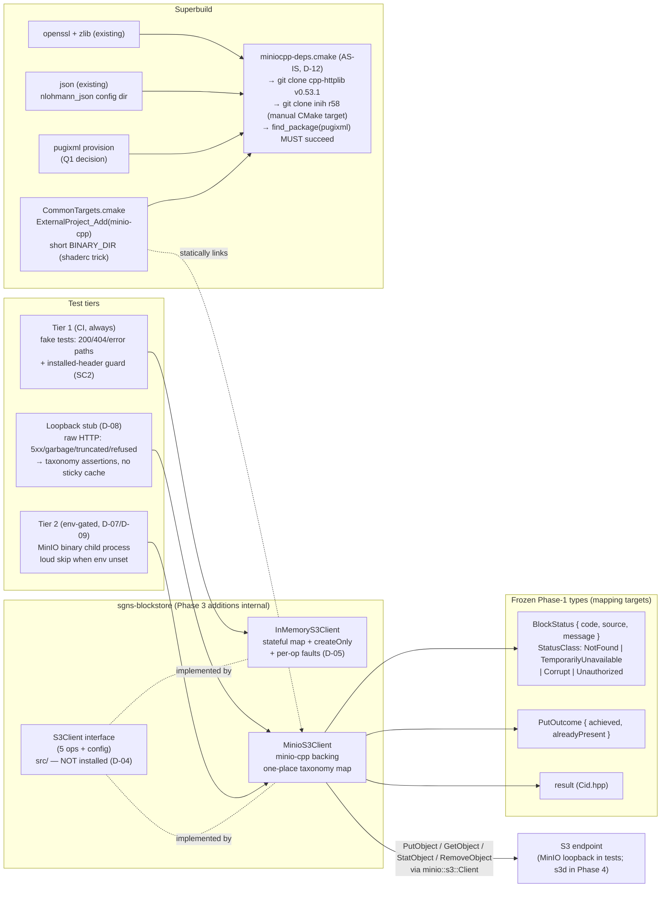

# Phase 3: minio-cpp Integration & S3Client Adapter - Research

**Researched:** 2026-10-21
**Domain:** C++17 thirdparty superbuild integration of minio-cpp v1.0.0 + internal S3 adapter interface, hermetic fake, and test harness
**Confidence:** HIGH (minio-cpp v1.0.0 API surface read directly from the pinned tag's headers/sources via raw.githubusercontent.com this session; all workspace facts read from source; three narrow items flagged ASSUMED/MEDIUM for the day-one spike)

## Summary

This research read the **actual pinned-tag source of minio/minio-cpp v1.0.0** — `CMakeLists.txt`, `cmake/miniocpp-deps.cmake`, `include/miniocpp/{client,baseclient,args,request,response,http,error,result,types,utils,config}.h`, and `src/{baseclient,client}.cc` — plus the Phase-1/2 `sgns-blockstore` tree and the superbuild's `CommonTargets.cmake`/`CommonCompilerOptions.cmake`. Three findings materially shape the plan. **(1) The D-11 entrance criterion is satisfiable at the pinned tag:** conditional `If-None-Match:*` on PUT rides `PutObjectArgs.headers` (an `utils::Multimap` on `ObjectWriteArgs`) — NOT `extra_headers`, which `Client::PutObject`'s single-part conversion path **drops** (verified in `src/client.cc`). **(2) `miniocpp-deps.cmake` does NOT fetch all three nested deps:** it clones cpp-httplib (pinned tag `v0.53.1`) and inih (pinned commit `5cc5e2c…` = r58, built as a hand-written CMake static target — the meson-only problem is solved upstream, no fork needed), but **pugixml has no source fallback and hard-errors** (`FATAL_ERROR "pugixml: neither a CMake package (pugixml) nor pkg-config (pugixml.pc) was found"`) — pugixml must be provided. **(3) Every failure — transport, 404, 412, 5xx — surfaces through the `tl::expected` error slot as a plain string** (`"NoSuchKey: …"`, `"PreconditionFailed: …"`, `"server failed with HTTP status code NNN"`); there is no structured error code on the failure path, so the taxonomy mapping is a string-classification in exactly one place, and unknown strings must land in `TemporarilyUnavailable`-class, never `NotFound`.

The superbuild wiring follows the shaderc precedent closely (short `BINARY_DIR` for MAX_PATH, upstream's own dep mechanism inside the ExternalProject step), with minio-cpp-specific facts verified: the static artifact is named `libminio.a`/`minio.lib` (target `miniocpp`, `OUTPUT_NAME minio`), the cache surface is tiny (`MINIO_CPP_TEST=OFF`, `MINIO_CPP_ENABLE_RDMA=OFF`, both already defaults; C++17 default matches the repo pin; `BUILD_SHARED_LIBS=OFF` default plus `_CMAKE_COMMON_CACHE_ARGS` forcing static/PIC/CRT), and the `VCPKG_ROOT` auto-toolchain hijack in minio-cpp's CMakeLists is **already neutralized** by the superbuild's `-DCMAKE_TOOLCHAIN_FILE:FILEPATH=` cache arg (defined-but-empty on desktop builds). The in-repo half is equally ready: `header_hygiene_check.cmake` already bans `minio` include patterns in installed headers (SC2 extends an existing mechanism), `FaultController.hpp` is the exact seam D-05's fake scripting mirrors, and the frozen `StatusClass`/`PutOutcome`/`result<R,S,policy::terminate>` types were re-read verbatim so adapter result types compose with zero re-freeze.

**Primary recommendation:** Add `thirdparty/minio-cpp` as an upstream-tag submodule (v1.0.0, like `shaderc`/`json` absolute-URL entries) with a shaderc-style `ExternalProject_Add` (short BINARY_DIR, deps resolved by `miniocpp-deps.cmake` as-is per D-12); provide pugixml via **one new decision** the planner must surface — recommended: a small upstream pugixml v1.6.0-tag submodule + ExternalProject exporting its config dir (standard repo pattern, cross-compile-clean) vs. a shaderc-precedent `PATCH_COMMAND` fetch-and-build inside the minio-cpp step (honors SC1's "no separate dep submodules" letter); then land the day-one D-11 spike (conditional header + BaseUrl trio + TLS on/off) inside the first plan before any adapter code.

<user_constraints>
## User Constraints (from CONTEXT.md)

### Locked Decisions

**Adapter contract**
- **D-01:** Conditional create-only Put is a **precondition option on `Put`** (options carry `createOnly=true`; adapter sends `If-None-Match:*`; Phase 4 just flips the flag) — one Put op, no HTTP-isms past the seam, no separate `PutIfAbsent` op, no raw-header bag — **Reversibility:** costly — the internal op-set shape binds the fake, `MinioS3Client`, and Phase-4 `S3BlockStore` call sites simultaneously
- **D-02:** "Object already exists" (412 / precondition failed) reports through the **success slot with `alreadyPresent=true`** — mirrors frozen Phase-1 D-04 `PutOutcome { achieved, alreadyPresent }`; Phase-4 SC2 (412 → AlreadyExists-as-success) maps 1:1 with zero re-freeze; no dedicated failure class, no raw passthrough codes — **Reversibility:** costly — Phase-4 mapping and conformance assertions bind to the payload shape
- **D-03:** `delete` stays an **internal adapter op** (BACK-05 names it; future tooling/audit consumers) — proven via fake tests; guard tests keep `BlockStore` itself delete-free; delete never climbs to the public interface — **Reversibility:** costly — guard tests + tooling surface bind the placement
- **D-04:** The `S3Client` interface is **internal in Phase 3** (src/, not installed); promoted to installed headers with Phase 4's `S3BlockStore`, its first public consumer — installed surface stays minimal per phase — **Reversibility:** reversible — promotion in Phase 4 is additive

**Fake fidelity**
- **D-05:** `InMemoryS3Client` = **stateful object map + `createOnly` enforcement + injectable per-op fault responses** (FaultController-style: next-op returns scripted 5xx/garbage/truncated/refused) — covers SC3 (200/404/error) now and is the Phase-5 fault-matrix seed — **Reversibility:** costly — Phase-5 matrix composes on the scripting surface; retrofitting a minimal fake later rewrites fixtures

**SC4 live-endpoint proof**
- **D-06:** The **MinIO-binary child-process harness lands in Phase 3** (C2 decision: server binary, no Docker) — env-gated, satisfying SC4 fully in-phase; Phase 4 instantiates the same harness for `S3BlockStore` instead of building one — **Reversibility:** costly — Phase 4's test tier binds to the harness shape
- **D-07:** MinIO-binary tests are **opt-in only** (env-gated), never the default CI lane; **loud labelled skip** when the gate is unset — TEST-01 Tier-2 discipline from day one — **Reversibility:** costly — Phase-5 SC3 inspects this configuration
- **D-08:** The "maps every failure" half of SC4 is proven by a **loopback stub server** (raw HTTP) serving scripted 5xx/garbage/truncated/connection-refused directly at `MinioS3Client` — deterministic taxonomy assertions with no sticky negative cache; the stub becomes Phase 5's fault-matrix seed — **Reversibility:** reversible
- **D-09:** The harness locates MinIO via an **env var pointing at a pre-installed binary**; loud skip when unset; **no auto-download** — zero network at test time — **Reversibility:** reversible

**Entrance criterion**
- **D-10:** **No pre-committed contingency** for `If-None-Match:*` unavailability — research rates failure probability LOW (README-verified feature; headers never compiled against; hosted doxygen stale). If a needed feature is genuinely missing, decide then — **forking minio-cpp to add it is acceptable at that point**; BUILD-02's "no fork" is the default integration mechanism, not a never-fork pledge
- **D-11:** Entrance criterion verified as a **day-one spike inside the first Phase-3 plan** (Phase-1 C1 discipline), covering the **full trio**: conditional-header exposure + BaseUrl config fields (path-style/HTTPS/region) + TLS on/off smoke against a local endpoint — **Reversibility:** reversible — spike scope adjustable in planning

**Dependency bundling**
- **D-12:** **minio-cpp's own dependency mechanism (`miniocpp-deps.cmake`) is used as-is** inside the ExternalProject step — it fetches/builds pugixml v1.16 / cpp-httplib v0.62.0 / inih r62 with upstream's own pins. **No GNUS fetch script, no separate pin file, no injected inih CMakeLists, no pre-committed hermeticity patch** — matches BUILD-02's primary formulation ("its own dependency mechanism... pinning enforced per its mechanism"). If upstream's mechanism hits a concrete wall (e.g., inih meson-only build on MSVC), surface it via research/day-one spike and handle then — **Reversibility:** reversible — integration mechanics stay adjustable until phase close. **NOTE for downstream agents:** research SUMMARY `:139`/`:195` recommends GNUS forks of inih and minio-cpp (hermeticity patch) — that recommendation is **superseded by this decision**; do not pre-create forks

### the agent's Discretion
- `S3ClientConfig` field set beyond the research-listed surface (endpoint, path-style=true, pinned region, https, tls-verify)
- Adapter result-type mechanics, provided they use the library-local `result<R,S,policy::terminate>` alias (Cid.hpp) and leak no SDK types
- Loopback stub implementation approach (raw sockets vs in-tree cpp-httplib server side)
- Harness env-var names, child-process lifecycle, port/temp-dir management
- `MinioS3Client` threading/execution model (sync blocking calls mirror the frozen BlockStore style)
- Per-platform CI evidence details for SC1 (which lanes run where)
- Any minimal patch to minio-cpp should upstream's mechanism concretely break — minimal-diff norm, decide-as-needed (user posture), documented wherever the shaderc precedent documents its patch

### Deferred Ideas (OUT OF SCOPE)
None — discussion stayed within phase scope.
</user_constraints>

<phase_requirements>
## Phase Requirements

| ID | Description | Research Support |
|----|-------------|------------------|
| BUILD-02 | minio-cpp integrated at upstream tag as a submodule, shaderc-style — its own dependency mechanism fetches/bundles nested deps inside the ExternalProject step, statically linked and non-exported; pinning enforced per its mechanism (or a small patch step mirroring the shaderc `git-sync-deps` precedent at `CommonTargets.cmake:438`); no GNUS fork, no separate dep submodules | `miniocpp-deps.cmake` @ v1.0.0 behavior fully documented (clone fallback + pins verified); shaderc precedent read (short-BINARY_DIR + PATCH_COMMAND rationale); **pugixml gap discovered** — the mechanism fetches only 2 of 3 deps, requiring one plan-level decision (see Open Question Q1); inih meson-only concern dissolved — upstream builds it as a manual CMake static target |
| BUILD-03 | `sgns-blockstore` and minio-cpp wired into `thirdparty/build/CommonTargets.cmake` ExternalProject orchestration across all five platform builds | Concrete `ExternalProject_Add(minio-cpp …)` sketch with verified cache args, artifact name `libminio.a`/`minio.lib`, `_CMAKE_COMMON_CACHE_ARGS` interplay (static/PIC/CRT/`BUILD_TESTING=OFF` force + `TESTING` gate note), nlohmann_json wiring var, MAX_PATH strategy, cross-compile analysis (host-side clone, target-side build) |
| BACK-05 | Internal `S3Client` adapter interface (~5 ops: put/get/head/delete + config) with an `InMemoryS3Client` fake for hermetic tests | Exact minio-cpp v1.0.0 op mapping verified header-level (`PutObjectArgs`/`GetObjectArgs`/`StatObjectArgs`/`RemoveObjectArgs`/`BaseUrl`); frozen `result` alias + `PutOutcome` + `StatusClass` re-read verbatim; fake design seeded by `FaultController.hpp` seam; conditional-PUT field identified (`headers`, not `extra_headers`) |
| BACK-06 | `MinioS3Client` implementation via minio-cpp; SDK types never leak past the adapter | Complete error-model evidence for the one-place taxonomy mapping (string formats from `GetErrorResponse` verified); `header_hygiene_check.cmake` already bans `minio` includes in installed headers (SC2 extends it); internal-placement pattern (D-04) mirrors Phase-2 pimpl precedent |
</phase_requirements>

## Architectural Responsibility Map

| Capability | Primary Tier | Secondary Tier | Rationale |
|------------|-------------|----------------|-----------|
| minio-cpp thirdparty build (5 platforms) | Superbuild orchestration (`thirdparty/build/CommonTargets.cmake`) | minio-cpp's own `miniocpp-deps.cmake` (nested cpp-httplib/inih) | ExternalProject is the repo's only sanctioned dependency boundary; D-12 delegates nested deps to upstream's mechanism *inside* that boundary |
| S3 wire operations (put/get/head/delete) | Library internal sources (`sgns-blockstore/src/`, not installed) | minio-cpp SDK (private implementation detail) | D-03/D-04: adapter is internal in Phase 3; SDK types must never appear in installed headers (SC2, existing `header_hygiene` guard) |
| Failure→taxonomy mapping | `MinioS3Client` (exactly one place) | — | Frozen Phase-1 precedent (`MemoryBlockStore`, `LocalBlockStore` each map in one place); SC4 requires unknown→Unknown/TemporarilyUnavailable, never NotFound |
| Hermetic adapter tests (SC3) | `InMemoryS3Client` fake + GTest in `sgns-blockstore/test/` | conformance-kit *style* (mirror, not instantiate) | D-05; fake is also the Phase-5 fault-matrix seed |
| Failure-mapping proof (SC4b) | Loopback raw-HTTP stub server in the test tree | — | D-08; byte-level fault control (truncated/garbage) argues for raw sockets over a real HTTP server framework |
| Live-endpoint proof (SC4a) | MinIO-binary child-process harness, env-gated | test fixture managing port/temp-dir lifecycle | D-06/D-07/D-09; lands this phase, reused by Phase 4 |
| Public-header hygiene enforcement | Existing `header_hygiene` ctest + `api_hygiene_test` | — | SC2's compile-time check extends mechanisms that already exist and already ban `minio` patterns |

## Standard Stack

### Core

| Library | Version | Purpose | Why Standard |
|---------|---------|---------|--------------|
| **minio/minio-cpp** (upstream, submodule `thirdparty/minio-cpp`) | **v1.0.0 tag** (2026-09-09) | S3 client behind the internal `S3Client` adapter: `PutObject`/`GetObject`/`StatObject`/`RemoveObject` + `BaseUrl` config | Locked by research + BUILD-02; C++17 floor matches repo pin; Apache-2.0 with `MINIO_CPP_ENABLE_RDMA=OFF` keeping the proprietary `vendor/s3rdma` out [VERIFIED: CMakeLists.txt @ v1.0.0 — `option(MINIO_CPP_ENABLE_RDMA "Enable RDMA support" OFF)`] |
| **cpp-httplib** (nested dep, fetched by upstream mechanism) | **v0.53.1** — upstream's own pin [VERIFIED: `miniocpp-deps.cmake` — `set(MINIO_CPP_HTTPLIB_PINNED_TAG "v0.53.1")`] | HTTP/TLS transport (header-only, OpenSSL backend) | D-12: upstream mechanism as-is; do NOT bump to v0.62.0 — that would be a GNUS pin override, exactly what D-12 forbids |
| **inih** (nested dep, fetched by upstream mechanism) | **commit `5cc5e2c24642513aaa5b19126aad42d0e4e0923e` (r58)** — upstream's own pin [VERIFIED: `miniocpp-deps.cmake`] | INI/credential-file parsing; built by upstream as a **manual CMake static target `miniocpp_inih`** from `ini.c` + `cpp/INIReader.cpp` | The "inih is meson-only" wall **does not exist** at v1.0.0 — upstream compiles the two files directly; no GNUS fork, no injected CMakeLists (D-12 holds trivially here) |
| **pugixml** (required dep, **NOT fetched by upstream**) | v1.16 recommended (any version with a CMake config package) | XML parsing for S3 error/List responses inside minio-cpp | `miniocpp-deps.cmake` resolves pugixml as *vcpkg config → pkg-config → **hard `FATAL_ERROR`*** — there is **no git-clone fallback** for pugixml [VERIFIED: `miniocpp-deps.cmake` — `message(FATAL_ERROR "pugixml: neither a CMake package (pugixml) nor pkg-config (pugixml.pc) was found")`]. Provision choice = plan decision (Open Question Q1) |
| **nlohmann_json** (existing `thirdparty/json` submodule) | v3.12.0 pin (already in tree) | `find_package(nlohmann_json CONFIG REQUIRED)` inside `miniocpp-deps.cmake` | Already built by the `json` ExternalProject; needs only a new `_FINDPACKAGE_JSON_CONFIG_DIR`-style export var wired into the minio-cpp entry [VERIFIED: `miniocpp-deps.cmake` — `find_package(nlohmann_json CONFIG REQUIRED)`] |
| **OpenSSL / zlib** (existing) | ~3.0 / existing pin | `find_package(OpenSSL REQUIRED)` + `find_package(ZLIB REQUIRED)` inside the deps file | Already flow via `${_OPENSSL_CACHE_ARGS}` / `${_ZLIB_PACKAGE_ARGS}` in every ExternalProject entry |

### Supporting

| Library | Version | Purpose | When to Use |
|---------|---------|---------|-------------|
| libp2p `p2p_cid` (existing) | current pin | The `Cid` type + `result` alias the adapter's internal headers reuse | Every internal adapter header — `Cid.hpp` alias is MANDATORY (Phase-1 landmine) |
| GTest (existing) | ~1.14 | All test tiers via the repo's `addtest()` macro | fake tests, guard tests, stub-server tests, env-gated MinIO tests |
| MinIO server binary (pre-installed, NOT a dependency of the build) | any recent release | SC4 live-endpoint tier (D-06/D-09) | Env-gated opt-in lane only; located via env var; loud skip when unset |

### Alternatives Considered

| Instead of | Could Use | Tradeoff |
|------------|-----------|----------|
| minio-cpp v1.0.0 pinned tag | floating `master` | Forbidden — 2026 API churn (namespaces reshaped in v1.0.0 itself); pin the tag, record SHA |
| `PutObjectArgs.headers` Multimap for `If-None-Match:*` | `BaseArgs::extra_headers` | **extra_headers is broken for this purpose**: `Client::PutObject`'s single-part conversion path does not copy `extra_headers` into `PutObjectApiArgs` [VERIFIED: `src/client.cc` — the `*part_count == 1` branch sets `extra_query_params` but never `extra_headers`]. Use `headers` (flow via `args.Headers()` → `api_args.headers` → `req.headers.AddAll(...)`) |
| Raw-socket loopback stub (recommended) | cpp-httplib server mode | cpp-httplib *is* in minio-cpp's install tree, but consuming another dep's nested dep couples the test tree to minio-cpp's prefix, and its server model fights byte-exact fault injection (truncated/garbage bodies). Raw sockets: ~150 self-contained lines, exact byte control |
| Hand-rolled child-process launcher (recommended) | Boost.Process (header-only, ships in the boost submodule) | Boost is not currently on sgns-blockstore's link/include line; adding it just for spawn/kill adds surface. A thin `#ifdef _WIN32` CreateProcess/POSIX fork-exec wrapper (~100 lines) keeps the lib dependency-minimal. Boost.Process acceptable if the team prefers |

**Installation:** No package manager — `git submodule add https://github.com/minio/minio-cpp.git thirdparty/minio-cpp` + `git -C thirdparty/minio-cpp checkout v1.0.0` (upstream absolute-URL pattern like `shaderc`/`json`/`GTest` entries in `thirdparty/.gitmodules`), then the `ExternalProject_Add` sketch in Code Examples. If Q1 resolves to a pugixml submodule: same pattern with `https://github.com/zeux/pugixml.git` at the v1.16 tag.

**Version verification:** all minio-cpp facts in this document were read from `raw.githubusercontent.com/minio/minio-cpp/v1.0.0/...` **this session** (2026-10-21). Hosted doxygen remains stale (pre-1.0 `minio::http::BaseUrl` shapes) — do not consult it; the pinned tag's headers are the only API reference.

## Package Legitimacy Audit

> Not applicable in the npm/PyPI/crates sense — this phase adds **no registry packages**. It adds git submodules pinned at upstream tags. Verification here = direct read of the pinned tag's files (stronger than registry lookup):

| Package | Source | Tag/Commit verified | Files read this session | Verdict |
|---------|--------|--------------------|-----------------------|---------|
| minio/minio-cpp | github.com/minio/minio-cpp | v1.0.0 | README.md, CMakeLists.txt, cmake/miniocpp-deps.cmake, 11 headers, src/{baseclient,client}.cc | OK — upstream primary |
| cpp-httplib (nested) | fetched by upstream mechanism | v0.53.1 pin read from miniocpp-deps.cmake | pin verified; library itself not fetched | OK — upstream's pin governs (D-12) |
| inih (nested) | fetched by upstream mechanism | r58 commit `5cc5e2c…` read from miniocpp-deps.cmake | pin + build mechanism verified | OK — upstream's pin governs (D-12) |
| pugixml | TBD by Q1 decision | — | — | Pending plan decision; any source is upstream zeux/pugixml, never a GNUS fork |

**Packages removed due to [SLOP] verdict:** none (no registry packages).
**Packages flagged as suspicious [SUS]:** none.

## Architecture Patterns

### System Architecture Diagram



Data flow for a conditional Put: caller → `S3Client::Put(key, data, {createOnly=true})` → `MinioS3Client` builds `minio::s3::PutObjectArgs` (bytes via stream, `headers.Add("If-None-Match", "*")`) → `client.PutObject(args)` → `Result<PutObjectResponse>`; on success → `PutOutcome{achieved, alreadyPresent=false}`; on error-string containing `PreconditionFailed` → **success slot** `PutOutcome{achieved, alreadyPresent=true}` (D-02); on `NoSuchKey`/`NoSuchBucket` context → `BlockStatus{NotFound, …}`; everything else unrecognized → `BlockStatus{TemporarilyUnavailable, …}` — never NotFound (SC4).

### Recommended Project Structure

```
thirdparty/
├── minio-cpp/                          # NEW submodule @ v1.0.0 (upstream URL)
├── pugixml/                            # NEW submodule @ v1.16 — ONLY if Q1 resolves this way
├── build/CommonTargets.cmake           # + ExternalProject_Add(minio-cpp …) (+ pugixml?),
│                                       #   sgns-blockstore entry gains -Dminiocpp_DIR + DEPENDS minio-cpp,
│                                       #   json entry gains _FINDPACKAGE_JSON_CONFIG_DIR export
└── sgns-blockstore/
    ├── src/
    │   ├── S3Client.hpp                # internal interface (~5 ops + S3ClientConfig) — NOT installed
    │   ├── MinioS3Client.{hpp,cpp}     # minio-cpp impl; the ONE taxonomy-mapping place
    │   └── InMemoryS3Client.{hpp,cpp}  # stateful fake + fault scripting (test + Phase-5 seed)
    └── test/
        ├── in_memory_s3_client_test.cpp   # SC3: 200/404/error + createOnly/alreadyPresent
        ├── minio_s3_client_test.cpp       # D-08 stub taxonomy matrix (+ env-gated live ops, D-06/D-07)
        ├── LoopbackHttpStub.{hpp,cpp}     # raw-socket scripted-response server (test support)
        ├── MinioServerHarness.{hpp,cpp}   # child-process lifecycle (env-gated, D-09)
        └── api_hygiene_test.cpp           # EXTENDS: no `miniocpp/` include compiles into installed surface
```

### Pattern 1: The internal adapter seam (D-03/D-04)

**What:** `S3Client` lives in `src/`, compiled into the static lib, invisible to installed headers. `MinioS3Client` holds the minio-cpp types by member (pimpl or direct — internal header, either is fine; Phase-2 pimpl precedent applies when it eventually promotes in Phase 4).
**When to use:** exactly this phase; promotion mechanics (install + package-config export + `find_dependency(miniocpp)`) are Phase-4 additive work.
**Why:** `header_hygiene_check.cmake` already FATAL_ERRORs on any `#include` matching `minio` in `include/sgns-blockstore/*.hpp` [VERIFIED: `thirdparty/sgns-blockstore/test/header_hygiene_check.cmake` — `_banned` list contains `"minio"`]. SC2's "compile-time check" extends `api_hygiene_test.cpp` (which includes every installed header and links exactly `sgns-blockstore` + `p2p::p2p_cid`) — if it still compiles with minio-cpp linked into the lib, no SDK type leaked into the installed surface. That is the whole check.

### Pattern 2: One-place failure mapping over string-shaped errors

**What:** a single function (e.g. `MapMinioFailure(const minio::error::Error&, const char* op) -> BlockStatus`) converts every minio-cpp failure into the frozen taxonomy. Verified input formats (all from `BaseClient::GetErrorResponse`/`execute` at v1.0.0):

| minio-cpp error string (prefix) | Real cause | Maps to |
|---|---|---|
| `NoSuchKey: …` / `NoSuchBucket: …` (object context set) | authoritative 404 | `StatusClass::NotFound` |
| `AccessDenied: …` (403, synthesized or XML) | auth/permission | `StatusClass::Unauthorized` |
| `PreconditionFailed: …` (XML body on 412) | conditional-create hit existing object | **not a failure** — success slot `alreadyPresent=true` (D-02) |
| `server failed with HTTP status code 5xx` (no-body default) | backend error | `TemporarilyUnavailable` |
| transport strings (`Connection refused`, `Connection closed`, cURL/httplib-level text — no `Code:` prefix pattern) | transport | `TemporarilyUnavailable` |
| anything else | unknown | `TemporarilyUnavailable` (+ message preserved) — **never NotFound** (SC4) |

**Critical nuance:** 412 with an *empty/non-XML body* falls into the status-code default branch (`"server failed with HTTP status code 412"`) [VERIFIED: the `switch (resp.status_code)` in `GetErrorResponse` has no `case 412`]. Real MinIO returns XML on 412, so the `PreconditionFailed` prefix is the live path — but the mapper should treat BOTH strings as precondition evidence, and the D-08 stub should exercise both shapes.

### Pattern 3: Stateful fake with per-op fault scripting (D-05)

**What:** `InMemoryS3Client` = `std::map<std::string, std::vector<uint8_t>>` + `createOnly` enforcement returning `alreadyPresent=true` on duplicate + an injectable `nextResponse` fault table mirroring `FaultController`'s philosophy (one scripted response per op kind: 5xx / garbage / truncated / refused). The fake returns adapter-level results directly (no HTTP), so fault entries map to taxonomy outcomes, not raw bytes — keeping the Phase-5 matrix composable on the same surface.
**When to use:** all SC3 tests now; Phase-5 fault matrix later.

### Pattern 4: Env-gated child-process harness (D-06/D-07/D-09)

**What:** fixture reads env var (recommend `SGNS_BLOCKSTORE_TEST_MINIO_BIN`) → if unset, `GTEST_SKIP() << "[SGNS_BLOCKSTORE][MINIO-TIER] binary not provided (set SGNS_BLOCKSTORE_TEST_MINIO_BIN)"` (loud, labelled, greppable — Phase-1 D-10 kit pattern). When set: probe a free ephemeral port, spawn `<bin> server <tempdir> --address 127.0.0.1:<port>` with `MINIO_ROOT_USER`/`MINIO_ROOT_PASSWORD` (≥8 chars, generated per-run), poll `http://127.0.0.1:<port>/minio/health/live` **with deadline** until connect+200 (no fixed sleeps — Phase-1 discipline), `MakeBucket` via minio-cpp in fixture setup, teardown = terminate process + wait + remove temp dir.

### Anti-Patterns to Avoid

- **Mapping any unrecognized failure to NotFound** — the CRDT-corruption trap (research Pitfall 2). Default bucket is `TemporarilyUnavailable`.
- **Putting `If-None-Match:*` into `extra_headers`** — silently dropped by the single-part PUT path at v1.0.0 [VERIFIED: `src/client.cc`]. Use `PutObjectArgs.headers`.
- **Consulting hosted doxygen** for the API — it documents the pre-1.0 `minio::http::` API; the pinned tag's headers are the only truth.
- **Bumping the nested dep pins** (cpp-httplib v0.62.0 etc.) — D-12 says upstream's pins govern; overriding them re-creates the GNUS-patch problem the decision closed.
- **Leaving `region` empty in `BaseUrl` for tests** — empty region + credentials triggers a `GetBucketLocation` roundtrip before the first op (`GetRegion` falls back to a network call) [VERIFIED: `baseclient.cc` — `GetRegion` → `Request req(http::Method::kGet, "us-east-1", …)` with `?location`]. Pin the region (e.g. `us-east-1`) in `S3ClientConfig` so stub servers see exactly one request per op.
- **Naming byproducts `libminiocpp.a`** — the target is `miniocpp` but the artifact is `libminio.a` / `minio.lib` (`OUTPUT_NAME minio`) [VERIFIED: CMakeLists.txt — `set_target_properties(miniocpp PROPERTIES OUTPUT_NAME minio)`].

## Don't Hand-Roll

| Problem | Don't Build | Use Instead | Why |
|---------|-------------|-------------|-----|
| SigV4 signing, chunked uploads, XML error parsing | Custom S3 client on sockets | minio-cpp v1.0.0 behind the adapter | Signing/parsing is high-risk duplicated domain knowledge; adapter keeps the choice reversible |
| HTTP client with TLS | Anything on WinSock directly | cpp-httplib (comes with minio-cpp) | Transport, TLS, timeouts already solved and pinned |
| Result envelope | New optional/expected types | library-local `result<R,S,policy::terminate>` alias from `Cid.hpp` | Phase-1 landmine: any other outcome spelling trips the `policy::terminate` deviation already guard-tested |
| CID construction/verification in adapter code | Re-derive codecs | `CidOf` / `ContentIdentifierCodec` (existing lib surface) | Already frozen + conformance-covered in Phases 1–2 |
| Conditional-create semantics | `PutIfAbsent` op or raw header bag at the interface | `PutOptions.createOnly` flag; `If-None-Match:*` only inside `MinioS3Client` | D-01: one Put op, no HTTP-isms past the seam |
| Wait-for-server-ready | `Sleep(2000)` | Deadline-bounded health poll (`/minio/health/live`) | Phase-1 no-fixed-sleeps discipline; also faster and deterministic |

**Key insight:** every wire-level subtlety this phase touches (signing, conditional headers, error XML) is already implemented inside the pinned SDK — the phase's real work is *containment* (seam, taxonomy, hygiene guards) not protocol code.

## Common Pitfalls

### Pitfall 1: The pugixml provision wall (new, discovered this session)
**What goes wrong:** The phase description and BUILD-02 assume `miniocpp-deps.cmake` fetches all three nested deps. It does not: **pugixml has no source fallback** — `find_package(pugixml CONFIG QUIET)` → pkg-config → `message(FATAL_ERROR …)` [VERIFIED: `cmake/miniocpp-deps.cmake` @ v1.0.0]. A bare ExternalProject configure fails hard at configure time.
**Why it happens:** upstream's default flow is vcpkg (which provides pugixml); the source-fallback branch exists only for the musl/Alpine case and was written for exactly the two deps Alpine lacks (cpp-httplib, inih).
**How to avoid:** Decide Q1 in planning (pugixml submodule+ExternalProject — recommended — or shaderc-style PATCH_COMMAND fetch-and-build). Either way the day-one spike must show a configure passing with pugixml resolvable.
**Warning signs:** configure log ends with `pugixml: neither a CMake package (pugixml) nor pkg-config (pugixml.pc) was found`.

### Pitfall 2: `extra_headers` dropped on the single-part PUT path (new, discovered this session)
**What goes wrong:** conditional `If-None-Match:*` placed in `PutObjectArgs.extra_headers` never reaches the wire for small objects — `Client::PutObject`'s `*part_count == 1` branch constructs `PutObjectApiArgs` copying `extra_query_params`, bucket/region/object, data, progress, and `headers` — but **not `extra_headers`** [VERIFIED: `src/client.cc` @ v1.0.0, both the serial and parallel-upload variants].
**Why it happens:** upstream's own examples attach conditional/extra headers via `extra_headers` on *bucket/list* ops; the Client-level PUT wrapper is a newer composition layer and the omission looks like an upstream bug-in-waiting (harmless for its examples, not for ours).
**How to avoid:** adapter sets `args.headers.Add("If-None-Match", "*")` (the `ObjectWriteArgs::headers` Multimap) — that path is verified to flow: `args.Headers()` → local `headers` → `api_args.headers` → `BaseClient::PutObject` does `req.headers.AddAll(args.headers)`. The day-one spike asserts the header on the wire (stub captures raw bytes) and a 412→`alreadyPresent=true` round trip.
**Warning signs:** createOnly PUT overwrites an existing object instead of returning `alreadyPresent=true`.

### Pitfall 3: Transport failure flattened into NotFound (carried from foundational research, now with the exact mechanism)
**What goes wrong:** every failure arrives as a string; naive mapping (`if (!resp) return NotFound`) converts outages into authoritative absence — the CRDT-corruption trap.
**Why it happens:** the `Result` error slot carries only `minio::error::Error` — a string wrapper [VERIFIED: `error.h` — `class Error { std::string msg_; … }`]; status codes ride strings like `"server failed with HTTP status code 503"`.
**How to avoid:** one mapping function; `NotFound` **only** on `NoSuchKey:`/`NoSuchBucket:` prefixes; `Unauthorized` on `AccessDenied:`; precondition strings → success slot (D-02); everything else → `TemporarilyUnavailable`. D-08 stub proves each class + no sticky negative cache (good fetch after a failed one).
**Warning signs:** any `if (!result) → NotFound` shape in `MinioS3Client`.

### Pitfall 4: Windows MAX_PATH inside the nested `_deps` tree
**What goes wrong:** `miniocpp-deps.cmake` clones into `${CMAKE_CURRENT_BINARY_DIR}/_deps/{cpp-httplib,inih}-src`; under the default ExternalProject BINARY_DIR that stacks `<build>/Windows/Debug/minio-cpp/src/minio-cpp-build/_deps/…` past 260 chars on runners without long-path support (shaderc hit exactly this: 272-char paths).
**How to avoid:** copy the shaderc precedent verbatim — `BINARY_DIR "${CMAKE_CURRENT_BINARY_DIR}/mcb/src"` (short, and under a `*/src` directory so build-tree tarball excludes keep working) [VERIFIED: `CommonTargets.cmake:403-448` — the shaderc block documents both the MAX_PATH rationale and the `--exclude='./*/src'` interaction].
**Warning signs:** MSBuild `.tlog` path errors or `fatal error C1083` on cloned-dep headers.

### Pitfall 5: `VCPKG_ROOT` auto-toolchain hijack (pre-neutralized — verify, don't fix)
**What goes wrong:** minio-cpp's CMakeLists auto-includes the vcpkg toolchain when `CMAKE_TOOLCHAIN_FILE` is undefined and `ENV{VCPKG_ROOT}` is set [VERIFIED: `CMakeLists.txt` — `if(NOT DEFINED CMAKE_TOOLCHAIN_FILE AND DEFINED ENV{VCPKG_ROOT})`]. A dev machine with vcpkg installed globally would silently change the dependency-resolution universe.
**How to avoid:** already handled by the superbuild — `_CMAKE_COMMON_CACHE_ARGS` always passes `-DCMAKE_TOOLCHAIN_FILE:FILEPATH=${CMAKE_TOOLCHAIN_FILE}`, which *defines* the cache var (empty on desktop builds), making upstream's guard false [VERIFIED: `CommonCompilerOptions.cmake:100-134`]. Do not remove that arg; note it in the entry comment. Only a manual standalone configure of minio-cpp could ever hit this.
**Warning signs:** `vcpkg.cmake` appearing in a configure log.

### Pitfall 6: Configure-time network access + cache semantics of the clone fallback
**What goes wrong:** first configure of the minio-cpp ExternalProject runs `git clone` at *configure* time (plain `execute_process`, not FetchContent) for cpp-httplib/inih [VERIFIED: `miniocpp-deps.cmake`]. Clean build trees re-clone (network + ~minutes); clones persist in the build tree across rebuilds (`NOT EXISTS` guard + `git fetch --tags` + `git checkout <pin>` re-pins cached clones — pin enforcement IS upstream behavior, satisfying "pinning enforced per its mechanism").
**How to avoid:** accept per D-12; ensure git is on PATH in all five platform lanes (CI images and local — verified locally: git 2.48.1). Budget: clones are small (httplib ~1 MB, inih ~200 KB). If a lane is network-isolated at configure time, that lane fails loudly at configure — surface, don't pre-solve (D-12).
**Warning signs:** `cpp-httplib: git clone failed` / `inih: git clone failed` FATAL_ERRORs in configure logs.

### Pitfall 7: MSVC/Windows source-build specifics
**What goes wrong:** (a) CRT mismatch — solved by building from source inside the superbuild (`_MSVC_RUNTIME_LIBRARY` propagates the repo's runtime setting [VERIFIED: `CommonCompilerOptions.cmake` — `${_MSVC_RUNTIME_LIBRARY}` in the common args]); (b) prebuilt-bundle temptation — the README advertises windows-amd64 zip bundles; do NOT use them in the superbuild (CRT/ABI by-construction mismatch, and they bypass the dep pins); (c) `GetObject` macro collision with `windows.h` — upstream handles it with `#undef`/push-pop + inline `GetObjectA/W` wrappers [VERIFIED: `baseclient.h`]; adapter code including minio-cpp headers on Windows inherits that handling — nothing to do, just don't fight it.
**How to avoid:** source build via `_CMAKE_COMMON_CACHE_ARGS` (static + PIC + CRT consistent); day-one spike runs on Windows/MSVC first.
**Warning signs:** LNK4098 CRT warnings; unresolved `GetObjectA` symbols.

### Pitfall 8: Superbuild test-gate name collision
**What goes wrong:** `_CMAKE_COMMON_CACHE_ARGS` forces `-DBUILD_TESTING:BOOL=OFF` into every sub-build; a project gating tests on `BUILD_TESTING` can never enable them through the superbuild. minio-cpp's gate is `MINIO_CPP_TEST` (default OFF) — no conflict; but if anyone flips it on to run upstream's tests, they hit live-network examples (EXAMPLE_APPS list built under `MINIO_CPP_TEST`) — keep it OFF.
**How to avoid:** pass `-DMINIO_CPP_TEST:BOOL=OFF` explicitly (self-documenting, matches shaderc's explicit skip flags); sgns-blockstore's own `TESTING`-last-cache-arg pattern already demonstrates the mechanism for our lib's tests [VERIFIED: `CommonTargets.cmake:804-810` comment + `sgns-blockstore/CMakeLists.txt:29-38`].

### Pitfall 9: Research-doc supersession (D-12 discipline)
**What goes wrong:** agents following the 2026-10-19 SUMMARY (`:139`/`:195`) pre-create GNUS forks of minio-cpp/inih or a hermeticity patch — explicitly superseded by D-12.
**How to avoid:** upstream mechanism as-is; the only fork-shaped action permitted without new user input is D-10's decide-then clause (conditional header genuinely missing — it is not; see Code Examples). Any concrete wall → surface in spike, decide then.

## Code Examples

All minio-cpp snippets verified against v1.0.0 headers/sources (raw.githubusercontent.com, 2026-10-21). Style: repo conventions (Ullman braces, PascalCase types, `m_`/trailing-underscore members, Doxygen on public interfaces).

### BaseUrl — the config surface (D-11 trio, part 1)

```cpp
// Source: include/miniocpp/request.h @ minio-cpp v1.0.0 (verbatim struct fields)
// struct BaseUrl {
//   bool https = true;
//   std::string host;
//   unsigned int port = 0;
//   std::string region;
//   std::string aws_s3_prefix;
//   std::string aws_domain_suffix;
//   bool dualstack = false;
//   bool virtual_style = false;
//   explicit BaseUrl(std::string host, bool https = true, std::string region = {});
// };

// S3ClientConfig → BaseUrl mapping (path-style is the DEFAULT: virtual_style=false)
minio::s3::BaseUrl baseUrl;          // default-constructed, then field-assigned
baseUrl.https    = cfg.useTls;       // TLS on/off — part of the D-11 trio
baseUrl.host     = cfg.endpoint;     // "127.0.0.1"
baseUrl.port     = cfg.port;         // e.g. 9000; 0 = scheme default
baseUrl.region   = cfg.region;       // PIN IT ("us-east-1") — empty region triggers a
                                     // GetBucketLocation roundtrip before the first op
// virtual_style stays false → path-style addressing (cfg.pathStyle==true is the no-op default)

minio::creds::StaticProvider provider(accessKey, secretKey);
minio::s3::Client client(baseUrl, &provider);
client.IgnoreCertCheck(!cfg.tlsVerify);  // TLS verification toggle is a CLIENT method,
                                         // not a BaseUrl field [VERIFIED: baseclient.h —
                                         // void IgnoreCertCheck(bool flag)]
```

### Conditional create-only Put (D-01/D-02, D-11 trio, part 2)

```cpp
// Source: include/miniocpp/args.h + src/client.cc @ v1.0.0 (verified flow)
minio::s3::PutObjectArgs args(*stream /*std::istream over the block bytes*/,
                              std::optional<uint64_t>(dataSize), /*part_size=*/0);
args.bucket = bucket;
args.region = cfg.region;          // pinned — avoids a location roundtrip
args.object = objectKey;
args.content_type = "application/octet-stream";
if (createOnly)
{
    // THE field: ObjectWriteArgs::headers — flows via args.Headers() into the
    // single-part PutObjectApiArgs.headers → req.headers.AddAll(...). Do NOT use
    // args.extra_headers: Client::PutObject's single-part path drops it (v1.0.0).
    args.headers.Add("If-None-Match", "*");
}

minio::Result<minio::s3::PutObjectResponse> result = client.PutObject(args);
if (!result)
{
    // String-shape failure taxonomy (see Pattern 2). Precondition → SUCCESS slot:
    if (IsPreconditionFailure(result.error().String()))  // "PreconditionFailed: ..." or
        return S3PutResult{ PutOutcome{ /*achieved*/ ObjectStoreAccepted,
                                        /*alreadyPresent*/ true } };  // D-02
    return MapMinioFailure(result.error(), "PutObject");               // one place
}
return S3PutResult{ PutOutcome{ ObjectStoreAccepted, false } };
```

### Get / Head / Delete — the remaining ops (D-11 trio, part 3)

```cpp
// Get: datafunc streaming into a buffer
minio::s3::GetObjectArgs gargs;
gargs.bucket = bucket;  gargs.region = cfg.region;  gargs.object = objectKey;
gargs.datafunc = [&](minio::http::DataFunctionArgs dfa) { out.append(dfa.datachunk); return true; };
minio::Result<minio::s3::GetObjectResponse> g = client.GetObject(gargs);
// StatObjectArgs = ObjectConditionalReadArgs (offset/length/match_etag available if ever needed)
minio::s3::StatObjectArgs sargs;  sargs.bucket = bucket;  sargs.region = cfg.region;  sargs.object = objectKey;
minio::Result<minio::s3::StatObjectResponse> s = client.StatObject(sargs);
// size_t size = s->size;  // head-op result
// RemoveObjectArgs = ObjectVersionArgs
minio::s3::RemoveObjectArgs rargs;  rargs.bucket = bucket;  rargs.region = cfg.region;  rargs.object = objectKey;
minio::Result<minio::s3::RemoveObjectResponse> r = client.RemoveObject(rargs);
```

### Result/error envelope (what the mapper consumes)

```cpp
// Source: include/miniocpp/result.h + error.h @ v1.0.0 (verbatim)
// template <typename T> using Result = tl::expected<T, error::Error>;
// class Error { std::string msg_; const std::string& String() const; explicit operator bool() const; }
// — no structured code on the error path; classification is string-prefix based.
```

### ExternalProject_Add sketch (BUILD-03)

```cmake
# thirdparty/build/CommonTargets.cmake — minio-cpp entry (shaderc precedent shape).
# pugixml provision per Q1 decision appears here (own entry, or PATCH_COMMAND below).
ExternalProject_Add(minio-cpp
    PREFIX minio-cpp
    SOURCE_DIR "${THIRDPARTY_DIR}/minio-cpp"
    # Short binary dir (shaderc trick): miniocpp-deps.cmake clones into
    # ${CMAKE_CURRENT_BINARY_DIR}/_deps — the default BINARY_DIR pushes those
    # paths past Windows MAX_PATH. Must stay under a */src dir (tarball excludes).
    BINARY_DIR "${CMAKE_CURRENT_BINARY_DIR}/mcb/src"
   CMAKE_CACHE_ARGS
    -DCMAKE_INSTALL_PREFIX:PATH=<INSTALL_DIR>
    -DMINIO_CPP_TEST:BOOL=OFF              # upstream gate; examples+tests off
    -DMINIO_CPP_MAKE_DOC:BOOL=OFF
    -DMINIO_CPP_ENABLE_RDMA:BOOL=OFF       # default; keeps proprietary s3rdma out
    -Dpugixml_DIR:PATH=${_FINDPACKAGE_PUGIXML_CONFIG_DIR}   # Q1 outcome
    -Dnlohmann_json_DIR:PATH=${_FINDPACKAGE_JSON_CONFIG_DIR}
    ${_ZLIB_PACKAGE_ARGS}
    ${_OPENSSL_CACHE_ARGS}
    ${_CMAKE_COMMON_CACHE_ARGS}            # static/PIC/C++17/CRT; TOOLCHAIN_FILE arg
                                           # also neutralizes VCPKG_ROOT auto-toolchain
    BUILD_BYPRODUCTS
    "${CMAKE_CURRENT_BINARY_DIR}/minio-cpp/lib/${CMAKE_STATIC_LIBRARY_PREFIX}minio${CMAKE_STATIC_LIBRARY_SUFFIX}"
    # NOTE the artifact name: target miniocpp, OUTPUT_NAME minio → libminio.a / minio.lib
)
set(_FINDPACKAGE_MINIOCPP_CONFIG_DIR "${CMAKE_CURRENT_BINARY_DIR}/minio-cpp/lib/cmake/miniocpp")

# sgns-blockstore entry gains:
#   -Dminiocpp_DIR:PATH=${_FINDPACKAGE_MINIOCPP_CONFIG_DIR}
#   DEPENDS … minio-cpp   (and the TESTING-last-arg comment/ordering stays intact)
```

### Harness readiness poll (D-06, no fixed sleeps)

```cpp
// Poll MinIO's liveness endpoint with deadline (Phase-1 wait_condition discipline).
// Bind 127.0.0.1:<ephemeral> first, close, pass as --address (small race, retry-on-EADDRINUSE
// in the spawn loop). Ready == TCP connect + "GET /minio/health/live" returns 200.
// Teardown: TerminateProcess/waitpid + temp-dir removal (fixture destructor).
```

## State of the Art

| Old Approach | Current Approach | When Changed | Impact |
|--------------|------------------|--------------|--------|
| minio-cpp over curl/curlpp | minio-cpp over cpp-httplib (v0.7.0+, Aug 2026) | before v1.0.0 | No libcurl enters the tree; transport deps are the three tiny ones verified here |
| Pre-1.0 API (`minio::http::BaseUrl`, method-per-op docs site) | v1.0.0 `minio::s3::` Args/Response pattern, `Result<T>` = `tl::expected` | v1.0.0 (2026-09-09) | Hosted doxygen stale — pinned-tag headers only (re-verified this session) |
| Hermeticity via GNUS fork + patch (2026-10-19 research) | Upstream mechanism as-is (D-12) | Phase-3 context, 2026-10-21 | No forks pre-created; pins enforced by upstream's own checkout logic |

**Deprecated/outdated:**
- Hosted doxygen (minio-cpp.min.io) — pre-1.0 API; do not use.
- SUMMARY-2026-10-19 fork recommendations (`:139`/`:195`) — superseded by D-12.

## Assumptions Log

| # | Claim | Section | Risk if Wrong |
|---|-------|---------|---------------|
| A1 | cpp-httplib v0.53.1 + the rest of minio-cpp v1.0.0 compile cleanly under MSVC 2022 with the repo's cache args (CRT/PIC) | Standard Stack / Pitfall 7 | Configure/build failure on Windows lane → day-one spike catches; fix path = minimal patch per D-12 discretion, surfaced not pre-solved |
| A2 | MinIO server binary health endpoint `/minio/health/live` returns 200 when ready and `--address 127.0.0.1:PORT` + `MINIO_ROOT_USER/PASSWORD` env are the correct spawn surface | Pattern 4 | Harness misbehaves → spike adjusts; any recent MinIO release documents these; binary not present on this machine (env-gated lane, expected) |
| A3 | pugixml v1.16 installs a `pugixml` CMake config package consumable via `-Dpugixml_DIR` (standard pugixml CMake install behavior; not yet compiled in this session) | Standard Stack / Q1 | If pugixml's config export differs, the ExternalProject entry adjusts — spike-level detail |
| A4 | A TLS-on smoke is achievable day-one against a locally generated self-signed cert (openssl available in the thirdparty build tree) with `IgnoreCertCheck`/`SetSslCertFile` | D-11 trio | TLS-on half of spike needs a different fixture (e.g. MinIO certs-dir); TLS-off (plain HTTP loopback) is trivially covered either way |
| A5 | Configure-time `git clone` works inside ExternalProject configure steps on all five platform lanes (host-side tool; verified present on Windows dev box; CI lanes presumed to carry git — all existing submodules already require it) | Pitfall 6 | A network-isolated lane fails at configure — loud, surfaced per D-12; no pre-solution |

## Open Questions (RESOLVED 2026-10-21 — resolutions below; details in 03-CONTEXT.md ## Amendments and the PLAN files)

1. **Pugixml provision — SC1's letter vs the mechanism's reality** — **RESOLVED: option (a), pugixml as its own upstream submodule** (`thirdparty/pugixml` @ v1.16) — user-selected 2026-10-21 during plan-phase; recorded in 03-CONTEXT.md `## Amendments` (which also corrects this file's original dep-inventory assumption) and PLAN 03-01 must_haves. Original framing:
   - What we know: `miniocpp-deps.cmake` cannot fetch pugixml (hard error without a package) [VERIFIED]. BUILD-02's parenthetical blesses "a small patch step mirroring the shaderc git-sync-deps precedent" for pinning; SC1 says "no separate dep submodules."
   - What's unclear: which provision shape the user wants, given the phase description assumed all three deps arrive via upstream's mechanism.
   - Recommendation: **(a) pugixml as its own upstream submodule + ExternalProject** (`thirdparty/pugixml` @ v1.16, `DEPENDS` + `-Dpugixml_DIR`, exporting `_FINDPACKAGE_PUGIXML_CONFIG_DIR`) — standard repo pattern, offline-friendly at configure time (submodule = no clone), cross-compile handled by `_CMAKE_COMMON_CACHE_ARGS` like every other lib; it technically adds a "dep submodule" (SC1 letter) but is upstream-not-fork (BUILD-02's actual red line). Alternative **(b)**: shaderc-style `PATCH_COMMAND` on the minio-cpp entry that fetches + builds + installs pugixml into minio-cpp's prefix before configure — honors SC1's letter, but must forward the full cross-compile cache args inside the patch step and adds configure-time network to a second place. Present both to the user at planning; default (a).

2. **TLS-on smoke fixture (D-11, part 3)** — **RESOLVED: as recommended** — self-signed cert generated in the day-one spike (openssl from the thirdparty tree), MinIO started with TLS, client connects `https=true` + `IgnoreCertCheck(true)`, asserts handshake + one op; TLS-off plain-HTTP loopback stays the primary lane everywhere (PLAN 03-01, env-gated behind `SGNS_BLOCKSTORE_TEST_MINIO_BIN`). Original framing:
   - What we know: `BaseUrl.https` + `IgnoreCertCheck`/`SetSslCertFile` are the verified client-side controls.
   - What's unclear: cheapest server-side fixture for a real TLS handshake day-one (MinIO with a generated self-signed pair vs. an openssl s_server one-shot vs. deferring TLS-on to the stub with a TLS wrapper).
   - Recommendation: generate a self-signed cert in the spike (openssl from the thirdparty tree), start MinIO with it, connect with `https=true` + `IgnoreCertCheck(true)`; assert handshake + one op. Keep TLS-off (plain HTTP loopback) as the primary lane everywhere else.

3. **Which CI lanes produce SC1 evidence, and who installs the MinIO binary where (D-07/D-09)** — **RESOLVED: per-platform build-log evidence from the existing five lanes** (Windows/MSVC = in-phase proof lane; four non-Windows lanes carried as a backstop truth in PLAN 03-01 per Q3's agent-discretion); MinIO-binary tier = dev-machine opt-in via env var, loud skip in CI (PLAN 03-03 Task 3). Original framing:
   - What we know: repo CI = self-hosted, no Docker (foundational research C2); env-gated tier never runs by default.
   - What's unclear: per-lane evidence artifacts for the five-platform build claim (BUILD-03/SC1) — e.g. Windows local + Linux CI + macOS/iOS/Android cross lanes.
   - Recommendation: planner treats SC1 evidence as per-platform build logs from the existing lanes (the agent's discretion per CONTEXT); MinIO-binary tier documented as dev-machine opt-in with the env var, skipped loudly in CI.

## Environment Availability

| Dependency | Required By | Available | Version | Fallback |
|------------|------------|-----------|---------|----------|
| git | miniocpp-deps clone fallback; submodule ops | ✓ | 2.48.1.windows.1 | — |
| CMake | ExternalProject configure | ✓ | 3.29.2 | — |
| Python 3 | (shaderc PATCH precedent; not needed by minio-cpp itself) | ✓ | 3.13.4 | — |
| MSVC 2022 / cl.exe | Windows lane build | ✓ (repo builds active) | 17 2022 | — |
| MinIO server binary | SC4 live tier (D-06/D-09) | ✗ not on PATH | — | Env-gated loud skip — BY DESIGN; dev installs binary and sets env var |
| Network at configure time (first build) | cpp-httplib/inih clones via upstream mechanism | ✓ (dev box) | — | Loud configure failure per D-12; no pre-provisioning |
| W: disk budget | nested dep builds | ✓ | 136.9 GB free | — (historical ~17 GB pressure currently clear; minio-cpp + deps add only tens of MB) |

**Missing dependencies with no fallback:** none blocking.
**Missing dependencies with fallback:** MinIO binary → loud labelled skip (the intended behavior, D-07/D-09).

## Security Domain

> `security_enforcement: true`, ASVS level 1 (`security_block_on: high`). Scope: an S3 client adapter inside a build/test library — no user-facing attack surface added this phase.

### Applicable ASVS Categories

| ASVS Category | Applies | Standard Control |
|---------------|---------|-----------------|
| V2 Authentication | yes (S3 credentials) | `minio::creds::StaticProvider` fed from `S3ClientConfig`; credentials arrive via consumer config/env — never committed (foundational research P11); test creds are generated per-run ephemeral |
| V3 Session Management | no | stateless client; no sessions introduced |
| V4 Access Control | no | no new authorization surface; bucket creds only |
| V5 Input Validation | minimal | object keys are library-generated (`v1/blocks/…` layout is Phase 4); adapter validates config fields (non-empty endpoint) before use |
| V6 Cryptography | yes (TLS) | OpenSSL via cpp-httplib — never hand-rolled; `tlsVerify` config maps to `IgnoreCertCheck` (default verify ON; loopback tests may disable explicitly); plain-HTTP loopback only for test fixtures |

### Known Threat Patterns for this stack

| Pattern | STRIDE | Standard Mitigation |
|---------|--------|---------------------|
| Secrets in logs/error strings | Information Disclosure | Frozen Phase-1 rule re-applied: `BlockStatus.message` never embeds credentials/keys [VERIFIED: `BlockStatus.hpp` note — "message content must NEVER embed secrets"]; minio-cpp error strings carry server messages only |
| Malicious/garbage server responses (stub matrix is literally this) | Tampering | Adapter trusts only status/error classification; CID verification (Phase-4 boundary, CORE-04) is the content authority — ETag never a proof (foundational research Pitfall 3) |
| TLS verification disabled broadly | Spoofing | `tlsVerify=false` is config-gated and test-scoped; default true; never verify against s3d's per-start self-signed cert (Phase-4 note carried forward) |
| Supply-chain via dep fetch | Tampering | upstream's own pinned checkouts (`git checkout <tag/commit>` verified in the deps file); submodule pinned at v1.0.0 tag; no floating clones |

## Sources

### Primary (HIGH confidence)
- `github.com/minio/minio-cpp` @ **tag v1.0.0**, fetched 2026-10-21 via raw.githubusercontent.com: `README.md`, `CMakeLists.txt`, `cmake/miniocpp-deps.cmake`, `include/miniocpp/{args,baseclient,client,config,error,http,request,response,result,types,utils}.h`, `src/{baseclient,client}.cc`
- Workspace source (read this session): `thirdparty/build/CommonTargets.cmake` (shaderc `:403-460`, sgns-blockstore `:778-816`, json entry, wallet-core/libssh2/AsyncIOManager/gnus_upnp patterns), `thirdparty/build/CommonCompilerOptions.cmake` (`:85-140`), `thirdparty/.gitmodules`, `thirdparty/sgns-blockstore/` (CMakeLists.txt, `cmake/functions.cmake`, `cmake/config.cmake.in`, `include/sgns-blockstore/{BlockStatus,Cid,BlockStore,Durability,FaultController}.hpp`, `src/CMakeLists.txt`, `test/{api_hygiene_test.cpp,header_hygiene_check.cmake,CMakeLists.txt}`)
- Foundational research (2026-10-19, extended not re-derived): `.planning/research/{SUMMARY,STACK,PITFALLS,ARCHITECTURE}-rocksdb-backup-2026-10-19.md`

### Secondary (MEDIUM confidence)
- MinIO server flags/health endpoint behavior (A2) — long-stable documented surface, not re-fetched this session
- pugixml v1.16 config-package install shape (A3) — standard CMake behavior, not compiled this session

### Tertiary (LOW confidence)
- None — every load-bearing claim is pinned to a file read this session or flagged in the Assumptions Log

## Metadata

**Confidence breakdown:**
- Standard stack: HIGH — every version/pin/flag read from the pinned tag's own files this session
- Architecture: HIGH — adapter seam, guard mechanisms, and superbuild wiring all verified against in-repo source; one open decision (Q1) properly a plan checkpoint
- Pitfalls: HIGH — five of nine pitfalls are new discoveries from pinned-tag source reads (pugixml wall, extra_headers drop, string-only errors, artifact name, VCPKG_ROOT neutralization), the rest carried forward with mechanisms now verified

**Research date:** 2026-10-21
**Valid until:** 2026-11-21 (minio-cpp is pinned at an immutable tag; the volatile items are the MSVC build assumption A1 and the Q1 decision, both resolved by the day-one spike)
