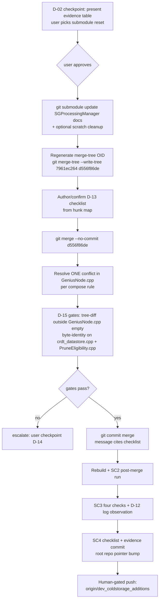

# Phase 13: Bootstrap Branch Merge & Composition Baseline - Research

**Researched:** 2026-11-16
**Domain:** Git merge composition (SuperGenius submodule) + local Windows verification infrastructure
**Confidence:** HIGH (every merge-surface claim verified read-only this session via `git merge-tree`, `git show`, `git diff`, `git log`, `git ls-tree`)

## Summary

This is a **git-merge composition phase**, not a feature-build phase. The forecast in CONTEXT.md ("only `GeniusNode.cpp` conflicts; all CRDT seams auto-merge", previously MEDIUM confidence) is now **CONFIRMED by dry-run**: `git merge-tree --write-tree 7961ec264 d556f86de` (git 2.48.1, run this session, read-only) reports **exactly one content conflict — `src/account/GeniusNode.cpp`** — and five auto-merged files (`GeniusNode.hpp`, `globaldb.cpp`, `globaldb.hpp`, `graphsync_dagsyncer.hpp`, `impl/graphsync_dagsyncer.cpp`). The conflict is a single region inside `GeniusNode::ShutdownForDestruction()`: our side added the lifecycle drain-barrier lock scope with its explanatory comment; their side added walk-timer/trust-handle cancellation inside the *same* lock scope. The compose rule is mechanical: keep our comment, keep the lock scope, add their two cancellation `if` blocks inside it. Everything else on the CRDT seam either lands as a pure branch blob (24 their-side-only files, including `crdt_datastore.cpp` and `PruneEligibility.cpp` — the D-15b byte-identity targets) or auto-merges with disjoint hunks.

The D-02 "dirty-tree drift" investigation resolves cleanly: the working tree's submodule pointers (`SGProcessingManager` @ `89d161b08`, `docs` @ `c6d8c8342`) are **exactly the merge-base values** — ancestor checks confirm both are ancestors of our recorded pointers (`dc8a994cb`, `77f4fcfd5`). The drift is *stale submodule checkouts* (never re-synced after our line advanced the pointers during the 2026-11 develop-merge), not local work. The merge itself moves **no** submodule pointers (merged tree keeps our recorded values, verified). Disposition recommendation for the human checkpoint: `git submodule update SGProcessingManager docs` before the merge; untracked scratch (`test-data/cold-read-freeze` case dirs, `SGProcessingManager/test/fixtures/`) collides with nothing (neither line tracks those paths) and is ignorable per D-02's presumption.

The verification mechanics are all pre-existing and enumerable: SC2 runs the full local ctest suite in the Windows build tree (`SuperGenius/build/Windows/Release` — binaries from the 7961ec264-era verification runs, Nov 3-4) pre/post with identical scope; SC3 cites named existing tests (branch's `node_startup_test` walk tests, our `cold_storage_fallback_test` 21 cases, `EraseSurfaceGateTest.SealKeyHasNoProductionHome`) plus a D-12 log observation with the exact parse-able log line `"cold read: rehydrated CID {} through the cold chain"`; GATE-03's grep is confirmed **already clean on working tree, branch, AND merged tree (0 quoted `"sealed"` literals)** — with a discovered PowerShell quoting trap that produces a false 49-match count if quotes are eaten. SC4 gets a clean mechanical mechanism: regenerate the `merge-tree` OID at execution time and diff the final merge commit against it — everything outside `GeniusNode.cpp` must be blob-identical.

**Primary recommendation:** Plan the phase as: (1) D-02 checkpoint with this session's evidence attached → submodule re-sync; (2) author the D-13 checklist from the hunk map below; (3) `merge --no-commit` → resolve the single ShutdownForDestruction conflict by composition → D-15a/D-15b mechanical gates → commit; (4) rebuild + SC2 pre/post pair (note: no full-suite run on exactly `7961ec264` is on record — budget a fresh pre-merge run); (5) SC3 four-check evidence; (6) SC4 checklist committed in the phase dir + root-repo pointer bump; (7) human-gated push creating `origin/dev_coldstorage_additions`.

<user_constraints>
## User Constraints (from CONTEXT.md)

### Locked Decisions

#### Merge execution & push posture
- **D-01:** **Push target is a NEW `origin/dev_coldstorage_additions`** — the v1.2 line name becomes canonical on origin; `origin/dev_blockstore` is accepted as going stale by decision (it sits at the same SHA `7961ec264` today, so nothing is lost at push time) — **Reversibility:** costly — creates a second canonical remote line; unwinding means re-pointing the team's remote line and rewriting the v1.2 remote-branch convention
- **D-02:** **Dirty-tree disposition is investigate-first, then a human checkpoint** — the working tree has local-only drift exactly on paths the merge itself moves: `SGProcessingManager` pointer `dc8a994cb→89d161b08` (+ untracked `test/fixtures/` inside it), `docs` pointer `77f4fcfd5→c6d8c8342`, untracked `test-data/cold-read-freeze` at SuperGenius root. The executor inspects what `89d161b08`/`c6d8c8342` contain vs the recorded pointers, reports, and the user picks reset-vs-keep BEFORE any merge command. Untracked scratch is presumed ignorable unless the investigation says otherwise
- **D-03:** **The executor performs the merge, step-gated** — `git merge --no-commit` dry-run first, resolve `GeniusNode.cpp` per the checklist, gate each resolution, then commit. Never a blind ours/theirs
- **D-04:** **Single evidence-complete push after ALL SCs pass** — merge commit + SC4 checklist/evidence push together, after SC2/SC3 pass locally. The push itself is a human checkpoint (executor never pushes — v1.1 D-03 discipline)

#### Pre-merge baseline & SC2 surface
- **D-05:** **SC2 is proven by a local Windows pre/post pair** — pre-merge run on `7961ec264` + post-merge run on the merge commit, same tree, same env, CloudflareWARP disconnected for network-dependent suites (documented environmental constraint, A/B-verified 2026-11-12). SC2's gate closes on local green; the origin CI run after the push is recorded as confirmation, not a gate — **Reversibility:** costly — this defines the zero-regression evidence contract for the gate phase of v1.2; loosening it re-opens what "zero regressions" means
- **D-06:** **"Full existing test suite" = full local, matched scope** — Tier-1+2+3 including dev-gated suites where they also ran pre-merge; identical scope on both sides of the pair; skips/failures-to-exclude listed explicitly side-by-side (the pairing is what makes the comparison honest)
- **D-07:** **Baseline = reuse a recent local run if suitable** — the executor verifies a recent full local run on exactly `7961ec264` exists (recency + suite completeness criteria are executor discretion); otherwise falls back to a fresh pre-merge full run
- **D-08:** **SC2 numbers are recorded in plan SUMMARY / commit messages only** — no standalone committed baseline artifact (deliberately lighter than v1.1 D-05). NOTE: this lightness applies to SC2 numbers ONLY — SC4's checklist + evidence remains a committed artifact per its own letter

#### SC3 verification-gate evidence
- **D-09:** **No new tests this phase** — the four checks are evidenced by filtered re-runs of existing v1.1 suites + the bootstrap branch's own validation tests + the existing GATE-03 check output, each cited per item in the SC4 checklist doc. Deterministic cold-before-peer enforcement is consciously deferred to Phase 15's evidence work — **Reversibility:** reversible — evidence posture; Phase 15 builds the real suites
- **D-10:** **Nothing new enters the CI Tier-1 contract this phase** (Tier-2/local-first posture for anything that does land) — the merged-line invariants ride existing Tier-1 suites only
- **D-11:** **GATE-03 via the existing enforcement re-run on the merged tree** — develop Phase 16 shipped a grep + ctest gate (zero quoted `"sealed"` literals in `src/`); re-run it as-is and cite the pass in the SC4 checklist. No new machinery
- **D-12:** **Cold-before-peer ordering = log-based observation** — run a cold-miss scenario and parse the fetch order from logs; observable-but-not-enforced is accepted for this phase (deterministic barrier-based proof is Phase 15 scope)

#### Conflict resolution & the SC4 grep gate
- **D-13:** **The `GeniusNode.cpp` checklist is authored pre-merge and amended as-run** — predicted conflict hunks + per-hunk resolution rules from branch-diff analysis BEFORE the merge; as-run outcomes amend it after
- **D-14:** **Arbitration = compose-by-default, escalate collisions** — cold-storage wiring is ours, bootstrap/walk logic is theirs, and `getNode` (the Phase-9 cold-read seam) is the composition point. True semantic collisions → user checkpoint. Same escalation if the conflict surface exceeds the "only `GeniusNode.cpp`" forecast (MEDIUM confidence until executed). Prior precedent: the develop-merge's "keep our 6-arg `BuildPayoutOutputs` but pass develop's local burn value" compose-don't-pick style
- **D-15:** **The grep gate makes two mechanical assertions** — (a) *auto-merge snapshot comparison*: `merge --no-commit` auto-result vs the committed result; hand-edits are allowed ONLY in `GeniusNode.cpp` (+ legitimately expected submodule pointer takes); (b) *symbol identity*: walk-bearing files (`crdt_datastore.cpp`, `PruneEligibility.cpp`, `graphsync_dagsyncer.cpp`) are byte-identical to the branch blobs wherever our side hadn't also touched them — **Reversibility:** costly — this is the mechanical definition of "composition-only" that SC4's evidence cites; weakening it post-hoc re-opens the re-derivation question
- **D-16:** **SC4 checklist + evidence live in the workstream phase dir** — `.planning/workstreams/rocksdb-backup/phases/13-bootstrap-branch-merge-composition-baseline/` (root repo; `commit_docs: true`). Process evidence stays with the workstream (v1.1 D-05 precedent), not in the SuperGenius product repo

### The Agent's Discretion
- Mechanics of capturing the auto-merge snapshot (stash-of-result vs temporary worktree vs diff-to-expected)
- Recency/completeness criteria for the "suitable recent local run" check (D-07)
- Log-parsing approach for D-12 (grep patterns, which existing scenario drives the cold miss)
- Investigation report format and depth for the D-02 checkpoint
- Checklist hunk granularity (per-function vs per-region predictions)
- Whether the branch's own test files need Windows-specific gating when they land via merge
- Whether the pre-merge baseline run must precede the submodule-pointer disposition (ordering of D-02 vs D-07 — pointers affect what "on 7961ec264" means)
- Merge-commit message shape (how the as-run summary references the checklist)

### Deferred Ideas (OUT OF SCOPE)
- "Fix Vulkan capability-probe deadlock/crash in ProcessingManager::Create path" (`.planning/todos/2026-08-10-fix-vulkan-capability-probe-deadlock-in-processingmanager-cr.md`) — reviewed 2026-11-16, NOT folded: keyword-only match, zero topical overlap.
- None else — no other deferred ideas.
</user_constraints>

<phase_requirements>
## Phase Requirements

| ID | Description | Research Support |
|----|-------------|------------------|
| RECOVER-01 | fix/trust-genesis-bootstrap is merged into dev_coldstorage_additions with the full existing suite green (Phase 13 gate for all recovery work) | Conflict surface verified to a single compose-able hunk (merge-tree dry-run this session); file inventory per side enumerated; SC2 pre/post pair mechanics, SC3 test-name map, SC4 mechanical gates, and D-02 disposition evidence all below |
</phase_requirements>

## Architectural Responsibility Map

| Capability | Primary Tier | Secondary Tier | Rationale |
|------------|-------------|----------------|-----------|
| Merge execution (submodule SuperGenius) | SuperGenius submodule git repo | — | Both branch tips live there; merge commit lands there |
| Submodule pointer disposition (D-02) | SuperGenius submodule + nested submodules | — | Dirty pointers are nested-submodule checkout state |
| Root-repo bookkeeping | GeniusNetwork root repo | — | Root records SuperGenius pointer; SC4 evidence commits here (`commit_docs: true`) |
| Push (SC1) | origin (GitHub: GeniusVentures/SuperGenius) | — | Creates NEW `origin/dev_coldstorage_additions` (verified: does not exist today) |
| SC2 test execution | Local Windows build tree (`SuperGenius/build/Windows/<Config>`) | — | ctest lanes + binaries live in the build tree; same tree both legs |
| SC3 evidence | Existing test binaries + logs | — | Filtered re-runs per D-09; no new tests |
| SC4 mechanical gates | git plumbing (merge-tree / diff) | — | Read-only object-DB comparisons; no runtime needed |

## Merge Conflict Surface — VERIFIED 2026-11-16 (dry-run)

> **Method:** `git merge-tree --write-tree --name-only 7961ec264 d556f86de` (git 2.48.1.windows.1). Writes only throwaway tree/blob objects into the object DB; no worktree or ref is touched. Result tree OID: `b91b84c94481ea542e567c951b83fe2f2057fee5`. The executor must **regenerate this OID at execution time** (deterministic for identical inputs, same git).

### Topology (verified today — matches CONTEXT specifics exactly)

- `dev_coldstorage_additions` (local HEAD) ≡ `dev_blockstore` ≡ `origin/dev_blockstore` = `7961ec264ab00d14efe99ceb857ec9796de8116b`
- `fix/trust-genesis-bootstrap` ≡ `origin/fix/trust-genesis-bootstrap` = `d556f86deab7fe78dead80fead1f333625b7a2ce`
- `origin/dev_coldstorage_additions` — **does not resolve** (does not exist; D-01's new remote line) [VERIFIED: `git rev-parse` unresolved this session]
- Merge base = `8ff74636bf21ad0bb4964574f2badcd42b17498c`
- Remote: `origin = git@github.com:GeniusVentures/SuperGenius.git`
- Branch carries **4 commits** [VERIFIED: `git log --oneline 8ff74636b..d556f86de`]:
  - `d556f86de` fix: add validated bootstrap history recovery
  - `6acee9c9a` fix: initialize UTXOs before certificate replay
  - `5c9b5fab9` fix: register certificate slot rules before consensus startup
  - `3b337643d` fix: fetch trust genesis before transaction startup

### Conflict verdict

**The CONTEXT forecast is CONFIRMED — no D-14 escalation on conflict-surface grounds.**

```
CONFLICT (content): Merge conflict in src/account/GeniusNode.cpp   ← the ONLY conflict
Auto-merging src/account/GeniusNode.hpp
Auto-merging src/crdt/globaldb/globaldb.cpp
Auto-merging src/crdt/globaldb/globaldb.hpp
Auto-merging src/crdt/graphsync_dagsyncer.hpp
Auto-merging src/crdt/impl/graphsync_dagsyncer.cpp
```

### The single conflict, verbatim (merged-blob line 2795)

Location: `GeniusNode::ShutdownForDestruction()`, immediately after `node_logger_->info( "GeniusNode shutdown start" )` [VERIFIED: extracted from merge-tree result blob this session]:

```cpp
<<<<<<< 7961ec264
        // Drain barrier: an in-flight StateTransition body (e.g. the detached
        // migration thread's INITIALIZING_DATABASE -> InitDatabase) may have
        // passed the shutdown gate before shutdown_started_ was set. Acquiring
        // lifecycle_mutex_ here waits for that body to finish so every member
        // read below -- tx_globaldb_ in particular -- observes final state, and
        // the tx_globaldb_->ShutdownNow() below stops/joins the CRDT rebroadcast
        // worker instead of leaking it to process exit (run 41936126485 exit-time
        // SegFault). Pairs with the post-lock shutdown re-check in
        // StateTransition: after this barrier no body is running and none can
        // start. Recursive mutex: safe if teardown is ever reached from a body
        // thread. Sits BEFORE io teardown so a blocked body can still complete;
        // bounded by one state body.
        {
            std::lock_guard<std::recursive_mutex> lifecycle_lock( lifecycle_mutex_ );
=======
        {
            std::lock_guard<std::recursive_mutex> lifecycle_lock( lifecycle_mutex_ );
            if ( bootstrap_walk_timer_ )
            {
                boost::system::error_code ignored;
                bootstrap_walk_timer_->cancel( ignored );
            }
            if ( trust_bootstrap_sync_handle_ )
            {
                trust_bootstrap_sync_handle_->cancel();
                trust_bootstrap_sync_handle_.reset();
            }
>>>>>>> d556f86de
        }
```

**Per-hunk compose rule (D-14 style, mechanical):** keep OUR comment block verbatim; keep the `{ std::lock_guard<std::recursive_mutex> lifecycle_lock( lifecycle_mutex_ ); }` opening (both sides identical there); insert THEIR two `if` blocks (`bootstrap_walk_timer_` cancel; `trust_bootstrap_sync_handle_` cancel + reset) inside the lock scope; keep the closing `}`. Optionally amend the comment's last line to note walk-timer cancellation also happens under the barrier. No semantic collision: both sides want the same lock acquired before member teardown; theirs adds member cleanup inside it. This is the D-13 checklist's hunk #1 and (verifiably) its only content hunk.

### Both-side hunk maps of `GeniusNode.cpp` (since merge base) — the D-13 authoring material

**OUR side** (`git diff 8ff74636b 7961ec264 -- src/account/GeniusNode.cpp`), 8 hunks — all cold-storage wiring, all outside their regions except one:

| Base line | Function/region (from context) | Content |
|---|---|---|
| @376 | startup/logging area | address logging (`Account Address {}`) |
| @581 | `LoadCrdtConfig()` | config load ordering comment: "CRDT config loads BEFORE the io thread pool spawns" |
| @593 | config parsing | `ParseColdStorageConfig` into `cold_storage_config_`, throws on error, `LogSummary()`, retention-configured-without-enabled check |
| @636 | constructor/init | `crdt_backup_config_` + `cold_storage_config_` passed to GlobalDB ctor (widened arg) |
| @708 | near `return;` + lifecycle lock | runtime-member release logging additions |
| @2158 | ctor wiring (`scheduler_, generator_, nullptr`) | cold-stack ctor arg additions |
| @2530 | **`ShutdownForDestruction()`** | **drain-barrier lock scope + comment (THE conflict)** |
| @3156 | `DeleteAccount` area | `return DeleteAccount( previous_address )` context |

**THEIR side** (`git diff 8ff74636b d556f86de -- src/account/GeniusNode.cpp`), 12 hunks — all bootstrap/walk machinery:

| Base line | Content (symbols) |
|---|---|
| @60 | includes (`MigrationManager.hpp` etc. + walk-related includes) |
| @433 (+44) | config reading: `force_bootstrap_walk` (bool, must-be-boolean error path), `bootstrap_walk_max_blocks`, `bootstrap_walk_max_retries` via `read_walk_limit`, INFO log of all three |
| @718 | `transition_in_progress_`/`transition_epoch_` state-machine bookkeeping |
| @796 | `private_network_id_` area |
| @804 | `blockchain_` guards |
| @866 | `blockchain_` guards (2nd) |
| @1047 | early-return guard |
| @1155 | return guard |
| @1437 | `NodeState::WAITING_FOR_TRUST_GENESIS` / `WAITING_FOR_BURN_GENESIS` state handling |
| @1453 (+149) | **`RequestBootstrapWalk()` implementation** (timer cancel, `force_bootstrap_walk_`/`tx_globaldb_`/`shutdown_started_` guard, retry-count vs `bootstrap_walk_max_retries_`, `PruneEligibility::CanRestoreElement( *db, element.key() )` guard during replay) |
| @1837 | `trust_bootstrap_sync_interval_` scheduling: `trust_bootstrap_sync_handle_.emplace( scheduler_->scheduleWithHandle( ... ) )` |
| @2530 | **`ShutdownForDestruction()` walk-timer/trust-handle cancellation (THE conflict)** |

Base line 2530 is the **only overlap**; every other hunk pair is disjoint, which is why the merge reports one conflict.

### File inventory per side (since merge base) [VERIFIED: `git diff --name-status` both directions]

- **Their side (29 paths, all `M`):** `example/node_test/sgns_config.json`; `src/account/GeniusNode.{cpp,hpp}`; `src/crdt/{crdt_data_filter.hpp,crdt_datastore.hpp,dagsyncer.hpp}`; `src/crdt/globaldb/{globaldb.cpp,globaldb.hpp,pubsub_broadcaster_ext.cpp}`; `src/crdt/graphsync_dagsyncer.hpp`; `src/crdt/impl/{crdt_data_filter.cpp,crdt_datastore.cpp,graphsync_dagsyncer.cpp}`; `src/migration/Migration3_6_0To3_7_0.cpp`; `src/transaction/{PruneEligibility.cpp,PruneEligibility.hpp,TransactionConsensusHandler.cpp,TransactionConsensusHandler.hpp,TransactionManager.cpp,TransactionManager.hpp}`; 9 test files (`test/src/account/{prune_eligibility_test,transaction_manager_certificate_fallback_test,transaction_manager_pending_lifecycle_test,tx_lookup_tri_state_test,tx_pruner_test}.cpp`, `test/src/blockchain/node_startup_test.cpp`, `test/src/crdt/{crdt_datastore_test,globaldb_erase_test}.cpp`, `test/testutil/genius_node_test_access.hpp`).
- **Our side (43 paths):** CI workflows, `build/*.cmake`, `cmake/FindZLIB.cmake`, submodule pointers `SGProcessingManager`+`docs`, the cold-storage stack under `src/crdt/globaldb/` (11 `A` files), `src/account/GeniusAccount.{cpp,hpp}`, `src/crdt/impl/crdt_set.cpp`, `src/processing/CMakeLists.txt`, `test/CMakeLists.txt`, `test/src/crdt/CMakeLists.txt`, 13 `A` cold test files, `test/tier1_audit_check.cmake`.
- **Overlap (6 paths):** `GeniusNode.cpp` (conflict), `GeniusNode.hpp`, `globaldb.cpp`, `globaldb.hpp`, `graphsync_dagsyncer.hpp`, `impl/graphsync_dagsyncer.cpp` (all auto-merge).

**D-15b consequence the planner must encode:** of the three walk-bearing files, only `crdt_datastore.cpp` and `PruneEligibility.cpp` are theirs-only → byte-identity to branch blobs applies. `impl/graphsync_dagsyncer.cpp` is touched by BOTH sides (our cold chain + their `HasStoredBlock`/`GetStoredNode`/`InheritRoutes`) → it auto-merges and is NOT byte-identical; its gate is hunk-preservation instead (see SC4 commands).

### Auto-merge semantic spot-checks (read from the merge-tree result blob) [VERIFIED]

- Merged `impl/graphsync_dagsyncer.cpp` preserves our 4-term `HasBlock` verbatim, in order, then adds their methods, then our `GetNodeWithoutRequest` → `FetchNodeFromColdStorage`. Their two hunks in that file are at base @185 (`InheritRoutes`, +19 lines) and @539 (`HasStoredBlock`/`GetStoredNode`, +11 lines) — disjoint from all nine of our hunks (@1, @25, @45, @225, @236, @456, @536, @549, @576).
- Merged `GeniusNode.hpp` carries both member families side by side: theirs (`force_bootstrap_walk_`, `RequestBootstrapWalk()`, `trust_bootstrap_sync_interval_{15}`, `trust_bootstrap_sync_handle_`, `bootstrap_walk_timer_`) and ours (`crdt::GlobalDB::ColdStorageOptions cold_storage_config_`).
- Merged `GeniusNode.cpp` contains 6 `RequestBootstrapWalk` occurrences — the walk body survived auto-merge intact outside the single conflict.

### The 4-term `HasBlock` (SC3 item 1 target), verbatim [VERIFIED: SuperGenius/src/crdt/impl/graphsync_dagsyncer.cpp:686-732, working tree]

```cpp
outcome::result<bool> GraphsyncDAGSyncer::HasBlock( const CID &cid ) const
{
    auto getNodeResult       = GetNodeFromMerkleDAG( cid );   // term 1
    auto getCachedNodeResult = GrabCIDBlock( cid );           // term 2
    ...
    if ( cold_read_hook_ != nullptr && cold_read_hook_->HasLocalCold( cid ) )   // term 3 (D-08 v1.1 Ph9, local tier only)
    ...
    if ( cold_read_hook_ != nullptr && cold_read_hook_->HasDisposed( cid ) )    // term 4 (D-11 v1.1 Ph11, dedup only)
```

`GetNodeWithoutRequest` resolves through the cold chain after both hot helpers miss ("READ-01 (v1.1 Phase 9): both hot helpers missed - resolve through the cold chain (LocalBlockStore -> S3BlockStore), OUTSIDE dagMutex_") and falls to `FetchNodeFromColdStorage( cid, grabResult )`.

### Branch interface additions (auto-merge surface in `dagsyncer.hpp`) [VERIFIED: `git diff 8ff74636b d556f86de -- src/crdt/dagsyncer.hpp`]

```cpp
/// Persistent block presence, excluding transient fetch caches. ...
virtual outcome::result<bool> HasStoredBlock( const CID &cid ) const
{
    return HasBlock( cid );
}
/// Reads stored bytes without a cache or network fetch. ...
virtual outcome::result<std::shared_ptr<ipfs_lite::ipld::IPLDNode>> GetStoredNode( const CID &cid ) const
{
    return GetNodeWithoutRequest( cid );
}
/// @brief Makes a retained parent's source peers available when fetching a child. ...
virtual void InheritRoutes( const CID &, const CID & ) {}
```

Base-class defaults delegate to `HasBlock`/`GetNodeWithoutRequest`; `GraphsyncDAGSyncer` overrides both (branch impl @561/@566 — per ARCHITECTURE research: raw hot datastore only, deliberately NOT the cold terms; that split is Phase 15's refinement target, NOT this phase's).

### Branch config knobs (land via `example/node_test/sgns_config.json` + their config-reading hunk) [VERIFIED: branch diff, quoted verbatim]

```json
"force_bootstrap_walk": false,
"bootstrap_walk_max_blocks": 10000,
"bootstrap_walk_max_retries": 8,
```

Defaults: walk **opt-in disabled**. SC3's walk/walk-ordering observations must explicitly enable `force_bootstrap_walk` in the scenario config (test-local change only — D-10: nothing new enters CI Tier-1).

## D-02 Dirty-Tree Disposition Evidence (investigation complete — feeds the human checkpoint)

| Item | Recorded (HEAD `7961ec264`) | Working tree (dirty) | Merge-base `8ff74636b` | Merged tree | Finding |
|---|---|---|---|---|---|
| `SGProcessingManager` | `dc8a994cb` | `89d161b08` | `89d161b08` | `dc8a994cb` (ours kept) | Dirty value = **merge-base value**; `git merge-base --is-ancestor 89d161b08 dc8a994cb` → 0 (**base value is an ANCESTOR of ours**) — our line moved the pointer FORWARD (`dc8a994` = "MoltenVK upgrade: clarify Vulkan::Vulkan covers iOS static MoltenVK too"); the submodule checkout is simply **stale, never re-synced** after the develop-merge. `89d161b08` = "Merge pull request #20 from GeniusVentures/dev_wholearchive" (origin/main HEAD of the nested repo). Zero local commits at risk. |
| `docs` | `77f4fcfd5` | `c6d8c8342` | `c6d8c8342` | `77f4fcfd5` (ours kept) | Same pattern: `c6d8c8342` ("docs(13-10): document genesis serving window and --serve-seconds", on `origin/worktree-agent-13-10-docs`) is an **ancestor** of our `77f4fcfd5` ("docs(08-03): Phase-8 CI-readiness disposition"). Stale checkout, not lost work. |
| untracked `test-data/` (SuperGenius root) | — | `cold-read-freeze/case-0..case-4` RocksDB dirs | — | — | Scratch from our own `cold_read_freeze_latency_test` runs. **Neither our line nor the branch tracks any `test-data/` path in SuperGenius** (`git ls-tree -r` both tips: zero matches) → **no untracked-file collision; the merge cannot be blocked by it**. Ignorable per D-02 presumption. |
| untracked `test/fixtures/` (inside SGProcessingManager) | — | present | — | — | Untracked scratch in the nested repo; survives any pointer movement (no tracked-path collision). Ignorable. |

**Key clarification for the checkpoint:** the working-tree drift is NOT the merge moving pointers, and the merge itself takes **no** submodule pointers at all (their side never touched them; merged tree = our recorded values). Therefore D-15a's "legitimately expected submodule pointer takes" clause is **vacuous for this merge** — the correct post-merge state has zero pointer changes, which actually *simplifies* the SC4 gate. The drift matters only because it makes the tree dirty: clean it first (`git submodule update SGProcessingManager docs` from the SuperGenius root — mutates working-tree checkouts only, after the user picks) so the `--no-commit` snapshot and post-merge `git status` are honest.

**Root repo posture** [VERIFIED]: GeniusNetwork root is on `dev_persisprocresults` (ahead 3 of origin), records SuperGenius @ `7961ec264`; its ` M SuperGenius` is purely `-dirty` (no pointer delta). After the merge commit exists, the root bump = update root's SuperGenius pointer to the merge SHA + commit phase-dir evidence (same-root-commit is fine; develop-merge precedent "root bump `53a77a7`").

## Standard Tooling (no packages installed — nothing to buy, nothing to hand-roll)

| Tool | Version | Purpose | Why |
|---|---|---|---|
| git (Windows) | 2.48.1.windows.1 [VERIFIED: `git version`] | merge, merge-tree dry-run, blob comparisons | `merge-tree --write-tree` (git ≥ 2.38) gives an exact object-level dry-run without touching worktree/refs |
| ctest (build tree) | ships with the configured build | SC2 lanes, filtered SC3 re-runs | Repo convention: run from inside `build/<Platform>/<Config>`; `ctest -L Tier1 --no-tests=error` fail-closed lane; **never `-LE`** (fails open) [CITED: v1.1 artifacts, testing-tiers.md] |
| MSVC 17 2022 build tree | `SuperGenius/build/Windows/{Debug,Release}` | SC2 pre/post builds | Both trees exist; Release test binaries freshest (Nov 3-4 = 7961ec264-era runs); Debug last built Oct 29 [VERIFIED: dir listing] |
| GTest | via ctest `--gtest_filter` | SC3 named re-runs | Filter grammar: positive-negative with ONE dash (`*-A:B:C`) [CITED: v1.1 research/PITFALLS] |

**Package Legitimacy Audit:** no external packages are installed or recommended by this phase — N/A.

## Architecture Patterns

### Merge execution flow (D-03 step-gate)



### Ordering note (discretion item resolved by evidence)

D-02 disposition (submodule re-sync) should precede the D-07 baseline decision — the pre-merge run's "on `7961ec264`" means the *committed* tree, and the stale nested-submodule checkouts do not affect SuperGenius builds (SGProcessingManager is a sibling service submodule, not a build input to the SuperGenius test binaries), but a clean tree removes ambiguity from the pair's environment record. WARP is currently **absent** from this machine (adapter not present [VERIFIED: `Get-NetAdapter`]) — the D-05 constraint is documented and currently moot; re-check adapter presence in the SC2 run record.

### SC3 evidence map (D-09: existing tests only, cited per item)

| SC3 item | Evidence vehicle | Exact names [VERIFIED unless noted] |
|---|---|---|
| 4-term `HasBlock` survives | `cold_storage_fallback_test` filtered re-run (Tier-1 lane) | `ColdStorageFallbackTest.D08_HasLocalColdBoolContractUnderFault`, `ColdStorageFallbackTest.D02_LocalTierHitPerformsZeroS3Gets` (term 3); disposed-marker term 4 exercised by the GC suites (`cold_storage_gc_test`, `cold_storage_gc_retrievability_test`) + code quote above |
| Cold-chained `GetNodeWithoutRequest` | `cold_storage_fallback_test` | `ColdStorageFallbackTest.D01_S3TierHitEndToEnd`, `ColdStorageFallbackTest.D03_LocalUnavailableFallsThroughToS3`, `ColdStorageFallbackTest.SC4_RehydrateSilence_BytesOnlyNoMarkers` (21 cases total in suite — full list enumerated in-repo) |
| GATE-03 seal permanence (D-11) | grep + ctest, as-is | grep: 0 quoted `"sealed"` literals in `src/` (verified 0 on working tree, branch, **and merged tree** this session); ctest: `EraseSurfaceGateTest.SealKeyHasNoProductionHome` in `test/src/crdt/crdt_erase_test.cpp` (exists in working tree [VERIFIED]) — scans production bodies at runtime |
| Cold-before-peer fetch ordering (D-12) | log observation on a cold-miss scenario | parse `"cold read: rehydrated CID {} through the cold chain"` (debug, `graphsync_dagsyncer.cpp:780`) and `"cold read: chain miss for CID {} (class={}, fromRemoteTier={})"` (:802) — assert a cold-chain hit line precedes any peer-fetch activity for that CID. Branch walk knobs (`force_bootstrap_walk=true` in the scenario config) drive the walk-shaped cold miss; fallback tests drive the read-shaped one. Observable-not-enforced per D-12. |

### Branch validation tests landing via the merge (their-side test files — SC3 citation pool)

- `node_startup_test.cpp` (binary exists in Release tree, Oct 29) [VERIFIED: branch blob]:
  - `BootstrapRecoverySettingsAreLoadedStrictlyFromSgnsConfig`
  - `ForcedBootstrapWalkRunsBeforeBlockchainIsReady`
  - `ForcedBootstrapWalkRetriesLateValidatorAfterReady`
  - `ProcessingHeadFetchesFullNodeAncestryBeforeBlockchainGenesis`
  - `TrustBootstrapRequestsExistingHeadsAfterPeerArrives`
- `prune_eligibility_test.cpp`: 40 cases incl. the four `CanRestoreElement*` cases (`AllowsUnknownTransactionsAndOrdinaryKeys`, `PreservesTransactionErasedWithPruneMarker`, `FailsClosedForMalformedPruneMarker`, `FailsClosedWhenValueAndPruneMarkerBothExist`) and the `PruneMarker_*`/`PrunedEraseDriver_*` families
- `tx_pruner_test.cpp` (24 cases incl. `RestartMatrix_*`), `tx_lookup_tri_state_test.cpp` (5), `transaction_manager_pending_lifecycle_test.cpp`, `transaction_manager_certificate_fallback_test.cpp`, `crdt_datastore_test.cpp`, `globaldb_erase_test.cpp` (their-side `M`)
- Discretion flag (CONTEXT): these land via merge — none are Tier-labeled on our side; they ride the **default fail-open full lane** (they were green on develop). No Windows-specific gating is warranted unless SC2 shows otherwise (executor discretion, document either way).

### SC2 lane mechanics (D-05/D-06/D-07)

- Tree choice: **Windows Release** (freshest `7961ec264`-era binaries; Nov 3-4) — one tree for both legs.
- "Full existing suite" shape: the full ctest run of the configured tree (develop Phase 16 precedent: full `ctest` → 150/151 with one `requires_foundry` family flake, isolated re-run green [CITED: 16-VERIFICATION]) plus the Tier-1 fail-closed lane `ctest -L Tier1 --no-tests=error` (v1.1 Phase 12: 10/10 then 11/11 incl. cold suites [CITED]). The `requires_foundry` family (bridge/anvil) is the known exclusion — record it identically on both legs (D-06 side-by-side skips).
- **D-07 finding: no full-suite run on exactly `7961ec264` is on record.** The 2026-11-13 develop-merge verification ran filtered suites only (gc 22/22, crdt_test 47/47, retrievability 4/4, fallback 21/21 [CITED: develop-merge note]). Budget a **fresh pre-merge full run** unless the executor's discretion criteria accept the Nov 3-4-era artifacts (they predate `7961ec264`'s keep-seal commit only if built before it — timestamps straddle; a fresh run removes the doubt cheaply relative to the phase's stakes).
- Build time: incremental rebuild post-merge on the cached tree (only the merge-touched translation units + dependents); a cold tree is multi-hour (develop P16 noted "multi-hour cold build (src/account + src/blockchain + ProofSystem + evmrelay)"). Plan the post-merge rebuild as incremental on the existing Release tree.

## Don't Hand-Roll

| Problem | Don't Build | Use Instead | Why |
|---|---|---|---|
| Merge dry-run / conflict forecast | Ad-hoc 3-way diff scripts | `git merge-tree --write-tree` | Object-level, uses the real ORT strategy — the dry-run IS the auto-merge result; ad-hoc diffs mis-predict |
| Auto-merge snapshot capture (D-15a) | Stash-of-result / temp worktree choreography | Regenerate the `merge-tree` OID at execution time; post-commit `git diff <oid> HEAD` | Same machinery produces both trees; a tree-vs-tree diff is exact and leaves no worktree state to clean up |
| Symbol-identity gate (D-15b) | Content greps for "similar code" | `git diff --exit-code d556f86de HEAD -- <paths>` | Blob identity is binary and cheap; similarity greps are refutable |
| GATE-03 grep | Naive `git grep '"sealed"'` from PowerShell | See Pitfall 1 — quote-safe invocation below | PowerShell strips embedded double quotes → 49 false matches observed this session |

## Common Pitfalls

### Pitfall 1: PowerShell eats embedded quotes in git grep (found live this session)
**What goes wrong:** `git grep -n '"sealed"' -- src/` from PowerShell 5.1 passes `sealed` (unquoted) to git → matched 49 lines of harmless `is_sealed`/`was_sealed` identifiers — a false GATE-03 failure.
**How to avoid:** pipe instead: `git grep -n sealed -- src/ | Select-String -SimpleMatch '"sealed"'` (verified: 0 matches on all three trees), or use `--%` stop-parsing.
**Warning signs:** any quoted-literal grep returning word-only matches.

### Pitfall 2: Confusing the D-02 drift with merge pointer takes
**What goes wrong:** treating the dirty `SGProcessingManager`/`docs` values as "what the merge wants" and preserving them in the merge commit — recording a **rollback** of our advanced pointers.
**Why:** the dirty values are the merge-BASE values (stale checkouts), and the merged tree verifiably keeps ours.
**How to avoid:** the D-15a tree-diff gate catches it (a pointer change outside `GeniusNode.cpp` ≠ empty diff → gate fails loudly). Re-sync submodules before merging.

### Pitfall 3: Stale topology at execution time
**What goes wrong:** branch tips verified 2026-11-16 drift (develop/branch advances) → the checklist and merge-tree OID no longer describe the merge.
**How to avoid:** re-run the topology block + merge-tree regeneration as the merge task's first steps; any deviation from this research's inventory → re-amend the D-13 checklist before `merge --no-commit` (D-14 escalation if the surface grows).

### Pitfall 4: SC2 legs run in different trees/configs
**What goes wrong:** pre-merge on Debug, post-merge on Release (or one leg with cold storage OFF) — the pair is dishonest.
**How to avoid:** one tree (Windows Release), same configure (`SGNS_COLD_STORAGE` state recorded), same env; WARP adapter absence noted per leg. The `requires_foundry` exclusion applied identically both legs.

### Pitfall 5: Expecting walk tests to do anything with defaults
**What goes wrong:** running `node_startup_test` walk cases and seeing them pass vacuously — `force_bootstrap_walk` defaults to `false`.
**How to avoid:** the branch's own tests configure their scenarios explicitly (`BootstrapRecoverySettingsAreLoadedStrictlyFromSgnsConfig` proves strict loading); for any manual D-12 scenario, set the knob in the scenario config, never in committed example configs.

### Pitfall 6: ctest label selection failing open
**What goes wrong:** `-LE` exclusions silently include unlabeled tests.
**How to avoid:** repo rule — `ctest -L Tier1 --no-tests=error` (fail-closed); label audit (`tier1_static_audit`, `test/tier1_audit_check.cmake`) exists on our side and rides the lane.

### Pitfall 7: The `-dirty` root pointer masking real drift
**What goes wrong:** root repo shows ` M SuperGenius` after the merge commit — could be the legitimate new pointer OR leftover dirt.
**How to avoid:** after `git submodule update`, the ONLY expected root change post-merge-commit is the pointer advancing to the merge SHA; verify with `git diff SuperGenius` (should show exactly the old→new SHA, no `-dirty`).

### Pitfall 8: WARP reappearing mid-phase
**What:** the CloudflareWARP adapter (100.96.0.1) breaks local network suites; A/B-verified environmental (2026-11-12). Currently ABSENT on this machine.
**How to avoid:** document per-leg adapter status in the SC2 record; if present, disconnect before network-dependent suites (documented constraint, don't chase as regression).

## Code Examples (exact executor recipes)

### Read-only topology + dry-run re-verification (first task of the merge)

```powershell
# From W:\gnus\GeniusNetwork\SuperGenius (all read-only)
git rev-parse HEAD dev_coldstorage_additions dev_blockstore origin/dev_blockstore fix/trust-genesis-bootstrap origin/fix/trust-genesis-bootstrap
git merge-base 7961ec264 d556f86de            # expect 8ff74636b...
git status --porcelain=v1 -b                   # expect clean after D-02 disposition
git merge-tree --write-tree --name-only 7961ec264 d556f86de   # capture fresh OID; expect ONLY GeniusNode.cpp conflicted
```

### D-15a — auto-merge snapshot comparison (the recommended discretion mechanics)

```powershell
# After regenerating: $oid = <fresh merge-tree OID>
# ... merge --no-commit, resolve GeniusNode.cpp, commit as $MERGE ...
# Assertion 1: NOTHING outside GeniusNode.cpp differs from the auto-merge tree
git diff --exit-code $oid $MERGE -- . ':!src/account/GeniusNode.cpp'
# Assertion 2: the GeniusNode.cpp delta vs auto-merge == exactly the conflict resolution (review artifact for the checklist)
git diff $oid $MERGE -- src/account/GeniusNode.cpp
```

(There are **no** expected submodule pointer takes in this merge — assertion 1 covers them; any pointer diff is a gate failure, see Pitfall 2.)

### D-15b — symbol identity

```powershell
# Byte-identity on the two theirs-only walk-bearing files (expect exit 0, no output)
git diff --exit-code d556f86de HEAD -- src/crdt/impl/crdt_datastore.cpp src/transaction/PruneEligibility.cpp
# graphsync_dagsyncer.cpp is BOTH-sides: assert their three symbols survive verbatim
git show HEAD:src/crdt/impl/graphsync_dagsyncer.cpp | Select-String 'GraphsyncDAGSyncer::(HasStoredBlock|GetStoredNode|InheritRoutes)'
# ...and that the diff vs the branch blob is confined to our cold-chain regions (manual review, cite in checklist)
git diff d556f86de HEAD -- src/crdt/impl/graphsync_dagsyncer.cpp
```

### D-11 — GATE-03 re-run (quote-safe)

```powershell
# grep half (PowerShell-safe; expect 0)
git grep -n sealed -- src/ | Select-String -SimpleMatch '"sealed"'
# ctest half (from inside the build tree)
ctest -C Release -R crdt_erase_test --output-on-failure
```

### SC3 filtered re-runs (from `SuperGenius/build/Windows/Release`)

```powershell
ctest -C Release -R cold_storage_fallback_test --output-on-failure
ctest -C Release -R node_startup_test --output-on-failure            # branch walk tests land via merge
ctest -C Release -R "prune_eligibility_test|tx_pruner_test" --output-on-failure
ctest -C Release -L Tier1 --no-tests=error                            # fail-closed lane
```

### D-12 — cold-before-peer log parse

```powershell
# Run a cold-miss scenario (walk-shaped: force_bootstrap_walk=true scenario config; or fallback-suite cold-miss case) with debug logs captured,
# then assert ordering per CID: a "cold read: rehydrated CID <cid> through the cold chain" line
# precedes any peer-fetch activity for that CID. Chain-miss class line for the negative control:
#   "cold read: chain miss for CID {} (class={}, fromRemoteTier={})"
Select-String -Path <run-log> -SimpleMatch 'cold read: rehydrated CID','cold read: chain miss for CID'
```

## Runtime State Inventory (D-02 — merge-moved paths; explicitly answered)

| Category | Items Found | Action Required |
|----------|-------------|------------------|
| Stored data | None — no database/store keyed by branch names; the merge moves source only | None |
| Live service config | None — no external service consumes the branch name | None |
| OS-registered state | None (WARP adapter absent today; noted as environmental constraint, not state) | None |
| Secrets/env vars | None — no secrets or env names reference the branches | None |
| Build artifacts | Stale nested-submodule checkouts (`SGProcessingManager` @ base value, `docs` @ base value) + untracked scratch (`test-data/cold-read-freeze` cases, `SGProcessingManager/test/fixtures/`) | `git submodule update SGProcessingManager docs` after user checkpoint (mutating — executor, post-checkpoint); scratch left in place unless user says otherwise |
| Root-repo pointer | Root records SuperGenius @ `7961ec264` (currently `-dirty` only) | Post-merge: root pointer bump to merge SHA + evidence commit (single root commit acceptable) |

## Assumptions Log

| # | Claim | Section | Risk if Wrong |
|---|-------|---------|---------------|
| A1 | Full local ctest run fits a session-scale window on the cached Windows Release tree (incremental rebuild post-merge) | SC2 mechanics | Schedule slip only; a cold tree is multi-hour (develop P16 note) — detected at first build |
| A2 | `merge-tree --write-tree` output == the real merge's auto-result for all non-conflicted paths (same ORT machinery, same inputs, same git 2.48.1) | SC4/D-15a | Low: the D-15a tree-diff gate would surface any divergence as a loud non-empty diff — fail-safe direction |
| A3 | Debug-level logging is obtainable in the D-12 scenario (the "rehydrated" line is `logger_->debug`) | SC3/D-12 | If the scenario harness cannot raise log level, fall back to the fallback-suite cases that assert chain order in-process; flag in checklist |
| A4 | The branch's walk tests configure their own scenarios (no committed config change needed for them to exercise the walk) | SC3 | Their `BootstrapRecoverySettingsAreLoadedStrictlyFromSgnsConfig` + `ForcedBootstrapWalk*` names strongly imply self-contained fixtures; verified only by name/branch-diff, not by reading test bodies |

## Open Questions (RESOLVED)

1. **D-07 baseline acceptance** — (RESOLVED → implemented 13-01 Task 3) No full-suite run on exactly `7961ec264` is on record (only filtered suites + Nov 3-4-era binaries). Resolution: the fresh pre-merge full run is planned as 13-01 Task 3, with the executor-discretion criteria recorded (same tree, same configure, complete scope) AND binary provenance established — HEAD verified by rev-parse then an incremental Release rebuild before the run, so the cached Nov 3-4 binaries never serve as the denominator.
2. **Full-suite runtime on the Release tree** — (RESOLVED → implemented 13-01 Task 3 + 13-03 Task 1) Not recorded in artifacts read. Resolution: both SC2 legs capture wall-clock duration (Get-Date bracket around each ctest invocation) into their task/plan SUMMARY records — SUMMARY-only per D-08; the numbers feed Phase 19 planning.
3. **Walk-test Windows behavior post-merge** — (RESOLVED → implemented 13-03 Task 2) The branch's `node_startup_test` walk cases were validated on their line; their behavior on the merged line with cold storage compiled ON is exactly what SC2/SC3 observes. Resolution: walk-case outcomes are recorded individually in the SC3 item-2 row; a trust-gate fixture failure routes through the `local_trust_setup.hpp` migration kit precedent (canonical ref) before any gating consideration, and a genuine walk-logic failure escalates per D-14.

## Environment Availability

| Dependency | Required By | Available | Version | Fallback |
|------------|------------|-----------|---------|----------|
| git | merge + all gates | ✓ | 2.48.1.windows.1 | — |
| MSVC build tree (Release) | SC2/SC3 | ✓ | binaries cached Nov 3-4 | Debug tree (older, Oct 29) |
| ctest | SC2/SC3 lanes | ✓ | via build tree | — |
| CloudflareWARP (absence of) | network-suite legs | ✓ absent | — | disconnect if reappears; document |
| origin SSH push access | SC1 push | not probed (human-gated anyway) | — | human executes push (D-04) |
| `requires_foundry` family | SC2 full suite | environmental exclusion | — | record identically both legs (D-06) |

**Missing dependencies with no fallback:** none (the push is deliberately human-gated, not missing).

## Security Domain

`security_enforcement: true`, ASVS level 1, `security_block_on: high`. This phase merges existing first-party code and adds no new input surface, network surface, or credential handling.

| ASVS Category | Applies | Standard Control |
|---------------|---------|-----------------|
| V2 Authentication | no | no new auth surface (branch's trust-genesis work alters node bootstrap auth flow but is first-party code validated on its own line; SC2/SC3 re-run its tests) |
| V3 Session Management | no | — |
| V4 Access Control | no | — |
| V5 Input Validation | no | no new parsers land from OUR side; branch's config reader (`force_bootstrap_walk` must-be-boolean, fail-loud) lands via merge and is covered by `BootstrapRecoverySettingsAreLoadedStrictlyFromSgnsConfig` |
| V6 Cryptography | no | no crypto changes in the merge's file inventory |

| Pattern | STRIDE | Standard Mitigation |
|---------|--------|---------------------|
| Tampering via merge resolution drift (re-derived logic silently differing from the validated branch) | Tampering | D-15a/D-15b mechanical gates — tree-diff outside `GeniusNode.cpp` empty + blob identity to branch |
| Supply-chain-style accidental content in the merge commit | Tampering | same D-15a gate (any unexpected path lights up); branch tips pinned to verified SHAs |
| Push of unverified content | Tampering | D-04: push is human-gated, after SC2/SC3 local green; single evidence-complete push |

## Project Constraints (from AGENTS.md / workspace instructions)

- **Tech stack discipline:** C++17/C++20, CMake, MSVC 17 2022 on Windows; builds originate from `build/<Platform>/<Debug|Release>/` — main projects have NO root `CMakeLists.txt` (matches the build-tree facts above).
- **Coding standard:** Corelinux-derived style per `Coding Standards.md` (Ullman braces, PascalCase, `m_`/trailing-underscore) — applies only to the one hand-resolved hunk's optional comment amendment; no new code otherwise.
- **Wire formats:** Protobuf; this merge touches none (no `.proto` in either side's inventory — verified by file list).
- **GSD workflow enforcement:** file changes go through the GSD phase flow (this phase IS the flow); executor never pushes (D-04 restates the v1.1 discipline).
- **No root `copilot-instructions.md`, no `.codex/skills`/`.agents/skills` at repo root** [VERIFIED: Test-Path false] — project instruction surface is `AGENTS.md` (attached) + `.planning/STATE.md` scope (hook-enforced).

## Sources

### Primary (HIGH confidence — verified read-only this session, in the SuperGenius submodule)
- `git merge-tree --write-tree 7961ec264 d556f86de` → tree `b91b84c94481ea542e567c951b83fe2f2057fee5`; conflict file list; auto-merge file list
- Merged-blob reads: `GeniusNode.cpp` (conflict region @2795; 6× `RequestBootstrapWalk`), `GeniusNode.hpp` (both member families), `impl/graphsync_dagsyncer.cpp` (4-term `HasBlock` + `HasStoredBlock`/`GetStoredNode`/`GetNodeWithoutRequest` ordering)
- Working tree `src/crdt/impl/graphsync_dagsyncer.cpp:686-732` (4-term `HasBlock` verbatim; cold-chain comments; log lines :780/:802), `src/crdt/dagsyncer.hpp`, `src/crdt/graphsync_dagsyncer.hpp`
- Both-direction `git diff --name-status` since `8ff74636b`; hunk maps of `GeniusNode.cpp` and `impl/graphsync_dagsyncer.cpp` (both sides)
- `git diff 8ff74636b d556f86de -- src/crdt/dagsyncer.hpp`, `-- example/node_test/sgns_config.json`
- GATE-03 grep (quote-safe): 0 on working tree / `d556f86de` / merged tree; `crdt_erase_test.cpp` + `EraseSurfaceGateTest.SealKeyHasNoProductionHome` present
- D-02: `git ls-tree` (base/line/branch/merged pointers), `git diff` pointer deltas, `merge-base --is-ancestor` (both nested repos), nested `git log -1`, `git status --porcelain`, `test-data/` listing, branch-tracked-path collision checks (zero)
- Branch test inventories: `git show d556f86de:test/...` (`node_startup_test`, `prune_eligibility_test`, `tx_pruner_test`, `tx_lookup_tri_state_test`, `crdt_datastore_test`)
- Topology: `git rev-parse` (incl. unresolved `origin/dev_coldstorage_additions`), `git merge-base`, `git log 8ff74636b..d556f86de` (4 commits), `git remote -v`
- Build trees: `build/Windows/{Debug,Release}` binary timestamps; root repo `git status`/`git ls-tree HEAD SuperGenius`

### Secondary (MEDIUM confidence — cited from project artifacts)
- `SuperGenius/.planning/phases/16-erasure-primitives-bookkeeping-hardening/16-VERIFICATION.md` — GATE-03 record; full-suite 150/151 precedent; multi-hour cold-build note
- `.planning/workstreams/rocksdb-backup/milestones/v1.1-phases/12-*/` — ctest lane rules, Tier discipline, Tier-1 lane counts
- `thirdparty/sgns-blockstore/docs/testing-tiers.md` — tier contract, `-L` fail-closed rule
- `.planning/workstreams/rocksdb-backup/notes/develop-merge-erase-vs-cold-storage-gap.md` — merge forecast origin, WARP note, filtered-suite verification (2026-11-13)
- `.planning/research/ARCHITECTURE-v1.2-rocksdb-backup.md` — walk anchors (`crdt_datastore.cpp:212-470` walk functions; `PruneEligibility.cpp:156-170` `CanRestoreElement`; `GeniusNode.cpp:1571-1630` `RequestBootstrapWalk`), `HasStoredBlock` = raw-hot semantics, conflation-bug framing (Phase 15 scope)
- `.planning/research/{SUMMARY,PITFALLS}-v1.2-rocksdb-backup.md` — external gate #2 spec, rederivation pitfall (P10), walk-lane portability traps

## Metadata

**Confidence breakdown:**
- Merge conflict surface: HIGH — dry-run executed this session; single conflict read verbatim from the merged blob
- D-02 disposition: HIGH — ancestor checks + content IDs verified; disposition recommendation is advisory (user checkpoint decides)
- SC2/SC3 mechanics: HIGH for names/commands (verified in-tree); MEDIUM for runtime expectations (durations unrecorded — A1)
- SC4 gates: HIGH for mechanism; A2 covers the merge-tree≡real-merge equivalence (fail-safe direction)

**Research date:** 2026-11-16
**Valid until:** topology-sensitive — re-verify tips before execution (Pitfall 3); otherwise 30 days
