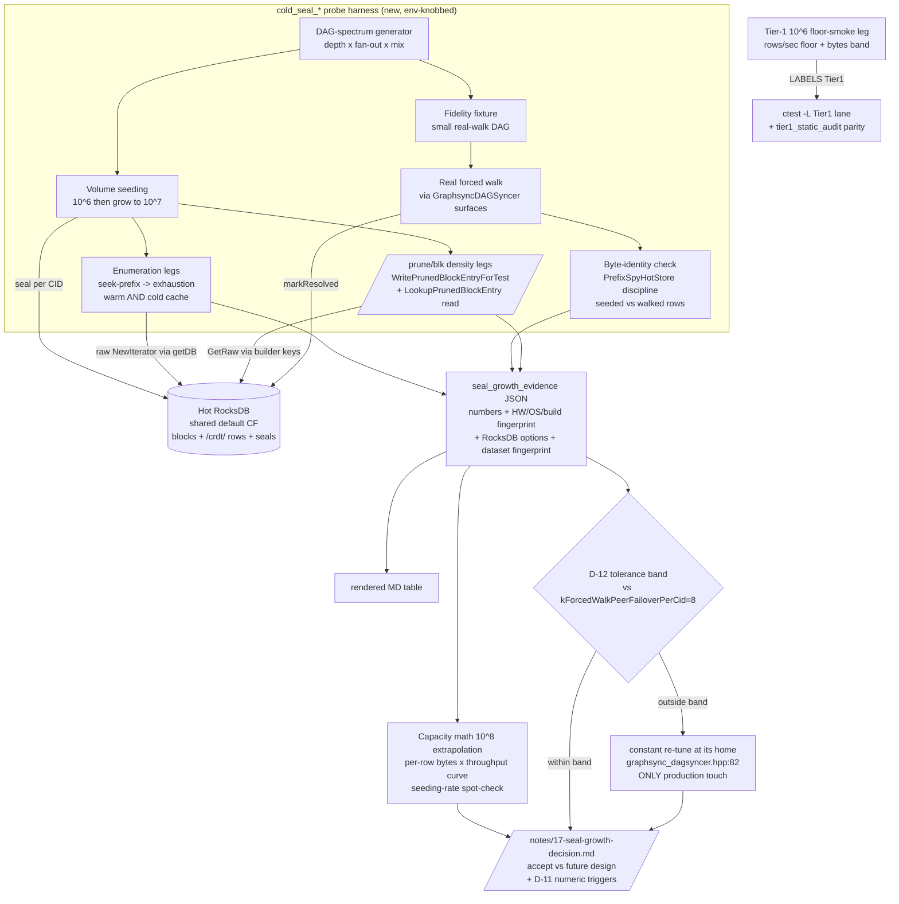

# Phase 17: Seal Growth Measurement & Decision - Research

**Researched:** 2026-11-18
**Domain:** Seal keyspace measurement (RocksDB `<cid>sealed` rows) + walk-bound validation + capacity-math decision record
**Confidence:** HIGH (in-repo code anchors verified verbatim at the ruled commit line; measurement methodology grounded in four landed harness precedents)

## Summary

Phase 17 measures the seal keyspace — the monotone, never-deleted `<cid>sealed` text rows both pruners retain by invariant — and records the accept-hot-growth-vs-future-design decision with capacity math. The research established the complete anatomy of the measured surface: seal rows are **empty-valued text keys** built as `<cid-string> + "sealed"` by the **vendored** ipfs-lite-cpp `RocksdbDatastore` (`thirdparty/ipfs-lite-cpp/ipfs_lite/ipfs/impl/datastore_rocksdb.cpp:48-66`), living in the **same default column family** as block binary keys and CRDT rows in the one hot RocksDB. The seal-key literal is governed by **GATE-03** (develop ruling, mirrored in `ColdStorageManager.cpp:1210-1212`): *"the seal-key literal lives only in the vendored RocksdbDatastore; markResolved/isResolved are its merkle-dag aliases. Never hand-construct the key here."* — so the probe MUST seed through the sanctioned `seal()`/`markResolved` surfaces and MUST NOT edit the vendored file (zero-new-dependencies rule pins it unedited).

The mandated anchor re-location was executed: the final post-Phase-16 line is SuperGenius submodule commit **`741980f5dc461aa964edb93f7f52a85a79c2ee51`** (`dev_coldstorage_additions` HEAD after 16-03; 7 commits after Phase 16's research base `af644481f`). All 20+ anchors were re-verified against it (full record with verbatim quotes below). A second directive finding: **the CONTEXT's premise that the v1.1 walk-recovery numbers live under `milestones/v1.1-phases/` is imprecise** — the v1.1 artifacts contain GC-reachability-walk and audit-walk material only (grep-verified, zero forced-walk-recovery hits); the numbers Phase 15 D-06 actually derived from are (a) in-code constants (verified) and (b) **develop-line `SuperGenius/.planning/phases/19-pruned-node-survival-recovery-hardening/19-07-SUMMARY.md`** (`RefusalFailover ≤ 8`, `PrunedMesh Phase B [1,4]`). SC3's capacity math should cite the derivation comment at `graphsync_dagsyncer.hpp:58-82`, those 19-07 numbers, and this phase's own probe numbers.

One further precision: the root-level `cold_storage_soak_test.cpp` / `cold_storage_wallclock_soak.cpp` / `cold_storage_spill_test.cpp` are **1-byte placeholder stubs, not harnesses** — the real wall-clock precedents are `SuperGenius/test/src/crdt/cold_storage_wallclock_soak.cpp` (env-knobbed, minimal-stack, stdout-status-as-evidence) and the committed evidence trio under `milestones/v1.1-phases/12-integration-hardening-fault-races-fresh-clone-proof/12-soak-evidence/`.

**Primary recommendation:** Build the probe as a `cold_`-prefixed gtest target in `SuperGenius/test/src/crdt/` following the wallclock-soak's minimal-stack construction (plain `storage::rocksdb` + `IpfsRocksDb` + vendored `RocksdbDatastore`), seed seals ONLY via `seal()`/`markResolved`, enumerate ONLY via the raw `getDB()` iterator with a `"sealed"`-suffix filter, land the bounded 10⁶ floor leg in Tier-1 (extending the existing label contract), keep 10⁷/10⁸ dev-gated one-shot, and write the decision record as `notes/17-seal-growth-decision.md` beside Phase 16's rulings doc.

<user_constraints>
## User Constraints (from CONTEXT.md)

### Locked Decisions

**Scale strategy (SC1 coverage)**
- **D-01:** **Hybrid coverage — materialize 10⁶ + 10⁷, extrapolate 10⁸** — the two smaller scales get real materialized rows; the 10⁸ number derives from measured per-row bytes + the enumeration throughput curve, spot-checked against the observed seeding rate. Tractable runs, defensible 10⁸ math. Full materialization of 10⁸ was considered and declined (size unknown until per-seal bytes are measured; likely tens of GB + a long one-shot seed for one data point); model-only-at-scale was declined (weakest evidence for SC1's enumeration-at-scale claim)
- **D-02:** **Growing DB — one dataset grown 10⁶ → 10⁷ in place** — cumulative growth (LSM levels, compaction state, fragmentation) is exactly what a long-lived archive node looks like; fresh-per-leg hides it. A fresh-DB control leg can be added later if the curve looks anomalous
- **D-03:** **Full-iteration enumeration measurement** — seek-to-prefix → iterate to exhaustion at each scale point; record rows/sec + wall time + bytes scanned, warm AND cold cache. Direct evidence for SC1's enumeration-cost claim (sampled windows leave the exhaustion cost — the number a maintenance sweep pays — inferred)

**Workload shape (what "representative" means)**
- **D-04:** **Seed + fidelity leg — direct seal-keyspace seeding for volume, one real-walk leg for row-shape proof** — the harness seeds seal rows directly (existing key builders; Phase 14 D-08 journal-injection precedent) for the volume legs, PLUS one small real-walk leg proving seeded rows are byte-identical to walk-produced seals (Phase 11 prefix-spy instrument). Decouples scale from walk speed; the fidelity leg is what makes direct seeding admissible evidence — **Reversibility:** costly — dropping the fidelity leg later re-opens the "seeded rows ≠ real seals" objection that the whole evidence chain rests on
- **D-05:** **Knobbed DAG spectrum** — env-knobbed generator (chain depth × fan-out breadth × mix ratio); ancestry density is measured across a controlled spectrum (deep chain, wide fan-out, mixed), not one arbitrary shape. Pathological extremes beyond the spectrum endpoints were declined (re-introduces worst-case modeling the capacity math does not need — see D-13)
- **D-06:** **Ancestry-density source = `/prune/blk` back-references** — density computed from Phase 15 D-02's back-reference records (erased-at generation + `/prune/tx` hash) over the fixture DAGs. Honors the recorded cross-phase dependency directly — **Reversibility:** costly — switching the density source (e.g. to walk instrumentation) re-opens the Phase 15 D-02 contract and orphans the back-reference record's stated justification

**Evidence tiering & re-runnability**
- **D-07:** **Tier-1 10⁶ floor-smoke leg + dev-gated one-shot big legs** — a bounded 10⁶-scale leg enters the Tier-1 CI contract asserting floors (enumeration rows/sec, per-row bytes band) so seal-shape/size regressions get caught by CI; the 10⁷ growing-DB run and the 10⁸ extrapolation stay dev-gated one-shot with committed numbers. Extends the Phase 14 D-09 / Phase 16 D-09 fresh-clone-safe Tier-1 precedent and feeds the Phase 19 three-platform capstone — **Reversibility:** costly — a Tier-1 suite entry becomes part of the lane contract the Phase 19 capstone proves green on three platforms
- **D-08:** **Reusable harness, not one-shot scripts** — env-knobbed benchmark target (scale, DAG-shape, cache-state knobs) checked in as a first-class tool; the decision record documents how to re-run it
- **D-09:** **JSON + rendered MD table evidence** — machine-readable JSON (raw numbers, hardware/OS/build fingerprint, RocksDB options, dataset fingerprint) beside a human-readable table. The numeric triggers (D-11) cite the JSON

**Decision record & triggers (SC3)**
- **D-10:** **Workstream rulings doc + STATE.md one-liner** — a dedicated decision record in the workstream planning tree carries the full capacity math, options considered, and triggers (Phase 16 D-12 rulings-doc precedent), plus a one-line key-decisions entry in STATE.md. Exact filename/home is agent discretion — **Reversibility:** costly — Phase 18's policy record and any future redesign milestone cite this doc by location
- **D-11:** **Explicit numeric redesign triggers** — concrete recorded thresholds (e.g. seal bytes exceed X% of projected hot store at 10⁸; warm-cache enumeration wall-time exceeds Y s at 10⁷ on the reference hardware fingerprint), each citing the committed JSON numbers
- **D-12:** **SC2 semantics = tolerance band + re-tune** — probe numbers within a recorded tolerance band of Phase 15 D-06's derived defaults → validated; outside the band → constants re-tuned and the amendment recorded at the constants' home AND in the decision doc. Band width derives from measured run-to-run variance — **Reversibility:** costly — this defines SC2's evidence contract
- **D-13:** **Spectrum-band capacity math** — bytes/node (and enumeration cost) projected from the spectrum's representative mix, with the spectrum endpoints (deep-chain / wide-fan-out) as the uncertainty band. Consistent with D-05; no separate pathological-extreme modeling

### The Agent's Discretion
- Benchmark target home/name and CLI shape (test target vs. example; knob syntax)
- Seeding mechanics — direct CF writes via the existing key builders (which builder home), batch sizing, WAL posture for seed speed vs. realism
- Fidelity-leg fixture size and which keyspaces the prefix-spy byte-identity enumeration covers
- Tier-1 floor values (rows/sec floor, per-row bytes band) — derived from the probe's own measured numbers
- Extrapolation model specifics — how the throughput curve is fit; how the seeding-rate spot-check validates the 10⁸ number
- Tolerance-band computation from run-to-run variance (repetition count, variance statistic)
- The numeric trigger values themselves (X%, Y s) — proposed from measured numbers, recorded in the rulings doc
- Cold-cache leg mechanics (RocksDB cache reset vs. fresh process)
- Dataset fingerprint scheme for the evidence JSON
- Whether the walk-bounds re-tune (if triggered) lands as a constant amendment in the same plan or a follow-up plan — planner sequences it
- Anchor re-location strategy against the final post-Phase-16 line — researcher rules exact procedure (ruled below)

### Deferred Ideas (OUT OF SCOPE)
None — discussion stayed within phase scope.

Reviewed todo not folded: "Fix Vulkan capability-probe deadlock/crash in ProcessingManager::Create path" (quick task 261029-uj0) — keyword-only match, unrelated (third consecutive review).
</user_constraints>

<phase_requirements>
## Phase Requirements

| ID | Description | Research Support |
|----|-------------|------------------|
| SEAL-01 | Seal growth is measured at representative workloads (row counts + bytes, including recovery-walk ancestry density) and the explicit decision — accept hot growth vs. future design — is documented with capacity math | Seal keyspace anatomy fully mapped (key shape, value shape, CF, growth model O(processed CIDs), both retention enforcement points); `/prune/blk` density source verified live with a test-only seeding precedent (`WritePrunedBlockEntryForTest`); four harness precedents located (journal-injection kit, prefix-spy, wallclock soak, W3 ghost-CID leg); Tier-1 lane contract + audit mechanics documented; rulings-doc shape precedent (Phase 16 D-12) captured; decision + trigger homes identified |
</phase_requirements>

## Project Constraints (from AGENTS.md / SuperGenius CLAUDE.md)

- **C++17/C++20, CMake, Ullman braces, PascalCase types, `m_`/trailing-underscore members, Doxygen headers on public interfaces, `outcome::result<T>` for fallible operations** — the harness is test/benchmark code but follows the same conventions (every located precedent does)
- **Zero new dependencies** (workstream rule, STATE.md): RocksDB pinned **9.4.0**, vendored **ipfs-lite-cpp unedited** — no seal-CF rework, no `removeSeal`, no seal spill (the SUMMARY-v1.2 "critical version holds" boundary); no compaction-filter deletion, no `DeleteRange`
- **Seals are never deleted by any path** (governing invariant 3) — the probe reads, counts, times; NEVER deletes or re-shapes. The ONLY production-code touch allowed is the conditional walk-bounds constant re-tune (SC2/D-12)
- **GATE-03** (develop ruling, mirrored at `ColdStorageManager.cpp:1210-1212`): the seal-key literal lives only in the vendored `RocksdbDatastore`; SuperGenius code goes through the `markResolved`/`isResolved` merkle-dag aliases; never hand-construct the key
- **D-C1 no-third-builder rule** (Phase 15): `/prune/*` key shapes are built only by `PruneEligibility` — the harness seeds markers through its builders/test-writer, never by re-formatting strings
- **One owning module per domain / never duplicate logic** (SuperGenius CLAUDE.md hard invariants): the probe reuses `PruneEligibility` builders, `GlobalDB::GetRaw`, and the syncer's public `markResolved` rather than re-deriving key shapes
- **Build-system pre-PR checklist applies** if the probe adds CMake wiring (label lines, gating parity, artifact routing) — see Pitfall 8
- STATE.md status: Phase 16 verified `passed_with_uat` with one outstanding UAT item (live MinIO SC3 leg) — does NOT block Phase 17 planning

## Anchor Re-Location Ruling (mandated directive 1)

**The ruling:** every code anchor in this research was verified against SuperGenius submodule commit **`741980f5dc461aa964edb93f7f52a85a79c2ee51`** — `dev_coldstorage_additions` HEAD, the final post-Phase-16 line (Phase 16 landed 7 commits on top of `af644481f`: `5f6ff19d9`, `88283905e`, `20519ce87`, `ccb1c08bc`, `f25f53b3e`, `84391b372`, `741980f5d`).

**The procedure (planner/executor MUST repeat at execution time):**
1. `git -C SuperGenius rev-parse HEAD` — if it still resolves to `741980f5d...`, the anchor table below is authoritative as-is.
2. If the line moved (e.g., the Phase 16 live-MinIO UAT leg or any fix lands), re-grep each anchor by its **symbol name** (given in the table), not by line number — every prior phase that skipped this drifted (15-RESEARCH cited `crdt_datastore.hpp:730`; it is now `:743`).
3. The vendored seal-key anchor (`datastore_rocksdb.cpp:48-66`) cannot move — thirdparty is pinned and unedited; treat any diff there as a stop-the-line event.

### Anchor Record (all [VERIFIED: path:lines] at `741980f5d`)

| # | Anchor | Prior cite | Current line | Verbatim evidence (the quote IS the verification) |
|---|--------|-----------|--------------|---------------------------------------------------|
| A1 | Seal key construction (vendored, THE measured row) | `datastore_rocksdb.cpp:48-56` (graphsync_dagsyncer.hpp:212 comment) | `thirdparty/ipfs-lite-cpp/ipfs_lite/ipfs/impl/datastore_rocksdb.cpp:48-66` — unchanged (vendored pin) | `seal()`: `BOOST_OUTCOME_TRY( auto cid_string, key.toString() );` / `cid_string += "sealed";` / `key_buf.put( cid_string );` / `common::Buffer value_buf;` / `return rocksdb_->put( key_buf, std::move( value_buf ) );` — **value is an EMPTY buffer**. `is_sealed()`: same key construction + `return rocksdb_->contains( key_buf );` [VERIFIED: datastore_rocksdb.cpp:48-66] |
| A2 | Seal accessors on the syncer | `graphsync_dagsyncer.cpp:1083-1092` | `:1202-1213` (`GraphsyncDAGSyncer::markResolved` / `isResolved`) | `outcome::result<void> GraphsyncDAGSyncer::markResolved( const CID &cid )` at `:1202`; `outcome::result<bool> GraphsyncDAGSyncer::isResolved( const CID &cid ) const` at `:1208`; both `std::lock_guard<std::mutex> lock( dagMutex_ )` then delegate `dagService_->` [VERIFIED: graphsync_dagsyncer.cpp:1202-1213] |
| A3 | Responder-side alias | — | `graphsync_dagsyncer.cpp:151-153` | `IPFS::outcome::result<void> ColdServeDagService::markResolved( const CID &cid )` → `return inner_->markResolved( cid );` [VERIFIED: graphsync_dagsyncer.cpp:151-153] |
| A4 | BlockStore-backed forwarders | — | `BlockStoreBackedIpfsDatastore.hpp:58-59`, `.cpp:109-118` | header: `IPFS::outcome::result<void> seal( const CID &key ) override;` + `IPFS::outcome::result<bool> is_sealed( const CID &key ) const override;`; file comment: `// Seal markers are TEXT keys in the hot store's namespace` [VERIFIED: BlockStoreBackedIpfsDatastore.cpp:109-118] |
| A5 | GC-side seal retention (GATE-03 in action) | `ColdStorageManager.cpp:1317-1345`, comment `:1327-1333` | `RunHotCleanup` at `:1347-1389`; retention comment `:1356-1362` | `// The seal/resolved marker is` / `// DELIBERATELY RETAINED (develop's GATE-03 invariant: evicting` / `// or erasing a block never erases its seal - the traversal` / `// terminator that prevents re-fetch storms; the block stays` / `// recoverable through the cold chain, so its already-processed` / `// record stays true).` [VERIFIED: ColdStorageManager.cpp:1356-1362] |
| A6 | GATE-03 key-literal ruling (the no-hand-construct rule) | — | `ColdStorageManager.cpp:1210-1212` | `// Resolution state through the SANCTIONED path (develop's` / `// GATE-03: the seal-key literal lives only in the vendored` / `// RocksdbDatastore; markResolved/isResolved are its` / `// merkle-dag aliases). Never hand-construct the key here.` [VERIFIED: ColdStorageManager.cpp:1210-1212] |
| A7 | TxPruner-side seal retention + precondition | `globaldb.cpp:1462-1466` (extra_entry staging, 15-C) | `GlobalDB::EraseEntry` def at `:1572`; guard (4) `:1633-1641`; post-commit re-assert `:1747-1759` | guard 4: `// (4) The seal marker must exist before erasing (unresolved CID means` / `//     nothing certifies this node ever completed the block).` / `BOOST_OUTCOME_TRY( auto resolved, m_dagSyncer->isResolved( cid ) );` re-assert: `// The seal marker is never staged for removal above; if it is gone` / `// now, something erased it out-of-band -- fail loudly with a` / `// DISTINCT error` → `Error::POST_COMMIT_ERASE_ANOMALY` [VERIFIED: globaldb.cpp:1633-1641, 1747-1759] |
| A8 | `/prune/blk` prefix mirror (GlobalDB-local) | — | `globaldb.cpp:88` | `static constexpr std::string_view kPruneBlockMarkerPrefix{ "/prune/blk/" };` [VERIFIED: globaldb.cpp:88] |
| A9 | Marker prefixes (the ONE home) | — | `PruneEligibility.hpp:415, :421` | `static constexpr std::string_view PRUNE_MARKER_PREFIX = "/prune/tx/";` (":415") and `static constexpr std::string_view PRUNE_BLOCK_MARKER_PREFIX = "/prune/blk/";` (":421") [VERIFIED: PruneEligibility.hpp:415-421] |
| A10 | `/prune/blk` key + record builders + reader | — | `PruneEligibility.cpp:286-356` | key: `return std::string( PRUNE_BLOCK_MARKER_PREFIX ) + cid_string;` record: `record.set_pruning_tx_hash( tx_hash );` / `record.set_has_erased_at_generation( true );` / `record.set_erased_at_generation( generation );` (protobuf `SGTransaction::PrunedBlockRecord`) [VERIFIED: PruneEligibility.cpp:286-356] |
| A11 | Density-record reader (D-06's read surface) | — | `PruneEligibility::LookupPrunedBlockEntry` at `PruneEligibility.cpp:295-331` | returns `std::pair<PrunedBlockLookup, std::optional<SGTransaction::PrunedBlockRecord>>`; comment: `// Presence IS the refusal evidence; the record buys operator` / `// CID->tx traceability and feeds Phase 17's ancestry-density` / `// measurement (D-02).` [VERIFIED: PruneEligibility.cpp:295-331] |
| A12 | Density-fixture test writer (DIRECT seeding precedent) | — | `PruneEligibility::WritePrunedBlockEntryForTest` at `PruneEligibility.cpp:358-369` | `// TEST-ONLY (see header): the production write joins the erase` / `// WriteBatch so value XOR markers hold atomically (D-01).` / `auto entry = BuildPruneBlockMarkerEntry( cid_string, tx_hash, generation );` / `return db.PutRaw( entry.first, entry.second );` [VERIFIED: PruneEligibility.cpp:358-369] |
| A13 | Production `/prune/blk` write (lands with EVERY TxPruner erase — directive 4 confirmed) | `TransactionManager.cpp:4718` (15-C) | `:4725-4765` (`EraseTransactionEntryWithMarker`) | `markers.push_back( PruneEligibility::BuildPruneMarkerEntry( tx_hash, path ) );` / `markers.push_back(` / `    PruneEligibility::BuildPruneBlockMarkerEntry( path_and_cid.second, tx_hash, generation ) );` — both markers join the one `EraseEntry` WriteBatch [VERIFIED: TransactionManager.cpp:4748-4762] |
| A14 | PruneCycleStats (Phase 16 D-10 split counters) | `TxPruner.hpp:68` | `:68-143` (same position) | `struct PruneCycleStats` at `:68`; split counters `uint64_t cold_deferred_groups = 0;` (`:92`), `cold_unreadable_groups` (`:96` region), `uint64_t cold_disposed_stranded_groups = 0;` (`:109`); header comment: `bytes_reclaimed is deliberately absent ... a fabricated number is worse than none` [VERIFIED: TxPruner.hpp:60-143] |
| A15 | **Walk-bound constants (the SC2/D-12 target)** | 15-RESEARCH: `crdt_datastore.hpp:730` | `graphsync_dagsyncer.hpp:58-82` (comment `:58-81`, constant `:82`); `MAX_FAILED_ROOT_RETRIES` moved to `crdt_datastore.hpp:743`; `bootstrap_walk_max_retries_ = 8` still `GeniusNode.hpp:1225` | `static constexpr uint32_t kForcedWalkPeerFailoverPerCid{ 8 };` with the derivation comment: `Derivation - the codebase's three independent 8-bounds converge:` / `the failed-root retry ladder (MAX_FAILED_ROOT_RETRIES = 8,` / `crdt_datastore.hpp), the bootstrap walk retry bound` / `(bootstrap_walk_max_retries_ = 8, GeniusNode.hpp), and the` / `observed refusal-failover attempts (<= 8 RefusalFailover,` / `develop 19-07-SUMMARY); PrunedMesh's observed [1,4] shows` / `healthy meshes need well under it.` + the Phase 17 contract: `Phase 17 SC2's ancestry-density probe` / `validates/re-tunes this constant against real walk-recovery` / `numbers (derive-now, refine-later ...)` [VERIFIED: graphsync_dagsyncer.hpp:58-82; crdt_datastore.hpp:743; GeniusNode.hpp:1225] |
| A16 | Walk-bound consumption + bounded overload | — | `crdt_datastore.cpp:545, :564`; `graphsync_dagsyncer.cpp:357-363`; unbounded sentinel `graphsync_dagsyncer.hpp:321` | `return graphsync_syncer->getNode( cid, GraphsyncDAGSyncer::kForcedWalkPeerFailoverPerCid );` [VERIFIED: crdt_datastore.cpp:545]; `static constexpr uint32_t kUnboundedPeerFailoverBudget = std::numeric_limits<uint32_t>::max();` [VERIFIED: graphsync_dagsyncer.hpp:321] |
| A17 | Walk stats vocabulary (probe interpretation surface) | — | `crdt_datastore.hpp:79-119` | `struct ForcedWalkStatus` — `size_t visited = 0; fetched = 0; restored = 0; skipped_pruned = 0;` `size_t walk_gaps = 0;` `size_t deferred = 0;` [VERIFIED: crdt_datastore.hpp:79-119] |
| A18 | Forced-walk sealed branch (fidelity-leg drive surface) | 15-C: `:212-470` | `crdt_datastore.cpp:472-603` (`ProcessForcedWalkCID` region) | `BOOST_OUTCOME_TRY( auto sealed, dagSyncer_->isResolved( cid ) );` (`:472`) then the `!retained && sealed` quadrant consults `LookupPruneEvidence` [VERIFIED: crdt_datastore.cpp:472-603] |
| A19 | Tier-1 label contract + audit (D-07's extension surface) | — | `SuperGenius/test/tier1_audit_check.cmake` (whole file); registered `test/CMakeLists.txt:20-23` | audit check 1: every `addtest(cold_*` needs a matching `set_tests_properties(cold_*` LABELS line — `ctest -L never selects unlabeled tests`; check 2: every target linking `sgns-blockstore::sgns-blockstore` sits inside `if(SGNS_COLD_STORAGE)`; check 3: `cold_storage_wallclock_soak` carries NO Tier1 label; registration: `add_test(NAME tier1_static_audit ... )` + `set_tests_properties(tier1_static_audit PROPERTIES LABELS "Tier1")` [VERIFIED: test/tier1_audit_check.cmake; test/CMakeLists.txt:20-23] |
| A20 | Current label set | — | `test/src/crdt/CMakeLists.txt` | **Tier1** (15 suites): `cold_storage_link_proof_test`, `cold_storage_config_gate_test`, `cold_storage_spill_test`, `cold_storage_fallback_test`, `cold_read_freeze_latency_test`, `cold_storage_durability_test`, `cold_storage_gc_test`, `cold_storage_gc_retrievability_test`, `cold_storage_fault_race_test`, `cold_storage_resurrection_test`, `cold_prune_gate_test`, `cold_prune_toctou_test`, `cold_evidence_matrix_test`, `cold_compose_matrix_test`, `cold_storage_soak_test`; **Tier3** (3 dev-gated): `cold_prune_live_smoke_test`, `cold_compose_live_smoke_test`, `cold_storage_wallclock_soak` [VERIFIED: test/src/crdt/CMakeLists.txt grep — every addtest + LABELS line] |
| A21 | Phase 14 journal-injection kit | — | `cold_prune_gate_test.cpp:690-810` | `// Journal-CF seeding machinery (v1.2 Phase 14 plan 14-03 Task 1,` / `// D-08a): deterministic arbitrary-state injection against the` / `// coldstore's PUBLISHED upload_journal column family.` + `SeedJournalRecord(dir, cid, value)`, `JournalKeyOf(cid)`, codec constants `kJournalPending = std::string{ '\x01', '\x00' };` etc. + `BuildStack`/`BuildStackOnDir` three-phase same-dir flow (populate → TeardownStack → seed → reopen) [VERIFIED: cold_prune_gate_test.cpp:690-810] |
| A22 | Phase 11 prefix-spy instrument | — | `cold_storage_gc_test.cpp:432-575` | `class PrefixSpyHotStore final : public BufferStorage` at `:440` — `// (a BufferStorage decorator tallying every operation by key shape)` (`:18`), wraps `std::shared_ptr<rocksdb> inner` [VERIFIED: cold_storage_gc_test.cpp:18, 432-575] |
| A23 | Wall-clock harness precedent (D-08's shape) | root `.cpp` files | `SuperGenius/test/src/crdt/cold_storage_wallclock_soak.cpp` — the ROOT-LEVEL `cold_storage_*.cpp` files are **1-byte stubs** (verified `Length = 1`) | header: `One long-running scenario (default 30 minutes,` / `SGNS_COLD_STORAGE_SOAK_DURATION_MIN overrides; ...)` + `Env gates (NAMES only - never values in committed captures):` / `SGNS_COLD_STORAGE_SOAK_ENABLE=1` / `SGNS_COLD_STORAGE_SOAK_DURATION_MIN` / `SGNS_COLD_STORAGE_SOAK_RESUME=1` + `EnvOr(name, fallback)` helper + `the status capture IS the evidence` [VERIFIED: cold_storage_wallclock_soak.cpp:1-34] |
| A24 | W3 seal-only ghost-CID precedent (fidelity-leg shape) | — | `node_startup_test.cpp:1065-1134` | `// The gap shape is the corruption posture research describes (seal-only` / `// remnants): the ghost CIDs below are real content-addressed CIDs whose` + seeding via `syncerOf( node_db )->markResolved( ghost_a->getCID() )` — **the public markResolved is the sanctioned seal-seeding surface** [VERIFIED: node_startup_test.cpp:1065-1134] |
| A25 | Rulings-doc precedent + neighborhood (D-10's home) | — | `.planning/workstreams/rocksdb-backup/notes/16-txpruner-gc-composition-rulings.md` | structure: `## (a)` interplay → `## (b)` ruling → `## (c)` nuances → `## (d)` options-considered table → `## (e)` lock analysis → Evidence → Deferred item → `## Forward pointers` (its Phase 17 pointer: `cold_disposed_stranded_groups is an input to stranded-mass measurement`); dir contains 2 docs (`16-txpruner-gc-composition-rulings.md`, `develop-merge-erase-vs-cold-storage-gap.md`) [VERIFIED: notes/16-txpruner-gc-composition-rulings.md] |
| A26 | GlobalDB hot-store RocksDB options (the D-09 fingerprint) | — | `globaldb.cpp:690-697` | `options.create_if_missing = true;` / `options.target_file_size_base = 32 * 1024 * 1024;` / `options.max_compaction_bytes = 32 * 1024 * 1024;` / `options.write_buffer_size = 32 * 1024 * 1024;` / `options.level0_file_num_compaction_trigger = 1;` / `options.target_file_size_multiplier = 1;` / `options.level_compaction_dynamic_level_bytes = false;` [VERIFIED: globaldb.cpp:690-697] |
| A27 | Committed-evidence trio precedent (D-09's upgrade target) | — | `milestones/v1.1-phases/12-integration-hardening-fault-races-fresh-clone-proof/12-soak-evidence/` | `README.md` (runbook: binary, build command, working dir `test_bin/Debug`, env-gate table, reproduce procedure) + `run-capture.md` + `status-capture.txt` — text/MD only; **no JSON exists yet anywhere in the workstream evidence tree** [VERIFIED: 12-soak-evidence/README.md] |
| A28 | Hot-store stack construction (probe's minimal stack) | — | `globaldb.cpp:815-822` | `auto ipfsDBResult = IpfsRocksDb::create( m_datastore->getDB() );` then `auto ipfsDataStore = std::make_shared<RocksdbDatastore>( ipfsDBResult.value() );` — seals/blocks/CRDT rows share ONE RocksDB; the wallclock soak constructs the same triple directly [VERIFIED: globaldb.cpp:815-822] |

## The v1.1 Walk-Recovery Numbers Ruling (mandated directive 2)

**Finding (corrects the CONTEXT premise):** grep over `milestones/v1.1-phases/**` for `forced walk|ForcedWalk|walk recover|restored=|walk_gaps|RefusalFailover|ladder|failover` returns **zero** forced-walk-recovery hits — the v1.1 artifacts' walk content is the **GC reachability walk** (Phase 11: `fresh walk`, `WalkReachable`) and the **D-12 audit walk** (Phase 12: `SuiteEnd_AuditWalk_EveryCidInLegalState`). The forced walk itself landed via the Phase 13 bootstrap merge; its first node-level recovery numbers are the **Phase 15 W1–W4 legs** (this milestone), recorded in `15-02-SUMMARY.md` (W1 `Completed, fetched=1, restored=1`; W2 `skipped_pruned=1, walk_gaps=0`; W3 `Incomplete, walk_gaps=1`; W4 legacy-skip posture).

**The artifacts SC3's capacity math must cite (what D-06 ACTUALLY derived from):**
1. [VERIFIED: graphsync_dagsyncer.hpp:58-82] — the in-code derivation comment (quoted verbatim at A15): root ladder 8 + walk retries 8 + observed refusal-failover ≤ 8; PrunedMesh [1,4]; composition with `CID_FAILURE_SUPPRESSION` (4 s) and `kTotalFetchTimeout` (20 s).
2. [VERIFIED: crdt_datastore.hpp:743] `static constexpr uint32_t             MAX_FAILED_ROOT_RETRIES = 8;` and [VERIFIED: GeniusNode.hpp:1225] `size_t bootstrap_walk_max_retries_ = 8;     ///< Maximum retries of non-empty incomplete walks.`
3. [CITED: SuperGenius/.planning/phases/19-pruned-node-survival-recovery-hardening/19-07-SUMMARY.md] — `"mesh window asserts attempts bounded (<=8 RefusalFailover, <=4 PrunedMesh Phase B)"` (T-19-0701, line :121) and `"attempts in [1,4]"` (PrunedMesh Phase B, line :53). These are develop-line artifacts, NOT workstream v1.1 artifacts.
4. This phase's own probe numbers (SC3: "citing real walk-recovery numbers" — the probe's fidelity/density legs become the freshest citation).

**Consequence for the planner:** the decision doc's citation list should name (1)–(4) explicitly; do not cite "v1.1 recovery-suite SUMMARYs" as the CONTEXT suggested — that citation would not resolve.

## Architectural Responsibility Map

| Capability | Primary Tier | Secondary Tier | Rationale |
|------------|-------------|----------------|-----------|
| Seal row/byte measurement (counts, per-row bytes) | Test/benchmark harness (new `cold_seal_*` target) | — | Read-only instrumentation over the hot RocksDB; no production tier owns measurement |
| Enumeration cost (rows/sec, wall time, bytes scanned) | Test/benchmark harness | RocksDB layer (pinned 9.4.0) | The cost being measured is RocksDB iteration over the shared default CF; the harness drives raw iterators via `getDB()` |
| Recovery-walk ancestry density | Test harness (fixture DAGs) | `PruneEligibility` (record reader) | Density = `/prune/blk` records over fixture DAG ancestry; reader already exists (`LookupPrunedBlockEntry`); fixtures seeded via `WritePrunedBlockEntryForTest` |
| Byte-identity fidelity proof | Test harness | Phase 11 prefix-spy | Enumeration discipline + exact-key comparison; no production change |
| Walk-bound validation/re-tune (SC2) | Production constant home (`graphsync_dagsyncer.hpp:82`) — CONDITIONAL touch only | Decision doc | The ONLY sanctioned production edit, and only if the probe lands outside the D-12 band |
| Capacity-math decision + triggers (SC3) | Workstream planning tree (`notes/17-*.md`) + STATE.md one-liner | — | Documentation tier; Phase 16 D-12 precedent |
| Tier-1 floor leg (D-07) | CI lane (`ctest -L Tier1`) | tier1_static_audit | Extends the existing label contract; audit enforces parity automatically for `cold_`-prefixed suites |

## Standard Stack

### Core (all existing — zero new dependencies, per workstream rule)

| Component | Version | Purpose | Why Standard |
|-----------|---------|---------|--------------|
| RocksDB (via `sgns::storage::rocksdb` wrapper + raw `ROCKSDB_NAMESPACE`) | pinned 9.4.0 (thirdparty) | The measured engine; raw `NewIterator` for D-03 enumeration | Pinned by the workstream's critical version holds; wrapper exposes `getDB()` for direct iterator access [VERIFIED: rocksdb.hpp:33, 103-105] |
| Vendored `RocksdbDatastore` (`ipfs_lite::ipfs`) | vendored, unedited | The ONLY seal-key constructor (`seal()`/`is_sealed()`) | GATE-03: the seal-key literal lives only here; seeding through it is the sanctioned path [VERIFIED: datastore_rocksdb.cpp:48-66] |
| `GraphsyncDAGSyncer::markResolved` / `isResolved` | in-tree `:1202-1213` | Syncer-level seal aliases (with `dagMutex_`) | The SuperGenius-side sanctioned surface the W3 precedent already uses [VERIFIED: node_startup_test.cpp:1116] |
| `PruneEligibility` builders + `WritePrunedBlockEntryForTest` | in-tree `:286-369` | `/prune/*` key + record seeding for density fixtures | D-C1 one-home rule; the test writer is the existing direct-seeding precedent [VERIFIED: PruneEligibility.cpp:358-369] |
| GTest + `EnvOr` env-knob helper | in-tree | Knobbed harness (scale, DAG shape, cache state) | The v1.1 env-knob norm; `EnvOr` pattern at cold_storage_wallclock_soak.cpp:108-115 [VERIFIED] |
| PrefixSpyHotStore (copy/adapt) | in-tree `cold_storage_gc_test.cpp:440` | Fidelity-leg byte-identity enumeration | The proven exact-key tallying instrument [VERIFIED] |
| ctest + `tier1_audit_check.cmake` | in-tree | Tier-1 lane contract for the floor leg | Audit auto-covers any new `cold_*` suite [VERIFIED: tier1_audit_check.cmake] |

### Supporting

| Component | Purpose | When to Use |
|-----------|---------|-------------|
| `storage::rocksdb::Options` alias (`rocksdb.hpp:39`) | Match production options for representativeness; fingerprint in evidence JSON | Always for the growing-DB legs (D-02) — GlobalDB's exact options at A26 |
| `ReadOptions::fill_cache` / fresh process | Cold-cache leg mechanics (agent discretion) | D-03's cold-cache measurement |
| `WriteOptions` via `setWriteOptions` (`rocksdb.hpp:73-74`) | WAL posture knob for seed speed vs. realism (agent discretion) | Volume seeding at 10⁶/10⁷ |
| `SGNS_BLOCKSTORE_TEST_MINIO_BIN` gate pattern | Dev-gated one-shot convention (Tier-3) | Only if a leg ever needs live services — the seal probe does NOT (hermetic) |

### Alternatives Considered

| Instead of | Could Use | Tradeoff |
|------------|-----------|----------|
| Raw `getDB()` iterator with `"sealed"`-suffix filter | Editing vendored ipfs-lite-cpp to add a seal-enumeration API | **Forbidden** — vendored-unedited rule + GATE-03; suffix filter is the honest measure of what a maintenance sweep would pay today (that IS the finding) |
| `seal()`-per-CID volume seeding | Direct `put(<cid>+"sealed")` batch writes | **Forbidden** — GATE-03 hand-construction; `seal()` overhead is itself part of the measured seeding rate (and it's a thin toString+put) |
| Hand-rolled flat-JSON emitter in the harness | nlohmann/json (in thirdparty) | Zero-dep posture is safest for a test target; the evidence shape is flat (numbers + fingerprint strings) — a ~30-line emitter avoids the linkage question. If nlohmann is already linked to an existing test target the planner may reuse it (verify before assuming) |
| gtest target with env knobs (wallclock-soak shape) | Standalone example binary | gtest target reuses the build/lane/audit wiring and the Tier-1/Tier-3 labeling; the soak precedent proves env-gating works inside gtest |

**Installation:** none — no packages. **Package Legitimacy Audit:** not applicable — the phase installs zero external packages (workstream zero-new-dependencies rule; verified no new linkage needed for any located precedent).

## Architecture Patterns

### System Architecture Diagram (the measurement pipeline)



### Recommended Project Structure

```
SuperGenius/test/src/crdt/
├── cold_seal_growth_test.cpp        # probe harness (volume + density + fidelity; env-knobbed)
│                                    #   Tier-1-eligible bounded 10^6 floor leg + dev-gated big legs
└── CMakeLists.txt                   # addtest(cold_seal_growth_test...) + LABELS "Tier1"
                                     #   inside if(SGNS_COLD_STORAGE) IF it links sgns-blockstore (audit check 2)
.planning/workstreams/rocksdb-backup/
├── notes/
│   └── 17-seal-growth-decision.md   # D-10 decision record (capacity math, options, D-11 triggers,
│                                    #   re-run instructions, spectrum + tolerance-band derivation)
├── phases/17-seal-growth-measurement-decision/
│   └── 17-*-evidence/               # committed JSON + MD + run captures (12-soak-evidence trio shape)
└── STATE.md                         # one-line key-decisions entry
```

### Pattern 1: Minimal-stack construction (the wallclock-soak precedent)
**What:** build the measured stack directly — plain `storage::rocksdb` → `IpfsRocksDb::create(db->getDB())` → vendored `RocksdbDatastore` — without a full GlobalDB/node.
**When to use:** all volume/enumeration/density legs that don't need the walk.
**Source:** [VERIFIED: cold_storage_wallclock_soak.cpp includes + construction; globaldb.cpp:815-822 shows the production equivalent]

### Pattern 2: Sanctioned-path seeding (GATE-03 + D-C1 discipline)
**What:** seals seeded ONLY via `markResolved`/`seal()`; `/prune/blk` fixtures ONLY via `WritePrunedBlockEntryForTest`.
**When to use:** every seeding leg. The fidelity leg is what makes direct volume seeding admissible (D-04).
**Source:** [VERIFIED: node_startup_test.cpp:1116 uses the public `markResolved`; PruneEligibility.cpp:358-369]

### Pattern 3: Env-knobbed determinism with evidence fingerprint
**What:** `EnvOr`-style knobs (scale, DAG shape, cache state, seed); env NAMES documented, VALUES never committed; evidence JSON carries hardware/OS/build/RocksDB-options/dataset fingerprints.
**When to use:** every nondeterministic/measurement run (v1.1 norm; 12-soak-evidence README discipline).
**Source:** [VERIFIED: cold_storage_wallclock_soak.cpp:1-34, 108-115; 12-soak-evidence/README.md]

### Pattern 4: Rulings-doc both-homes amendment (D-12)
**What:** if the re-tune triggers, the amendment records at the constant's home (`graphsync_dagsyncer.hpp:58-82` comment + value) AND in the decision doc — Phase 16 D-12's discipline.
**Source:** [VERIFIED: the derivation comment already carries the Phase 17 contract in-code at :76-80]

### Anti-Patterns to Avoid
- **Hand-constructing `<cid>sealed` keys anywhere in SuperGenius or the harness** — GATE-03 violation; the W3/soak precedents never do it
- **Editing vendored ipfs-lite-cpp** (seal enumeration helper, `removeSeal`, CF rework) — the pinned-unedited boundary; also `AF-6`: seal spill/compaction through the blockstore is a measured-trigger future milestone, never this phase
- **Deleting or re-shaping seals in any leg** — invariant 3; the probe's posture is read/count/time only
- **Putting wall-clock big legs in Tier-1** — audit check 3 exists precisely to keep them out; Tier-1 gets floors on a bounded 10⁶ leg only
- **Fresh-per-scale DBs** — D-02 locks growing-DB (cumulative LSM state is the representative shape)

## Don't Hand-Roll

| Problem | Don't Build | Use Instead | Why |
|---------|-------------|-------------|-----|
| Seal row creation | `put(cid_string + "sealed")` | Vendored `RocksdbDatastore::seal()` / syncer `markResolved` | GATE-03 single-home; byte-identity with production rows guaranteed |
| `/prune/blk` key/record construction | string formatting + manual protobuf | `PruneEligibility::BuildPruneBlockMarkerKey/Entry` + `WritePrunedBlockEntryForTest` | D-C1 one-home; record shape stays in lockstep with production |
| Seal presence check | `contains(<cid>+"sealed")` | `isResolved` / `is_sealed` | Same GATE-03 rule |
| Prefix enumeration at 10⁷ scale | `rocksdb->query(prefix)` (loads a full `std::map` — `QueryResult = std::map<Buffer,Buffer>`, rocksdb.hpp:40) | Raw `db->NewIterator(ReadOptions, handle)` via `getDB()`, stream-count | `query()` materializes every KV in memory — unusable at 10⁷; the raw iterator is the sanctioned streaming surface [VERIFIED: rocksdb.hpp:40, 71-82] |
| Dense / density record reads | raw Get + ad-hoc parse | `PruneEligibility::LookupPrunedBlockEntry` | Handles tri-state + malformed-as-error (T-17-0502 discipline) |
| Wait/deadline logic in legs | bare `sleep_for` loops | `PollUntil` deadline helper (12-PATTERNS sanctioned shape) | The audit's recorded scoping depends on it |

**Key insight:** every key-shape and record-shape fact this phase touches already has exactly one home; the probe is pure composition over those homes plus raw RocksDB iteration — which is also why zero new dependencies suffices.

## Common Pitfalls

### Pitfall 1: The shared-CF enumeration subtlety
**What goes wrong:** seals have NO dedicated prefix — the marker is a `"sealed"` SUFFIX on the CID text key, and the rows share the default CF with binary block keys and `/crdt/` text rows.
**Why it happens:** the vendored key scheme predates the workstream; `AF-6`/D-1 already ruled a redesign is only a measured trigger away.
**How to avoid:** the enumeration leg must iterate the CF and suffix-filter — and THAT cost is itself the SC1 finding (what a maintenance sweep would pay today). Count non-seal keys encountered for context (they establish the denominator for D-11's "X% of projected hot store").
**Warning signs:** a probe that "enumerates seals" via a magic prefix that doesn't exist, or that excludes the non-seal keys from the cost model.

### Pitfall 2: Line drift between research and execution
**What goes wrong:** anchors cited at `741980f5d` move when the Phase 16 live-MinIO UAT leg (or any fix) lands.
**Why it happens:** it already happened twice (`crdt_datastore.hpp:730` → `:743`; seal accessors `:1083-1092` → `:1202-1213`).
**How to avoid:** re-run the anchor procedure (Anchor Re-Location Ruling step 1-2) at execution start; symbols, not line numbers, are the stable key.
**Warning signs:** executor greps that miss a symbol the research quoted.

### Pitfall 3: CI floor legs that flake on slow lanes
**What goes wrong:** Tier-1 asserts exact throughput numbers; the Phase 19 three-platform capstone then fails on a slow macOS runner.
**Why it happens:** wall-clock floors are hardware-dependent — the evidence JSON's hardware fingerprint exists precisely because numbers don't transfer.
**How to avoid:** floors (generous lower bounds) + a per-row BYTES band (deterministic-ish, shape-based), not exact timings; derive floor values from the probe's measured numbers with wide safety margins; keep exact numbers in the dev-gated JSON only.
**Warning signs:** a Tier-1 leg asserting wall-time equality or tight bands.

### Pitfall 4: Seeding-rate contamination
**What goes wrong:** the 10⁸ extrapolation's seeding-rate spot-check is measured with WAL disabled (or with background compaction from a prior leg still settling), making the curve fit meaningless.
**Why it happens:** WAL/compaction posture is agent discretion (CONTEXT) — the discretion cuts both ways.
**How to avoid:** record the WAL posture and RocksDB options IN the JSON fingerprint per leg; take the spot-check on the same posture the curve legs used; let the growing DB quiesce (or document that it didn't).
**Warning signs:** JSON legs with different options fingerprints being compared as one curve.

### Pitfall 5: The density fixture walks itself into gossip nondeterminism
**What goes wrong:** node-level walk legs (W1–W4 topology) are broadcast-sequenced coin-flips if routes come from gossip cache.
**Why it happens:** 19-07's recorded lesson (15-RESEARCH Pitfall 3): grafting relays cached publishes at once.
**How to avoid:** follow the two-part proof — hermetic ordered-`AddRoute` + direct `getNode` for mechanism; ordering-free topology only for convergence; reuse the W3 fixture shape (split-phase ancestry seeding, manual head announce with the source's PeerInfo).
**Warning signs:** walk legs green only with huge polling windows.

### Pitfall 6: Re-tune without the band derivation
**What goes wrong:** SC2 "validation" is asserted by eyeball; or the constant is edited while the numbers are inside the band.
**Why it happens:** the tolerance band is agent discretion (repetition count, variance statistic).
**How to avoid:** derive the band from recorded run-to-run variance (repeat the enumeration/fidelity legs N times, compute the statistic, write the band into the decision doc BEFORE the comparison verdict); the ONLY production touch is the out-of-band case.
**Warning signs:** a D-12 verdict with no variance numbers beside it.

### Pitfall 7: Measuring the wrong "recovery-walk ancestry density" denominator
**What goes wrong:** density computed against all CIDs ever seen rather than the fixture DAG's ancestry, or against seeded seals rather than `/prune/blk` records.
**Why it happens:** D-06 locks the SOURCE (`/prune/blk` back-references) but the denominator is interpretation.
**How to avoid:** define density = evidence-bearing ancestry / total ancestry per fixture DAG shape (D-05 spectrum: deep / wide / mixed); the denominator is the generator's emitted DAG, which is known exactly.
**Warning signs:** density > 1 or density unrelated to the generator's mix knob.

### Pitfall 8: CMake/audit wiring misses
**What goes wrong:** the new suite registers without a LABELS line (vanishes from `ctest -L Tier1` silently), or links `sgns-blockstore` outside `if(SGNS_COLD_STORAGE)` (breaks OFF configure).
**Why it happens:** `addtest()` has no LABELS support; the audit exists because of exactly this.
**How to avoid:** copy a neighboring registration block verbatim (`cold_compose_matrix_test` at CMakeLists.txt:442-472); the audit then enforces parity — run it as the wiring test. Apply the SuperGenius build-system pre-PR checklist if any artifact routing changes.
**Warning signs:** `tier1_static_audit` red; or the new suite absent from `ctest -L Tier1 -N`.

### Pitfall 9: Root-level stub confusion
**What goes wrong:** an executor "reuses" the root-level `cold_storage_soak_test.cpp` — a 1-byte placeholder.
**How to avoid:** the real sources are `SuperGenius/test/src/crdt/*.cpp`; committed evidence lives under the phase/milestone planning trees (12-soak-evidence shape) or `test-data/cold-*` (DB fixtures, not numbers).
**Warning signs:** diffs touching root-level `cold_storage_*.cpp`.

## Code Examples

### Volume seeding — the sanctioned seal write (GATE-03 compliant)
```cpp
// Source: vendored thirdparty/ipfs-lite-cpp/ipfs_lite/ipfs/impl/datastore_rocksdb.cpp:48-56
// (verbatim — this is THE production row shape; the harness reaches it via
//  GraphsyncDAGSyncer::markResolved (graphsync_dagsyncer.cpp:1202-1206) or the
//  vendored datastore's seal() directly — NEVER by hand-constructing the key)
IPFS::outcome::result<void> RocksdbDatastore::seal( const CID &key )
{
    BOOST_OUTCOME_TRY( auto cid_string, key.toString() );
    cid_string += "sealed";
    common::Buffer key_buf;
    key_buf.put( cid_string );
    common::Buffer value_buf;              // EMPTY value — per-seal bytes = key bytes
    return rocksdb_->put( key_buf, std::move( value_buf ) );
}
```

### Fidelity-leg seal seeding through the public syncer surface (W3 precedent)
```cpp
// Source: SuperGenius/test/src/blockchain/node_startup_test.cpp:1104-1117
// (shape — real content-addressed CIDs whose bytes exist nowhere)
auto ghost_a = sgns::ipfs_lite::ipld::IPLDNodeImpl::createFromString(
    "walk gap ghost a - bytes exist nowhere" );
// ...
ASSERT_TRUE( syncerOf( node_db )->markResolved( ghost_a->getCID() ).has_value() );
```

### Density-fixture seeding (D-06 source, D-C1 compliant)
```cpp
// Source: SuperGenius/src/transaction/PruneEligibility.cpp:358-369 (verbatim body)
outcome::result<void> PruneEligibility::WritePrunedBlockEntryForTest( crdt::GlobalDB   &db,
                                                                      const std::string &cid_string,
                                                                      const std::string &tx_hash,
                                                                      uint64_t          generation )
{
    // TEST-ONLY (see header): the production write joins the erase
    // WriteBatch so value XOR markers hold atomically (D-01).
    auto entry = BuildPruneBlockMarkerEntry( cid_string, tx_hash, generation );
    return db.PutRaw( entry.first, entry.second );
}
```

### Enumeration leg skeleton (raw iterator, streaming count)
```cpp
// Source: pattern from SuperGenius/src/storage/rocksdb/rocksdb.hpp:26,39-40,103-105
// (getDB() exposes the raw DB; NewIterator is the streaming surface — the
//  wrapper's query(prefix) materializes a std::map and is unusable at 10^7)
auto db_handle = hot_store->getDB();
std::unique_ptr<ROCKSDB_NAMESPACE::Iterator> it(
    db_handle->NewIterator( ROCKSDB_NAMESPACE::ReadOptions() ) );
uint64_t seals = 0, others = 0;
uint64_t seal_key_bytes = 0;
const auto t0 = std::chrono::steady_clock::now();
for ( it->SeekToFirst(); it->Valid(); it->Next() )
{
    const auto k = it->key().ToString();
    if ( k.size() > 6 && k.compare( k.size() - 6, 6, "sealed" ) == 0 )
    {
        ++seals;
        seal_key_bytes += k.size() + it->value().size();  // value is empty by shape
    }
    else
    {
        ++others;  // the shared-CF denominator (D-11's hot-store % context)
    }
}
const auto ms = std::chrono::duration_cast<std::chrono::milliseconds>(
    std::chrono::steady_clock::now() - t0 ).count();
```

### Env-knob helper (harness knobs — scale, DAG shape, cache state)
```cpp
// Source: SuperGenius/test/src/crdt/cold_storage_wallclock_soak.cpp:108-115 (verbatim shape)
uint64_t EnvOr( const char *name, uint64_t fallback )
{
    const char *raw = std::getenv( name );
    return raw == nullptr || *raw == '\0'
               ? fallback
               : static_cast<uint64_t>( std::strtoull( raw, nullptr, 10 ) );
}
```

### Production RocksDB options to match + fingerprint (D-02/D-09)
```cpp
// Source: SuperGenius/src/crdt/globaldb/globaldb.cpp:690-697 (verbatim values)
options.create_if_missing                    = true;
options.target_file_size_base                = 32 * 1024 * 1024;
options.max_compaction_bytes                 = 32 * 1024 * 1024;
options.write_buffer_size                    = 32 * 1024 * 1024;
options.level0_file_num_compaction_trigger   = 1;
options.target_file_size_multiplier          = 1;
options.level_compaction_dynamic_level_bytes = false;
```

## State of the Art

| Old Approach | Current Approach | When Changed | Impact |
|--------------|------------------|--------------|--------|
| Evidence numbers as prose/captures (12-soak-evidence trio: README + run-capture.md + status-capture.txt) | D-09: JSON + rendered MD beside it | This phase | First machine-readable evidence in the workstream; D-11 triggers become automatable |
| Walk bounds derived from converging code constants + develop observations (Phase 15 D-06) | Validated/re-tuned against this phase's probe (derive-now/refine-later second half) | This phase | Closes the recorded Phase 15↔17 dependency; the re-tune is the phase's only production touch |
| Seal growth argued qualitatively (v1.2 research D-1: "seal ≈ tiny row vs block ≈ KBs") | Measured capacity math with explicit accept-vs-redesign triggers | This phase | REQUIREMENTS' "only if SEAL-01 measurement demands it" becomes checkable (D-11) |

**Deprecated/outdated:** nothing in-tree is deprecated by this phase; all changes are additive (probe + docs + conditional constant tune).

## Runtime State Inventory

Not a rename/refactor/migration phase — additive measurement code only. Not applicable per template rule; no stored data, live-service config, OS-registered state, secrets, or build artifacts are renamed or moved.

## Environment Availability

| Dependency | Required By | Available | Version | Fallback |
|------------|------------|-----------|---------|----------|
| CMake + MSVC 17 2022 build tree | Building the probe target | ✓ (existing `SuperGenius/build/Windows/Debug` tree; soak README documents target build + `test_bin/Debug` working dir) | per tree | — |
| ctest with LABELS | Tier-1 floor leg + audit | ✓ (Tier-1/Tier-3 lanes in daily use) | in-tree | — |
| RocksDB headers (raw `ROCKSDB_NAMESPACE`) | Enumeration legs | ✓ (`rocksdb.hpp` includes `rocksdb/db.h`, `options.h` — the soak already compiles against them) | 9.4.0 pinned | — |
| Disk for the growing DB (10⁷ seals + context rows) | D-02 leg | ✓ expected (~1–3 GB, see A1/A3 in Assumptions — the probe itself measures the real number) | — | 10⁷ materialization is the ceiling; 10⁸ is model-only by D-01 |
| Live MinIO / S3 | NOT required | n/a | n/a | Hermetic by design — seal probes touch only the hot store; density fixtures use the test writer; walk legs use the W-shape hermetic topology |
| No new packages | all | ✓ zero-new-dependencies rule holds | — | — |

**Missing dependencies with no fallback:** none.
**Missing dependencies with fallback:** none.

## Security Domain

`security_enforcement: true`, ASVS level 1, block-on high (`.planning/config.json`). This is a measurement/documentation phase touching no auth, session, network protocol, or crypto surface.

### Applicable ASVS Categories

| ASVS Category | Applies | Standard Control |
|---------------|---------|-----------------|
| V2 Authentication | no | no new surface |
| V3 Session Management | no | no new surface |
| V4 Access Control | no | probe is test-tier; no production authorization paths touched |
| V5 Input Validation | yes (minimal) | env-knob parsing through `EnvOr`/`std::strtoull` (the soak's proven shape); fixture paths derived from constants; no committed env VALUES (12-soak-evidence rule) |
| V6 Cryptography | no | CIDs are content-addressed by existing machinery; probe adds no crypto |
| V8 Data Protection | yes (posture) | evidence JSON carries hardware/OS fingerprints — NO keys, NO env values, NO node data; seals never deleted (invariant 3 preserved by read-only posture) |

### Known Threat Patterns for this change shape

| Pattern | STRIDE | Standard Mitigation |
|---------|--------|---------------------|
| Env-var-driven path injection in test fixtures | Tampering/DoS (test-tier) | Fixtures under constant relative roots (`test-data/...`); knobs parsed as integers only; the 12-soak-evidence "NAMES only, never values" capture rule |
| Evidence tampering (numbers drift post-commit) | Repudiation | JSON committed beside MD rendering + dataset fingerprint (D-09); the decision doc cites committed hashes/numbers |
| Probe corrupting the measured store | Tampering | Read/count/time-only posture; seeding only through sanctioned one-home builders; no delete/remove calls in any leg |
| The one production touch (constant re-tune) smuggles behavior change | Tampering | D-12 band verdict recorded BEFORE the edit; amendment documented at both homes; no other production diff (plan-checker grep gate) |

## Assumptions Log

| # | Claim | Section | Risk if Wrong |
|---|-------|---------|---------------|
| A1 | Seal key lengths: CIDv0 (base58, "Qm…") ≈ 46+6 = ~52 bytes; CIDv1 (base32, "b…") ≈ 59+6 = ~65 bytes; per-seal store cost ≈ key bytes + RocksDB index/filter overhead | Seal keyspace anatomy | Low — the probe measures actual bytes (D-09 JSON makes this a measurement, not an assumption); only the 10⁸ extrapolation pre-estimate would shift |
| A2 | Seals, binary block keys, and `/crdt/` rows share the DEFAULT column family of the one hot RocksDB (inferred: `IpfsRocksDb::create(getDB())` opens no CF fan-out; vendored `rocksdb.cpp:60` create-by-DB has no CF parameters) | Seal keyspace anatomy | Low-medium — if production ever used a non-default CF for the IPFS face, the enumeration leg's iterator would need the CF handle; the probe's first leg (count vs `is_sealed` ground truth) falsifies this immediately |
| A3 | 10⁷-seal DB ≈ 1–3 GB on disk | Environment Availability | Low — affects only dev-run planning; D-01 already declined 10⁸ materialization partly on size grounds |
| A4 | `ReadOptions::fill_cache = false` approximates cold-cache point reads, and a fresh process (resume-mode precedent) is the cleaner cold-cache leg | Discretion recommendation | Low — cold-cache mechanics is locked as agent discretion; both options preserved for the planner |
| A5 | No existing test target links nlohmann/json in a way the probe can reuse for the evidence JSON (unverified) | Standard Stack / JSON emitter | Low — the recommendation is a hand-rolled flat emitter which needs no linkage; if wrong, reuse is a simplification, not a blocker |

## Open Questions (RESOLVED)

_All four questions were ruled at plan level (planner, within the CONTEXT Agent's-Discretion grants); each ruling is recorded inline below and implemented by the plan named. No question remains open._

1. **Does the Tier-1 floor leg need `if(SGNS_COLD_STORAGE)` gating?** — (RESOLVED by 17-01)
   - What we know: audit check 2 requires gating ONLY for targets linking `sgns-blockstore::sgns-blockstore`; a pure seal probe (rocksdb + vendored datastore + syncer) links neither.
   - What's unclear: whether the fidelity/walk legs (CrdtDatastore-level walks) pull in gated includes transitively.
   - Recommendation: mirror the neighboring `cold_*` registration blocks; let `tier1_static_audit` arbitrate at wiring time; if gated, the floor leg runs only on SGNS_COLD_STORAGE builds (consistent with every existing Tier-1 cold suite).
   - **Ruling (17-01):** registration lands INSIDE `if(SGNS_COLD_STORAGE)` with `LABELS "Tier1"` — gating parity with every cold Tier-1 suite, `tier1_static_audit` arbitrating at wiring time (17-01 Task 1, action step 6).
2. **Walk-leg topology weight: node-level (W1–W4 in `node_startup_test.cpp`) vs datastore-level walks in the crdt test dir?** — (RESOLVED by 17-02)
   - What we know: the W3 fidelity precedent is node-level (heavy but proven); the crdt-dir suites construct datastore+syncer directly (lighter).
   - Recommendation: planner weighs fidelity-leg size (discretion) — the W-shape precedents prove node-level works; a datastore-level walk suffices for byte-identity if the sealing surface is the same `dagService_` path.
   - **Ruling (17-02):** DATASTORE-LEVEL walk — CrdtDatastore + GraphsyncDAGSyncer over a real GlobalDB hot store on the Phase-14 kit construction, driving the public walk surface; the node-level W3 shape is the sanctioned fallback only if datastore-level driving proves impractical, and the SUMMARY records which topology was used (17-02 objective, planner rulings).
3. **Tolerance-band repetition budget (D-12):** how many repeats per scale point on the dev legs (runtime cost vs variance quality). — (RESOLVED by 17-02)
   - Recommendation: 3–5 repeats on the 10⁶ legs, ≥2 on 10⁷; record the statistic (e.g. max-deviation or coefficient of variation) in the decision doc.
   - **Ruling (17-02):** SGNS_SEAL_REPEATS default 3 at 10⁶ and minimum 2 at 10⁷; recorded statistics = max deviation AND coefficient of variation per leg, both emitted into the evidence JSON as the D-12 band inputs (17-02 objective, planner rulings).
4. **Where the walk-bounds re-tune lands if triggered** (same plan vs follow-up) — planner sequences per CONTEXT discretion; research notes the amendment site is small (one constant + comment) but must carry the both-homes record. — (RESOLVED by 17-03)
   - **Ruling (17-03):** the conditional amendment lands in 17-03 Task 1, immediately after the verdict commit — not a follow-up plan — with the both-homes record (in-code derivation-comment extension + decision-doc ruling section) shipping in the same plan (17-03 objective, planner rulings).

## Sources

### Primary (HIGH confidence — opened and quoted this session, all at SuperGenius `741980f5d`)
- `thirdparty/ipfs-lite-cpp/ipfs_lite/ipfs/impl/datastore_rocksdb.cpp:48-66` — seal key/value construction (the measured row)
- `SuperGenius/src/crdt/impl/graphsync_dagsyncer.cpp:151-153, 357-363, 1202-1213` — seal aliases, bounded overload
- `SuperGenius/src/crdt/graphsync_dagsyncer.hpp:58-82, 212-215, 321` — walk-bound constants + derivation + re-tune contract
- `SuperGenius/src/crdt/crdt_datastore.hpp:79-119, :743`; `SuperGenius/src/account/GeniusNode.hpp:1225` — walk stats + the two sibling 8-bounds
- `SuperGenius/src/crdt/impl/crdt_datastore.cpp:472-603, :545/:564` — walk sealed-branch + budget consumption
- `SuperGenius/src/crdt/globaldb/ColdStorageManager.cpp:1210-1212, 1347-1389` — GATE-03 ruling + `RunHotCleanup` seal retention
- `SuperGenius/src/crdt/globaldb/globaldb.cpp:88, 690-697, 815-822, 1572-1759` — prefix mirror, hot options, stack construction, `EraseEntry` seal guards/re-assert
- `SuperGenius/src/transaction/PruneEligibility.{hpp:415-421, cpp:286-369}` — marker prefixes, builders, reader, test writer
- `SuperGenius/src/transaction/TransactionManager.cpp:4725-4765` — production both-marker staging
- `SuperGenius/src/transaction/TxPruner.hpp:60-143` — `PruneCycleStats` split counters
- `SuperGenius/test/tier1_audit_check.cmake`; `SuperGenius/test/CMakeLists.txt:17-23`; `SuperGenius/test/src/crdt/CMakeLists.txt` — lane contract + audit
- `SuperGenius/test/src/crdt/cold_prune_gate_test.cpp:690-810` — journal-injection kit
- `SuperGenius/test/src/crdt/cold_storage_gc_test.cpp:18, 432-575` — prefix-spy
- `SuperGenius/test/src/crdt/cold_storage_wallclock_soak.cpp:1-34, 108-115` — wall-clock harness precedent
- `SuperGenius/test/src/blockchain/node_startup_test.cpp:1065-1134` — W3 seal-only ghost leg
- `SuperGenius/src/storage/rocksdb/rocksdb.hpp:26-105` — wrapper surface (`getDB`, `query`, Options aliases)
- `.planning/workstreams/rocksdb-backup/notes/16-txpruner-gc-composition-rulings.md` — D-10 shape precedent (+ its Phase 17 forward pointer)
- `.planning/workstreams/rocksdb-backup/milestones/v1.1-phases/12-integration-hardening-fault-races-fresh-clone-proof/12-soak-evidence/README.md` — committed-evidence trio precedent
- `.planning/research/{SUMMARY,ARCHITECTURE,FEATURES}-v1.2-rocksdb-backup.md` — seals rows (TS-3/TS-8/D-1/AF-6), §(c) overlap inventory, version holds
- `.planning/workstreams/rocksdb-backup/phases/15-*/15-{CONTEXT,RESEARCH,02-SUMMARY}.md` — D-02/D-06 contracts, derivation sources, W1–W4 numbers
- Workstream REQUIREMENTS.md / STATE.md / 17-CONTEXT.md — scope, invariants, decisions

### Secondary (MEDIUM confidence)
- [CITED: SuperGenius/.planning/phases/19-pruned-node-survival-recovery-hardening/19-07-SUMMARY.md:53, :121] — `RefusalFailover ≤ 8`, `PrunedMesh [1,4]` (develop line; the actual observed-numbers source D-06 cited)
- [CITED: same file key-decisions] — gossip-cache nondeterminism lesson (Pitfall 5 basis)

### Tertiary (LOW confidence)
- None used for any load-bearing claim.

## Metadata

**Confidence breakdown:**
- Standard stack: HIGH — every surface opened and quoted at the ruled commit line; zero new dependencies confirmed possible
- Architecture: HIGH — four landed harness precedents located with exact mechanics; probe pipeline composed entirely from verified surfaces
- Pitfalls: HIGH — each grounded in an observed in-repo fact (audit checks, line drift history, 19-07 lesson, shared-CF layout)
- Walk-recovery numbers provenance: HIGH on the correction (v1.1-phases grep empty; 19-07-SUMMARY located) — the CONTEXT premise was adjusted with evidence

**Research date:** 2026-11-18
**Valid until:** 2026-12-18 (stable domain — pinned versions; re-run the anchor procedure if SuperGenius `dev_coldstorage_additions` moves past `741980f5d`)
