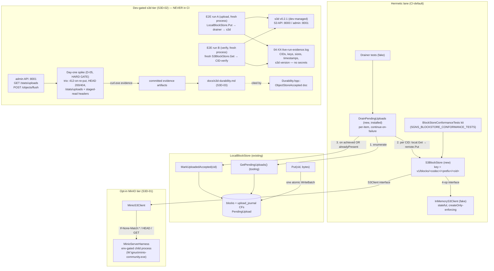

# Phase 4: S3BlockStore & Sia s3d Roundtrip - Research

**Researched:** 2026-10-21
**Domain:** C++17 BlockStore cold-tier composition over the Phase-3 S3Client adapter; Sia s3d v0.2.1 pinned-tag semantics (conditional writes, HEAD, admin durability signals); public drainer API; dev-gated live E2E design
**Confidence:** HIGH (all codebase claims read from source this session; all s3d claims fetched from the pinned v0.2.1 tag — README, openapi.yml, s3/preconditions.go, CHANGELOG.md, GitHub release assets — this session)

<user_constraints>
## User Constraints (from CONTEXT.md)

### Locked Decisions

**Store & drainer composition**
- **D-01:** Phase 4 ships **`S3BlockStore` AND the upload drainer** — a library component that iterates `LocalBlockStore`'s pending journal set (tooling enumeration, 02 D-05), Puts each block to `S3BlockStore`, and calls `MarkUploadedAccepted` on remote-present outcomes. Phase 2's "for Phase 4's uploader" intent is honored in-phase; a tiered facade remains deferred future work — **Reversibility:** costly — the drainer binds the journal transition surface (02 D-06), the store's Put semantics, and consumer spilling behavior simultaneously
- **D-02:** The drainer is a **public installed API** (installed header, first-class library capability) — consumers (SuperGenius, genius-tube) drive the actual hot→cold spilling themselves, so the upload path is not test scaffolding. Follows the `S3Client` promotion precedent (03 D-04) — **Reversibility:** costly — published API surface; removal is an API break
- **D-03:** Drain semantics are **per-item, continue-on-failure**: each pending block uploads independently; the drain returns a per-item outcome vector (uploaded / alreadyPresent / failed with taxonomy status) and keeps going past failures. Mirrors the frozen `PutMany` no-all-or-nothing contract (01 D-14); a later re-drain retries only still-pending blocks. Crash-safe by construction — journal state advances only on per-item remote-present outcomes — **Reversibility:** costly — the return shape and re-drain contract bind consumer call sites
- **D-04:** The drainer marks **`MarkUploadedAccepted` only** — both `achieved` and `alreadyPresent` count as remote-present and advance the journal to Accepted. `MarkUploadedDurable` stays a caller/tooling transition until the durability-polling implementation lands (fast-follow milestone) — **Reversibility:** reversible — Durable wiring is added later without touching Accepted semantics

**s3d entrance spike**
- **D-05:** **Day-one dev-gated live s3d spike** (Phase-3 D-11 discipline) opens the first Phase-4 plan: prove at a real s3d v0.2.1 endpoint what S3BlockStore semantics will rely on, BEFORE the store bakes in assumptions. Contingency is decided **then, on real evidence** (D-10 posture: no pre-committed fallback ladder; if a needed s3d capability is genuinely missing, decide with facts in hand) — **Reversibility:** reversible — spike scope adjustable in planning
- **D-06:** The spike covers the **full trio including durability**: (1) conditional PUT `If-None-Match:*` → expect 412 on re-put, (2) HEAD 200/404 semantics, (3) `/stats/uploads` + staged-read header field shapes. The S3D-03 finding doc is written from this spike ground truth + `openapi.yml` cross-read — one dev session feeds both the entrance criterion and the characterization — **Reversibility:** reversible
- **D-07:** The spike is a **hard entrance gate**: s3d-dependent work (E2E, durability finding, any s3d-conditional semantic) blocks until the spike runs against real s3d. Hermetic work (conformance vs fake, drainer vs fake, MinIO tier) proceeds in parallel — **Reversibility:** reversible — mirrors Phase-1 C1 gating discipline

**s3d E2E design (S3D-02)**
- **D-08:** The E2E test **connects to a dev-managed running s3d** via env-provided config (endpoint URL, access keys, bucket, TLS flag — the 03 D-09 env-var + loud-skip pattern). The test NEVER spawns or manages s3d: the Sia account/wallet is dev-owned state, fundamentally heavier than the MinIO-binary child process — **Reversibility:** costly — Phase-4's Tier-3 test shape and evidence procedure bind to this model
- **D-09:** "A fresh library instance" is proven by a **two-run fresh-process design**: run A (upload) seeds via the library; run B (verify) is a genuinely fresh process with zero local state that retrieves and CID-verifies the block. Committed evidence shows both runs — an honest cold-retrieval proof (same-process reconstruction proves nothing about cold reads) — **Reversibility:** costly — test binary interface (upload/verify modes) and evidence format bind together
- **D-10:** The E2E's upload run exercises the **drainer-driven spill path**: `LocalBlockStore` Put → drainer → s3d (`MarkUploadedAccepted` lands in the journal); the verify run retrieves via a fresh `S3BlockStore`. The drainer ships this phase (D-01), so its first live proof comes free here — this is the milestone's actual story, end to end — **Reversibility:** costly — the E2E evidence artifact encodes this path
- **D-11:** The evidence artifact is a **committed run log** (Phase-3 precedent: `03-04-live-run-evidence.log`): CIDs, object keys, sizes, timestamps, s3d version, pass/fail for both runs. Human-readable and diffable; **no secrets in the log** (endpoint host at most, never credentials) — **Reversibility:** reversible

**Durability finding disposition (S3D-03)**
- **D-12:** The finding ships as a **repo doc + header citation**: a characterization doc in the sgns-blockstore repo (e.g., `docs/s3d-durability.md`), AND `Durability.hpp`'s `ObjectStoreAccepted` doc comment cites it — the API's "200-OK ≠ durable" honesty is grounded in a committed, versioned characterization of the pinned s3d. Consumers see the same truth the library encodes — **Reversibility:** costly — published header documentation and shipped doc
- **D-13:** The finding meets an **evidence-cited bar**: raw `/stats/uploads` output before/after an upload, staged-read header observations, and the `openapi.yml` field definitions are committed as spike evidence, and every claim in the finding doc traces to an artifact. SC5's "characterized from the pinned version's admin API" is auditable, not asserted — **Reversibility:** reversible

### the agent's Discretion
- Exact CID string encoding in the key layout (BACK-07 locks `v1/blocks/` full-CID codec-preserving; base32/base58 form and separator details follow the architecture doc + research)
- `S3BlockStore` construction/config shape (bucket, prefix, injected `S3Client`) beyond the requirement letter
- `GetSize` (HEAD content-length) and verify-on-read mapping details beyond BACK-07/CORE-04
- Drainer construction shape (free function vs small class), option surface, and exact per-item result type
- Env-var names for the s3d endpoint/credentials/bucket; secret-hygiene mechanics in the evidence log
- MinIO-tier test breadth for `S3BlockStore` beyond the SC3 letter (e.g., key-layout observability checks)
- Unique-CID/re-run discipline for the two-run E2E (fresh run pair vs re-verify of previously-seeded CIDs)
- Where the s3d spike's evidence artifacts live in the repo (test tree vs docs)

### Deferred Ideas (OUT OF SCOPE)
- Durability-signal polling implementation — fast-follow milestone per roadmap note
- `MarkUploadedDurable` wiring into any automated path — caller/tooling-only until polling exists (D-04)
- `TieredBlockStore` / retrieval tiering / peer racing — REQUIREMENTS Future list (needs measured latencies)
- Background/async drainer scheduling — v1 ships the synchronous one-shot drain; orchestration cadence is consumer policy
</user_constraints>

<phase_requirements>
## Phase Requirements

| ID | Description | Research Support |
|----|-------------|------------------|
| BACK-07 | `S3BlockStore` uses the `v1/blocks/` full-CID (codec-preserving) key layout, conditional create-only PUTs, and HEAD→exists mapping (200/404→bool, everything else→`TemporarilyUnavailable`) | Composition map of BlockStore ops onto the verified 4-op `S3Client` interface; key-layout encoding resolved (base32 CIDv1 string + codec/prefix components); s3d v0.2.1 conditional-write semantics verified from `s3/preconditions.go` source |
| S3D-01 | S3 integration tests run against a local MinIO binary (opt-in; no Docker-in-CI dependency) | Phase-3 `MinioServerHarness` instantiates unchanged; `W:\gnus\minio-community.exe` confirmed present for the env gate |
| S3D-02 | Live Sia `s3d` end-to-end roundtrip acceptance test — dev-gated (requires Sia account), evidence artifact committed, never in CI | Two-run fresh-process design (D-09) mapped to concrete binary/env-var/evidence mechanics; s3d v0.2.1 Windows binary distribution confirmed; `s3d version` subcommand identified for the evidence log |
| S3D-03 | Durability-signal discovery — probe s3d's admin API (`/stats/uploads` + `openapi.yml`) to characterize staged-vs-durable semantics; documented finding (polling implementation is fast-follow work) | `UploadStats` schema captured verbatim from pinned-tag `openapi.yml`; **no per-object signal exists** (offline-conclusive); `POST /objects/flush` identified as the blocking flush primitive; fallback characterization shape defined |
</phase_requirements>

## Summary

Phase 4 is pure composition: every primitive it needs already exists and was read from source this session. `S3BlockStore` maps the frozen 4-op `BlockStore` interface onto the Phase-3 `S3Client` adapter seam (`Put`/`Get`/`Head`/`Delete` + `S3ClientConfig`), which already carries every semantic the success criteria demand — `createOnly` → `If-None-Match:*` on the wire (verified in `MinioS3Client.cpp`: `args.headers.Add("If-None-Match", "*")`), 412 → success-slot `alreadyPresent=true` via a mapper that classifies **all three** observed 412 error-string shapes, HEAD authoritative-absence → success-slot `exists=false`. The store layer therefore never sees HTTP; SC2 is inherited from the adapter rather than re-implemented.

The dominant new knowledge is s3d v0.2.1 itself, and this session pinned it from the exact tag: conditional create-only PUT is **source-verified** (`s3/preconditions.go` `CheckWrite`: `If-None-Match` matching the current object → `ErrPreconditionFailed`; `etagMatches` treats `"*"` as matching any existing object; the source comment mandates atomic evaluation with the write), `HeadObject` is fully supported per the compatibility matrix, and the admin API's `GET /stats/uploads` schema is captured verbatim from the tag's `openapi.yml`. The headline S3D-03 finding is already offline-conclusive on the decisive question: **the admin API carries only pipeline-global counters (`pendingObjects`, `uploadedObjects`, ...) plus a transient in-flight `activeUploads[].label` — no per-object staged-vs-durable signal exists at v0.2.1** — so the "accepted-is-max-provable" fallback is the finding, enriched by `POST /objects/flush` (blocks until all pending objects are uploaded to Sia and pinned), which gives the E2E a clean staged→durable observability step and the finding doc a positive proof mechanism. What remains genuinely live-only (the D-05 spike's job): the exact 412/HEAD **error-body shapes as minio-cpp renders them against s3d**, staged-read response headers, and SigV4 interop.

The riskiest mechanical work is not the store — it is (a) the `S3Client.hpp` promotion, which touches the api_hygiene include-everything TU and its negative guard traits, and resolves a real CORE-05/D-03 tension this research spells out with a recommendation; (b) the key-layout fan-out detail (base32 CIDv1 strings share the constant prefix `bafkrei` for raw+sha256 — fanning out on the first CID-string characters produces ONE bucket); and (c) the drainer's per-item contract, which must compose `GetPendingUploads` → remote `Put` → `MarkUploadedAccepted` without ever aborting siblings.

**Primary recommendation:** Ship in dependency order — hermetic store + conformance first (fake client), drainer over fake second, promotion mechanics with the store (they are one change-set), MinIO-binary tier next, and open the phase with the day-one s3d spike (D-05) running in parallel so the E2E + durability doc land on live evidence; write `docs/s3d-durability.md` from the captured `openapi.yml` schema + spike artifacts, and cite it from `Durability.hpp`'s `ObjectStoreAccepted`.

## Architectural Responsibility Map

| Capability | Primary Tier | Secondary Tier | Rationale |
|------------|-------------|----------------|-----------|
| CID→object-key derivation (codec-preserving layout) | sgns-blockstore library (`S3BlockStore` internal) | — | Key is a pure function of the CID; no service round-trip; observability requirement (SC1) makes the layout a library contract |
| Conditional create-only PUT, 412→alreadyPresent | `S3Client` adapter (existing, Phase 3) | `S3BlockStore` (maps `S3PutResult` → `PutOutcome`) | One-place mapping discipline — HTTP semantics already stop at the adapter; SC2 "proven at the adapter level" is already true |
| HEAD→bool, everything-else→taxonomy | `S3Client` adapter (`Head` success slot) | `S3BlockStore::Has` (propagates) | `S3HeadResult{exists,size}` already encodes 200/404→bool; error slot = could-not-obtain |
| Verify-on-read (CID re-check of fetched bytes) | `S3BlockStore` (facade boundary, CORE-04) | — | Every backend owns its verify path (`MemoryBlockStore` precedent read this session); S3 sources attribute `Corrupt+Remote` |
| Upload-journal advance (Accepted) | `LocalBlockStore` (existing `MarkUploadedAccepted`) | drainer (orchestrates) | Journal transitions are backend-owned (02 D-06); the drainer composes, never touches RocksDB |
| Pending-set enumeration | `BlockStoreTooling::GetPendingUploads` (existing) | drainer (consumes snapshot) | CORE-06: enumeration lives only on the tooling surface; drainer is its first production consumer |
| s3d process/account management | Dev machine (human) | — | D-08: the test NEVER spawns s3d; login/wallet/indexer registration is dev-owned ops |
| s3d admin-API probing (durability evidence) | Spike session (curl.exe against :8001) | committed evidence artifacts | No C++ admin client needed this phase — `/stats/uploads` and `/objects/flush` are plain HTTP Basic GET/POST |
| MinIO server lifecycle (S3D-01 tier) | `MinioServerHarness` (existing child-process harness) | — | Phase 4 instantiates; does not extend |

## Standard Stack

### Core

| Library | Version | Purpose | Why Standard |
|---------|---------|---------|--------------|
| `sgns-blockstore` (this repo, `thirdparty/sgns-blockstore`) | 0.1.0-in-flight | Everything: `S3BlockStore`, drainer, promotion, tests, docs | Phase 1–3 codebase read this session — the contract is frozen and guard-tested |
| minio-cpp (behind `MinioS3Client`) | v1.0.0 pinned (Phase 3) | Real S3 transport for MinIO-tier tests + s3d E2E | Already integrated; `PRIVATE`-linked; conditional header mechanism spike-proven (03 D-11 MET) |
| libp2p `p2p_cid` | current submodule pin | CID type + `ContentIdentifierCodec` (string↔bytes) + sha256 | Key derivation and verify path build on it; base32 CIDv1 string form spike-proven (`cid_spike_test.cpp`) |
| Sia `s3d` (dev-gated ops artifact, NOT a build dependency) | **v0.2.1 pinned** (2026-10-05; latest release as of 2026-10-21) | Live E2E backend + durability characterization target | Tag-pinned facts fetched this session (see Sources); Windows native binary ships on the release |

### Supporting

| Library | Version | Purpose | When to Use |
|---------|---------|---------|-------------|
| `MinioServerHarness` (in-repo, Phase 3) | — | Opt-in MinIO-binary tier for `S3BlockStore` roundtrip | S3D-01/SC3 — instantiate as-is (`Start(tls)`, `MakeBucket`) |
| `InMemoryS3Client` (in-repo fake) | — | Hermetic conformance + drainer tests; key-layout observability via its object map | Default lane; also the SC1 key-observability probe surface |
| `LoopbackHttpStub` (in-repo) | — | Wire-level fault injection at `MinioS3Client` | Optional store-level fault coverage (full matrix is Phase 5) |
| GTest | ~1.14 (superbuild) | All test binaries | Existing `addtest()` pattern in `test/CMakeLists.txt` |
| curl.exe (Windows built-in; `C:\WINDOWS\system32\curl.exe` confirmed) | — | Spike evidence capture (`/stats/uploads`, `/objects/flush`, staged-read headers) | Dev session only; outputs committed as artifacts — zero C++ admin-API code this phase |

### Alternatives Considered

| Instead of | Could Use | Tradeoff |
|------------|-----------|----------|
| Base32-lower CIDv1 string as key terminal component | Raw CID bytes (hex/base64) | String form is the multibase convention, human-auditable in object listings, and produced directly by `ContentIdentifierCodec::toString` — no new codec code |
| Free-function drainer (`UploadDrainer.hpp`) | Small class with options | Class adds construction ceremony for a stateless one-shot loop; free function + options struct matches the header-only style of `BlockStoreTooling` (recommendation, planner may flip) |
| curl.exe for spike evidence | C++ admin client on cpp-httplib | Polling implementation is fast-follow; this phase needs only committed evidence artifacts — curl keeps it zero-code |

**Installation:** No packages to install. No registry dependencies exist in this phase. `thirdparty/build/CommonTargets.cmake` changes are library-internal only (new `S3BlockStore.cpp` in the existing `add_library` list — the sgns-blockstore entry at `CommonTargets.cmake:862-919` needs no new `DEPENDS`; 04-CONTEXT confirms no new ExternalProject).

**Version verification:** s3d v0.2.1 verified as latest release via `api.github.com/repos/SiaFoundation/s3d/releases/tags/v0.2.1` this session (released 2026-10-05, commit `312789a`, 7 assets). minio-cpp/pugixml/cpp-httplib/inih pins unchanged from Phase 3 (no re-verification needed — nothing moves).

## Package Legitimacy Audit

> This phase installs **no external packages** — no npm/PyPI/crates registry interaction, no new thirdparty submodules, no new ExternalProject entries. The only externally-sourced artifact is the dev-machine s3d binary (`s3d_windows_amd64.zip` from the official `SiaFoundation/s3d` GitHub release at the pinned tag, ~7.0 MB, verified via the GitHub API this session) used exclusively by the dev-gated live tier; it never enters any build or CI lane. **Audit table: N/A — no packages to audit.**

## Architecture Patterns

### System Architecture Diagram



A reader tracing the milestone story: block enters via `LocalBlockStore.Put` (journal record born `PendingUpload`) → drainer enumerates the pending set → `S3BlockStore.Put` derives the key and conditionally PUTs through the adapter → 412 → `alreadyPresent=true` (success) → `MarkUploadedAccepted` → run B's fresh process GETs and CID-verifies from a cold start. The spike feeds the durability doc, which the API header cites.

### Recommended Project Structure (additions to `thirdparty/sgns-blockstore`)

```
include/sgns-blockstore/
├── S3Client.hpp          # PROMOTED from src/ (03 D-04) — install rule already pattern-matches *.hpp
├── S3BlockStore.hpp      # NEW — the cold-tier backend (BlockStore impl over S3Client)
└── UploadDrainer.hpp     # NEW — the installed drainer API (D-02)
src/
├── S3BlockStore.cpp      # NEW — key derivation + op mapping + verify-on-read
├── UploadDrainer.cpp     # NEW (or header-only if trivial) — drain loop
├── InMemoryS3Client.*    # stays in src/ (test-only fake; include changes to <sgns-blockstore/S3Client.hpp>)
└── MinioS3Client.*       # stays in src/ (SDK-free header by pimpl; tests reach it via src/ include path)
test/
├── s3_block_store_test.cpp        # NEW — conformance via fake + key-layout observability + taxonomy
├── upload_drainer_test.cpp        # NEW — per-item outcomes, re-drain, journal advance (fake remote)
├── s3_block_store_minio_test.cpp  # NEW — opt-in MinIO-binary tier (harness) roundtrip
├── s3d_roundtrip_e2e.cpp          # NEW — dev-gated two-run E2E binary (upload/verify modes)
docs/
├── s3d-durability.md              # NEW (D-12) — S3D-03 finding, evidence-cited (D-13)
└── evidence/s3d-spike/            # NEW (discretion recommendation) — raw /stats/uploads captures,
                                   #   header observations, openapi field defs
```

### Pattern 1: S3BlockStore — map adapter results, never HTTP

**What:** `S3BlockStore` is a thin facade over an injected `S3Client`: derive key from CID → call one adapter op → map into the frozen envelope. Status mapping lives in exactly one place per backend (the `MemoryBlockStore`/`LocalBlockStore`/`MinioS3Client` discipline read this session).

**When to use:** Every `BlockStore` member.

The exact composition surface, from the verified adapter interface (`src/S3Client.hpp`, read this session):

| `BlockStore` op | `S3Client` op(s) | Mapping |
|---|---|---|
| `Put(cid, bytes, opts)` | `Put(key, bytes, {createOnly=true})` | entry-check non-sha256 → **throw** `std::invalid_argument` (D-08 precedent); `CidOf` verify first → mismatch = `Corrupt`+`Caller`; `S3PutResult{achieved, alreadyPresent}` → `PutOutcome{ObjectStoreAccepted, alreadyPresent}` (S3BlockStore **always** create-only — blocks are immutable and pre-verified); adapter failure propagates (already taxonomy-typed, `Remote`-sourced) |
| `Get(cid, opts)` | `Get(key)` | error `NotFound` → `NotFound` failure (authoritative); success → re-verify bytes vs CID unless `verify==false` → mismatch = `Corrupt`+**`Remote`** (source attribution differs from Put — bytes came from the remote); wrap `Block{cid, bytes}` |
| `Has(cid)` | `Head(key)` | success `exists` bool → bool; error slot propagates — the adapter already maps 200/404→`exists` true/false and "could not obtain"→taxonomy (SC2's "everything else → TemporarilyUnavailable" is the adapter mapper's default bucket, with `Unauthorized` preserved as its own class per CORE-02) |
| `GetSize(cid)` | `Head(key)` | success `exists==false` → `NotFound` failure; `exists==true` → `S3HeadResult.size` (HEAD content-length; no bytes returned → no verification applies, matching the interface doc) |
| `PutMany` | loop of `Put` | per-element vector, NO all-or-nothing (01 D-14 verbatim contract) |

Construction shape (discretion — recommendation): factory following `LocalBlockStore::Open`/`MinioS3Client::Open` precedent, with **`std::shared_ptr<S3Client>`** injection so tests retain a handle to the fake for key-layout observability (SC1):

```cpp
struct S3BlockStoreOptions
{
    std::string keyPrefix = "v1/blocks"; ///< layout root (BACK-07 letter)
};
static result<std::unique_ptr<S3BlockStore>, BlockStatus> Open(
    std::shared_ptr<S3Client> client, const S3BlockStoreOptions& options = {});
// capabilities: BlockStoreCapabilities{ ObjectStoreAccepted } — a store NEVER
// reports an achieved level it has not verified (Durability.hpp contract).
```

### Pattern 2: Key layout — full-CID codec-preserving, fan-out-safe

**What:** BACK-07 locks `v1/blocks/`; the architecture doc (line 180, verbatim) specifies `v1/blocks/<multicodec>/<prefix>/<cid>` and states "The exact S3 key is not authoritative. The CID is authoritative."

**Recommended encoding (discretion area, decided here):**

```
v1/blocks/<codec>/<xx>/<cid-string>
          raw      7f   bafkreifzjut3te2nhyekklss27nh3k72ysco7y32koao5eei66wof36n5e
```

- `<cid-string>` = `ContentIdentifierCodec::toString(cid)` — base32-lowercase CIDv1 text. The exact form is spike-proven in `test/cid_spike_test.cpp:73` (verbatim known vector): `"bafkreifzjut3te2nhyekklss27nh3k72ysco7y32koao5eei66wof36n5e"` for sha256("hello world") RAW. Round-trip `toString`/`fromString` verified lossless in the same test. Codec-preserving **by construction**: the CID string carries version+codec+multihash.
- `<codec>` = the CID's own content codec, rendered as a short lowercase token (e.g. `raw`, `dag-pb`). Derive from `cid.content_type` (`MulticodecType::Code`). If libp2p exposes no name lookup at this pin, a tiny fixed `switch` over the codecs the library accepts (v1: RAW, DAG_PB — see `Cid.hpp` D-08 note) is acceptable: it is a *display* component only, never parsed back.
- `<xx>` = first byte of the multihash **digest** as two lowercase hex chars (256-way fan-out) — `cid.content_hash` gives the multihash; take the digest span, not the hash-prefix byte.
- Injectivity: do NOT normalize CIDv0↔CIDv1. `toString` is injective across versions (`Qm...` vs `baf...`); identical content under both versions yields two objects — document as a v1 non-goal (dedup is by exact CID, mirroring the D-08 blake2b boundary note).

**⚠ The fan-out trap (load-bearing):** for RAW+sha256 CIDv1, the string prefix `bafkrei` is **constant** — every such CID begins identically. Fanning out on `cidString.substr(0, 2)` yields exactly ONE bucket, defeating the architecture doc's operational-listing purpose. Fan out on digest-derived bytes (`<xx>` above), never on the string head.

Charset/limits: base32-lower is `[a-z2-7]`, hex `[0-9a-f]`, separators `/` — total key length ≈ 9+1+6+1+2+1+59 ≈ **~79 bytes**, comfortably inside every S3-compatible server's key budget. (S3's 1024-byte UTF-8 key limit and case-sensitivity are [ASSUMED] from training knowledge — not load-bearing at this length/charset; the concrete tiers in SC1/SC3 make it observable anyway.)

**Key observability (SC1):** the fake's `objects_` map (`std::map<std::string, std::vector<uint8_t>>`, read this session) and MinIO-tier listing/HEAD make the layout assertable: tests assert the derived key for a known CID equals the expected literal — the `bafkrei...36n5e` vector above is the natural fixture.

### Pattern 3: The drainer — installed API, per-item contract

**What (D-01..D-04):** a synchronous one-shot drain of `LocalBlockStore`'s pending set into a `BlockStore` (the S3 tier in practice, any store by type), advancing the journal per item on remote-present outcomes only.

**Recommended shape (discretion — recommendation):** free function in an installed header, per-item result carrying BOTH the upload result and the journal-mark result:

```cpp
// UploadDrainer.hpp (installed; uses the Cid.hpp result alias MANDATORY in new headers)
struct DrainItem
{
    Cid cid;                                ///< the drained block
    result<PutOutcome, BlockStatus> upload; ///< the remote Put outcome
    result<void, BlockStatus> journal;      ///< MarkUploadedAccepted outcome
                                           ///< (default success when upload failed and no mark ran)
};
result<std::vector<DrainItem>, BlockStatus> DrainPendingUploads(
    LocalBlockStore& local, BlockStore& remote,
    const WriteOptions& options = {});
```

Loop semantics (from the CONTEXT flow sketch + read APIs):
1. `local.GetPendingUploads()` — snapshot in lexicographic encoded-CID order (tooling contract, verbatim from `BlockStoreTooling.hpp`). An outer failure here aborts the drain (wholesale malfunction envelope, mirroring `PutMany`).
2. Per CID: `local.Get(cid)` → bytes; `remote.Put(cid, bytes, options)` (S3BlockStore's Put is conditional; a re-put of an already-remote block returns `alreadyPresent=true` — the idempotent re-drain path).
3. On success slot (`achieved` OR `alreadyPresent` — D-04 verbatim): `local.MarkUploadedAccepted(cid)`. Its failure is recorded per-item, never rolls back the upload, and the item retries on the next drain (upload returns `alreadyPresent` again → mark retried — crash-safe by construction).
4. Any failure (local.Get NotFound — e.g. locally evicted — taxonomy failure, mark failure) records and **continues** (D-03). Re-drain retries only still-pending blocks because `MarkUploadedAccepted` removed the succeeded ones from the pending set.

Taking `BlockStore&` (not `S3BlockStore&`) for `remote` keeps the drainer composable and matches D-01's "Puts each block to S3BlockStore" without hard-coding the type; `LocalBlockStore&` is concrete because `MarkUploadedAccepted`/`GetPendingUploads` are its surfaces.

### Pattern 4: S3Client.hpp promotion — the mechanical change-set

**What (03 D-04 honored):** `src/S3Client.hpp` → `include/sgns-blockstore/S3Client.hpp`.

Verified mechanics (all read this session):
1. **Install:** root `CMakeLists.txt` installs via `install(DIRECTORY include/ ... FILES_MATCHING PATTERN "*.hpp")` — the moved header installs automatically. Zero install-rule changes.
2. **Includers to update:** `src/InMemoryS3Client.hpp` and `src/MinioS3Client.hpp` include `"S3Client.hpp"` → `<sgns-blockstore/S3Client.hpp>`. Test TUs reaching the adapter via `target_include_directories(... ${CMAKE_SOURCE_DIR}/src)` keep that path for the two impl headers (which stay internal).
3. **Header hygiene gate:** `test/header_hygiene_check.cmake` globs ALL `include/sgns-blockstore/*.hpp` and bans `#include` lines matching `_banned = "ipfs_lite/ipfs/" "SuperGenius/" "GeniusSDK/" "GeniusWallet/" "minio"`. `S3Client.hpp` includes only `<cstdint> <string> <vector> <sgns-blockstore/BlockStatus.hpp> <sgns-blockstore/Cid.hpp>` — **passes as-is**.
4. **api_hygiene TU:** `test/api_hygiene_test.cpp` includes every installed header explicitly and links exactly `sgns-blockstore + p2p::p2p_cid`. It MUST gain `#include <sgns-blockstore/S3Client.hpp>` (+ the two new Phase-4 headers), and its stale comment ("The S3Client seam itself stays internal (D-04; src/ headers, asserted by the Head/Delete negative traits below)") must be rewritten to the promotion reality. Its negative traits extend: `!HasHead<S3BlockStore>` and `!HasDelete<S3BlockStore>` (public existence probe stays `Has`; the S3-shaped names live on the adapter, not the store).
5. **CORE-05 / 03-D-03 tension — resolve explicitly in planning:** CORE-05's letter says "nothing in the API can remove remote blocks", and 03 D-03 says delete "never climbs to the public interface", yet 03 D-04 locks promoting the S3Client header whose 4-op interface includes `Delete` (`S3Client::Delete`, documented there as "internal op, D-03 — never on BlockStore"). **Recommended resolution:** promote the header whole (that is what "promoted to installed headers" meant; BACK-05's "~5 ops" letter names delete), and record the reconciliation in the header's doc comment: CORE-05 governs the **BlockStore data-path family** (guard-test-enforced — `S3Client` is a composition seam, `Delete` is tooling/audit-only, and calling it from cache/eviction logic is forbidden). The stricter alternative — splitting a delete-free `S3ObjectClient` base for promotion — adds surface without removing risk (the delete-capable impl symbols already ship in the static lib); reject unless the planner wants the letter preserved literally.
6. **`MinioS3Client` stays internal:** 04-CONTEXT's boundary names only the `S3Client` header for promotion. Its own header is SDK-free by pimpl (verified: includes only `"S3Client.hpp"` + `<memory>`), so promoting it later is trivial — but consumer construction wiring is a later milestone; tests reach it via the src/ include path (existing "test-surface-only privilege" precedent in `test/CMakeLists.txt`).
7. **New headers must use the library-local `result<R,S,policy::terminate>` alias from `Cid.hpp`** (Phase-1 landmine, restated in 04-CONTEXT canonical refs) — `S3BlockStore.hpp` and `UploadDrainer.hpp` include `Cid.hpp` and use `result<...>` exactly as `BlockStore.hpp` does.

### Pattern 5: Two-run E2E + evidence (D-08..D-11)

**What:** a dev-gated binary with two modes, run as two fresh processes; committed log.

**Recommended mechanics (discretion — recommendations):**
- One binary, two GTest cases, selected per invocation: `s3d_roundtrip_e2e.exe --gtest_filter=S3dE2E.UploadRun` then `--gtest_filter=S3dE2E.VerifyRun` — two invocations ARE the two fresh processes (each with its own `LocalBlockStore` temp dir for run A; run B constructs no local store at all). Alternatively a plain console `main` with argv modes; GTest keeps the repo convention and ctest can register it with a loud-skip when env is unset (TEST-01 discipline; never required in CI).
- Run pair state hand-off: run A derives a **unique-per-run CID** (payload = fixed prefix + ISO timestamp + random nonce → `CidOf`), writes `{cid-string, object-key, size, timestamp}` to a small JSON/text file whose path arrives via env var (e.g. `SGNS_BLOCKSTORE_TEST_S3D_RUN_STATE`); run B reads it, `Get`s via a fresh `S3BlockStore` + `MinioS3Client`, CID-verifies, and asserts byte-identity against the recorded payload hash. Fresh-pair discipline (vs re-verify of an old seed) makes every run self-contained.
- Run A path (D-10 verbatim): `LocalBlockStore.Put` (journal born PendingUpload) → `DrainPendingUploads` → assert journal now `UploadedAccepted` (`GetUploadState`). This is the drainer's first live proof.
- Env-var surface (03 D-09 naming pattern): `SGNS_BLOCKSTORE_TEST_S3D_ENDPOINT`, `SGNS_BLOCKSTORE_TEST_S3D_ACCESS_KEY`, `SGNS_BLOCKSTORE_TEST_S3D_SECRET_KEY`, `SGNS_BLOCKSTORE_TEST_S3D_BUCKET`, `SGNS_BLOCKSTORE_TEST_S3D_USE_TLS` (default unset = plain HTTP loopback — never TLS-verify s3d's per-start self-signed cert), optional admin pair `SGNS_BLOCKSTORE_TEST_S3D_ADMIN_ENDPOINT` + `SGNS_BLOCKSTORE_TEST_S3D_ADMIN_PASSWORD` for the durability-evidence step. Loud skip label: `[SGNS_BLOCKSTORE][S3D-TIER]` (mirrors `[SGNS_BLOCKSTORE][MINIO-TIER]` seen in the 03-04 log).
- Evidence log (D-11): both runs' output appended to `.planning/workstreams/rocksdb-backup/phases/04-.../04-XX-live-run-evidence.log` following the 03-04 precedent (raw test output incl. gtest lines — read this session: UTF-16LE PowerShell redirect produced `03-04-live-run-evidence.log`; prefer ASCII/UTF-8 output redirect for diffability). Include: s3d version (`s3d version` prints "version, commit hash, and build date" — README verbatim), CIDs, object keys, sizes, timestamps, pass/fail per run. **Endpoint host at most; never credentials** (D-11 + BlockStatus message rule: "message content must NEVER embed secrets" — BlockStatus.hpp verbatim).
- Durability-evidence step inside the same dev session: capture `curl -u ":$ADMIN_PW" http://127.0.0.1:8001/stats/uploads` before PUT, after PUT (staged: `pendingObjects` +1), after `POST /objects/flush` (returns when all pending objects are uploaded to Sia and pinned — openapi verbatim: "Blocks until done"), and the staged-read GET/HEAD response headers. These artifacts feed `docs/s3d-durability.md` (D-13).

### Pattern 6: Day-one spike (D-05..D-07) — offline-known vs live-only

**Offline-known this session (do NOT re-derive, cite the sources):**

| Question | Answer | Source |
|---|---|---|
| Does s3d v0.2.1 support conditional PUT? | Yes — "PutObject, CopyObject and CompleteMultipartUpload honor If-Match and If-None-Match against the current version of the destination, evaluated atomically with the write." | README @ v0.2.1 (verbatim) |
| Does `If-None-Match:*` mean create-only? | Yes — `etagMatches` treats `"*"` as "matches any existing object" (`const wildcardETag = "*"`); `CheckWrite` returns `ErrPreconditionFailed` iff the condition matches the current object; no current object → precondition passes (write proceeds) | `s3/preconditions.go` @ v0.2.1 (verbatim logic) |
| Is the check atomic with the write? | Yes by design — "A backend must call this in the same atomic operation as the write itself, so that of two concurrent writers only one can satisfy the same condition." | `s3/preconditions.go` comment (verbatim) |
| HEAD supported? | "HeadObject ✓" fully supported | README compatibility matrix @ v0.2.1 |
| `/stats/uploads` shape? | `UploadStats` schema captured verbatim (below) | `openapi.yml` @ v0.2.1 |
| Per-object durability signal? | **No** — pipeline-global counters only; `activeUploads[].label` = "bucket and key as bucket/key when the group holds a single object" exists only while streaming | `openapi.yml` @ v0.2.1 |
| Blocking flush? | `POST /objects/flush` — "Uploads all pending objects to Sia immediately, regardless of padding, and pins them so their local pending files are removed. Blocks until done." | `openapi.yml` @ v0.2.1 (verbatim) |
| Staged-read distinguishing header? | None documented anywhere in README/openapi at the tag; repo-wide search for `X-Sia`-style headers returned nothing | absence — spike settles it with real captures |
| SigV4? | "AWS Signature V4 exclusively. SigV4A is not implemented." UNSIGNED-PAYLOAD + streaming modes supported | README @ v0.2.1 |
| Under disk pressure? | PUTs waiting for disk space "give up after two minutes and return a 503 SlowDown" (since 0.1.2) | CHANGELOG @ v0.2.1 |

**Live-only (the spike's actual residual job — D-06 trio):**
1. Conditional re-PUT against a real s3d via `MinioS3Client` → confirm 412 arrives and **which of the three mapper shapes** the SDK error string takes against s3d's error body (s3d's XML/empty-body wording may differ from MinIO's — the mapper classifies all three, but the evidence pins which fires).
2. HEAD missing key → confirm the SDK error string classifies as authoritative absence (`IsAuthoritativeAbsence` matches `"NoSuchKey:"`/`"NoSuchBucket:"` prefixes; s3d's HeadObject-on-missing wording is the thing to capture — a mismatch here would make `Has` return a failure instead of `false`, the exact D-05 contingency case).
3. `/stats/uploads` raw capture + staged-read GET/HEAD response headers (before/after PUT, after flush) — the D-13 evidence set.

**Spike → entrance gate:** items 1–2 directly gate `S3BlockStore`'s s3d-facing semantics (D-07); item 3 gates the finding doc. If item 2's evidence does not classify (e.g. an unrecognized missing-key string), the contingency decision happens then, on evidence (D-05 posture: no pre-committed ladder) — candidate remedies in ascending invasiveness: extend `IsAuthoritativeAbsence` with an s3d-verified string; none beyond that is anticipatable.

### Anti-Patterns to Avoid

- **HTTP-shaped logic in S3BlockStore** — no status codes, no header names, no ETag reads past the adapter (03 D-01 verbatim: "No HTTP-isms cross this seam").
- **`NotFound` as a catch-all** — the CRDT-corruption trap; the adapter's default bucket already defends this, do not re-map failures downward in the store.
- **Fan-out on the CID string head** — the `bafkrei` constant-prefix trap (Pattern 2).
- **Drainer aborting on first failure or rolling back siblings** — D-03 forbids; PutMany precedent.
- **`MarkUploadedDurable` anywhere in the drainer** — D-04: Accepted only; polling is fast-follow.
- **Treating PUT 200 as durable** — s3d stages on local disk; GET succeeds from staging (prior research pitfall 1; the entire S3D-03 reason for existing).
- **Spawning s3d from the E2E** — D-08 verbatim prohibition.
- **TLS-verify against s3d** — per-start self-signed cert; plain-HTTP loopback is the test lane.
- **Verifying ETag as content proof** — s3d encrypts client-side before upload; digests are over ciphertext (prior research pitfall 3).

## Don't Hand-Roll

| Problem | Don't Build | Use Instead | Why |
|---------|-------------|-------------|-----|
| CID→string encoding | varint/multibase/base32 codec | `ContentIdentifierCodec::toString` (p2p_cid) | Round-trip spike-proven (`cid_spike_test.cpp`); hand-rolling is the exact drift-bug class verification exists to catch |
| Conditional-PUT mechanics | Raw header plumbing in the store | `PutObjectOptions{createOnly}` on the adapter (wire proven in 03: `args.headers.Add("If-None-Match", "*")`) | One Put op, one flag; the three-412-shape classifier already exists in `MinioS3Client.cpp` |
| Status taxonomy mapping | Per-call-site error translation | The existing one-place mappers (`MapMinioFailure`; adapter success-slot contracts) | CORE-02 discipline; already guard-tested |
| Journal transitions | Direct RocksDB writes | `MarkUploadedAccepted` / `GetPendingUploads` (existing, crash-tested in Phase 2) | 02 D-06 surfaces exist precisely for this composition |
| MinIO server lifecycle | New process management | `MinioServerHarness` (Start/MakeBucket/Stop; TLS + plaintext proven live, G-3-1 closed) | S3D-01 instantiates, not extends |
| s3d admin-API client | C++ HTTP client for :8001 | curl.exe in the dev session; artifacts committed | Polling is fast-follow; this phase needs evidence files, not code |
| CID verification | New hashing path | `CidOf` (sha256 → Multihash → CID, composed of libp2p primitives) | The one verified constructor (Cid.hpp D-07); D-08 entry-throw contract already established |

**Key insight:** every deceptively complex piece of this phase (conditional writes, 412 classification, HEAD existence, journal advance, server lifecycle) already shipped in Phases 1–3 and was read from source this session. Phase 4's only genuinely new artifacts are two classes, one header move, one test binary, and one document.

## Common Pitfalls

### Pitfall 1: The api_hygiene include-everything TU breaks on promotion
**What goes wrong:** `api_hygiene_test.cpp` enumerates installed headers by explicit include; after promotion + two new headers, the TU silently no longer proves the newest headers standalone-compile.
**Why it happens:** The include list is manual by design (it links exactly `sgns-blockstore + p2p::p2p_cid`).
**How to avoid:** The promotion change-set adds all three headers (`S3Client.hpp` moved, `S3BlockStore.hpp`, `UploadDrainer.hpp`) to the TU's include block and extends the negative traits (`!HasHead<S3BlockStore>`, `!HasDelete<S3BlockStore>`) + rewrites the stale "stays internal" comment.
**Warning signs:** api_hygiene passing while never mentioning the new headers.

### Pitfall 2: s3d missing-key HEAD evidence doesn't match `IsAuthoritativeAbsence`
**What goes wrong:** `Has`/`GetSize` against s3d returns a `TemporarilyUnavailable` failure instead of `false` because s3d's StatObject error string lacks the `"NoSuchKey:"` prefix the mapper matches.
**Why it happens:** The mapper's authoritative-absence strings were learned from MinIO; s3d wording is unverified until the spike.
**How to avoid:** Spike item 2 captures the exact string; extend `IsAuthoritativeAbsence` if needed (one-line, one-place) — D-05's decide-on-evidence posture.
**Warning signs:** E2E run B's `Get` path works but a `Has`-before-`Get` probe fails.

### Pitfall 3: Fan-out collapses to one bucket
**What goes wrong:** Key prefix fan-out uses the first characters of the CID string; all raw+sha256 CIDs share `bafkrei` — a single prefix bucket, defeating listing/lifecycle fan-out (and the architecture doc's stated purpose).
**How to avoid:** Fan out on the first digest byte (`<xx>` hex), per Pattern 2.
**Warning signs:** MinIO-tier listing shows every object under one `<prefix>/`.

### Pitfall 4: Drainer marks the journal on upload failure "to be safe"
**What goes wrong:** Any mark not grounded in a remote-present outcome fabricates upload state — the block leaves the pending set without proof it reached the remote tier; a crash then loses the only copy path.
**Why it happens:** Temptation to "clean up" failed items; conflating drain progress with journal truth.
**How to avoid:** D-04's rule verbatim — mark ONLY on success-slot outcomes (`achieved` OR `alreadyPresent`); mark failures stay pending and retry next drain.
**Warning signs:** Any `MarkUploadedAccepted` call not dominated by a checked Put success.

### Pitfall 5: Evidence log leaks the secret key
**What goes wrong:** The E2E echoes config or error strings containing credentials into the committed log.
**Why it happens:** SDK error strings sometimes echo request context; raw env dumps during debugging.
**How to avoid:** Log endpoint **host** at most (D-11); BlockStatus message rule already forbids secrets (mapper never concatenates config — verified in `MinioS3Client.cpp` T-3-03 note); review the log before commit.
**Warning signs:** Any `SECRET`/`PASSWORD`-shaped token in the diff.

### Pitfall 6: Deployed-header staleness after promotion (Windows superbuild)
**What goes wrong:** The wrapper-vcxproj builds compile nothing; the deployed `include/` tree keeps the old header set, so a consumer-side (or test-TU) compile still sees `src/S3Client.hpp`-era reality while the build is green.
**Why it happens:** Repo-documented thirdparty landmines (wrapper-project trap; MSBuild no-dependent-rebuild-on-header-change).
**How to avoid:** Verify inner-vcxproj build + deployed-tree header hash after the promotion change; `/t:Rebuild` dependents after header changes (Phase-3 discipline, STATE.md).
**Warning signs:** Promotion "done" but `find_package` consumers can't see `S3BlockStore.hpp`.

### Pitfall 7: `policy::terminate` misuse in new headers/call sites
**What goes wrong:** `.value()` on a failed result terminates the process (debug crash / silent prod death).
**Why it happens:** The alias is deliberate (struct error types can't instantiate the throw-policy observers) but unforgiving.
**How to avoid:** Guard with `if (res)` / `has_value()` everywhere; never `OUTCOME_TRY` a `CidOf` failure into a `BlockStatus` envelope — map explicitly (Phase-2/3 landmine restated).
**Warning signs:** Any un-guarded `.value()` in review.

### Pitfall 8: Conformance kit's CID fixtures collide with the store's key expectations
**What goes wrong:** Key-layout assertions hard-code a CID string computed for a different payload/codec than the kit's fixtures.
**Why it happens:** The kit uses `"conformance payload a/b"` fixtures; the known-vector string in this doc is for `"hello world"`.
**How to avoid:** Key tests compute the expected string via `ContentIdentifierCodec::toString` on the SAME fixture CID, asserting against a separately-derived literal only where a known vector exists.
**Warning signs:** Copy-pasted `bafkrei...` literals next to non-matching payloads.

## Code Examples

### Conformance instantiation for S3BlockStore (kit contract, verified shape)
```cpp
// Source: thirdparty/sgns-blockstore/test/memory_block_store_test.cpp:381-391 (read this session)
SGNS_BLOCKSTORE_CONFORMANCE_TESTS(
    S3BlockStoreConformance,
    [] { return std::shared_ptr<sgns::blockstore::BlockStore>(
        std::make_shared<...>()); })
// For S3BlockStore the factory opens a store over a FRESH InMemoryS3Client
// per case (per-case hermeticity is the kit's contract: "The factory is
// invoked PER CASE so every TEST_F sees a fresh store").
```

### Conditional PUT — the exact wire mechanism the store inherits (verified)
```cpp
// Source: thirdparty/sgns-blockstore/src/MinioS3Client.cpp:186-190 (read this session)
if (options.createOnly)
{
    // THE conditional field: the ObjectWriteArgs headers Multimap
    // - verified on the wire in the 03-01 spike. NEVER
    // extra_headers: the pinned tag's single-part PUT path
    // silently drops that member (03-RESEARCH pitfall 2).
    args.headers.Add("If-None-Match", "*");
}
// ...on 412, ALL THREE observed error-string shapes classify to the
// success slot before the mapper runs:
//   "PreconditionFailed: ..." | "server failed with HTTP status code 412"
//   | "invalid response received; status code: 412; ..."
// → S3PutResult{ achieved=true, alreadyPresent=true }
```

### s3d v0.2.1 create-only source truth (fetched this session)
```go
// Source: https://raw.githubusercontent.com/SiaFoundation/s3d/v0.2.1/s3/preconditions.go
// wildcardETag is the ETag condition that matches any existing object.
const wildcardETag = "*"

// CheckWrite evaluates the preconditions against the object a write would
// replace; current is nil when there is none, as is a delete marker. A backend
// must call this in the same atomic operation as the write itself, so that of
// two concurrent writers only one can satisfy the same same condition. [...]
func (p ObjectPreconditions) CheckWrite(current *ObjectAttrs) error {
	if current == nil || current.IsDeleteMarker {
		if p.IfMatch != nil {
			return s3errs.ErrNoSuchKey
		}
		return nil
	}
	if p.IfMatch != nil && !etagMatches(*p.IfMatch, current.ETag) {
		return s3errs.ErrPreconditionFailed
	} else if p.IfNoneMatch != nil && etagMatches(*p.IfNoneMatch, current.ETag) {
		return s3errs.ErrPreconditionFailed
	}
	return nil
}
// etagMatches: if condition == wildcardETag ("*") → true (matches ANY
// existing object) ⇒ If-None-Match:* + existing object ⇒ 412; no object ⇒
// nil error ⇒ create proceeds. This IS conditional create-only, verified
// at the pinned tag's source.
```

### `/stats/uploads` schema at v0.2.1 (verbatim field inventory, fetched this session)
```yaml
# Source: https://raw.githubusercontent.com/SiaFoundation/s3d/v0.2.1/openapi.yml
UploadStats:
  properties:
    pendingObjects:   # Objects buffered on disk waiting to be uploaded to Sia.
    pendingSize:      # Total size of pending objects in bytes.
    uploadedObjects:  # Objects fully uploaded to the Sia network.
    uploadedSize:     # Total size of uploaded objects in bytes.
    unpinnedObjects:  # Objects uploaded to Sia but not yet pinned in the indexer.
    failedUploads:    # Failed upload attempts since the process started.
    orphanedObjects:  # Deleted or overwritten objects pending cleanup.
    multipartUploads:# In-progress multipart uploads.
    bufferUsed:      # Bytes held on disk in the uploads directory [...]
    bufferLimit:     # Configured disk buffer limit in bytes. Zero means unlimited.
    transfer:        # $ref TransferStats
TransferStats:
  properties:
    ingressActive:   # PutObject and UploadPart requests currently in flight.
    ingressBytes / ingressRate / uploadBytes / uploadRate
    activeUploads:   # array of ActiveUpload — "Upload groups currently streaming
                     # to Sia, in the order they started. Omitted when none are in flight."
ActiveUpload:
  properties:
    label:     # "The bucket and key as bucket/key when the group holds a single
               #  object, otherwise the number of objects it holds."
    objects / size / sent / finalizing
# POST /objects/flush: "Uploads all pending objects to Sia immediately,
# regardless of padding, and pins them so their local pending files are
# removed. Blocks until done."
```

### Journal surfaces the drainer composes (verified signatures)
```cpp
// Source: thirdparty/sgns-blockstore/include/sgns-blockstore/LocalBlockStore.hpp (read this session)
result<std::vector<Cid>, BlockStatus> GetPendingUploads();          // BlockStoreTooling (02 D-05)
result<void, BlockStatus> MarkUploadedAccepted(const Cid& cid);     // no record → NotFound+Local, never fabricates
result<void, BlockStatus> MarkUploadedDurable(const Cid& cid);      // caller/tooling-only until polling (D-04)
result<UploadState, BlockStatus> GetUploadState(const Cid& cid);    // accessor for drain assertions
// enum class UploadState { PendingUpload, UploadedAccepted, UploadedDurable }
```

## State of the Art

| Old Approach | Current Approach | When Changed | Impact |
|--------------|------------------|--------------|--------|
| s3d durability unobservable | `/stats/uploads` gains live `TransferStats` + `activeUploads` progress | v0.2.1 (2026-10-05), "Report live transfer stats" | Richer pipeline evidence for the finding doc; still NO per-object signal |
| No conditional writes | Conditional ops support | s3d v0.1.3 (2026-08-31) | `If-None-Match:*` create-only available at the pinned tag |
| SQLite backup endpoint `POST /system/sqlite3/backup` | `POST /snapshots` | v0.2.0 (breaking) | Irrelevant to this phase; note if reading old docs |
| Staged-file durability gap | Upload dir synced after staging | v0.2.0 fix | Staging-loss window narrowed; still not "durable" |

**Deprecated/outdated:** none affecting this phase's code. s3d v0.2.1 remains the latest release as of 2026-10-21 (33 commits on master since — none gated; the pin does not move this phase).

## Assumptions Log

| # | Claim | Section | Risk if Wrong |
|---|-------|---------|---------------|
| A1 | S3-family object-key budget ≥ ~79 bytes and case-sensitive keys (charset `[a-z2-7/]` safe everywhere) | Pattern 2 | LOW — keys are ~79 bytes of the safest charset; observable at fake + MinIO tiers regardless |
| A2 | libp2p pin exposes a multicodec→name lookup (`MulticodecType` name rendering); if not, a 2-case switch (RAW, DAG_PB) suffices | Pattern 2 | LOW — codec token is display-only, never parsed |
| A3 | s3d's HeadObject missing-key SDK error string classifies via `IsAuthoritativeAbsence` prefixes (`"NoSuchKey:"`) | Pitfall 2 / Pattern 6 | MEDIUM — `Has` would fail-not-false against s3d; spike item 2 settles; one-line mapper extension fixes |
| A4 | GTest two-invocation (`--gtest_filter`) mode split satisfies the "two fresh processes" proof | Pattern 5 | LOW — plain console `main` is a drop-in alternative; the evidence log shows both runs either way |
| A5 | Evidence log written as UTF-8/ASCII (03-04 log was UTF-16LE via PowerShell redirect) | Pattern 5 | LOW — format choice only; diffability preference stated |
| A6 | `shared_ptr<S3Client>` injection is the right ownership for S3BlockStore (fake-inspection ergonomics) | Pattern 1 | LOW — `unique_ptr` + raw test handle is equivalent |
| A7 | s3d 503 SlowDown (disk-wait timeout) surfaces through the SDK as an unrecognized string → mapper default bucket `TemporarilyUnavailable` | Pattern 6 table | LOW — default bucket is exactly the correct class by design |

## Open Questions

1. **s3d error-body shapes as minio-cpp renders them (spike items 1–2)**
   - What we know: the three MinIO-side 412 shapes and the `"NoSuchKey:"` absence prefixes are classified today; s3d's bodies are AWS-wording-conformant per its changelog ("Match the AWS wording..." fix history).
   - What's unclear: exact strings at the SDK boundary against s3d.
   - Recommendation: D-05 day-one spike captures them; contingency per D-05 posture (extend `IsPreconditionFailure`/`IsAuthoritativeAbsence` only with captured evidence).
2. **Staged-read headers (spike item 3)**
   - What we know: no distinguishing header is documented at the tag; repo search found none.
   - What's unclear: whether GET/HEAD responses carry ANY signal correlated with staging.
   - Recommendation: capture real response headers before/after PUT and after flush; expected negative — the finding documents the absence with the captures as proof.
3. **Promotion guard-story wording (Pattern 4, item 5)**
   - What we know: CORE-05's letter vs 03 D-04's promotion lock is a real textual tension.
   - What's unclear: whether the user wants the delete-free split instead of whole-header promotion.
   - Recommendation: whole-header promotion + doc-comment reconciliation (planner may surface to user as a checkpoint if they consider it letter-breaking).
4. **Drainer result-type final shape**
   - What we know: D-03 locks per-item vector + continue-on-failure; PutMany precedent locks the envelope pattern.
   - What's unclear: whether `journal` belongs in the per-item payload or a parallel vector.
   - Recommendation: per-item struct with both fields (self-describing evidence per block).

## Environment Availability

| Dependency | Required By | Available | Version | Fallback |
|------------|------------|-----------|---------|----------|
| s3d binary (v0.2.1) | S3D-02/03 dev-gated tiers, spike | ✗ (not on PATH; no checkout in workspace) | — | Dev downloads `s3d_windows_amd64.zip` (~7.0 MB) from the official v0.2.1 GitHub release (assets verified this session); no Go/Docker needed |
| MinIO community binary | S3D-01 opt-in tier | ✓ `W:\gnus\minio-community.exe` (env gate `SGNS_BLOCKSTORE_TEST_MINIO_BIN` currently unset) | RELEASE.2025-04-22T22-12-26Z (per 03-04 log) | Test loud-skips when env unset (existing harness contract) |
| `W:\gnus\minio.exe` | — | ✗ FORBIDDEN | AIStor license-gated | Never use (STATE.md) |
| s3d Sia account/wallet (login + indexer registration + funded storage) | S3D-02 E2E, spike | ✗ (dev-owned state, unknown) | — | D-08: human-owned prerequisite; `s3d login`/`s3d users create`/`s3d keys create` per README — flag as a human_needed UAT item for the dev |
| curl.exe | Spike evidence capture | ✓ `C:\WINDOWS\system32\curl.exe` | OS-bundled | — |
| W: free space | Builds (superbuild landmine) | ✓ 135.8 GB free (probed this session) | — | Budget still applies to full rebuilds |
| superbuild GTest/toolchain | All hermetic tests | ✓ (Phases 1–3 green on this tree) | ~1.14 | — |

**Missing dependencies with no fallback:** none blocking — s3d install + account setup are dev-session prerequisites by design (D-08), to be listed as human-gated steps in the plan.
**Missing dependencies with fallback:** none.

## Security Domain

> `security_enforcement: true`, ASVS level 1, block_on high (`.planning/config.json`, read this session).

### Applicable ASVS Categories

| ASVS Category | Applies | Standard Control |
|---------------|---------|-----------------|
| V2 Authentication | yes | S3 SigV4 static keys via env vars only (D-08 surface); admin API HTTP Basic (`adminPassword`, username ignored — README/openapi verbatim); never in config files or logs |
| V3 Session Management | no | No sessions — per-request SigV4; nothing to manage |
| V4 Access Control | yes | s3d bucket policies (owner-only writes by default); admin API loopback-only default (`127.0.0.1:8001`); test buckets per-run |
| V5 Input Validation | yes | CID entry contract: non-sha256 multihash → throw `std::invalid_argument` BEFORE any write (D-08); key derivation from verified CID strings only — no caller-supplied keys, no path traversal surface (charset `[a-z2-7/]`) |
| V6 Cryptography | yes | sha256 CID verification via `CidOf`/p2p_sha (OpenSSL); TLS verification default-ON (`tlsVerify=true`, T-3-02 — "a default-off verification would silently downgrade every future consumer", S3Client.hpp verbatim); loopback tests explicitly opt out; NEVER verify against s3d's per-start self-signed cert |

### Known Threat Patterns for this stack

| Pattern | STRIDE | Standard Mitigation |
|---------|--------|---------------------|
| Credential leakage into committed evidence/logs | Information Disclosure | D-11 rule (endpoint host at most); BlockStatus message discipline (T-3-03 — mapper copies SDK text only, never config fields); pre-commit log review |
| TLS downgrade against non-loopback endpoints | Spoofing/MITM | `tlsVerify` defaults true; opt-off only for explicit loopback fixtures; s3d lane = plain HTTP on loopback by design |
| Staged-data loss mistaken for durable storage | Tampering/Destruction | S3D-03 honesty: `ObjectStoreAccepted` ≠ `ObjectStoreDurable` (4-value enum, Durability.hpp verbatim); D-04 Accepted-only marking; `EvictLocal` warning already documents the only-copy risk (LocalBlockStore.hpp verbatim `@warning`) |
| Transport failure read as absence (CRDT corruption) | Tampering | Taxonomy guard: default bucket `TemporarilyUnavailable`, never `NotFound` (MapMinioFailure verbatim contract); conformance kit asserts the classes are never conflated |
| Malicious/blocked endpoint content (wrong bytes) | Tampering | Unconditional CID re-verify on Get (CORE-04, compiled-out prohibited — Options.hpp verbatim note); `Corrupt+Remote` attribution |
| Admin API exposure | Elevation | Loopback bind + Basic auth; credentials env-only; no admin calls from library code (curl-only spike) |

## Sources

### Primary (HIGH confidence)
- `thirdparty/sgns-blockstore` sources, read this session: `include/sgns-blockstore/{BlockStore,BlockStatus,Block,Durability,Options,Capabilities,Cid,LocalBlockStore,BlockStoreTooling,MemoryBlockStore}.hpp`, `src/{S3Client,InMemoryS3Client,MinioS3Client}.hpp`, `src/MinioS3Client.cpp`, `src/CMakeLists.txt`, root `CMakeLists.txt`, `test/{api_hygiene_test.cpp,header_hygiene_check.cmake,CMakeLists.txt,MinioServerHarness.hpp,cid_spike_test.cpp,conformance/BlockStoreConformanceTests.hpp,memory_block_store_test.cpp:370-391}`
- `https://raw.githubusercontent.com/SiaFoundation/s3d/v0.2.1/openapi.yml` — fetched 2026-10-21: `UploadStats`/`TransferStats`/`ActiveUpload` schemas verbatim; `POST /objects/flush` ("Blocks until done"); admin Basic auth (username ignored)
- `https://raw.githubusercontent.com/SiaFoundation/s3d/v0.2.1/s3/preconditions.go` — fetched 2026-10-21: `wildcardETag = "*"`, `etagMatches`, `CheckWrite` (create-only semantics + atomicity comment)
- `https://github.com/SiaFoundation/s3d/tree/v0.2.1` (README at tag) — fetched 2026-10-21: conditional-requests paragraph (verbatim), compatibility matrix (HeadObject ✓), upload-packing description, HTTPS self-signed note, `s3d version` subcommand, config surface, default ports/paths
- `https://raw.githubusercontent.com/SiaFoundation/s3d/v0.2.1/CHANGELOG.md` — fetched 2026-10-21: 0.2.1 "Report live transfer stats"; 0.1.3 "Support conditional operations"; 0.1.2 `/objects/flush` + SlowDown 503 disk-wait timeout
- `api.github.com/repos/SiaFoundation/s3d/releases/tags/v0.2.1` — queried 2026-10-21: 5 native binaries incl. `s3d_windows_amd64.zip` (7,071,339 bytes); latest release; commit `312789a`
- Workstream planning docs, read this session: `04-CONTEXT.md`, `REQUIREMENTS.md`, `STATE.md`, `03-CONTEXT.md` (incl. Q1 amendment), `03-04-live-run-evidence.log` (format precedent), prior research STACK/PITFALLS/ARCHITECTURE/SUMMARY (2026-10-19), `supergenius-sharded-ipld-cache-architecture.md:173-192` (key layout verbatim), `.planning/config.json`

### Secondary (MEDIUM confidence)
- GitHub code search over `SiaFoundation/s3d` for `If-None-Match` / `X-Sia` (staged-header absence corroboration)

### Tertiary (LOW confidence)
- A1/A2 training-knowledge claims (S3 key limits/charset; libp2p multicodec name lookup) — flagged in Assumptions Log, observable in-tier

## Metadata

**Confidence breakdown:**
- Composition surface (S3BlockStore/drainer/promotion): HIGH — every interface read from source this session with verbatim signatures
- s3d v0.2.1 semantics: HIGH for offline-knowable facts (conditional PUT, HEAD support, /stats/uploads schema, flush, binary distribution — all fetched from the pinned tag this session); SPIKE-REQUIRED residuals explicitly enumerated (SDK-rendered error shapes, staged-read headers)
- Key layout: HIGH on encoding choice (spike-proven CID string form); MEDIUM on cosmetic details (codec token form, fan-out width — planner-free within the architecture doc's letter)
- Pitfalls: HIGH — each grounded in a file read this session or a fetched primary source

**Research date:** 2026-10-21
**Valid until:** 2026-11-20 (stable: pinned tag + frozen codebase; re-check only if the s3d pin moves or Phase-3 adapter semantics change)
