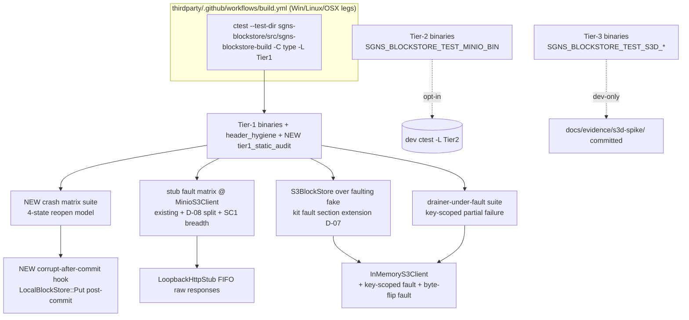

# Phase 5: Fault Injection & Three-Tier Hardening - Research

**Researched:** 2026-10-22
**Domain:** Test hardening of the finished `sgns-blockstore` three-backend stack (CTest tier labeling, CI lane restriction, in-process crash/corruption injection matrices, static test audits) — C++17/CMake/GTest/RocksDB/minio-cpp
**Confidence:** HIGH (every codebase claim read from source this session with file:line; CTest label semantics verified against the official ctest(1) manual)

---

<user_constraints>
## User Constraints (from CONTEXT.md)

### Locked Decisions (D-01..D-17 — research serves these, never re-litigates)

**Crash-injection mechanism**
- **D-01:** Crash injection is **in-process FaultController reopen ONLY** — inject fault, close-without-clean-shutdown, reopen, RocksDB WAL recovery does the real work. NO subprocess kills: Phase-2 D-07's "Phase 5 may add" door is now **closed**
- **D-02:** SC2's "mid-temp-write" window is **reinterpreted against the atomic design and documented**: there are no temp files (Phase-2 D-02, one WriteBatch), so an interrupted local write = crash-before-WAL-commit ⇒ NOTHING visible (`Get`→`NotFound`, no journal record). SC2's three named windows map onto **four real states**: pre-commit, pending, uploaded-but-unmarked, accepted. The mapping is documented where the crash tests live
- **D-03:** The matrix proves **all four states**, including the uploaded-but-unmarked payoff: reopen → reconciliation surfaces pending → re-drain → createOnly Put → `alreadyPresent` → `MarkUploadedAccepted` advances
- **D-04:** Crash windows involving the remote tier run against the **hermetic fake only**. No MinIO-binary or s3d crash cases — crash tests stay Tier-1 and run in CI everywhere

**Fault-matrix breadth**
- **D-05:** The matrix runs the **full composed stack**: (a) loopback-stub faults at `MinioS3Client`; (b) `S3BlockStore` over the faulting fake; (c) `UploadDrainer` under injected faults — per-item continue-on-failure, journal advances only on remote-present, re-drain retries only still-pending
- **D-06:** "No sticky negative caching" is asserted **per-case**: every fault case ENDS with a good-fetch-succeeds assertion in the same test
- **D-07:** Matrix home is **split by generality**: backend-generic fault cases extend the conformance kit's FaultController section; transport-specific suites (stub/HTTP garbage at `MinioS3Client`) and the drainer-under-fault suite stay **standalone** test targets
- **D-08:** Truncated-body taxonomy is **split by layer**: HTTP framing broken mid-read → `TemporarilyUnavailable` (transport); complete-but-wrong-length body → store-level CID verify fails → `Corrupt` with remote attribution

**Corruption injection mechanics**
- **D-09:** Local byte-flips via a **FaultController corrupt-after-commit hook**: after the WriteBatch lands, internally flip bytes in the blocks column family. Tests stay API-only — no direct RocksDB second-handle access from tests, no coupling to CF naming internals, portable across all five platforms
- **D-10:** Remote byte-flips via **`InMemoryS3Client` scripting only**: scripted `Get` returns flipped bytes for a stored key → store CID-verify fails → `Corrupt` with remote attribution
- **D-11:** **Remote-corrupt repeated-Get semantics**: every `Get` re-fetches and re-reports `Corrupt` — no caching of bad bytes, remote block NEVER deleted. Local corruption keeps Phase-2 D-09's evict-and-surface self-heal unchanged
- **D-12:** Corruption proof rides the **Get path only**; `Has`/`GetSize` documented in headers as NOT content-verifying

**Tier inspectability (SC3/TEST-01)**
- **D-13:** Primary tier separation is **CTest LABELS + CI lane**: every sgns-blockstore test declares `LABELS Tier1|Tier2|Tier3`; CI restricted to Tier1. Env-gating remains the inner defense layer
- **D-14:** The static audits (no fixed sleeps; no non-loopback hosts in Tier-1 sources) run **AS a Tier-1 ctest test**
- **D-15:** **No skip meta-test** — env-gate + loud-labelled-skip carries enforcement; labels + audits carry inspectability
- **D-16:** Human-readable tier inventory at **`docs/testing-tiers.md`** inside the sgns-blockstore repo, referenced from the repo README
- **D-17:** SC3's Tier-3 "committed evidence" clause satisfied by **Phase-4's existing artifacts** — Phase 5 does NOT re-run s3d

### the agent's Discretion
- FaultController hook naming/granularity; stub fault-case enumeration beyond SC1's four classes; audit-test mechanics (grep patterns, allowlist shape, scope) and placement; CI workflow edits; kit fault-section macro mechanics; test file naming/layout; exact label strings and Tier-2/3 label × env-gate interplay; accepted-state assertion mechanism; testing-tiers.md format and README wording; four-state window-model documentation location

### Deferred Ideas (OUT OF SCOPE)
- Subprocess-kill crash tests (D-01 closes the door); MinIO-binary/s3d crash replay (D-04); durability-signal polling, `MarkUploadedDurable` automated wiring, `TieredBlockStore`/retrieval tiering, metrics — unchanged REQUIREMENTS Future list
</user_constraints>

<phase_requirements>
## Phase Requirements

| ID | Description | Research Support |
|----|-------------|------------------|
| TEST-01 | Three-tier test strategy — Tier 1 hermetic fakes in CI, Tier 2 MinIO-binary opt-in, Tier 3 s3d dev-only; no live endpoints in CI, no fixed sleeps | Q1 (CTest LABELS mechanics + safest CI invocation), Q4 (the actual CI lane location + minimal Tier1-restricting edit), Q5 (static-audit ctest mechanics + the one existing `sleep_for` and zero non-loopback hosts found), Q7 (complete tier inventory data for docs/testing-tiers.md) |
| TEST-02 | Fault/crash injection — partial uploads, crash between local commit and remote upload, journal recovery, corrupt-response rejection | Q2 (corrupt-after-commit hook shape + exact firing point), Q3 (reopen pattern + four-state assertion matrix), Q6 (existing fake/stub coverage vs. the exact seam gaps: key-scoped faults, success-slot byte-flip, matrix breadth) |
</phase_requirements>

---

## Summary

Phase 5 is a test-and-config hardening phase over a finished stack — and the codebase already carries more of the machinery than the phase description implies. The crash seam (`CrashPoint::BeforeCommit` + `SetCrashPointForTesting`, the no-flush close/reopen discipline, `avoid_flush_during_shutdown=true` fixed at open), the journal state reader (`GetUploadState`/`GetPendingUploads`/`MarkUploadedAccepted/Durable`), the conformance kit's FaultController section with its `dynamic_pointer_cast`+`GTEST_SKIP` pattern, the loopback stub fault matrix (SC1's four classes already proven at adapter level), and the drainer fault/convergence suite all exist and run green. The genuine deltas are: (1) the D-09 corrupt-after-commit library-internal hook replacing today's test-side raw second RocksDB handle; (2) fake seam extensions for key-scoped faults and success-slot byte flips; (3) the four-state crash matrix incl. the uploaded-but-unmarked re-drain payoff; (4) CTest LABELS + a Tier1-restricted ctest line; (5) a static-audit ctest modeled exactly on the existing `header_hygiene` CMake-script test; (6) `docs/testing-tiers.md`.

Two premise-correcting findings matter for planning. **First**, the sgns-blockstore CI lane is NOT in `SuperGenius/.github/workflows/cmake.yml` — SuperGenius CI downloads a prebuilt thirdparty release and runs only its own tests; the sgns-blockstore tests run in `thirdparty/.github/workflows/build.yml` ("Run sgns-blockstore tests", gated to Windows/Linux/OSX legs). D-13's CI edit lands THERE. **Second**, `-LE "Tier2|Tier3"` fails open (CTest never excludes unlabeled tests) while `-L Tier1` fails closed — the safest CI form is `-L Tier1` (optionally anchored `^Tier1$`).

**Primary recommendation:** Extend existing seams, never new ones — hook Put post-commit for D-09, add two fake fault dimensions (per-key, byte-flip-in-success-slot) for D-05(c)/D-10, stamp `set_tests_properties(... LABELS ...)` on every existing registration, add one CMake-script audit test cloned from `header_hygiene_check.cmake`, and change one line of thirdparty CI to `-L Tier1`.

## Architectural Responsibility Map

| Capability | Primary Tier | Secondary Tier | Rationale |
|------------|-------------|----------------|-----------|
| Crash/corruption injection seams | Library (`src/LocalBlockStore.cpp`, installed `FaultController.hpp`/`LocalBlockStore.hpp`) | — | D-09 requires the hook library-internal so tests stay API-only and CF-name-agnostic |
| Fault scripting at adapter level | Test fake (`src/InMemoryS3Client`) | — | D-10/D-05(b): hermetic, deterministic; already the established seam |
| Wire-level fault matrix | Test support (`test/LoopbackHttpStub`) | — | Genuine wire bytes (SC1 letter); real `MinioS3Client` is the subject |
| Tier labeling | `test/CMakeLists.txt` (repo-local) | — | D-13: labels readable from test CMake itself |
| CI tier enforcement | `thirdparty/.github/workflows/build.yml` | — | The only workflow that invokes the inner ctest (see Q4) |
| Static audits (sleeps/hosts) | `test/` CMake-script ctest | — | D-14: runs everywhere ctest runs; `header_hygiene` precedent |
| Tier inventory doc | `docs/testing-tiers.md` in the library repo | README (does not exist yet — see Open Questions) | D-16 |

## Standard Stack

No new libraries, packages, or external dependencies. The phase composes entirely on:

| Component | Version | Role |
|-----------|---------|------|
| CTest label filtering | CMake ≥ 3.20 (repo floor, `CMakeLists.txt:1`) | `-L`/`-LE` + `LABELS` test property (D-13) |
| CMake script mode (`cmake -P`) | same | The D-14 audit test mechanism (`header_hygiene` precedent) |
| GTest ~1.14 | superbuild | all new suites; `GTEST_SKIP` loud-skip pattern |
| RocksDB 9.4 (superbuild) | consumer-provided | WAL recovery is the crash oracle; hook uses the store's own handle |
| GitHub Actions | existing runners | one-line edit in `thirdparty/.github/workflows/build.yml` |

## Package Legitimacy Audit

No external packages are installed by this phase. **Disposition: none to audit.** (No npm/pypi/crates dependency changes; all edits are in-repo C++/CMake/Markdown.)

## Architecture Patterns

### System Architecture Diagram



### Recommended Project Structure (additions inside `thirdparty/sgns-blockstore/`)

```
test/
├── CMakeLists.txt              # LABELS on every registration + audit test registration
├── tier1_audit_check.cmake     # NEW (D-14) — clone of header_hygiene_check.cmake shape
├── local_block_store_crash_test.cpp   # extended: 4-state matrix, corrupt-after-commit hook replaces CorruptStoredBlock
├── minio_s3_client_test.cpp    # extended: systematic SC1 breadth + D-08 truncated split
├── upload_drainer_test.cpp     # extended: key-scoped partial-failure suite (D-05c, D-06)
└── conformance/BlockStoreConformanceTests.hpp  # fault-section extension (D-07)
docs/
└── testing-tiers.md            # NEW (D-16) — inventory table from Q7
```

### Pattern 1: Test registration with labels (extend, don't fork)

**What:** The repo's `addtest()` macro (`cmake/functions.cmake:12-38`) owns `add_test(NAME ${test_name} ...)`. Labels attach with `set_tests_properties` AFTER each `addtest`/`add_test` call — zero macro surgery, one line per test:

```cmake
# Source: thirdparty/sgns-blockstore/test/CMakeLists.txt (existing) + D-13 extension
addtest(local_block_store_crash_test local_block_store_crash_test.cpp)
target_link_libraries(local_block_store_crash_test
    sgns-blockstore
    p2p::p2p_cid
    RocksDB::rocksdb        # removable once D-09 hook replaces CorruptStoredBlock
)
set_tests_properties(local_block_store_crash_test PROPERTIES LABELS "Tier1")
```

**When to use:** every one of the 14 existing registrations (13 `addtest` + `header_hygiene` at `test/CMakeLists.txt:182`). Alternative (planner's call): add an optional tier argument to `addtest()` — more invasive, touches the shared macro.

### Pattern 2: CMake-script static audit as a ctest (the D-14 mechanism)

**What:** `header_hygiene` (`test/CMakeLists.txt:182-184` + `test/header_hygiene_check.cmake`) is the exact precedent: a shell-independent `cmake -P` script that `file(GLOB_RECURSE)`s sources, `file(STRINGS)`s each, regex-matches banned patterns, and `message(FATAL_ERROR "… violation: ${file}: ${line}")`s with file:line. The D-14 audit test is a clone with different pattern sets:

```cmake
# Modeled on test/CMakeLists.txt:182-184 [VERIFIED: read this session]
add_test(NAME tier1_static_audit
    COMMAND ${CMAKE_COMMAND} -DSRC_DIR=${CMAKE_SOURCE_DIR}
    -P ${CMAKE_CURRENT_SOURCE_DIR}/tier1_audit_check.cmake)
set_tests_properties(tier1_static_audit PROPERTIES LABELS "Tier1")
```

### Pattern 3: In-process crash injection (the proven reopen shape)

**What:** arm a test-only seam → scope-block the store (destructor = no-flush close) → reopen → assert WAL-recovered truth. Discipline documented in the crash-suite banner: no test ever calls `Flush()`/`SyncWAL()`; `avoid_flush_during_shutdown=true` is fixed at open (`LocalBlockStore.hpp:82`) so the close-then-reopen path is crash-faithful. [VERIFIED: `test/local_block_store_crash_test.cpp:14-28` banner; `LocalBlockStore.hpp:82`]

### Anti-Patterns to Avoid

- **Second RocksDB handle from tests** — today's `CorruptStoredBlock` (`local_block_store_crash_test.cpp:79-131`) does exactly what D-09 now forbids; Phase 5 replaces it with the library hook and drops the `RocksDB::rocksdb` test link
- **`-LE` as the CI restriction** — fails open for unlabeled tests (see Q1); a future unlabeled test silently runs in CI
- **Fixed sleeps in fault cases** — the stub FIFO (`EnqueueResponse`) makes wire-level cases deterministic without polling; keep it that way (D-14 audits it)
- **Matrix re-implementing classification** — assert the mapper's outputs (`MinioS3Client.cpp:41-44` three-412-shape detection), never re-classify in tests

## Don't Hand-Roll

| Problem | Don't Build | Use Instead | Why |
|---------|-------------|-------------|-----|
| Tier separation in CI | Per-test CMake flags/env booleans | CTest `LABELS` + `ctest -L` | Native, inspectable from test CMake (D-13's "verifiable from configuration" clause), zero runtime cost |
| Static source audits | CI-only shell grep steps | `cmake -P` ctest (header_hygiene shape) | Runs everywhere ctest runs incl. dev machines; part of test config; shell-independent (Windows CI reality) |
| Wire-level HTTP faults | Replaying recorded sockets / mocking at SDK level | `LoopbackHttpStub` FIFO raw responses | Already produces genuine wire bytes incl. truncation-by-close and garbage; captures requests as evidence |
| Crash simulation | Subprocess kill machinery | FaultController reopen + WAL recovery | D-01 locked; deterministic, portable, runs in every CI lane |
| Stored-bytes corruption | Test-side second DB handle | Library-internal post-commit hook | D-09 locked; kills CF-name coupling and the RocksDB test link |

**Key insight:** every mechanism this phase needs has an in-repo precedent from Phases 1-4 — the phase is extension, not invention.

## Common Pitfalls

### Pitfall 1: `-LE "Tier2|Tier3"` silently runs unlabeled tests
**What goes wrong:** CTest "never excludes" unlabeled tests under `-LE`; a newly added test without a label leaks into the "hermetic-only" CI lane — possibly with live-endpoint cases.
**Why:** documented label-matching semantics [CITED: cmake.org/cmake/help/latest/manual/ctest.1.html#label-matching — "If a test has no labels attached to it, then -L will never include that test, and -LE will never exclude that test"].
**How to avoid:** restrict CI with `-L Tier1` (fails closed). Optionally anchor `^Tier1$` since `-L` is regex-substring matching (label `Tier10` would match `Tier1`). A belt-and-suspenders variant: the D-14 audit additionally fails if any registered test lacks a Tier label.
**Warning signs:** CI lane shows a test name not present in testing-tiers.md's Tier-1 table.

### Pitfall 2: Vacuous WAL proofs (flush on close)
**What goes wrong:** any `Flush()`/`SyncWAL()` in the crash path converts reopen proofs into no-ops — the WAL tail is already durable, so "recovery" tests nothing.
**Why:** RocksDB clean shutdown flushes memtables unless `avoid_flush_during_shutdown=true`.
**How to avoid:** the existing discipline already holds (crash-suite banner forbids flush/sync; option fixed at open). New four-state cases must reuse `MakeStore`/`ReopenStore` and the scope-block destructor pattern verbatim. [VERIFIED: `local_block_store_crash_test.cpp:22-28`, `LocalBlockStore.hpp:80-84`]
**Warning signs:** a crash test that passes with the WAL file deleted between runs.

### Pitfall 3: Auditing ALL test sources for sleeps hits the harness poll
**What goes wrong:** `MinioServerHarness.cpp:241` contains `std::this_thread::sleep_for` inside `WaitUntilHealthy`'s deadline-bounded poll loop — a naive whole-tree sleep grep fails on Tier-2 support code.
**Why:** bounded readiness polling is the legitimate pattern (vs fixed sleeps); TEST-01's letter scopes "no fixed sleeps" to Tier 1.
**How to avoid:** scope the audit to Tier-1 source files (explicit list or "not in the Tier-2/3 sets"), or allowlist `MinioServerHarness.cpp` with a comment citing the bounded-pool pattern. [VERIFIED: `test/MinioServerHarness.cpp:241`; it is the ONLY `sleep_for`/`Sleep(` match in `test/*.cpp`]
**Warning signs:** audit failures on files no Tier-1 binary compiles.

### Pitfall 4: D-08 store-level truncated case asserted at the wrong layer
**What goes wrong:** "complete-but-wrong-length body → Corrupt" tested at `MinioS3Client` — but the adapter returns bytes; CID verification lives in the STORE (CORE-04). Asserting Corrupt at the adapter re-implements classification.
**Why:** verification-at-boundary is the frozen Phase-1 design; the adapter is transport-honest only.
**How to avoid:** transport half = stub + real `MinioS3Client` → `TemporarilyUnavailable` (exists: `minio_s3_client_test.cpp:176-193`); store half = fake's byte-flip fault + `S3BlockStore::Get` → `Corrupt`+Remote (new seam, Q6).
**Warning signs:** any new test calling `CidOf` to "check" what the store should have checked.

### Pitfall 5: `policy::terminate` result alias in new test code
**What goes wrong:** `.value()` on a failed result terminates the process — a failing assertion becomes a crash.
**Why:** library-local `result<R,S,policy::terminate>` alias in every header (Phase-1 landmine).
**How to avoid:** `ASSERT_TRUE(res)` / `if (!res)` before `.value()`/`.error()` — every existing suite already follows this.
**Warning signs:** new test lines calling `.value()` directly on an unchecked result.

### Pitfall 6: MSVC debug `std::vector` from `gsl::span` iterator temporaries
**What goes wrong:** crashes in debug builds on Windows (verified Phases 1-3 landmine).
**How to avoid:** use string iterators when constructing expected byte vectors in new fixtures (see `SpanOf` helpers in existing suites).

## Code Examples

### Q1 — CTest LABELS mechanics and the CI invocation (TEST-01/D-13)

**Attaching labels** — `set_tests_properties(<name> PROPERTIES LABELS "<tier>")` after each registration; multi-label via semicolons (`"Tier1;Tier2"`).

**Invocation semantics** [CITED: cmake.org, ctest(1) manual, Label Matching section]:
- `-L <regex>`: run only tests where at least one label matches the regex; multiple `-L` = AND. **Unlabeled tests are never included** (fails closed).
- `-LE <regex>`: exclude tests where each regex matches at least one label. **Unlabeled tests are never excluded** (fails open).
- Regex is substring-based: `-L Tier1` also matches label `Tier10`; anchor with `^Tier1$` if that ever matters (label set is controlled — three values).
- `-C <cfg>` (multi-config selection) and `-R`/`-E` (name filters) AND-compose with `-L`/`-LE` — the SuperGenius lanes already combine `-C` with `-LE`/`-E` (`cmake.yml:604`, `:674-676`), so `-C ${{matrix.build-type}} -L Tier1` composes identically in the thirdparty lane.
- `--print-labels` lists labels without running; `--no-tests=error` makes an empty selection fail loudly (guards against a label-typo'd CI line selecting nothing).

**Recommended CI form (D-13):**
```
ctest --test-dir sgns-blockstore/src/sgns-blockstore-build -C <type> --output-on-failure -L Tier1
```

**Label × env-gate interplay (discretion item, recommendation):** pure binaries get their tier's label; MIXED binaries — `minio_cpp_spike_test`, `minio_s3_client_test` (hermetic cases + env-gated live cases in one binary) — carry `"Tier1;Tier2"`: CI's `-L Tier1` runs them (live cases loud-skip without the env var), while a dev `ctest -L Tier2` with `SGNS_BLOCKSTORE_TEST_MINIO_BIN` set becomes the complete opt-in Tier-2 lane. `s3_block_store_minio_test` (all cases gated) is pure `Tier2`; `s3d_spike_test`/`s3d_roundtrip_e2e` are `Tier3`.

### Q2 — The corrupt-after-commit hook (D-09)

**What the seam exposes today:**
- Installed `FaultController.hpp` = `FaultKind { None, Unavailable, CorruptData, Unauthorized }` + pure virtual `SetFault`/`GetFault` — **no crash points, no hooks** [VERIFIED: `include/sgns-blockstore/FaultController.hpp:14-19,52-58`]
- `CrashPoint { None, BeforeCommit }` + `SetCrashPointForTesting(CrashPoint)` live on the **concrete `LocalBlockStore` type**, explicitly noted "the frozen FaultKind enum and FaultController surface are untouched" [VERIFIED: `include/sgns-blockstore/LocalBlockStore.hpp:63-66,260`]
- CF names are currently published constants for the second-handle forge: `kBlocksColumnFamilyName = "blocks"` (`:27`), `kUploadJournalColumnFamilyName = "upload_journal"` (`:32`)

**Viable mechanics (within D-09's letter):** a library-internal hook fired from the store's OWN RocksDB state — read the just-committed value back through `impl_->blocks_`, flip a byte, write it back sync via `impl_->db_`. No second handle is opened, no CF name crosses the API, and the test link on `RocksDB::rocksdb` (`test/CMakeLists.txt:29`) becomes removable.

**Exact firing point** [VERIFIED: `src/LocalBlockStore.cpp:345-364`]:
```cpp
// ...presence probe (322-334), BeforeCommit gate (337-343)...
rocksdb::WriteBatch batch;                       // :350
batch.Put(impl_->blocks_, ...);                  // :351-354
if (!already_present)
    batch.Put(impl_->journal_, ..., JournalRecord::Encode(UploadState::PendingUpload)); // :356-357
const auto committed = impl_->db_->Write(impl_->wo_, &batch);  // :359
if (!committed.ok())
    return MapStatus(committed, "Put: batch commit failed");   // :360-363
// >>> HOOK FIRES HERE: after committed.ok(), before the return <<<
return PutOutcome{DurabilityLevel::LocalCommitted, already_present};  // :364
```

**Placement recommendation (discretion):** follow the `CrashPoint` precedent — a `SetCorruptAfterCommitForTesting(...)` concrete method on `LocalBlockStore` + member flag, rather than widening the installed `FaultController` interface. D-09's operative constraint is tests-stay-API-only; the CrashPoint note in `LocalBlockStore.hpp` already establishes that test seams may live on the backend type without touching the frozen kit seam. (If the planner prefers the D-09 letter's mention of `FaultController.hpp` literally, a sibling `CorruptAfterCommit` kind could join a backend-side fault enum — but the kit's `dynamic_pointer_cast<FaultController>` probing must not newly trigger eviction semantics; the `FaultCorruptionDoesNotEvict` regression (`local_block_store_crash_test.cpp:167-198`) pins that the existing `CorruptData` kind NEVER evicts, because it corrupts only the returned copy. The new hook is a DIFFERENT animal: real stored bytes.)

**What the hook must NOT do:** touch the journal CF (the self-heal eviction assertions check journal co-removal), corrupt on the `already_present` re-Put path unless scripted to (keeps the re-Put-repairs flow in `StoredCorruptionSelfHealsEvictAndSurface` composable), or fire when disarmed.

### Q3 — WAL recovery proof mechanics + the four-state assertion matrix (D-01/D-02/D-03)

**What exists** [VERIFIED: `test/local_block_store_crash_test.cpp`]:
- Reopen pattern: `MakeStore(dir)` (fresh) / `ReopenStore(dir)`; crash = scope-block end (destructor, no-flush close); recovery = next `ReopenStore`. Banner forbids `Flush()`/`SyncWAL()` (`:22-28`).
- `CrashBeforeCommitLeavesNothing` (`:202-233`): state 1 of the matrix — already proven.
- `CrashAfterCommitRecoversBlockAndPending` (`:246-267`): state 2 (pending) — already proven.
- `JournalTransitionsReconcileAcrossRestart` (`:270-291`): Accepted/Durable transitions survive restart.
- `StoredCorruptionSelfHealsEvictAndSurface` (`:139-164`): local corruption semantics — today via second handle, Phase 5 via hook.
- `FaultCorruptionDoesNotEvict` (`:167-198`): fault-copy vs stored corruption distinction.

**Journal state reader surface per state** [VERIFIED: `LocalBlockStore.hpp` + tooling]:
| State (D-02/D-03) | Construction before crash | Post-reopen assertions available |
|---|---|---|
| 1. Pre-commit | arm `CrashPoint::BeforeCommit`, Put fails `TemporarilyUnavailable` | `Get`→`NotFound`; `Has`→false; `GetPendingUploads`→empty; `GetUploadState`→`NotFound` |
| 2. Pending | Put succeeds (sync WriteBatch), no remote | block CID-verified via `Get`; `GetPendingUploads`=={cid}; `GetUploadState`==`PendingUpload` |
| 3. Uploaded-but-unmarked | Put, drain to fake (remote holds object), crash BEFORE mark — script the fake fault on Put after N successes or drain-then-corrupt-window via key-scoped fault | reopen: still `PendingUpload`; re-drain: Put→success slot `alreadyPresent=true`; `GetUploadState`→`UploadedAccepted`; pending set empty |
| 4. Accepted | Put, drain fully (`MarkUploadedAccepted` landed) | `GetUploadState`→`UploadedAccepted`; `GetPendingUploads`→empty (accepted leaves the pending set — `BlockStoreTooling.hpp` GetPendingUploads doc: "CIDs whose upload-journal state is PendingUpload"); block retrievable; **re-drain is a no-op** (empty pending → empty result vector) |

**Discretion recommendation (accepted-state mechanism):** assert BOTH the state reader and drain idempotency — the reader assertion is cheap and the no-op re-drain is the idempotency proof SC2 language actually wants.

**The D-02 window-model documentation:** the crash-suite banner already carries half the story ("There is deliberately NO mid-DB::Write fault point…", `:15-21`); the four-state mapping extends that banner (discoverable, lives with the tests) — cheaper than a doc and satisfies D-02's "documented where the crash tests live."

### Q4 — CI workflow edit surface (D-13) — WITH PREMISE CORRECTION

**Finding: sgns-blockstore tests are NOT invoked by `SuperGenius/.github/workflows/cmake.yml`.** [VERIFIED: read both workflows]
- SuperGenius "Release Build CI" **downloads a prebuilt thirdparty release** (`gh release download "$tag" --repo GeniusVentures/thirdparty`, `cmake.yml:318-331`) and runs only its own tests: `ctest . -j $CTEST_JOBS -C <type> --output-on-failure -LE requires_foundry` (Windows/OSX lane, `cmake.yml:604`; Linux lane adds `-E "$CTEST_EXCLUDE_REGEX"`, `cmake.yml:674-676`). No thirdparty test runs there — grep for `blockstore` in that file returns nothing.
- The actual lane: **`thirdparty/.github/workflows/build.yml`** (reusable `workflow_call` engine, driven by `build-targets.yml`), step "Run sgns-blockstore tests" [VERIFIED: `thirdparty/.github/workflows/build.yml:364-373`]:
```yaml
      - name: Run sgns-blockstore tests
        if: ${{ matrix.target == 'Windows' || matrix.target == 'Linux' || matrix.target == 'OSX' }}
        working-directory: ${{env.BUILD_DIRECTORY}}
        run: ctest --test-dir sgns-blockstore/src/sgns-blockstore-build -C ${{matrix.build-type}} --output-on-failure
```
  Its own comment already records the research resolution: "ctest in the build tree; SuperGenius CI consumes prebuilt thirdparty releases and runs no thirdparty tests. Gated off iOS/Android legs — their cross-compiled test executables cannot run on the host."

**Minimal D-13 change (one line):**
```yaml
        run: ctest --test-dir sgns-blockstore/src/sgns-blockstore-build -C ${{matrix.build-type}} --output-on-failure -L Tier1
```
- Applies uniformly to all three desktop targets (the `if:` already gates lanes); no Windows-lane difference in the ctest line itself (the workflow runs it under bash uniformly; `--test-dir` avoids cwd dependence).
- The build path `sgns-blockstore/src/sgns-blockstore-build` is the ExternalProject build dir (PREFIX `sgns-blockstore`); the superbuild entry (`CommonTargets.cmake:863-919`) hard-codes `-DTESTING:BOOL=ON` as the LAST cache arg so test binaries are always built by the preceding `cmake --build` step — labeling changes nothing about build ordering.
- Consider adding `--no-tests=error` so a mis-filtered invocation fails loudly instead of passing vacuously (optional; discretion).
- Dev-machine full runs stay `ctest` with no `-L` (all tiers, gated cases skip loudly) — the verification recipe inside `thirdparty/build/Windows/Debug/sgns-blockstore/src/sgns-blockstore-build` is unchanged (Phase-2 landmine note).

### Q5 — The static audit test (D-14)

**Mechanics (clone of `header_hygiene_check.cmake`, pattern proven in-repo):**
- Registration: `add_test(NAME tier1_static_audit COMMAND ${CMAKE_COMMAND} -DSRC_DIR=${CMAKE_SOURCE_DIR} -P .../tier1_audit_check.cmake)` + `LABELS "Tier1"` — shell-independent, runs in every ctest context incl. the CI lane and Windows.
- Sleep patterns to scan (C++ surfaces): `std::this_thread::sleep_for`, `SleepForMilliseconds`, `Sleep(`, `sleep(`, `usleep`, `nanosleep`. One live match exists in the whole test tree today: `MinioServerHarness.cpp:241` (`std::this_thread::sleep_for` in the bounded health-poll) — Tier-2 support code.
- Host-literal policy: allow `127.0.0.1`, `localhost`, `::1`; reject everything host-shaped (IP literals, `*.com|*.io|*.net|*.org` patterns, `play.min.io` explicitly banned by research). **Current state: zero `http://`/`https://` URL literals and zero non-loopback host literals in `test/*.cpp`** [VERIFIED: grep this session] — endpoints arrive via `S3ClientConfig` fields, so the audit is a regression tripwire, not a cleanup.
- Scope decision (discretion): **recommended — audit the Tier-1 source set** (the `.cpp` files compiled into Tier-1-labeled binaries + `test/LoopbackHttpStub.*` + `test/conformance/*`), excluding the Tier-2/3 support (`MinioServerHarness.*`, gated binaries). Alternative: scan all of `test/` with an explicit allowlist naming `MinioServerHarness.cpp:241` and the bounded-poll justification. The Tier-1-scoped option needs a source list in the audit script (mirroring how the CMakeLists knows each target's sources) or a naming convention; the allowlist option is simpler but rots if new polls appear.
- The allowlist/config lives next to the audit script (one file), same as `header_hygiene_check.cmake` embeds its banned list.

### Q6 — Fake/stub coverage vs. matrix needs: exact gaps

**What exists** [VERIFIED: read this session]:

| Surface | Today | Gap for Phase 5 |
|---|---|---|
| `LoopbackHttpStub` (`test/LoopbackHttpStub.hpp`) | FIFO raw-response queue (`EnqueueResponse`), bare-200 default, request capture, 127.0.0.1-ephemeral bind only | None mechanical — matrix breadth only (more 5xx codes, truncation offsets, garbage shapes; connection-refused = unstarted stub, existing pattern) |
| Stub matrix at `MinioS3Client` (`minio_s3_client_test.cpp:134-303`) | ConnectionRefused→TempUnavailable; bare 500→TempUnavailable; truncated body→TempUnavailable; garbage→TempUnavailable; XML-body 412 + empty-body 412→alreadyPresent; NoSuchKey 404→NotFound; NoStickyNegativeCache (500 then good fetch) | SC1 formalization: only ONE 5xx code (500) and one truncation/garbage shape today; D-06 per-case good-fetch must end EVERY case; D-08 store-half cannot live here (see Pitfall 4) |
| `InMemoryS3Client` fake (`src/InMemoryS3Client.hpp/.cpp`) | `SetFault(S3Op op, S3FaultKind kind)` — per-OP, persists until cleared (`:46`); faults map to adapter-level taxonomy OUTCOMES: `Unavailable`/`CorruptData`/`Unauthorized` → ready-made `BlockStatus` failures (`FaultGate`, `.cpp:52-73`); stateful map, createOnly-enforcing, `ObjectKeys()` probe | **Gap A (key-scoped faults):** the fault table is `std::array<S3FaultKind,4>` indexed by op only (`hpp:81`) — "item 2 fails while siblings upload" (D-05c) is inexpressible; needs a per-key overlay (e.g., `SetFaultForKey(key, S3Op, S3FaultKind)` or per-key map consulted before the op-level gate). **Gap B (byte-flip in success slot):** `CorruptData` on Get returns a `Corrupt` FAILURE from the adapter — D-10 needs a kind that returns the stored bytes with a flipped byte in the SUCCESS slot so `S3BlockStore`'s CID verify is the detector (and D-11's re-fetch-still-Corrupt becomes assertable). Both are additive to the fake only; `S3Client.hpp`'s `S3FaultKind` may gain a member or the scripting can stay fake-internal (`InMemoryS3Client`-specific methods) — fake-internal is cleaner: the adapter interface stays frozen |
| Drainer suite (`upload_drainer_test.cpp:117-315`) | HappyPath; RemotePutFault (ALL Puts fail op-wide) records failures + retains pending; ReDrainConverges + fresh-store re-put alreadyPresent; LocalGetFault per-item; EmptyPending | **Gap C:** partial failure — exactly one key failing mid-drain while siblings succeed (needs Gap A); **Gap D:** D-06 per-case recovery inline (existing fault tests clear faults only in the NEXT test); journal-advances-only-on-remote-present is assertable today but not under partial-failure conditions |
| Conformance kit fault section (`BlockStoreConformanceTests.hpp:253-341`) | 4 fault cases: Unavailable→TempUnavailable-never-NotFound; ClearsNoSticky; CorruptData→Corrupt-with-backend-source; Unauthorized→Unauthorized — all with `dynamic_pointer_cast<FaultController>` + `GTEST_SKIP` `[fault-conformance]` | D-07's generic additions join inside the macro body (new `TEST_F(SuiteName, ...)` entries) — every backend instantiates them free; the placement mechanics are exactly these four cases' shape |
| Taxonomy mapper (`src/MinioS3Client.cpp`) | Three 412 shapes classified (`:41-44`: `PreconditionFailed`, `HTTP status code 412`, `status code: 412`); AccessDenied→Unauthorized (`:85`); default bucket→TemporarilyUnavailable NEVER NotFound (`:89`) | None — matrix asserts outputs; the 412 trio must not regress (STATE.md Phase-03 note) |

### Q7 — `docs/testing-tiers.md` inventory data (D-16)

Complete table (research output — the doc's content): [VERIFIED: `test/CMakeLists.txt:1-184`; env vars grepped from sources]

| Test binary / test | Tier | Gate env vars | Notes / evidence pointers |
|---|---|---|---|
| `memory_block_store_test` | Tier1 | — | conformance kit vs MemoryBlockStore |
| `cid_spike_test` | Tier1 | — | Phase-1 C1 spike suite |
| `local_block_store_test` | Tier1 | — | conformance + backend suite |
| `local_block_store_crash_test` | Tier1 | — | crash/corruption suite; extended by this phase (4-state matrix) |
| `api_hygiene_test` | Tier1 | — | API-shape guards |
| `header_hygiene` | Tier1 | — | CMake-script static audit (installed-header include hygiene) |
| `tier1_static_audit` (NEW) | Tier1 | — | D-14 sleep/host audit |
| `minio_cpp_spike_test` | Tier1 (+Tier2 live case) | live case: `SGNS_BLOCKSTORE_TEST_MINIO_BIN` | hermetic stub cases run in CI; env-gated TLS smoke loud-skips (`:252-267`) |
| `in_memory_s3_client_test` | Tier1 | — | fake op coverage |
| `s3_block_store_test` | Tier1 | — | conformance + key layout over fake |
| `upload_drainer_test` | Tier1 | — | drainer suite; extended by this phase |
| `minio_s3_client_test` | Tier1 (+Tier2 live cases) | live cases: `SGNS_BLOCKSTORE_TEST_MINIO_BIN` | hermetic stub matrix runs in CI; live roundtrips skip (`:308-324`) |
| `s3_block_store_minio_test` | Tier2 | `SGNS_BLOCKSTORE_TEST_MINIO_BIN` | MinIO-binary store roundtrip; harness child process, no Docker |
| `s3d_spike_test` | Tier3 | `SGNS_BLOCKSTORE_TEST_S3D_ENDPOINT`/`_ACCESS_KEY`/`_SECRET_KEY`/`_BUCKET`/`_USE_TLS` | dev-gated spike; evidence `docs/evidence/s3d-spike/` (sdk-error-shapes.txt, staged-read-headers.txt, stats-*.txt) |
| `s3d_roundtrip_e2e` | Tier3 | the five above + `SGNS_BLOCKSTORE_TEST_S3D_RUN_STATE` | two-run fresh-process E2E; evidence `docs/evidence/s3d-spike/e2e-stats-captures.txt` + `README.md`; finding doc `docs/s3d-durability.md` |

**D-16 gap found:** the sgns-blockstore repo has **no README** [VERIFIED: `file_search README*` → none] — "referenced from the repo README" means one must be created (minimal stub linking the doc) or the reference lands in `docs/s3d-durability.md`/`Readme` at workspace level. Planner discretion within D-16's letter.

## State of the Art

| Old Approach (pre-phase) | Current/Landed Approach | Impact for Phase 5 |
|---|---|---|
| Test-side second RocksDB handle corruption forge | Library-internal post-commit hook (D-09) | Removes `RocksDB::rocksdb` test link + CF-name coupling; `kBlocksColumnFamilyName` publication justification ("tests can address the store's column families", `LocalBlockStore.hpp:25-26`) weakens — consider whether the constants stay published (additive removal is a header change; planner decides within D-09's API-only rule) |
| Unlabeled ctest lane (everything runs; gates do the skipping) | LABELS + `-L Tier1` CI restriction (D-13) | Env gates remain as inner defense (D-15: no skip meta-test) |
| One 5xx code / one truncation shape | Systematic SC1 matrix + D-08 layer split | Adapter asserts transport honesty; store asserts verification |

## Assumptions Log

| # | Claim | Section | Risk if Wrong |
|---|-------|---------|---------------|
| A1 | `-L "^Tier1$"`-style anchoring is unnecessary given a controlled 3-label set (substring collision only arises with hypothetical `Tier10` labels) | Q1 | None material — recommend unanchored `Tier1` for readability; anchoring is a one-char change |
| A2 | Mixed binaries labeled `Tier1;Tier2` is the intended D-13 interplay (CONTEXT leaves exact label strings to discretion) | Q1 | Alternative: pure `Tier1` label + doc note that live cases are env-gated inside; both satisfy SC3 |
| A3 | GitHub-hosted/ Actions expression context: the `build.yml` lane runs under bash for all three desktop targets, so the one-line `-L Tier1` edit is lane-uniform | Q4 | If any lane used pwsh quoting differently, the flag string might need quoting — cosmetic |
| A4 | `S3BlockStore` surfaces adapter-success-slot bytes unmodified for CID verification (verification-at-boundary per CORE-04) — read from Phase-1 frozen contract + kit assertions, `S3BlockStore.cpp` itself not re-read this session | Q6/Pitfall 4 | LOW: frozen since Phase 1, conformance-proven; executor should re-verify Get's verify branch when writing the byte-flip case |

## Open Questions

1. **Hook placement — installed `FaultController.hpp` vs concrete `LocalBlockStore` surface**
   - What we know: D-09's text says "the hook joins the installed FaultController.hpp seam"; the in-repo precedent (`CrashPoint`, `LocalBlockStore.hpp:63-66,260`) put crash seams on the concrete type precisely to keep FaultController frozen.
   - What's unclear: whether widening the installed `FaultController` interface is desired or contradicts the "frozen FaultKind enum" note.
   - Recommendation: concrete `SetCorruptAfterCommitForTesting` on `LocalBlockStore` (CrashPoint precedent); kit-level genericity is preserved because the corruption matrix is LocalBlockStore-specific anyway (D-07 sends generic cases to the kit, this one stays backend-specific).
2. **Audit scope mechanics** (Tier-1 source list vs allowlist) — see Q5; both viable, planner picks per maintenance taste.
3. **README stub for D-16** — create minimal `Readme.md` in sgns-blockstore vs cross-reference from existing docs only.
4. **Whether `kBlocksColumnFamilyName`/`kUploadJournalColumnFamilyName` publication survives** once no test consumes it (D-09) — removing published constants is an API change; keeping them is harmless. Default: keep (additive posture).

## Environment Availability

| Dependency | Required By | Available | Version | Fallback |
|------------|------------|-----------|---------|----------|
| Windows/MSVC + inner build tree | dev verification | ✓ | VS2022; `thirdparty/build/Windows/Debug/...` recipe proven Phases 1-4 | — |
| ctest `-L` | CI restriction | ✓ | CMake ≥ 3.20 floor (`CMakeLists.txt:1`); label filtering is ancient/stable | — |
| LoopbackHttpStub sockets | stub matrix | ✓ | in-repo, ws2_32 linked on Windows (`test/CMakeLists.txt:64-66`) | — |
| MinIO binary (Tier-2 dev runs) | none this phase (D-04: no MinIO crash cases) | opt-in | `SGNS_BLOCKSTORE_TEST_MINIO_BIN` | not needed |
| s3d (Tier-3) | none this phase (D-17: no re-run) | n/a | — | existing committed evidence |

**Missing dependencies with no fallback:** none. **Missing with fallback:** none — the phase is fully hermetic by design (D-04).

## Security Domain

ASVS L1 (`security_enforcement: true`, level 1). This phase adds no production code paths and no new input surfaces; its security contribution is *proof* of existing controls:

| ASVS Category | Applies | Standard Control (proven, not built) |
|---------------|---------|--------------------------------------|
| V5 Input Validation | yes | CORE-04 CID verification at boundary — the D-10 byte-flip matrix proves corrupt remote bytes are rejected `Corrupt`+Remote (and D-11: never cached, never remote-deleted) |
| V6 Cryptography | no new surface | sha-256 verify paths exercised, unchanged |
| V4 Access Control | indirectly | `Unauthorized` taxonomy class conformance (kit) + adapter AccessDenied mapping asserted under fault |
| V2/V3 | no | no auth/session code touched |

Threat note: the audit's host allowlist (loopback-only) is itself a security control — it tripwires any future test hardcoding an external endpoint (research pitfall: never `play.min.io`, never live internet in CI).

## Sources

### Primary (HIGH confidence — read this session)
- `thirdparty/sgns-blockstore/test/CMakeLists.txt` (full), `cmake/functions.cmake` (`addtest`, `:12-38`), `test/header_hygiene_check.cmake` (full)
- `include/sgns-blockstore/FaultController.hpp` (full), `LocalBlockStore.hpp` (`:27,32,42-66,80-84,260` + full read), `BlockStoreTooling.hpp` (full), `UploadDrainer.hpp` (full), `S3Client.hpp` (full)
- `src/LocalBlockStore.cpp` (`:285-364` Put path), `src/InMemoryS3Client.hpp/.cpp` (full), `src/MinioS3Client.cpp` (`:26-89,159-200`)
- `test/local_block_store_crash_test.cpp` (full), `test/LoopbackHttpStub.hpp` (full), `test/minio_s3_client_test.cpp` (matrix case inventory), `test/upload_drainer_test.cpp` (`:117-315`), `test/MinioServerHarness.cpp:241`
- `thirdparty/.github/workflows/build.yml:364-373` + trigger block; `SuperGenius/.github/workflows/cmake.yml:169-231,318-331,596-680`; `thirdparty/build/CommonTargets.cmake:862-919`
- `.planning/workstreams/rocksdb-backup/phases/01..04/*-CONTEXT.md`, `REQUIREMENTS.md`, `ROADMAP.md`, `STATE.md`, `.planning/research/{PITFALLS,SUMMARY}-rocksdb-backup-2026-10-19.md`
- `thirdparty/sgns-blockstore/docs/` + `docs/evidence/s3d-spike/` (inventory)

### Secondary (MEDIUM confidence)
- [CITED: cmake.org/cmake/help/latest/manual/ctest.1.html] — `-L`/`-LE` label-regex semantics, unlabeled-test behavior, `-C` composition, `--no-tests=error`, `--print-labels`

## Metadata

**Confidence breakdown:**
- CI/test-infra mechanics (labels, audit, lane): HIGH — official manual + in-repo precedents read line-by-line
- Crash/corruption mechanics: HIGH — Put path, seams, and existing suites read; hook firing point pinned to lines
- Fake seam gaps (key-scoped, byte-flip): HIGH — fault table structure and FaultGate behavior read directly
- Label×gate interplay recommendation: MEDIUM-HIGH — design recommendation within locked constraints, not a fact claim

**Research date:** 2026-10-22
**Valid until:** ~2026-11-21 (stable, in-repo-grounded; re-verify only if CI workflows move)
