# Phase 8: Spill-on-Write & Background Drainer - Research

**Researched:** 2026-10-23
**Domain:** SuperGenius CRDT write-path integration of the shipped `sgns-blockstore` cold-storage library (journal spill decorator + background drain service)
**Confidence:** HIGH

## Summary

Phase 8 wires the shipped v1.0/Phase-6 `sgns-blockstore` library into the single SuperGenius CRDT block-write seam. That seam is verified at `SuperGenius/src/crdt/globaldb/globaldb.cpp:509` (`auto ipfsDataStore = std::make_shared<RocksdbDatastore>( ipfsDBResult.value() );` — the only production construction of an `IpfsDatastore` in SuperGenius). Every CRDT block write — local publishes AND remote-received sync blocks — flows `CrdtDatastore::ProcessJobIteration` (`crdt_datastore.cpp:1029`) → `GraphsyncDAGSyncer::addNode` (`graphsync_dagsyncer.cpp:187-191`, holding `dagMutex_`) → `MerkleDagServiceImpl::addNode` (`merkledag_service_impl.cpp:17-21`) → `IpfsDatastore::set`. A decorator at that construction point intercepts all of it with zero changes to GraphsyncDAGSyncer/CrdtDatastore/ipfs-lite.

Both phase-local research asks are answered with file:line evidence. **(1) Key layout:** the hot store keys blocks by raw binary CID bytes (`CID::toBytes()`) in the default column family of the single shared GlobalDB RocksDB; `LocalBlockStore` uses the *byte-identical* encoded-CID key in its own separate RocksDB (`blocks` + `upload_journal` column families) — no key translation anywhere. **(2) Hosting split:** the library ships `DrainPendingUploads` as a **synchronous one-shot free function** (no thread, no loop, no backoff, single-threaded contract) — SuperGenius MUST own the drainer thread (`ColdStorageManager`) and call the library function as the per-poll body. Everything D-01..D-12 requires on top (poll cadence, exponential backoff, watermarks, grace shutdown, ops-trigger enqueue) is SuperGenius-side new code; the library deliberately provides none of it.

Three integration mechanics need planner attention beyond the locked decisions: (a) production SuperGenius code now compiles against sgns-blockstore for the first time — a factory/stub split is required so default `SGNS_COLD_STORAGE=OFF` builds still link (with a loud failure when config requests cold storage on an OFF build, per the P10 silent-disable pitfall); (b) the shipped single-threaded-use contract on `LocalBlockStore`/`DrainPendingUploads` argues for one SuperGenius-side mutex serializing publisher vs drainer access; (c) neither the local dev tree nor CI currently configures `SGNS_COLD_STORAGE=ON`, so Tier-1 spill tests need a reconfigure step locally and a CI-arg decision.

**Primary recommendation:** Build `BlockStoreBackedIpfsDatastore` (decorator, journal-first ordering) + `ColdStorageManager` (own thread, cv-based poll loop calling `DrainPendingUploads`, atomics-backed status getter, grace-then-join stop) in `SuperGenius/src/crdt/globaldb/`, constructed through a gated factory (real impl under `SGNS_COLD_STORAGE`, stub otherwise), slotted into `GlobalDB::New`/`ShutdownNow` exactly where the backup loop already slots.

<user_constraints>
## User Constraints (from CONTEXT.md)

### Locked Decisions
- **D-01:** **Unbounded journal + alarm** — when s3d is slow/unavailable the journal grows without bound; writes are never blocked and spill is never skipped; disk is the pressure valve. Bounded-degrade and the opt-in hard cap were rejected — **Reversibility:** costly
- **D-02:** **Dual watermark on pending-upload record count** — warn + critical thresholds measured in pending-upload records (the exact unit `GetPendingUploads` yields); byte-based journal accounting deferred to milestone-Future — **Reversibility:** reversible
- **D-03:** **Exponential backoff, capped, reset on success** — consecutive s3d failures back off exponentially to a cap; first success resets. Exact floor/cap values are agent discretion (cap configurable per D-06) — **Reversibility:** reversible
- **D-04:** **Local journal-write failure fails the publish** — hot-write + journal are one mandatory pair; a journal-write failure (disk full, IO error) fails the Put loudly. SC4's "never fails due to cold-store state" is scoped to **remote** s3d state — **Reversibility:** costly
- **D-05:** **Minimal ops knob set only** — exactly: drain poll interval, backoff cap, warn watermark, critical watermark. Everything else stays compile-time constant until metrics evidence justifies exposure — **Reversibility:** costly
- **D-06:** **Nested `blockstore.backpressure` sub-object** — the four knobs live under `blockstore.backpressure`; absent sub-object = all defaults; unknown key inside = loud startup failure (Phase 7 D-05 posture inherited); tri-state semantics inherit Phase 7 unchanged — **Reversibility:** costly
- **D-07:** **Knobs optional, always-on built-in defaults** — absent knobs mean documented built-in defaults with the watermark alarm **always active**. No opt-in alarm — **Reversibility:** costly
- **D-08:** **Log + queryable status getter** — rate-limited warn/critical log lines PLUS a status getter exposing at minimum: journal depth (pending count), watermark state, drainer health. Not a metrics framework — **Reversibility:** reversible
- **D-09:** **Transition + heartbeat logging** — every threshold crossing logged (down-crossings/recovery included) plus a rate-limited heartbeat while a watermark is held — **Reversibility:** reversible
- **D-10:** **ColdStorageManager is a GlobalDB member** — lifecycle tied to `GlobalDB::New`/`Shutdown`, constructed behind the Phase 7 config gate (blank config = nothing constructed); status getter rides the active-accessor pattern; hermetic tests construct the manager directly; no CComponentFactory global state — **Reversibility:** costly
- **D-11:** **Clean shutdown = bounded grace wait, then resume** — shutdown stops new work and gives the drainer a bounded grace window for in-flight work; journal leftovers resume at next startup via crash-restart reconciliation; one resume code path serves crash and clean-stop; full blocking drain rejected — **Reversibility:** costly
- **D-12:** **Crash-restart reconciliation is async — the drainer's first poll** — node start latency unaffected; first poll enumerates `GetPendingUploads` and re-drains (idempotent via S3 createOnly); no separate synchronous startup gate — **Reversibility:** reversible

### The Agent's Discretion
- Exact built-in default values (drain interval, backoff floor/cap, watermark thresholds, grace window, heartbeat rate-limit period)
- Exact knob names inside `blockstore.backpressure` (subject to D-06 nesting + Phase 7 strictness inheritance)
- Status-getter signature shape and exact field set (D-08's three fields are the minimum)
- Decorator mechanics: how the atomic block+PendingUpload RocksDB batch composes with the inner `IpfsRocksDb` write, and the ordering of journal vs inner write (subject to D-04's fail-loud contract)
- How the SC1 latency-independence benchmark is built on the `InMemoryS3Client` fake (drainer paused vs running, injected-latency shape)
- Drainer thread-function placement (member function vs free function) and grace-window implementation
- Library hosting split: reuse the shipped v1.0 `UploadDrainer` vs a SuperGenius-side loop calling library APIs — researcher confirms against the shipped contracts
- Tier-1 test target registration mechanics (Phase 7's lane, `ctest -L Tier1 --no-tests=error`, tier-label discipline)
- Ops-triggered drain enqueue surface (mechanism is planner's call; SC2's enqueue-never-inline is the constraint)
- Exact log-message wording (constraint: D-09's transition + heartbeat discipline)
- Enumeration of the exact `IpfsRocksDb` block-key layout (roadmap research note) — phase-local research, planner consumes

### Deferred Ideas (OUT OF SCOPE)
- Byte-based journal watermarks — milestone-Future metrics surface (with journal-depth metrics)
- M3 needs-rebuild reconciliation tooling — Phase 11 (with GC, its consumer)
- Metrics framework beyond the D-08 status getter — milestone-Future
- Bounded-degrade / opt-in hard cap for disk-constrained operators — explicitly **rejected** in D-01, not deferred; revisit only with a concrete disk-constrained deployment requirement
</user_constraints>

<phase_requirements>
## Phase Requirements

| ID | Description | Research Support |
|----|-------------|------------------|
| SPILL-01 | Every CRDT block Put passing the `IpfsDatastore` seam (`globaldb.cpp:329` in the v1.1 research snapshot) journals block + PendingUpload record into `LocalBlockStore` atomically — local WAL only, no remote I/O on the `dagMutex_`-held write path | Seam re-verified at `globaldb.cpp:502/509` (post-Phase-7 lines); `LocalBlockStore::Put` commits block+journal as ONE sync WriteBatch (library contract); decorator pattern + journal-first ordering documented below |
| SPILL-02 | A background UploadDrainer thread drains the journal to S3 (backup-loop lifecycle pattern) with a defined backpressure policy when s3d is slow/unavailable, and drains cleanly at shutdown / resumes from the journal after crash-restart | Hosting split answered (library ships a one-shot free function; SuperGenius owns the thread); backup-loop pattern re-verified at `globaldb.cpp:609-656`; idempotent re-drain via S3 createOnly `alreadyPresent`; D-01..D-03 map onto `GetPendingUploads` count + backoff loop design below |

(SC5's Tier-1 spill tests ride TEST-01's lane — registration mechanics verified in `SuperGenius/test/src/crdt/CMakeLists.txt` and `SuperGenius/.github/workflows/cmake.yml:617`.)
</phase_requirements>

## Project Constraints (from AGENTS.md / copilot-instructions)

- **Tech stack:** C++17/C++20, CMake, libp2p, Protocol Buffers — match SuperGenius conventions
- **Coding standard:** Corelinux-derived style per `Coding Standards.md` — Ullman braces, PascalCase types, `m_`/trailing-underscore members, PascalCase headers; Doxygen `@brief`/`@param`/`@return` on public interfaces
- **Error handling:** Boost.Outcome `outcome::result<T>` for fallible operations; `[[nodiscard]]` where discarding is an error
- **Compatibility:** no breaks to existing SuperGenius/GeniusSDK/GeniusWallet builds; blank-config behavior byte-identical (Phase 7 SC2 bar carries forward)
- **Security:** main-wallet keys irrelevant here, but S3 credentials are NEVER-LOGGED (Phase 7 T-7-03 redaction-by-omission posture carries into every new log line)
- **Out of scope (REQUIREMENTS.md):** no new external dependencies; backup engine path untouched; no Docker/live endpoints in CI
- **Testing convention:** verification inside the existing `build/<Platform>/<Config>` tree with `ctest`; `addtest()` registration; Tier-1 = fail-closed `ctest -L Tier1 --no-tests=error`

## Architectural Responsibility Map

| Capability | Primary Tier | Secondary Tier | Rationale |
|------------|-------------|----------------|-----------|
| Atomic block+PendingUpload journaling | CRDT write path (decorator at IpfsDatastore seam) | LocalBlockStore (library) | SPILL-01's "every Put journals" is enforceable only where every Put passes — the single seam at `globaldb.cpp:509` |
| Hot block storage | Inner `RocksdbDatastore` (unchanged) | — | Decorator forwards; hot store stays byte-identical |
| S3 upload execution | `ColdStorageManager` drainer thread | `DrainPendingUploads` (library, per-poll body) | Remote I/O must never run under `dagMutex_`; library contract is synchronous one-shot |
| Backpressure policy | `ColdStorageManager` | — | D-01..D-03 are service-level semantics; the library has none of them |
| Crash-restart reconciliation | Drainer first poll (D-12) | LocalBlockStore WAL replay (library) | Journal survives crash by library contract; enumeration is `GetPendingUploads` |
| Config surface (`blockstore.backpressure`) | `ParseColdStorageConfig` (globaldb.cpp) | GeniusNode loader / wallet asset | Extends the Phase 7 strict parser in place |
| Lifecycle/shutdown ordering | `GlobalDB::ShutdownNow` | `ColdStorageManager::Stop` | D-10/D-11: stop slots after backup-loop stop, before datastore teardown |
| Observability (status getter, alarms) | `ColdStorageManager` (atomics) | GlobalDB active-accessor pattern | D-08/D-09; hermetic-test assertable without locks or journal scans |

## Standard Stack

### Core
| Library | Version | Purpose | Why Standard |
|---------|---------|---------|--------------|
| `sgns-blockstore` | v1.0 + Phase-6 widening (shipped, superbuild-installed) | `LocalBlockStore` (atomic journal), `S3BlockStore` (createOnly S3 tier), `DrainPendingUploads` (drain body), `OpenMinioS3Client` (production S3 client), `InMemoryS3Client` (hermetic fake) | The milestone's own frozen library; every contract Phase 8 needs is shipped and tested |
| RocksDB | superbuild in-tree (dual-compat 9.4/11.1 posture) | Hot store (existing) + LocalBlockStore's own instance | One in-tree RocksDB shared, never pinned, never a second archive (Phase 7 M1 posture) |
| GTest | ~1.14.0 (superbuild) | Tier-1 hermetic tests | Project standard; `addtest()` + `set_tests_properties(LABELS "Tier1")` |
| std::thread / std::condition_variable | C++17 stdlib | Drainer thread + cv poll loop | The backup-loop precedent (`globaldb.cpp:609-656`) uses exactly this — never `io_`, never the pubsub asio context (D-10) |

### Supporting
| Library | Version | Purpose | When to Use |
|---------|---------|---------|-------------|
| rapidjson | superbuild | `blockstore.backpressure` parsing inside `ParseColdStorageConfig` | Extending the existing strict parser — no new JSON dependency |
| spdlog/soralog (`sgns::base::Logger`) | existing | D-09 transition/heartbeat + rate-limited warn/critical lines | All manager logging |

### Alternatives Considered
| Instead of | Could Use | Tradeoff |
|------------|-----------|----------|
| Decorator at the `globaldb.cpp:509` seam | Hook inside `CrdtDatastore::ProcessJobIteration` (after `addNode`, `crdt_datastore.cpp:1029`) | The hook misses nothing today but edits CRDT internals and duplicates for the Phase-9 read path; the decorator delivers spill + fallback + serving from one seam with zero changes to GraphsyncDAGSyncer/CrdtDatastore (the v1.1 research's locked shape) |
| SuperGenius-owned drainer thread | "Reuse" library `UploadDrainer` as a hosted service | Not possible as literally stated — the library ships a synchronous one-shot free function, not a service (verified below); reuse = call it per poll |

**Installation:** none — no new packages. The library is already built unconditionally by the superbuild (`thirdparty/build/CommonTargets.cmake:862-921`) and consumed via the Phase-7-gated `find_package(sgns-blockstore CONFIG REQUIRED)` block (`SuperGenius/build/CommonBuildParameters.cmake:411-446`).

**Package Legitimacy Audit:** N/A — this phase installs zero external packages (REQUIREMENTS.md out-of-scope: "New external dependencies"). All code links the in-repo `sgns-blockstore::sgns-blockstore` target.

## Architecture Patterns

### System Architecture Diagram

```mermaid
flowchart TD
    subgraph WritePath["CRDT write path (dagMutex_ held)"]
        A["CrdtDatastore::Put / ProcessJobIteration<br/>crdt_datastore.cpp:1029"] --> B["GraphsyncDAGSyncer::addNode<br/>graphsync_dagsyncer.cpp:187 (dagMutex_)"]
        B --> C["MerkleDagServiceImpl::addNode<br/>merkledag_service_impl.cpp:17"]
        C --> D["BlockStoreBackedIpfsDatastore::set  (NEW decorator)"]
        D -->|"1. journal FIRST: one atomic sync WriteBatch<br/>block bytes + PendingUpload record"| E["LocalBlockStore (own RocksDB:<br/>blocks + upload_journal CFs)"]
        D -->|"2. then inner set (hot write)"| F["RocksdbDatastore (inner, GlobalDB RocksDB)"]
    end

    subgraph DrainPath["ColdStorageManager drainer thread (NEW; never io_, never pubsub ctx)"]
        G["poll loop: cv wait(drain_interval)<br/>or ops-trigger / stop"] --> H{"journal empty?"}
        H -->|yes| G
        H -->|no| I["DrainPendingUploads(local, s3store)<br/>(library free function, per-poll body)"]
        I -->|"per CID: Get bytes → Put createOnly"| J["S3BlockStore → S3Client<br/>(OpenMinioS3Client prod /<br/>InMemoryS3Client hermetic)"]
        I -->|"remote-present ⇒ MarkUploadedAccepted"| E
        I --> K["update atomics: pending count,<br/>watermark state, health;<br/>backoff on failures (D-03)"]
        K -->|"crossings/heartbeat (D-09)"| L["logger (rate-limited)"]
    end

    E -.->|"GetPendingUploads snapshot"| I
    M["GlobalDB::New (globaldb.cpp:509 seam)<br/>gated on ColdStorageOptions.enabled"] ==> D
    N["GlobalDB::Start / ShutdownNow<br/>(backup-loop pattern, grace+join)"] ==> G
    O["ParseColdStorageConfig +<br/>blockstore.backpressure (D-05/D-06)"] ==> M
    P["crash-restart: first poll = reconciliation (D-12)<br/>re-puts converge via alreadyPresent"] ==> G
```



A reader traces the primary use case: a publish enters at A, journals at E and lands hot at F with zero remote I/O; the drainer later moves E's pending set to J, advancing the journal so the pending count (and D-02 watermarks) drain down.

### Recommended Project Structure
```
SuperGenius/src/crdt/globaldb/
├── globaldb.cpp / globaldb.hpp        # seam construction (:502-524), ShutdownNow stop slot,
│                                      #   ColdStorageOptions gains BackpressureOptions
├── ColdStorageManager.hpp/.cpp        # (NEW, library-gated TU) drainer thread, backoff,
│                                      #   watermarks, status atomics, grace stop
├── BlockStoreBackedIpfsDatastore.hpp/.cpp  # (NEW, library-gated TU) decorator: set/remove/seal
│                                      #   forwarding + journal spill
├── ColdStorageStack.hpp               # (NEW, ALWAYS compiled) gated factory declaration +
│                                      #   status struct — no sgns-blockstore types in headers
│                                      #   included by default builds
└── ColdStorageStack.cpp               # (NEW, real impl — compiled only under SGNS_COLD_STORAGE)
└── ColdStorageStackStub.cpp           # (NEW, stub — compiled when SGNS_COLD_STORAGE is OFF;
                                       #   loud failure when config requests cold storage)

SuperGenius/test/src/crdt/
├── CMakeLists.txt                     # spill test targets; Tier1 labels;
│                                      #   InMemoryS3Client include path (see Pitfall 6)
└── cold_storage_spill_test.cpp        # (NEW) journal-write, drain, crash-resume,
                                        #   backpressure, latency-independence (SC1/SC3/SC4/SC5)
```

### Pattern 1: The decorator at the single seam
**What:** wrap the inner `RocksdbDatastore` in a `BlockStoreBackedIpfsDatastore : public ipfs_lite::ipfs::IpfsDatastore` and hand the decorator (not the inner store) to `GraphsyncDAGSyncer` at `globaldb.cpp:524`.
**When to use:** exactly here — `globaldb.cpp:509` is the only production `IpfsDatastore` construction (verified: the only `make_shared<RocksdbDatastore>` in `SuperGenius/src`).
**Why it works:** `GraphsyncDAGSyncer` stores the datastore only into `dagService_` (`graphsync_dagsyncer.hpp:212`); every `dagService_->` call sites sit under `dagMutex_` (`graphsync_dagsyncer.cpp:189/463/472/801/807/1009`). The decorator sees local publishes AND remote-received sync blocks (both converge on `ProcessJobIteration` → `addNode`) — "every Put passing the seam" is satisfied by construction.
**Interface to implement** (all pure-virtual, `datastore.hpp:24-62`): `contains`, `set`, `seal`, `is_sealed`, `get`, `remove`. Forwarding semantics: `set` = journal + forward (SPILL-01); `remove` = forward hot-only (eviction ≠ CRDT deletion); `seal`/`is_sealed` = forward hot-only; `get`/`contains` = forward (Phase 9 adds cold fallback later).

### Pattern 2: Journal-first write ordering (D-04 mechanics)
**What:** in `set()`, call `LocalBlockStore::Put(cid, bytes)` FIRST, then the inner `set()`.
**Why:** after any observable state, `hot ⊆ journaled` holds — a block can exist in the journal without existing hot (inner failed → publish fails → caller retries; the journaled copy is valid content-addressed data that will drain harmlessly), but never hot without a journal record (the silent-cold-gap hazard D-04 exists to close). Bonus: `LocalBlockStore::Put` verifies bytes against the CID before writing (`LocalBlockStore.cpp:296-312`), so the journal step is also the write-path's integrity gate — the inner `RocksdbDatastore::set` has no such check (`datastore_rocksdb.cpp:47-52` carries `// TODO(turuslan): FIL-117 maybe check value hash matches cid`).
**Failure mapping:** any `LocalBlockStore::Put` failure (checked via `has_value()` — the library `result` alias is `policy::terminate`, guard before `.value()/.error()`, `Cid.hpp:23-33`) → rate-limited error log carrying the `BlockStatus` detail → return `outcome::failure( IpfsDatastoreError::UNKNOWN )` (the enum has only `NOT_FOUND = 1` and `UNKNOWN = 1000` — `[VERIFIED: thirdparty/ipfs-lite-cpp/ipfs_lite/ipfs/ipfs_datastore_error.hpp:17-24]`). Wrap the call in a defensive `try/catch (const std::invalid_argument&)` for the out-of-set-hash programmer-error throw (`BlockStore.hpp:50-60`) so a hostile CID can never terminate the node.

### Pattern 3: The drainer service (backup-loop lifecycle, twice-proven)
**What:** `ColdStorageManager` owns `std::thread` + `std::condition_variable` + stop flag, mirroring `StartBackupLoop`/`StopBackupLoop` (`globaldb.cpp:609-656`):
```cpp
// Shape of the loop (backup-loop pattern at globaldb.cpp:626-647 is the precedent):
stop_.store( false );
thread_ = std::thread( [this] {
    DrainOnce();                       // D-12: the FIRST poll IS crash reconciliation
    while ( !stop_.load() ) {
        std::unique_lock<std::mutex> lock( wait_mutex_ );
        const bool woken = wait_cv_.wait_for( lock, current_delay_, [this] {
            return stop_.load() || drain_requested_.load(); } );
        lock.unlock();
        if ( stop_.load() ) break;     // check stop BETWEEN cycles (grace window covers
        drain_requested_.store(false); //   at most the one in-flight DrainOnce)
        DrainOnce();
        idle_cv_.notify_all();         // grace-wait signal (D-11)
    } } );
```
**Exactly one drain in flight** is guaranteed by the single-thread loop; ops-triggered drains set `drain_requested_` + `notify` — enqueued, never inline (SC2, and the v1.0 landmine "Two threads draining" is designed out).
**Stop with grace (D-11):** `stop_.store(true); wait_cv_.notify_all();` then `idle_cv_.wait_for(lock, kGraceWindow, [&]{ return idle_; })`, then unconditional `thread_.join()` — the loop's between-cycles stop check makes the join always terminate; the grace window only decides whether the in-flight cycle's work lands now or resumes next startup. Grace stays a compile-time constant (D-05: not a knob). Note: `S3BlockStore::Put` ignores `WriteOptions::deadline` (`S3BlockStore.cpp:122-124` — `const WriteOptions& /*options*/`), so no library deadline bounds a hung cycle; the join absorbs the tail (see Pitfall 7).
**Slotting:** started from `GlobalDB::Start()` next to `StartBackupLoop()` (`globaldb.cpp:669`); stopped in `ShutdownNow()` immediately after `StopBackupLoop()` (`globaldb.cpp:304`) and BEFORE the `lifecycle_mutex_` teardown block — matching the 08-CONTEXT's "after backup-loop stop, before datastore teardown".

### Pattern 4: Gated construction — factory + stub (first production link)
**What:** production SuperGenius code now includes sgns-blockstore headers for the first time. Default `SGNS_COLD_STORAGE=OFF` builds must still compile and link `crdt_globaldb` (which currently links NO sgns-blockstore — `src/crdt/globaldb/CMakeLists.txt:12-28`, PRIVATE rapidjson only). Pattern:
- `ColdStorageStack.hpp` — always compiled; declares the factory + status struct using ONLY ipfs-lite/globaldb types (no sgns-blockstore includes).
- `ColdStorageStack.cpp` — real implementation (opens `LocalBlockStore`, `OpenMinioS3Client`, `S3BlockStore`, builds decorator + manager); added to `add_library(crdt_globaldb ...)` sources only `if(SGNS_COLD_STORAGE)`, with `target_link_libraries(crdt_globaldb PRIVATE sgns-blockstore::sgns-blockstore)` under the same gate.
- `ColdStorageStackStub.cpp` — compiled when OFF; returns "not constructed" for disabled config and **fails loudly** when `cold_storage_options.enabled` is true on an OFF build (error: binary built without `SGNS_COLD_STORAGE`) — the P10 silent-disable trap demands the loud path.
This resolves 07-CONTEXT's deferred discretion ("conditional source inclusion vs preprocessor guards") in favor of conditional source inclusion — no preprocessor soup in `globaldb.cpp`, and the stub keeps default/mobile builds pristine. Consider `UNITY_BUILD OFF` for the new TUs if header collisions appear (`crdt_globaldb` sets `UNITY_BUILD ON` at `src/crdt/globaldb/CMakeLists.txt:10`).

### Pattern 5: Status getter on atomics (D-08)
**What:** the drainer updates `std::atomic<size_t> pending_count_`, `std::atomic<WatermarkState> watermark_` (None/Warn/Critical), `std::atomic<bool> healthy_` after each cycle; `GlobalDB::GetColdStorageStatus()` rides the active-accessor pattern (`lifecycle_mutex_` + `shutdown_started_` check, mirroring `ActiveDataStore` at `globaldb.cpp:329-339`) and reads atomics — no journal scan under the lock, no blocking. `pending_count_` derives from the drain snapshot (`GetPendingUploads().size()`) with the documented approximation that Puts landing mid-cycle appear next cycle. Tests assert transitions without polling loops.

### Anti-Patterns to Avoid
- **Inline S3 on the write path** — the v1.1 research P2: consensus latency coupled to a storage backend; 20-minute `WaitForJob` failures during outages. The decorator touches ONLY `LocalBlockStore` (local disk).
- **Two threads draining** (e.g., ops trigger running `DrainPendingUploads` inline) — violates the single-threaded contract and SC2's enqueue-never-inline.
- **Silent disable on malformed `backpressure` keys** — Phase 7 D-05 posture inherited: unknown key/wrong type inside the sub-object = loud startup failure naming the key.
- **Per-block info logs / `cid.toString()` in the spill hook** — hot-path CPU burn (v1.1 research M6; existing code guards toString by log level).
- **Credentials in any new log line** — redaction by omission carries forward from Phase 7 T-7-03.
- **Putting the cold store inside `<db>/backups`** — the RocksDB BackupEngine dir; M3 D-09 declares the journal rebuildable, NOT backed up. Use a sibling dir (e.g., `<db>/coldstore` — naming is planner's call; `ResolveBackupDirectory` at `globaldb.cpp:533-536` is the path-derivation precedent).

## The Two Phase-Local Research Asks (roadmap-named)

### Ask 1: Exact `IpfsRocksDb` block-key layout (hot + cold)

**Hot store (`ipfs_lite::rocksdb` + `RocksdbDatastore`)** `[VERIFIED: thirdparty/ipfs-lite-cpp/ipfs_lite/ipfs/impl/datastore_rocksdb.cpp:25-32,47-52]`:
```cpp
inline IPFS::outcome::result<common::Buffer> encode( const CID &value )
{
    BOOST_OUTCOME_TRY( auto encoded, value.toBytes() );
    return common::Buffer( std::move( encoded ) );
}
// ...
IPFS::outcome::result<void> RocksdbDatastore::set( const CID &key, Value value )
{
    BOOST_OUTCOME_TRY( auto encoded_key, encode( key ) );
    return rocksdb_->put( encoded_key, common::Buffer( std::move( value ) ) );
}
```
- **Block key = raw binary CID bytes (`CID::toBytes()`)**; **value = raw block bytes** — no prefix, no hashing, no transformation.
- Storage target: the **default column family of the single shared GlobalDB RocksDB instance** — `globaldb.cpp:502`: `auto ipfsDBResult = IpfsRocksDb::create( m_datastore->getDB() );` (the ipfs_lite `rocksdb` wrapper is a `PersistentBufferMap` over the SAME `DB` handle; it has no column-family logic of its own `[VERIFIED: thirdparty/ipfs-lite-cpp/ipfs_lite/rocksdb/rocksdb.hpp:36-77]` — `put(Buffer,Buffer)` straight to `db_`).
- **Seal markers are TEXT keys**: `cid_string += "sealed"` (`datastore_rocksdb.cpp:54-70`) — they coexist in the same default CF namespace; the decorator forwards seal/is_sealed hot-only.
- Write options: the wrapper's default `WriteOptions wo_` (no explicit sync) `[VERIFIED: thirdparty/ipfs-lite-cpp/ipfs_lite/rocksdb/rocksdb.hpp:70]` — hot writes are WAL'd but not fsynced.

**Cold journal store (`LocalBlockStore`)** `[VERIFIED: thirdparty/sgns-blockstore/src/LocalBlockStore.cpp:79-92]`:
```cpp
result<std::string, BlockStatus> MakeKey(const Cid& cid)
{
    auto encoded = libp2p::multi::ContentIdentifierCodec::encode(cid);
    ...
}
```
with the header comment: *"Byte-identical to ipfs-lite-cpp RocksdbDatastore's cid.toBytes() keys, so a migration between the stores needs no re-keying."*
- **Own RocksDB instance in its own directory** (never the GlobalDB handle — `LocalBlockStoreOptions::path` doc: *"NEVER the GlobalDB handle and never a directory shared with a CRDT/GlobalDB instance (D-01)"* `[VERIFIED: thirdparty/sgns-blockstore/include/sgns-blockstore/LocalBlockStore.hpp:55-73]`).
- **Two real column families** + the (unused, required-to-open) default CF `[VERIFIED: thirdparty/sgns-blockstore/include/sgns-blockstore/LocalBlockStore.hpp:17-23]`:
```cpp
static constexpr const char* kBlocksColumnFamilyName = "blocks";
static constexpr const char* kUploadJournalColumnFamilyName = "upload_journal";
```
- `blocks` CF: key = encoded CID (same bytes as hot), value = block bytes.
- `upload_journal` CF: same key, value = 2-byte record `[VERIFIED: thirdparty/sgns-blockstore/src/LocalBlockStore.cpp:94-101]`: *"value schema [version-byte 0x01] [state-byte] with 0x00=PendingUpload, 0x01=UploadedAccepted, 0x02=UploadedDurable"*; undecodable records decode conservatively to PendingUpload (never silently dropped from the pending set).
- **Commit durability:** every Put is ONE WriteBatch (block + journal-for-new-blocks) written with `WriteOptions::sync=true` (`Impl()` ctor: *"the fsync half ... set ONCE at open and never reset"*, `LocalBlockStore.cpp:196-200,349-372`); Open sets `avoid_flush_during_shutdown=true` so reopen always replays the WAL tail (`LocalBlockStore.cpp:236-238`) — the crash-faithful recovery path.
- **Planner consequence:** zero key translation anywhere in the decorator — CIDs are the keys in both stores, and the CID type itself is shared (`sgns::blockstore::Cid = libp2p::multi::ContentIdentifier` `[VERIFIED: thirdparty/sgns-blockstore/include/sgns-blockstore/Cid.hpp:43-47]` — *"Direct alias of the libp2p CID (decision D-05): one CID type everywhere, zero conversion friction for SuperGenius CRDT call sites"*).

### Ask 2: Library hosting split — reuse `UploadDrainer` vs own loop

**Answer: SuperGenius runs its own loop; the shipped `UploadDrainer` is reused as the per-poll drain BODY (a synchronous one-shot free function), not as a hosted service.** Evidence:

`[VERIFIED: thirdparty/sgns-blockstore/include/sgns-blockstore/UploadDrainer.hpp:46-83]`:
```cpp
    /**
     * @brief Drain every pending-upload block of `local` into `remote`.
     *
     * Synchronous one-shot semantics (D-02): iterates the pending-set
     * snapshot in documented order (lexicographic over encoded CID
     * bytes), at most one remote Put per pending CID per drain. No
     * RocksDB access and no journal writes except through the
     * LocalBlockStore methods - the Phase-2 surfaces exist for exactly
     * this composition.
     ...
     * @note Thread-safety contract (v1, CORE-03): single-threaded use
     *       - both stores are touched synchronously on the caller's
     *       thread; no internal synchronization is promised.
     */
    result<std::vector<DrainItem>, BlockStatus> DrainPendingUploads(
        LocalBlockStore& local, BlockStore& remote,
        const WriteOptions& options = {});
```
The header contains **no thread, no loop, no timer, no backoff, no lifecycle** — everything D-01..D-03/D-08..D-12 requires is SuperGenius-side. Per-item contract (`UploadDrainer.cpp:14-63`): snapshot `GetPendingUploads` → per CID `local.Get` → `remote.Put` (createOnly) → `MarkUploadedAccepted` **only on remote-present outcomes** (*"achieved OR alreadyPresent; a re-drain re-put of a block the remote already holds returns alreadyPresent in the success slot, so interrupted drains converge idempotently"*). A failing item is recorded in its `DrainItem` and the drain continues; the outer envelope fails only on pending-set enumeration failure. The `MarkUploadedDurable` transition is deliberately NOT the drainer's (Phase 10 territory).

**Consequence for the watermark unit (D-02):** `GetPendingUploads` yields ONLY records still in `PendingUpload` state `[VERIFIED: thirdparty/sgns-blockstore/src/LocalBlockStore.cpp:566-576]`:
```cpp
            const auto record = JournalRecord::Decode(it->value());
            if (!record || *record != UploadState::PendingUpload)
            {
                continue;
            }
```
so after a successful drain the pending count drops to zero WITHOUT Phase 10 — Accepted records remain as journal-CF rows (disk-usage note for Phase 11 GC) but leave the pending set. The D-02 watermarks drain down correctly in Phase 8.

## Don't Hand-Roll

| Problem | Don't Build | Use Instead | Why |
|---------|-------------|-------------|-----|
| Atomic block+PendingUpload commit | Custom two-phase file/DB choreography | `LocalBlockStore::Put` | Library commits both as one sync WriteBatch; crash-window pair is proven (BeforeCommit seam, restart suite) |
| Pending-set enumeration | Custom journal scan/iterator | `GetPendingUploads()` | Frozen ordering contract (byte-lexicographic), conservative decode, scan-status mapping |
| Idempotent S3 re-puts | ETags/compare-and-sput | `S3BlockStore::Put` createOnly | Server-side conditional create; 412 → `alreadyPresent` success slot; never overwrites original bytes |
| Drain iteration + journal advance | Custom loop over pending | `DrainPendingUploads()` | Per-item isolation, remote-present-only marks — shipped, tested contracts |
| CID conversion hot↔cold | Any adapter codec | Nothing — same type | `Cid` is the libp2p CID alias; keys byte-identical |
| Thread lifecycle | Raw detached threads / asio posting | backup-loop pattern (`std::thread` + cv + join) | Twice-proven in this file; D-10 mandates it |

**Key insight:** the v1.0 library exists precisely so the consumer writes only policy (cadence, backoff, watermarks, lifecycle) — every mechanism below the policy line is a frozen contract. The Phase-8 surface area is: one decorator, one manager, config extension, tests.

## Common Pitfalls

### Pitfall 1: Single-threaded-use contract vs two-thread reality
**What goes wrong:** `LocalBlockStore` and `DrainPendingUploads` promise *"single-threaded use - no internal synchronization is promised"* (`LocalBlockStore.hpp` class note; `UploadDrainer.hpp:75-85`). Phase 8's design has the publisher thread (under `dagMutex_`) calling `Put` while the drainer thread calls `GetPendingUploads`/`Get`/`MarkUploadedAccepted`.
**Why it happens:** RocksDB `DB` handles are themselves thread-safe for individual ops, so data races are unlikely in practice — but the shipped contract does not promise it, and the v1.0 milestone accepted W-1 (no post-Close guards).
**How to avoid:** one SuperGenius-side mutex (e.g., `cold_store_mutex_` owned by `ColdStorageManager`, shared with the decorator) serializing ALL `LocalBlockStore` access. Cost is negligible (local RocksDB ops, microseconds) versus S3 I/O on the drainer side.
**Warning signs:** any `LocalBlockStore` call site not visibly under the shared mutex.

### Pitfall 2: Journal-first vs inner-first ordering
**What goes wrong:** inner-set-first + journal-fail leaves a hot block with NO journal record if the node dies before retry — the silent cold gap SC1/D-04 exist to prevent.
**How to avoid:** journal FIRST (Pattern 2). The reverse waste (journaled but never hot when inner fails) is benign: content-addressed bytes drain to S3 harmlessly; the publish failed and the caller retries.
**Warning signs:** any decorator `set()` that calls the inner store before the journal Put.

### Pitfall 3: `alreadyPresent` re-Put semantics on the hot path
**What goes wrong:** assuming every `set()` writes a journal record — it doesn't (and shouldn't). `LocalBlockStore::Put` writes the journal record *"only for NEW blocks, so a re-Put never regresses an UploadedDurable state"* (`LocalBlockStore.cpp:326-372`).
**Why it matters:** remote-received blocks re-published locally, or retried publishes, hit the `already_present` path — cheap, idempotent, no state regression. Tests must assert this (re-Put of a drained block does not resurrect PendingUpload).

### Pitfall 4: Out-of-set hash THROW on the dagMutex_ path
**What goes wrong:** `LocalBlockStore::Put` THROWS `std::invalid_argument` for multihash types outside {sha-256, blake2b-256} — *"programmer error outside the 5-value runtime taxonomy"* (`BlockStore.hpp:50-60`). CRDT blocks are CIDv1/DAG_CBOR/blake2b-256 (Phase-6-widened; cross-check evidence committed), so the throw is unreachable in practice — but a hostile/unusual CID reaching the seam would terminate the node (`policy::terminate` makes unguarded result misuse fatal too).
**How to avoid:** defensive `try/catch (const std::invalid_argument&)` around the journal Put mapped to a loud outcome failure; guard every library `result` with `has_value()` before `.value()/.error()` (`Cid.hpp:23-33` landmine).

### Pitfall 5: Shutdown teardown races (the macOS SIGABRT precedent)
**What goes wrong:** drainer outliving `LocalBlockStore::Close`/GlobalDB teardown — v1.0 W-1 (no post-Close guard) turns latent to live crash; the 2026-09-19 macOS teardown SIGABRT (`graphsync_dagsyncer.hpp:96-107` comment) is the in-repo precedent.
**How to avoid:** strict order in `ColdStorageManager::Stop()`: stop flag → notify → bounded grace wait → `join()` → only THEN `Close()`/destroy the store. `GlobalDB::ShutdownNow` calls the manager stop after `StopBackupLoop()` and before the `lifecycle_mutex_` teardown block. Member declaration order in `globaldb.hpp` keeps the manager (declared near the backup members, ~line 434) destroyed AFTER `m_crdtDatastore` (declared ~line 460) — reverse-declaration destruction favors us; shared_ptr ownership makes it belt-and-suspenders.

### Pitfall 6: Reaching the NOT-installed `InMemoryS3Client.hpp` from SuperGenius tests
**What goes wrong:** the fake's header deliberately stays in `thirdparty/sgns-blockstore/src/` (only the interface header was promoted — `S3Client.hpp:10-16`), so `#include <sgns-blockstore/InMemoryS3Client.hpp>` fails against the install tree.
**How to avoid:** the symbols ARE in the installed static lib (`src/CMakeLists.txt` compiles `InMemoryS3Client.cpp` into `add_library(sgns-blockstore STATIC ...)`), so the test target links `sgns-blockstore::sgns-blockstore` and adds an explicit include dir derived from the test file's location: `target_include_directories(cold_storage_spill_test PRIVATE "${CMAKE_CURRENT_LIST_DIR}/../../../../thirdparty/sgns-blockstore/src")` (`SuperGenius/test/src/crdt` → four `..` = workspace root). This is repo-internal coupling — acceptable for an in-tree hermetic lane; no install-tree change needed (and the library's header-hygiene guard forbids promoting it).

### Pitfall 7: Unbounded join tail during shutdown in an s3d hang
**What goes wrong:** D-11's grace window does NOT bound the join — `S3BlockStore::Put` ignores `WriteOptions::deadline` (`S3BlockStore.cpp:122-124`) and the minio-cpp client's own HTTP timeouts govern [ASSUMED — no explicit timeout configuration found in `MinioS3Client.cpp`]. A hung S3 op makes `join()` wait for the SDK's timeout, not ours.
**How to avoid:** accept and document it (shutdown during a hard hang blocks on join; the loop's between-cycles stop check guarantees eventual exit), and keep the grace constant modest (recommend 5s). Do NOT detach the thread — a detached drainer touching a destroyed store is Pitfall 5's crash.

### Pitfall 8: Benchmark design trap — SC1 compares paused-vs-running, not on-vs-off
**What goes wrong:** asserting publish latency with cold storage ON equals latency with cold storage OFF — it never will: the journal Put adds one local fsync'd WriteBatch (`sync=true`) per new block (the v1.1 research's "Per-block sync=true WAL fsync on spill" slow/Windows-disk landmine).
**How to avoid:** SC1's letter is independence from **drainer/s3d state**: measure decorator `set()` with drainer paused vs drainer running, with a latency-injecting S3Client (test-local wrapper implementing the public `S3Client` interface around `InMemoryS3Client`, sleeping in `Put`) — assert both distributions match within tolerance and stay far below the injected latency. The fake itself has NO latency hook (fault kinds only — `InMemoryS3Client.hpp:60-98`); the wrapper is ~30 lines and stays test-local.

### Pitfall 9: Config sub-object edge semantics
**What goes wrong:** (a) treating `0` as "unset vs literal zero"; (b) `backpressure` present while the S3 required fields are blank; (c) `warn_pending >= critical_pending`.
**How to avoid:** (a) the CONTEXT fixes `0 = built-in default` for all four knobs; (b) inherits Phase 7 (e): optional-fields-only sections disable — a `backpressure`-only section is disabled config, not an error (consistent with `prefix`-only); (c) validate `warn < critical` when both non-zero — loud failure naming the pair (new validation this phase adds; strictness posture inherited). Unknown key inside `backpressure` → loud failure naming `blockstore.backpressure.<key>`.

### Pitfall 10: CI lane runs with the gate OFF
**What goes wrong:** spill test targets register only under `if(SGNS_COLD_STORAGE)` (they must — they link the library), but CI's configure args are only `-DSGNS_PRINT_LOGS=ON` (`SuperGenius/.github/workflows/cmake.yml:188-209`) and the option defaults OFF (`CommonBuildParameters.cmake:415`) — so in CI the Tier-1 lane passes today via the unconditionally-registered config-gate test while silently NOT building/running the spill tests. SC5's evidence would be local-only.
**How to avoid:** planner decision (flagged in Open Questions): add `-DSGNS_COLD_STORAGE=ON` to the desktop CI configure args (the superbuild builds sgns-blockstore unconditionally, `thirdparty/build/CommonTargets.cmake:862-921`, so the install tree is already there), or accept local-lane evidence per the Phase-7 precedent ("Windows local lane green; CI runtime on push").

## Code Examples

### The journal spill (decorator `set`, journal-first)
```cpp
// Sources: library contracts verified this session —
//   LocalBlockStore.hpp:166-180 (Put), LocalBlockStore.cpp:296-372 (verify + batch),
//   datastore_rocksdb.cpp:47-52 (inner set), datastore.hpp:24-62 (interface)
IPFS::outcome::result<void> BlockStoreBackedIpfsDatastore::set( const CID &key, Value value )
{
    // 1. Journal FIRST: one atomic sync WriteBatch (block + PendingUpload).
    //    Shared cold_store_mutex_ honors the single-threaded-use contract (Pitfall 1).
    try
    {
        std::lock_guard<std::mutex> lock( cold_store_mutex_ );
        auto journaled = local_->Put( key, gsl::span<const uint8_t>( value.data(), value.size() ) );
        if ( !journaled.has_value() )
        {
            // D-04: local journal-write failure fails the publish loudly.
            logger_->error( "cold-storage journal write failed for block: {} ({} {})",
                            journaled.error().code, ... );  // never credential-bearing
            return outcome::failure( IpfsDatastoreError::UNKNOWN );
        }
    }
    catch ( const std::invalid_argument &e )
    {
        logger_->error( "cold-storage journal rejected CID: {}", e.what() );  // Pitfall 4
        return outcome::failure( IpfsDatastoreError::UNKNOWN );
    }
    // 2. Hot write (inner, unchanged semantics).
    return inner_->set( key, std::move( value ) );
}
```

### The drain cycle (manager, per-poll body + policy)
```cpp
// Sources: UploadDrainer.hpp:46-83 (free function), LocalBlockStore.cpp:559-592
// (GetPendingUploads = PendingUpload-state rows only), S3BlockStore.hpp:63-76
// (createOnly ⇒ alreadyPresent convergence).
void ColdStorageManager::DrainOnce()
{
    std::vector<DrainItem> items;
    {
        std::lock_guard<std::mutex> lock( cold_store_mutex_ );
        auto drained = DrainPendingUploads( *local_, *s3store_ );
        if ( !drained.has_value() )
        {
            RecordFailedCycle();               // outer (enumeration) failure ⇒ backoff step
            return;
        }
        items = std::move( drained.value() );
    }
    const bool any_failure = /* any item.upload or item.journal failure */;
    const auto pending_after = /* snapshot count − succeeded items (documented approximation) */;
    UpdateStatus( pending_after );             // atomics: count, watermark, health (D-08)
    if ( any_failure ) BackoffStep();          // D-03: exponential to cap
    else               BackoffReset();         // first success resets
}
```

### Config extension shape (D-06, strictness inherited)
```json
"blockstore": {
  "endpoint": "", "bucket": "", "access_key": "", "secret_key": "",
  "backpressure": {
    "drain_interval_ms": 0, "warn_pending": 0, "critical_pending": 0, "backoff_cap_ms": 0
  }
}
```
Parse rules: absent sub-object ⇒ all defaults (D-07); `0` ⇒ built-in default; unknown key ⇒ `outcome::failure("crdt_config.json: unknown key 'blockstore.backpressure.<k>'")` (Phase-7 message shape); wrong type ⇒ loud; `warn_pending >= critical_pending` (both non-zero) ⇒ loud naming the pair. All four are `IsUint()`-checked rapidjson members inside the existing single-member loop of `ParseColdStorageConfig` (`globaldb.cpp:141-171` precedent).

### Recommended built-in defaults (D-07 discretion — planner confirms; see Assumptions Log)
| Knob/constant | Recommended | Rationale |
|---|---|---|
| `drain_interval_ms` | 5000 | Fast catch-up; pending scan is a cheap CF iteration; ops-trigger enqueue covers interactive drains |
| backoff floor | = `drain_interval_ms` (compile-time relation) | First retry after one normal interval; no extra knob (D-05) |
| backoff factor | ×2 (compile-time) | Standard exponential; D-03 |
| `backoff_cap_ms` | 60000 | Bounded endpoint hammering; ~1 attempt/min at floor during long outages |
| `warn_pending` | 10000 | ~minutes of s3d-down at healthy publish rates before operators hear |
| `critical_pending` | 100000 | An order beyond warn; journal still unbounded (D-01) — this is signal, not a limit |
| grace window (compile-time) | 5000 ms | Covers one small in-flight cycle; not a knob (D-05) |
| heartbeat period (compile-time) | 60000 ms | D-09: a multi-hour outage stays visible at 1 line/min |

## Runtime State Inventory

Phase 8 adds a new runtime state store, not a rename/migration — inventory of what the phase itself introduces:

| Category | Items Found | Action Required |
|----------|-------------|------------------|
| Stored data | NEW: `LocalBlockStore` own RocksDB at `<db>/coldstore` (planner names it; NOT inside `<db>/backups` — M3 D-09: journal is rebuildable, never backed up) | none pre-existing; crash-resume consumes whatever the journal holds (D-12) |
| Live service config | `crdt_config.json` gains `blockstore.backpressure` (node side: parsed; wallet side: schema parity — currently `"blockstore": {}` `[VERIFIED: GeniusWallet/assets/crdt_config.json:1-8]`) | parser + wallet asset update |
| OS-registered state | None — no tasks/services/registrations | None — verified: phase touches no OS registration surface |
| Secrets/env vars | None new — `SGNS_BLOCKSTORE_S3_ACCESS_KEY`/`_SECRET_KEY` (Phase 7) remain the only env vars; backpressure knobs are file-only | none |
| Build artifacts | Local `SuperGenius/build/Windows/Debug` cache: `SGNS_COLD_STORAGE:BOOL=OFF`; Release cache predates the option — the spill code/tests require a reconfigure with `-DSGNS_COLD_STORAGE=ON` (verified this session via CMakeCache.txt) | plan step: reconfigure + rebuild before running the Tier-1 lane |

## Assumptions Log

| # | Claim | Section | Risk if Wrong |
|---|-------|---------|---------------|
| A1 | Recommended default values (drain 5000 ms, cap 60000 ms, warn 10000, critical 100000, grace 5 s, heartbeat 60 s) | Code Examples / D-07 | Low — they become documented defaults; planner should sanity-check against expected publish rates |
| A2 | minio-cpp's own default HTTP timeouts eventually unblock a hung S3 op, so the shutdown join terminates in bounded-if-long time | Pitfall 7 | Low–Medium — worst case shutdown blocks on join during a hard hang; if minio defaults are infinite, document and accept (loop exit still guaranteed between cycles) |
| A3 | All blocks reaching the seam are CIDv1/DAG_CBOR/blake2b-256 (or otherwise inside {sha-256, blake2b-256}); the invalid_argument throw is unreachable for well-formed traffic | Pitfall 4 | Low — the defensive catch makes even a hostile CID a loud failure, not a crash |
| A4 | Pending-count-from-snapshot approximation (count = snapshot − succeeded) is acceptable for watermarks/status | Pattern 5 | Low — concurrent Puts appear one cycle late; exact re-scan is available if planners prefer O(journal) accuracy |
| A5 | Backpressure-only `blockstore` sections disable (by Phase-7 (e) inheritance) rather than erroring | Pitfall 9 | Low — matches `prefix`-only precedent; if operators find it confusing, a loud variant is additive |
| A6 | CI can safely add `-DSGNS_COLD_STORAGE=ON` on desktop legs (install tree always present via unconditional superbuild entry) | Pitfall 10 | Low — build-time cost only; matrix legs without the superbuild would need the gate left OFF |

## Open Questions (RESOLVED)

All four questions are dispositioned in the Phase-8 plans; nothing remains open.

1. **CI gate flip** — do desktop CI legs add `-DSGNS_COLD_STORAGE=ON` so spill Tier-1 tests run in the fail-closed lane, or is local-lane evidence sufficient (Phase-7 precedent)?
   - What we know: superbuild always builds sgns-blockstore; CI configure args today are only `-DSGNS_PRINT_LOGS=ON`; the lane passes via the unconditional config-gate test.
   - What's unclear: CI runner build-time budget with the extra link chain.
   - Recommendation (superseded — see disposition): flip the desktop legs (one-line change per `cmake_args`); keep mobile OFF.
   - **Disposition (RESOLVED):** CI gate stays NOT flipped — blocked on the same thirdparty release cut as Phase 7 (the Phase-7 verdict binds); the local Windows ON-lane Tier-1 evidence stands in (08-03 Task 2 records the exact ctest command + counts in the CI-readiness disposition). Supersedes the flip-the-desktop-legs recommendation above.
2. **Cold-store directory name** — `<db>/coldstore` vs `<db>/blockstore` vs other.
   - Recommendation: `coldstore` (unambiguous, sibling of `backups`; derived in the factory via the `ResolveBackupDirectory` precedent `globaldb.cpp:533-536`).
   - **Disposition (RESOLVED):** `<db>/coldstore` — adopted in 08-01 Task 1 step 2 (the factory derives it as a sibling of `backups`, never inside it).
3. **Watermark semantics under partial drain success** — a cycle where some items succeeded and some failed counts as a failed cycle for backoff (recommended) while still advancing the journal for the successes. Confirm.
   - **Disposition (RESOLVED):** Yes — a partial-success cycle counts as a failed cycle (backoff applies) while its successes still advance; adopted in 08-02 Task 2 (D-03 backoff rules) and evidenced in 08-03 Task 2 (FlakyS3Client partial-success case).
4. **Does SC1's benchmark live at the decorator level or through `GlobalDB::Put`?**
   - What we know: hermetic tests construct the manager/decorator directly (D-10) — decorator-level timing is deterministic and needs no pubsub/graphsync scaffolding.
   - Recommendation: decorator-level benchmark (paused vs running + injected latency), plus one integration-flavored test through the real seam only if cheap.
   - **Disposition (RESOLVED):** Decorator-level SC1 benchmark (paused vs running + injected latency) — adopted in 08-03 Task 2; the optional integration-flavored add-on was not taken (deterministic hermetic evidence preferred, no pubsub/graphsync scaffolding).

## Environment Availability

| Dependency | Required By | Available | Version | Fallback |
|------------|------------|-----------|---------|----------|
| CMake/CTest | build + Tier-1 lane | ✓ | 3.29.2 | — |
| SuperGenius Windows build tree (`build/Windows/Debug`) | compile + run tests | ✓ (configured) | SGNS_COLD_STORAGE=OFF | reconfigure with `-DSGNS_COLD_STORAGE=ON` (required plan step) |
| sgns-blockstore install tree (`${_THIRDPARTY_BUILD_DIR}/sgns-blockstore`) | find_package under the gate | ✓ (Phase 6/7 built it; superbuild entry unconditional) | v1.0+Phase-6 | — |
| GTest | Tier-1 tests | ✓ | superbuild ~1.14.0 | — |
| Visual Studio 2022 | Windows compile | ✓ (Phase 7 completed locally) | 17 2022 | — |
| Live s3d / MinIO | nothing in this phase | — (not required) | — | `InMemoryS3Client` fake; live tiers are TEST-02/TEST-03 (later phases) |

**Missing dependencies with no fallback:** none.
**Missing dependencies with fallback:** none — the only gap is configuration state (gate OFF), not a missing tool.

## Security Domain

ASVS level 1 (config: `security_enforcement: true`, `security_block_on: "high"`).

### Applicable ASVS Categories

| ASVS Category | Applies | Standard Control |
|---------------|---------|-----------------|
| V2 Authentication | yes (S3 credential handling) | Credentials flow only through `ColdStorageOptions` → `S3ClientConfig`; never logged (Phase-7 T-7-03 redaction-by-omission carries into every new log line); env vars remain value-override-only, never activation |
| V3 Session Management | no | no sessions introduced |
| V4 Access Control | yes (construction gate) | blank config constructs nothing (Phase-7 SC2); OFF-build + enabled-config fails loudly (factory stub) — no silent privilege to disk writes |
| V5 Input Validation | yes | strict `blockstore.backpressure` parser: unknown-key/wrong-type/`warn>=critical` all loud at startup; `0`-default semantics explicit; rapidjson single-member loop precedent |
| V6 Cryptography | no new crypto | library CID verification at Put (blake2b-256/sha-256) is the integrity control; no hand-rolled hashing |

### Known Threat Patterns for this stack

| Pattern | STRIDE | Standard Mitigation |
|---------|--------|---------------------|
| Hostile peer crafts exotic-multihash CID to reach the journal throw (DoS via `std::invalid_argument` / `policy::terminate`) | Denial of Service | Defensive catch at the decorator boundary + `has_value()` guards on every library result (Pitfall 4) |
| Credential leakage through new drainer/backpressure log lines | Information Disclosure | Redaction by omission — log endpoint/bucket/prefix/watermarks only, never keys (`LogSummary()` pattern, `globaldb.cpp:90-96`) |
| Malformed config silently disabling spill (operator believes cold storage is on) | Repudiation / Availability | Loud startup failures for every detectable malformation inside the section; alarm always on (D-07) |
| Disk exhaustion via unbounded journal during s3d outage (accepted by D-01) | Denial of Service | Dual watermark alarm (D-02) + heartbeat (D-09) makes the growth visible; bounded-degrade explicitly rejected |

## Sources

### Primary (HIGH confidence — read this session, in-repo)
- `SuperGenius/src/crdt/globaldb/globaldb.cpp` — seam :502/:509/:524; parser :103-232; ShutdownNow :293-327; backup loop :609-656; Start :669
- `SuperGenius/src/crdt/globaldb/globaldb.hpp` — ColdStorageOptions :52-75; members :425-435; accessors :454-460
- `SuperGenius/src/crdt/impl/crdt_datastore.cpp:995-1035` — ProcessJobIteration → addNode :1029
- `SuperGenius/src/crdt/impl/graphsync_dagsyncer.cpp` — addNode :187-191; dagMutex_ sites :189/463/472/801/807/1009; `graphsync_dagsyncer.hpp:212` (dagService_)
- `thirdparty/ipfs-lite-cpp/ipfs_lite/ipfs/impl/datastore_rocksdb.{hpp,cpp}` — key layout, seal keys, set/get/remove
- `thirdparty/ipfs-lite-cpp/ipfs_lite/ipfs/datastore.hpp` — IpfsDatastore interface
- `thirdparty/ipfs-lite-cpp/ipfs_lite/rocksdb/rocksdb.hpp` — PersistentBufferMap over shared DB handle
- `thirdparty/sgns-blockstore/include/sgns-blockstore/{LocalBlockStore,UploadDrainer,S3BlockStore,S3Client,BlockStore,Cid,Durability,Options}.hpp` — full contract surface
- `thirdparty/sgns-blockstore/src/{LocalBlockStore,UploadDrainer,S3BlockStore}.cpp` — WriteBatch composition, key codec, journal codec, pending-set semantics
- `thirdparty/sgns-blockstore/src/InMemoryS3Client.hpp` — fake capabilities (faults, no latency hook)
- `SuperGenius/build/CommonBuildParameters.cmake:411-446` — SGNS_COLD_STORAGE gate + find chain
- `SuperGenius/test/src/crdt/CMakeLists.txt` — Tier-1 registration pattern
- `SuperGenius/.github/workflows/cmake.yml:188-209,612-617` — CI lane + configure args
- `thirdparty/build/CommonTargets.cmake:862-921` — unconditional superbuild entry
- `thirdparty/sgns-blockstore/docs/testing-tiers.md`, `docs/s3d-durability.md` — tier discipline, s3d v0.2.1 characterization
- `.planning/research/PITFALLS-rocksdb-backup-2026-10-22.md` — P2/P3/M5/M6, landmines, fsync-cost note
- `.planning/workstreams/rocksdb-backup/phases/07-supergenius-build-wiring-config-gate/07-CONTEXT.md` — Phase-7 D-01..D-10

### Secondary (MEDIUM confidence)
- None — all claims trace to in-repo files read this session

### Tertiary (LOW confidence)
- minio-cpp default HTTP timeout behavior (A2) — not verified in this session

## Metadata

**Confidence breakdown:**
- Standard stack: HIGH — library contracts read in source; no external packages
- Architecture: HIGH — seam, write path, key layouts, and lifecycle patterns verified at current line numbers
- Pitfalls: HIGH — contract mismatches (threading, deadline, throw) verified against shipped headers/impls; defaults remain flagged assumptions

**Research date:** 2026-10-23
**Valid until:** 2026-11-22 (stable in-repo targets; re-verify globaldb.cpp line numbers if any commit touches `Init`/`ShutdownNow` before planning)
