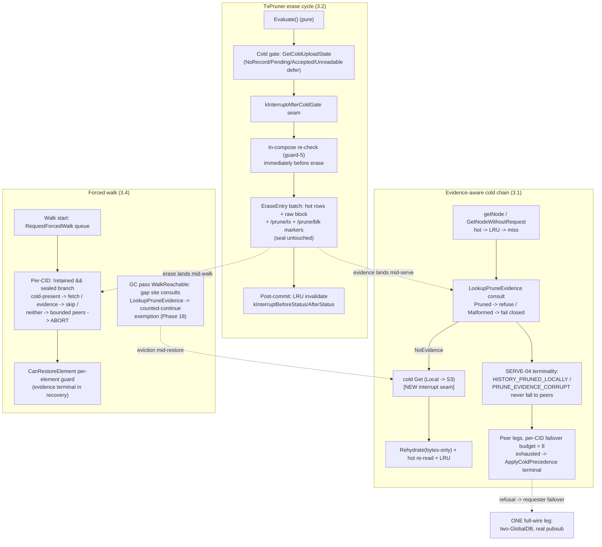

# Phase 19: Cross-Feature Fault-Race Matrix & Three-Platform CI Capstone - Research

**Researched:** 2026-11-19
**Domain:** C++ test infrastructure — barrier-driven fault-race suites over the composed cold-storage system (erase × serve × recovery) + GitHub Actions CI lane construction
**Confidence:** HIGH (all anchors verified this session against the landed line `dev_coldstorage_additions` @ `d2f2a7dec`)

## Summary

Phase 19 is an additive test + CI + documentation capstone over a fully-landed v1.2 code line. All six prior phases' code is confirmed on `dev_coldstorage_additions` @ `d2f2a7dec` (Phase 13 merge alignment through the Phase 18 REVIEW fixes; 33 phase-tagged commits verified via `git log`). Production code is expected untouched — every mechanism the matrix needs to attack already exists and is seam-instrumented: the TxPruner interrupt family (`kInterruptAfterEvaluation=1` … `kInterruptAfterColdGate=5`), the ColdStorageStack GC hooks (`SetGcBetweenHalvesHookForTesting` / `SetGcPreHalfOneHookForTesting` / `SetGcPreMarkProcessHookForTesting`, `SetColdStorageStackClientsForTesting`), the evidence-lookup injection (`SetPruneEvidenceLookup` on ColdReadService), the sanctioned marker builders (`BuildPruneMarkerKey` / `BuildPruneBlockMarkerKey` + tri-state lookups), and the v1.1 kit (TimingS3Client, WindowGate, PollUntil, `InMemoryS3*` fakes installed with the library). The only missing seams are serve-side interrupts inside `GraphsyncDAGSyncer` — a small, precedented addition.

The CI picture differs materially from the CONTEXT's shorthand. **All three permanent cold-ON legs (Windows-Release, Linux-x86_64-Release, OSX-Release) already exist in `cmake.yml`** — added by v1.1 Phase 12-03 D-02a as a `cold_storage: [OFF, ON]` matrix with excludes, release-upload-excluded, tests-enabled. The real gaps are: (1) `build-release-tags.yml` — the dispatch evidence instrument — has **no "Tier-1 fail-closed lane" step** (verified: `Tier1` appears only in cmake.yml at lines 707/806), so dispatch evidence never exercises the labeled contract lane; (2) the permanent lane's push filters watch only `develop`/`main`, so it is dormant for `dev_coldstorage_additions` until merge or a push-filter extension (the documented v1.1 "pending by topology" note); (3) the recovery-walk legs live in `node_startup_test` (blockchain dir), which is **not** Tier1-labeled — D-11's "all v1.2 suites green" reads over *both* lanes (full-suite + Tier-1), a contract definition the evidence doc must pin.

The boundary inventory derives cleanly from the v1.2 ARCHITECTURE data-flow sections (3.1 read path, 3.2 erase cycle, 3.4 forced walk) plus the D-01 boundary list. A 10-case hermetic proposal + 1 full-wire leg (= 11, inside D-03's 8–12 budget) crosses erase × serve × recovery at: evidence-lands-mid-serve (2 cases), durability-flip vs cold gate, GC-eviction mid-walk-restore, erase mid-walk-visit, downgrade-arms mid-walk, exemption-consult vs concurrent prune, rehydrate vs second erase, peer-failover-budget vs evidence terminality, and the two-GlobalDB full-wire refusal-failover-under-concurrent-erase leg (the v1.1 resurrection leg-3 recipe extended). Every case is two-layer per Phase 16 D-06 (deterministic seam leg + real-thread barrier leg where true concurrency is the claim), hazard-mapped per D-04, red-first per Phase 18 D-01 (fault-injected bad state where no live bug exists).

**Primary recommendation:** Land the sibling suite `cold_cross_feature_fault_race_test.cpp` in `test/src/crdt/` with the resurrection-test link set (full-wire leg needs pubsub) + `LABELS "Tier1"` under `if(SGNS_COLD_STORAGE)` (the `tier1_static_audit` parity check passes automatically); add the two Tier-1 fail-closed lane steps to `build-release-tags.yml` mirroring cmake.yml; treat the cmake.yml push-filter extension as a user checkpoint (standing self-hosted-runner load); write `notes/19-cross-feature-fault-race-three-platform-capstone.md` carrying the matrix table, quarantine table, portability runbook, and evidence links; refresh the fresh-clone checklist as `19-FRESH-CLONE-CHECKLIST.md` in the phase dir.

<user_constraints>
## User Constraints (from CONTEXT.md)

### Locked Decisions (D-01..D-16 — copied from 19-CONTEXT.md)

**Matrix shape & case grammar (SC1)**
- **D-01:** **Curated boundary list — not a formal 3-axis product** — the erase × serve × recovery crossing is implemented as named cases at specific phase-boundary failure points (pre-erase staging, post-commit erase, cold-fetch serve, refusal classification, walk-start, mid-walk GC eviction, ...), each asserting its impossibility. A formal {erase points} × {serve points} × {recovery points} product was considered and declined (combinatorial explosion nobody can keep green on three platforms) — **Reversibility:** costly
- **D-02:** **New sibling suite; v1.1's 13-case matrix stays frozen** — the extended matrix lands as a `cold_cross_feature_fault_race_test.cpp`-family sibling (the `cold_compose_matrix_test.cpp` precedent), with its own ctest Tier-1 label. Extending the v1.1 suite in place was declined (it churns the frozen baseline the v1.1 SC4 evidence was gathered on) — **Reversibility:** costly
- **D-03:** **~8–12 new cases, two-layer discipline per case** — every boundary gets a deterministic seam-stepped leg, plus a real-thread barrier leg where true concurrency is the claim (Phase 16 D-06 applied per case). Roughly doubles v1.1's matrix. Minimal-delta (~5–6, leaning on Phase 14/15/16 suites as compositional evidence) was declined — the capstone's letter is disproof at EVERY boundary — **Reversibility:** costly
- **D-04:** **Hazard-mapped per case** — each case designates its primary hazard (resurrection / partial-history validation / lost last copy) and asserts it loudly; the matrix table documents which case kills which hazard. All three hazards are covered ACROSS the matrix, not per-case. Tri-hazard-everywhere was declined — **Reversibility:** reversible

**Fault induction & topology (SC1 mechanics)**
- **D-05:** **Reuse + extend the v1.1 kit** — TimingS3Client, WindowGate, GC hooks (`SetGc*HookForTesting`), `InMemoryS3*` fakes, Phase 14/15/18 interrupt seams, and Phase 15's tri-state evidence fakes drive the new cases; add ONLY the missing serve-side seams (e.g. a refusal-classification interrupt, cold-read interruption). A purpose-built fresh harness was declined — **Reversibility:** costly
- **D-06:** **Hybrid topology — hermetic everywhere + exactly ONE full-wire leg** — all deterministic cases are hermetic single-node + fake cold + injected evidence states; ONE two-GlobalDB full-wire failover/refusal leg (the v1.1 resurrection leg-3 recipe, real pubsub) carries the true-topology claim, with generous instrumented deadlines (status-dump-on-failure per the v1.1 round-6 discipline — instrument, don't bump). It starts Tier-1 if it holds green across dispatches, else demotes to dev-gated — **Reversibility:** costly
- **D-07:** **Serve arm = evidence-aware serving core only** — cold-fetch consult + refusal classification (`ApplyColdPrecedence` surfaces) — where erase × recovery actually cross. Re-warm/LRU stays covered by the existing v1.1 spill/rewarm suites, cited compositionally — **Reversibility:** reversible
- **D-08:** **Recovery arm = walk boundaries + the concurrent-erase delta** — forced walk against induced evidence states at walk boundaries (pruned mid-walk, GC-evicted mid-walk via the Phase 18 exemption, seals-present), deterministic seam-driven. Phase 15 walk/recovery semantics are re-proven ONLY under concurrent erase (the cross-feature delta), not full re-proof — **Reversibility:** reversible

**CI lane mechanics (SC2)**
- **D-09:** **Permanent 3-platform cold-ON Tier-1 lane** — extend the existing Tier-1 cold-ON lane pattern (the permanent OSX ON leg) to ALL three desktop platforms in `cmake.yml` + `build-release-tags.yml`. Cold Tier-1 becomes continuously proven on every push/dispatch — not dispatch-only evidence. Dispatch-evidence-only was declined — **Reversibility:** costly — a permanent lane adds standing load to the self-hosted Windows (thermal saga) and macOS (tart VM) runners
- **D-10:** **Hermetic cold only in CI** — "cold storage ON" in the lanes means the hermetic cold stack (`InMemoryS3*` fakes — fresh-clone safe, no services). Live MinIO legs stay dev-gated/Tier-3. A Linux MinIO-service-container leg was declined — **Reversibility:** reversible
- **D-11:** **"Recovery-walk suites" = the FULL cold Tier-1 contract** — all v1.2 suites (Phase 14 gate, 15 walk, 16 matrix, 17 floor-smoke, 18 downgrade timeline, 19 cross-feature matrix) green on all three platforms. The narrow reading (walk suites only) was declined — **Reversibility:** costly — this defines TEST-03's verification contract
- **D-12:** **Documented quarantine table for NON-cold flakes — never silent, never cold** — known non-cold failures get pre-agreed exclusion/env-knob entries recorded in the Phase 19 evidence doc with first-occurrence history. v1.1 discipline applies: `CTEST_EXCLUDE_REGEX`, append-never-replace `GTEST_FILTER` composition, `*-A:B:C` filter grammar. Cold-labeled failures are NEVER quarantined — fix-forward in scope — **Reversibility:** costly

**Portability list & evidence (SC3)**
- **D-13:** **One `notes/19-*.md` — the rulings-chain home** — carries the portability list + the quarantine table (D-12) + the run evidence. Joins `notes/16-*` / `17-*` / `18-*`. A repo-side doc home was declined — **Reversibility:** costly
- **D-14:** **Full lane runbook depth** — SC3's four named items (CloudflareWARP adapter = environmental, distinct per-node base paths, poll predicates, gtest filter grammar) PLUS everything a fresh operator needs to reproduce the lanes: required env vars (`SGNS_BLOCKSTORE_S3_ADMIN_PASSWORD` presence, `SGNS_COLD_STORAGE` cache flag), parallel-level caps, crash-report capture, dispatch toggles, exclusion pointers — **Reversibility:** reversible
- **D-15:** **Evidence = run links + fresh-clone checklist** — green dispatch run links + parameters recorded in the evidence doc AND a refreshed/extended fresh-clone checklist (the v1.1 `12-FRESH-CLONE-CHECKLIST.md` precedent) — **Reversibility:** reversible
- **D-16:** **Green bar = one recorded green dispatch per platform** — one green closes the capstone record; the permanent Tier-1 lane (D-09) is the standing guard. Two-consecutive-greens was declined — **Reversibility:** reversible

### The Agent's Discretion (research resolves these)
The exact boundary inventory and named-case list; new serve-side seam placement/naming; sibling suite filename(s), test registration home, and the new Tier-1 label name; red-first proof mechanics per race case; the full-wire leg's promotion criteria concretization; `cmake.yml` / `build-release-tags.yml` edit shape; quarantine-table initial contents; exact filename for `notes/19-*.md`; fresh-clone checklist refresh shape and home; env-knob naming for the new nondeterministic tests; anchor re-location strategy against the final post-verification line.

### Deferred Ideas (OUT OF SCOPE)
None — discussion stayed within phase scope. (The known macOS exit-time teardown debt and the multi_node smoke Release-only flake were referenced as quarantine-table entries, not scope; their fixes remain SuperGenius backlog items per the v1.1 round-14 ruling.)
</user_constraints>

<phase_requirements>
## Phase Requirements

| ID | Description | Research Support |
|----|-------------|------------------|
| TEST-02 | An extended fault-race matrix crosses erase × serve × recovery — induced failures at each phase boundary cannot produce resurrection, partial-history validation, or lost last copies | Boundary inventory + 11-case named proposal (§ Discretion Resolution 1); seam/kit inventory (§ Standard Stack); two-layer + red-first mechanics (§ Discretion Resolutions 2/4); all boundaries verified against landed code anchors |
| TEST-03 | Recovery-walk suites run green on all three platform CI lanes (Windows, macOS, Linux) | Verified CI current-state (both workflows read in full); the two real gaps identified (Tier-1 lane step missing in build-release-tags.yml; push-filter topology); lane-contract definition (Tier-1 label set + full-suite lane); quarantine table; portability runbook content |
</phase_requirements>

## Project Constraints (from AGENTS.md / SuperGenius CLAUDE.md / workstream rules)

- **Zero new dependencies** (workstream rule, STATE.md) — everything composes pinned mechanisms; no new libraries, no new config surfaces (Phase 14 D-04 posture).
- **C++ Coding Standards authoritative** — Ullman braces, PascalCase types/methods, `m_`/trailing-underscore members, Doxygen headers on public test seams.
- **Gates, not promises** (SuperGenius CLAUDE.md) — the tier1_static_audit + `--no-tests=error` pattern is the house style for label contracts.
- **Refactor first, then change** — production code untouched unless a red-first case finds a real bug (fix-forward, Phase 16 D-03 precedent).
- **DRY / one home per fact** — marker keys ONLY via `PruneEligibility` builders (D-C1: "no second enum, no hand-built marker keys"); the matrix table rendered once in `notes/19-*` (suite header may point at it).
- **Never push** — all CI dispatches/pushes are user actions (the D-15/D-16 evidence checkpoints); GSD commits locally only.

## Architectural Responsibility Map

| Capability | Primary Tier | Secondary Tier | Rationale |
|------------|-------------|----------------|-----------|
| Fault-race case bodies (hermetic) | Test layer (`test/src/crdt/` sibling suite) | — | Additive test code; production untouched (D-02/D-05) |
| Serve-side interrupt seams | `GraphsyncDAGSyncer` test surface (header-declared, production-null) | — | The consult/terminality/cold-Get points live inside DAGSyncer methods; mirrors TxPruner seam family |
| Evidence-state injection | Test fixtures via `SetPruneEvidenceLookup` + sanctioned builders | Fake S3 clients for byte states | Evidence semantics live in PruneEligibility + the lookup seam; never hand-built keys |
| Full-wire topology | Test layer (MultiGlobalDBTest recipe, `genius_node_test` whole-archive) | Real pubsub/libp2p in-process | Exactly ONE leg (D-06); real-pubsub N-node is the repo's flakiest class |
| Tier-1 lane selection contract | CTest labels (`ctest -L Tier1 --no-tests=error`) + `tier1_static_audit` | CI workflow steps | Label parity is machine-audited; the lane is fail-closed |
| Three-platform lane execution | GitHub Actions (cmake.yml push lane; build-release-tags.yml dispatch lane) | Self-hosted runners (SG-WIN11, gv-OSX-Large, sg-ubuntu-linux) | Permanent lane shape already proven in v1.1 run 42905264387 |
| Quarantine + portability record | `notes/19-*.md` (rulings chain) | Fresh-clone checklist in phase dir | D-12/D-13/D-15 homes |
| `VALUE_PRESENT_INVARIANT_VIOLATION` loudness | Production observability already landed | Matrix asserts it stays loud | SC1 letter; existing dedicated-counter precedent (Phase 14 D-03 / 16 D-10) |

## Anchor Verification Record (Discretion Resolution 10 — read first, it conditions everything below)

**Landed line (verified this session):** `dev_coldstorage_additions` @ **`d2f2a7dec`** (`fix(18-02): downgrade interlock holds across unacknowledged restarts...`), clean tree except untracked `test-data/`. [VERIFIED: git log/status this session] All v1.2 phase code is present: Phase 13 (`4ae8a9a4e`), 14 (`dc788261d`..`095c8c502`), 15 (`638053925`..`af644481f`), 16 (`5f6ff19d9`..`f758356fe`), 17 (`0284d75c7`..`84d87d462`), 18 (`69fa79c29`..`d2f2a7dec`). [VERIFIED: `git log --oneline` filtered on `(1[3-9]-)`]

**Status-note caveat:** the CONTEXT notes Phases 13/15/16/17 "plans executed with verification still pending" — if verification lands follow-up fixes, line numbers below shift. **Re-location procedure for the planner:**
1. Plans cite **symbols, not line numbers** (function names, TEST_F names, enum constants) — symbols are stable across verification fixes.
2. Where a plan must cite a line, it prefixes the anchor with the SHA it was verified on (`@d2f2a7dec`); executors re-grep at task time.
3. Highest-drift-risk files (verification fixes most likely to touch): `src/crdt/impl/graphsync_dagsyncer.cpp`, `src/crdt/globaldb/ColdStorageManager.cpp`, `test/src/blockchain/node_startup_test.cpp`.
4. `STATE.md` frontmatter is stale (`current_phase: 15` while session continuity says Phase 19 context gathered) — housekeeping only, not blocking; do not "fix" it outside a GSD state verb.

**Verified anchor table:**

| Anchor | Symbol/Quote | Source [VERIFIED] |
|--------|--------------|-------------------|
| TxPruner interrupt family | `kInterruptAfterEvaluation = 1`, `kInterruptBeforeErase = 2`, `kInterruptBeforeStatus = 3`, `kInterruptAfterStatus = 4`, `kInterruptAfterColdGate = 5` | `src/transaction/TxPruner.hpp:272-289` |
| Cold gate consult + refusal mapping | `GetColdUploadState(cid)` switch at TxPruner.cpp:109; `COLD_NOT_DURABLE` at :325; `kInterruptAfterColdGate` fires at :298; in-compose re-check "immediately before the erase" at :465 | `src/transaction/TxPruner.cpp` |
| Marker builders + tri-states | `BuildPruneMarkerKey` (:449), `LookupPrunedEntry` (:473), `BuildPruneMarkerEntry` (:497), `BuildPruneBlockMarkerKey` (:526), `LookupPrunedBlockEntry` (:548), `BuildPruneBlockMarkerEntry` (:574); enums `PrunedLookup` (:115), `PrunedBlockLookup` (:140) | `src/transaction/PruneEligibility.hpp` |
| Serve consult + refusal classification | `ApplyColdPrecedence` free function; error strings verbatim: `"History was pruned on this node (node-local prune evidence)"`, `"Prune evidence marker failed to decode (failing closed)"`; `FetchNodeFromColdStorage` evidence switch (`PruneEvidenceClass::Pruned` → refuse; `Malformed` → fail closed; `NoEvidence` → serve body verbatim) | `src/crdt/impl/graphsync_dagsyncer.cpp:41-67, 853-905` |
| Serve terminality (SERVE-04) | `if ( node.error() == Error::HISTORY_PRUNED_LOCALLY || node.error() == Error::PRUNE_EVIDENCE_CORRUPT ) { return node.as_failure(); }` — "NEVER fall through to the peer leg" | `src/crdt/impl/graphsync_dagsyncer.cpp:422-430` |
| Peer-failover budget | `static constexpr uint32_t kForcedWalkPeerFailoverPerCid{ 8 }` | `src/crdt/graphsync_dagsyncer.hpp:82` |
| GC hooks + stack override | `SetGcBetweenHalvesHookForTesting` (:256), `SetGcPreHalfOneHookForTesting` (:258), `SetGcPreMarkProcessHookForTesting` (:260), `SetColdStorageStackClientsForTesting` (:343) | `src/crdt/globaldb/ColdStorageStack.hpp` |
| Walk-gap exemption consult | `WalkReachable` (:800); `gc_dag_syncer_->LookupPruneEvidence( current )` consult (:869); counted-continue `++pass_walk_exempted_` (:880); "gc: pass complete" INFO with walk-exempted count (:983); `gc_last_pass_exempted` status (:459) | `src/crdt/globaldb/ColdStorageManager.cpp` |
| GC hot cleanup | `RunHotCleanup( mark.cid, mark.hot_row_keys )` at :1379, def at :1389 | `src/crdt/globaldb/ColdStorageManager.cpp` |
| Walk decision matrix site | `ProcessForcedWalkCID`'s `!retained && sealed` branch (cold-present → fetch; `/prune/blk` → skip; neither → bounded peers → abort); walk code home `RequestForcedWalk / ProcessForcedWalkStep / ProcessForcedWalkCID / QueueForcedWalkLinks` | `src/crdt/impl/crdt_datastore.cpp` (15-CONTEXT anchor map; D-05 quadrant ruling verbatim in 15-CONTEXT.md:35) |
| DAGSyncer's only existing test seam | `SetBlacklistBackoffTimeoutForTest( uint64_t override_ms )` + `blacklist_backoff_override_ms_for_test_` | `src/crdt/graphsync_dagsyncer.hpp:293, 393` |
| v1.1 frozen 13-case matrix | TEST_F names verbatim: `EvictServe_HalfWindowS3Fetch_ResolvesCidVerified` (:1009), `EvictServe_HotCleanupWindow_ReaderNeverTorn` (:1141), `EvictServe_RewarmAttachVsMark_NoLostBlock` (:1196), `EvictDrain_EligibilityVsDurabilityAdvance_NeverEvictsNonDurable` (:1282), `EvictDrain_DrainSnapshotVsHalfOne_NoEvictedBytesInDrain` (:1336), `ServeDrain_RemoteLockLatency_ColdFetchWithinBudget` (:1385), `Triple_GraceExpiryReachableAgain_CancelsKeepsBytes` (:1448), `Triple_DeleteBatchMidFlight_RedeliveryDedupDrainUnaffected` (:1517), `Evict_CancelVsCommitKnifeEdge_HeadsMutationBetweenRecheckAndHalfOne` (:1568), `Jitter_PairwiseSeededIterations_EndStateInvariants` (:1616), `SuiteEnd_AuditWalk_EveryCidInLegalState` (:1694), `ZeroBlacklistWrites_AfterAllScenarios` (:1780), `CorruptAssertionHasTeeth_ByteFlipStillCorrupt` (:1818) | `test/src/crdt/cold_storage_fault_race_test.cpp` |
| Recovery-walk legs (D-11 "15 walk") | `ForcedWalkRestoresColdResidentAncestor` (:825), `ForcedWalkSkipsEvidenceBearingAncestor` (:948), `ForcedWalkAbortsNeverSkipsOnTrueGap` (:1076), `ColdDisabledWalkPreservesLegacyPruneBoundarySkip` (:1216) | `test/src/blockchain/node_startup_test.cpp` |
| Full-wire leg-3 recipe | Two REAL GlobalDB instances over the `pubsub_graphsync_test MultiGlobalDBTest` topology, cold ON via `SetColdStorageStackClientsForTesting`, real background GC eviction, re-broadcast over real gossip wire | `test/src/crdt/cold_storage_resurrection_test.cpp:1-40` |
| 18-01 kit composition quote | "real hot RocksDB + LocalBlockStore cold dir + InMemoryS3Client / InMemoryS3AdminClient + real ColdReadService / GraphsyncDAGSyncer with the evidence lookup installed + real CrdtDatastore + AttachGcDependencies + direct GcPassOnce drive, gc_interval_ms = 0" + `SetPruneEvidenceLookup` + `BuildPruneBlockMarkerKey` + PollUntil + "fresh fixture dir per case (distinct paths - Windows LOCK contention)" | `test/src/crdt/cold_gc_walk_gap_exempt_test.cpp:40-66` |
| Tier-1 audit rules | Label parity (`addtest(cold_*` count == `set_tests_properties(cold_*` count), gated linking (sgns-blockstore links inside `if(SGNS_COLD_STORAGE)`), wall-clock-soak containment | `test/tier1_audit_check.cmake:45-137`, registered `test/CMakeLists.txt:20-23` |

## Standard Stack

No external packages (zero-new-deps rule) — the "stack" is the in-repo test kit. All items verified present on the landed line.

### Core (the D-05 kit — reuse, do not rebuild)
| Instrument | Purpose | Where |
|-----------|---------|-------|
| `TimingS3Client` | latency/jitter/op-barrier decorator over `InMemoryS3Client` | `cold_storage_fault_race_test.cpp` (v1.1 frozen home — extract-by-include or re-declare per sibling convention; see Pitfall 2) |
| `WindowGate` | cv-latch barrier (never sleeps) | `cold_storage_fault_race_test.cpp` |
| `PollUntil` | bounded poll predicates ("No sleep_for outside the PollUntil" — suite-header contract) | fault-race/gc families |
| GC stage hooks | `SetGcBetweenHalvesHookForTesting` / `SetGcPreHalfOneHookForTesting` / `SetGcPreMarkProcessHookForTesting` | `ColdStorageStack.hpp:256-261` |
| Stack client override | `SetColdStorageStackClientsForTesting` (hermetic fakes into a REAL stack) | `ColdStorageStack.hpp:343` |
| Evidence-lookup injection | `SetPruneEvidenceLookup` on ColdReadService (verdicts derive from `PrunedBlockRecord` bytes at sanctioned keys) | 18-01 fixture pattern |
| Interrupt-seam family | TxPruner steps 1–5 (see anchor table); Phase 16 observe-and-continue seam | `TxPruner.hpp:272-289` |
| Marker writers/lookups | `BuildPruneMarkerEntry` / `BuildPruneBlockMarkerEntry` + tri-state lookups — the ONLY marker homes (D-C1) | `PruneEligibility.hpp:443-574` |
| InMemory fakes | `InMemoryS3Client` / `InMemoryS3AdminClient` — installed library headers (`<sgns-blockstore/InMemoryS3Client.hpp>`, header-install ruling 2026-10-28) | sgns-blockstore install tree |
| Two-GlobalDB topology | `MultiGlobalDBTest` recipe + `genius_node_test` whole-archive link | `cold_storage_resurrection_test.cpp` |
| Journal/CF injection | Phase 14 D-08 direct-CF seeding kit | Phase 14 suites |

### Supporting (CI contract machinery — verified in the workflows)
| Mechanism | Purpose | Where |
|-----------|---------|-------|
| `ctest -L Tier1 --no-tests=error` | fail-closed lane selection | cmake.yml:707/806 — **missing in build-release-tags.yml** |
| `tier1_static_audit` | label parity + gated-link audit (auto-covers the new suite) | `test/CMakeLists.txt:20` |
| `CTEST_EXCLUDE_REGEX` / `GTEST_FILTER` | quarantine plumbing; `*-A:B:C` grammar, append-never-replace | both workflows' Linux test steps |
| `SGNS_TEST_P99_BOUND_MS` | CI env knob for the absolute-p99 guard (OSX sets `2000`) | both workflows' Run-tests env |
| `RESOURCE_LOCK genius_node_pool` | serializes node-booting suites | `test/src/blockchain/CMakeLists.txt` |
| Crash-report capture | macOS marker+collect+upload (.ips); Linux gdb backtraces | both workflows |

### Alternatives Considered (declined by D-05/D-06 — do not reintroduce)
| Instead of | Could Use | Why declined |
|------------|-----------|--------------|
| Kit reuse + new serve seams | Purpose-built fresh harness | Parallel kit drifts from the seams CI knows; zero-new-deps (D-05) |
| ONE full-wire leg | Several real-pubsub N-node legs | Real-pubsub N-node is the repo's flakiest class (D-06; PITFALLS testing trap 5) |
| Hermetic `InMemoryS3*` in lanes | MinIO service container (Linux) | Windows self-hosted Docker Desktop landmine; heavier than the contract needs (D-10) |

**Installation:** none — no packages. `npm`/`pip`/`cargo` not applicable; the Package Legitimacy Audit is therefore N/A (no external packages installed this phase).

## Package Legitimacy Audit

N/A — this phase installs zero external packages (workstream zero-new-dependencies rule). All instruments are in-repo.

## Architecture Patterns

### System Architecture Diagram — the composed system the matrix crosses



The matrix cases are failures induced **on the dashed edges** — the cross-feature boundaries no single phase's suite owns.

### Recommended Project Structure

```
SuperGenius/
├── test/src/crdt/
│   ├── cold_cross_feature_fault_race_test.cpp   # NEW — the D-02 sibling suite (hermetic legs + ONE full-wire leg)
│   └── CMakeLists.txt                           # NEW registration block (resurrection-test link set + LABELS "Tier1")
├── src/crdt/
│   ├── graphsync_dagsyncer.hpp / impl/graphsync_dagsyncer.cpp  # NEW serve-side test interrupt seam (test-only)
├── .github/workflows/
│   ├── cmake.yml                                # EDIT — push-filter decision (user checkpoint); legs already exist
│   └── build-release-tags.yml                   # EDIT — add Tier-1 fail-closed lane steps (non-Linux + Linux)
.planning/workstreams/rocksdb-backup/
├── notes/19-cross-feature-fault-race-three-platform-capstone.md   # NEW — rulings-chain doc (matrix + quarantine + runbook + evidence)
└── phases/19-.../19-FRESH-CLONE-CHECKLIST.md                       # NEW — refreshed checklist (12-FRESH-CLONE precedent)
```

### Pattern 1: Two-layer race discipline (Phase 16 D-06 — applies per case, D-03)
**What:** every boundary case = a deterministic seam-stepped leg (exact interleaving, reproducible to the step) PLUS a real-thread barrier leg where true concurrency is the claim.
**When to use:** every matrix case; the seam layer proves the ordering, the barrier layer proves the ordering can actually occur.
**Why both:** "the 261029-uj0 OSX faults were real-thread timing seams can't reproduce; SC1's exact window (insert between guard-check and commit) can't be forced reliably by real threads" [VERIFIED: 16-CONTEXT.md:36].

### Pattern 2: Red-first counter-test via fault-injected bad state (Phase 18 D-01)
**What:** where no live bug exists, inject the BAD state the guard must catch (e.g. delete the cold object via the fake's test-side deletion; corrupt only the VALUE at a sanctioned-builder key) and prove the test FAILS against the unguarded behavior — teeth proof — then GREEN with the guard.
**Precedent verbatim:** "LEG-1 (the LIVE poisoned-GC-triangle state...) and LEG-2 (the v2 fault-injected state: the cold object additionally deleted from BOTH tiers via the fake's test-side deletion) are RED against the UNMODIFIED walk BY DESIGN until... The fail-closed CONTROL legs (NoEvidence / Malformed) are GREEN today and must STAY green" [VERIFIED: cold_gc_walk_gap_exempt_test.cpp:8-21].

### Pattern 3: Hermetic-first CI, dispatch-instrumented evidence
Hermetic `InMemoryS3*` everywhere in CI lanes (D-10); the dispatch workflow is the evidence instrument (D-15/D-16); live MinIO stays Tier-3 dev-gated (`SGNS_BLOCKSTORE_TEST_MINIO_BIN` opt-in, loud labelled skip).

### Pattern 4: Instrument, don't bump (v1.1 round-6)
Poll-deadline exhaustion on some platforms only = structural: dump the involved status structs in the failure message (the round-6/round-11 diagnostics that cracked the v1.1 wedges); never widen the deadline to pass.

### Anti-Patterns to Avoid
- **Sleeps for synchronization** — barriers (WindowGate) and PollUntil only; `sleep_for` outside PollUntil is a suite-header contract violation.
- **Hand-built marker keys** — string-formatted `/prune/*` keys anywhere in a test file is testing-trap 1/D-C1; only `BuildPrune*` products.
- **`-LE` lane selection / vacuous lanes** — `ctest -L Tier1` never `-LE`; `--no-tests=error` mandatory (a label typo must fail, not pass empty).
- **Replace-form filter composition** — append (`GTEST_FILTER_VALUE="${GTEST_FILTER_VALUE}:NewCase"`); replacing dropped base exclusions once failed a leg (run 41744226815).
- **Quarantining a cold-labeled failure** — never; fix-forward is in scope (D-12).

## Discretion Resolutions (the 10 open questions)

### 1. Boundary inventory → named-case list (within D-03's 8–12 budget)

Boundary sources: v1.2 ARCHITECTURE §3.1 (read path), §3.2 (erase cycle), §3.4 (forced walk) + D-01's list + the walk-gap exemption site (Phase 18). **Proposal: 10 hermetic cases + 1 full-wire leg = 11 total** (case names indicative — planner may refine names, keep the boundary set):

| # | Case (working name) | Boundary (from → to) | Primary hazard | Layer(s) | Tier |
|---|---------------------|----------------------|----------------|----------|------|
| X1 | `Cross_EraseCommitVsServe_EvidenceLandsMidConsult` | serve consult (S1) × erase marker commit (E4) | resurrection | seam (evidence written between `LookupPruneEvidence` and the cold Get) + barrier | Tier1 |
| X2 | `Cross_EraseCommitVsServe_InflightColdGetNoRehydrateAfterEvidence` | cold Get in flight (S2) × evidence lands before Rehydrate (S3) | resurrection | seam (new serve interrupt) + barrier | Tier1 |
| X3 | `Cross_DurabilityFlipVsColdGate_ServeNeverUnlocksErase` | durability state flip (E2) × concurrent cold read (S2) | lost last copy | seam (journal-state flip at `kInterruptAfterColdGate`) | Tier1 |
| X4 | `Cross_GcEvictionMidWalkRestore_RestoreCompletesOrAborts` | GC eviction of the cold-resident ancestor (R4) × walk restore fetch (R2) | partial-history validation | seam (GC hook between halves) + barrier (real GC thread vs walk) | Tier1 |
| X5 | `Cross_EraseMidWalkVisit_EvidenceSkipsNeverPartial` | TxPruner erase (E4) × walk `!retained && sealed` branch (R2) | partial-history validation + resurrection (peer re-fetch) | seam (erase interrupt before walk's fetch) + barrier | Tier1 |
| X6 | `Cross_DowngradeArmsMidWalk_InterlockHoldsTimeline` | role-downgrade ack/arming (Phase 18 interlock) × walk start/visit (R1/R2) | partial-history validation | seam (interlock ack key write at walk step) | Tier1 |
| X7 | `Cross_ExemptionConsultVsConcurrentPrune_FailClosedControlsStay` | exemption gap-site consult (R4, ColdStorageManager.cpp:869) × concurrent /prune/blk write (E4) | partial-history validation (wrongly-exempted gap) | seam + red-first fail-closed controls (NoEvidence/Malformed legs GREEN-and-stay) | Tier1 |
| X8 | `Cross_RehydrateVsSecondErase_GateDefersOnRejournaledPending` | rehydrate re-journals PendingUpload (S3) × next erase cycle's cold gate (E2) | lost last copy | seam (`kInterruptAfterColdGate` after re-journal) + barrier | Tier1 |
| X9 | `Cross_PeerBudgetVsEvidenceTerminality_RefusalNotNotfound` | failover budget exhaustion (S5) × evidence terminality (S4) — refusal vocabulary stays distinct under race; budget-abort ≠ skip | partial-history validation | seam + barrier (jitter) | Tier1 |
| X10 | `Cross_SuiteEnd_AuditWalkAndCounterTeeth` | end-state audit (v1.1 SuiteEnd pattern): every CID in a legal state; `VALUE_PRESENT_INVARIANT_VIOLATION`-class invariant counters have teeth via fault injection | all three (loudly) | audit + counter-teeth legs | Tier1 |
| X11 | `Cross_FullWire_RefusalFailoverUnderConcurrentErase` | node A (archive) serves × node B (light) erases + requests — refusal → failover → A serves; concurrent erase on A cannot resurrect B's pruned history nor lose A's last copy | resurrection + lost last copy | real-thread, real pubsub (leg-3 recipe), instrumented deadlines + status-dump-on-failure | Tier1 **conditional** (D-06 promotion; see §5) |

Hazard coverage check (D-04 — across the matrix): resurrection = X1, X2, X5, X11; partial-history validation = X4, X5, X6, X7, X9; lost last copy = X3, X8, X11. All boundaries in D-01's list map: pre-erase staging = X3; post-commit erase = X1/X2; cold-fetch serve = X2; refusal classification = X1/X9; walk-start = X6; mid-walk GC eviction = X4; concurrent-prune exemption = X7; re-warm/second-cycle = X8. The v1.1-13-case budget doubling: 11 new ≈ 13 frozen. ✓

### 2. New serve-side seam placement/naming (sibling of the Phase 14/15/18 family)

**Finding:** `GraphsyncDAGSyncer` currently has exactly ONE test seam — `SetBlacklistBackoffTimeoutForTest` (+ `blacklist_backoff_override_ms_for_test_`) [VERIFIED: graphsync_dagsyncer.hpp:293, 393]. The serve path's interruption points are all inside DAGSyncer methods (consult at graphsync_dagsyncer.cpp:867-882, cold Get/Rehydrate at :886-905, terminality at :425-430) — so the seam belongs on **`GraphsyncDAGSyncer`**, mirroring the TxPruner step-enum shape:

```cpp
// graphsync_dagsyncer.hpp — test-only, production-null (TxPruner.hpp:272-289 family)
/// Interrupt seam step: after the LookupPruneEvidence consult, before the cold Get.
static constexpr int kInterruptAfterEvidenceConsult = 1;
/// Interrupt seam step: after the cold Get returns bytes, before Rehydrate.
static constexpr int kInterruptBeforeRehydrate = 2;
/// Interrupt seam step: after the cold fetch resolves, before the SERVE-04
/// terminality check in GetNode (the never-fall-through-to-peers point).
static constexpr int kInterruptAfterColdFetch = 3;
static void SetColdServeInterruptForTest( std::function<bool(int)> hook );  // true = abort
```

Rationale: (a) same declaration style + doc-comment shape as TxPruner's family — reviewable at a glance; (b) static-or-instance choice follows TxPruner (instance hook, `nullptr` in production, zero cost); (c) step 3 is the refusal-classification interrupt — it is the point where an induced failure answers "can classification change after resolution and still resurrect?" Naming keeps the `kInterrupt*` prefix so greps find the whole family. GC-side needs nothing new (the three `SetGc*HookForTesting` hooks + the exemption consult's observables cover X4/X7). Alternative (a `ColdStorageStack`-level cold-read stage hook) was considered and set aside: the boundaries X1/X2 straddle DAGSyncer-owned control flow the stack cannot interrupt.

### 3. Sibling suite filename, registration home, Tier-1 label

- **Filename:** `cold_cross_feature_fault_race_test.cpp` — D-02 names the family; the `cold_` prefix is load-bearing (the `tier1_static_audit` regex `addtest[(]cold_[a-z0-9_]+` scopes over it — a non-`cold_` name would silently escape the audit's parity check) [VERIFIED: tier1_audit_check.cmake:58-59].
- **Home:** `SuperGenius/test/src/crdt/` beside `cold_compose_matrix_test.cpp`.
- **Registration:** the **cold_storage_resurrection_test link set** (not the compose-matrix one) — the full-wire X11 leg needs pubsub: `genius_node_test` whole-archive (MSVC `/WHOLEARCHIVE`, APPLE `-force_load`, else `-Wl,--whole-archive`), `p2p::p2p_logger`, `logger`, `AsyncIOManager_INCLUDE_DIR`, over the cold set (`sgns-blockstore::sgns-blockstore`, `crdt_globaldb`, `crdt_datastore`, `rocksdb`), under `if(SGNS_COLD_STORAGE)` + `set_tests_properties(... PROPERTIES LABELS "Tier1")` [VERIFIED: test/src/crdt/CMakeLists.txt resurrection block].
- **Tier-1 label name: NO new label.** The `ctest -L` contract stays `Tier1` — one lane, one label. D-11's contract is the label SET's membership (the new suite joins it), not a new label; a second label would split the fail-closed lane and dilute `--no-tests=error`'s teeth. The audit passes automatically once label parity holds (no count to update) [VERIFIED: tier1_audit_check.cmake:62-77].
- **Recovery-walk legs caveat:** the "15 walk" suites live in `node_startup_test` (blockchain dir), which is **not** Tier1-labeled and carries `RESOURCE_LOCK genius_node_pool` [VERIFIED: test/src/blockchain/CMakeLists.txt:246-255]. D-11's "all v1.2 suites green on all three platforms" therefore reads over **both** lanes: `ctest -L Tier1` (labeled cold contract) AND the full-suite lane (which runs node_startup_test + globaldb_integration_test cold legs). Recommend pinning this reading in `notes/19-*` rather than re-labeling node_startup_test (full-node boots + RESOURCE_LOCK do not belong in the hermetic fail-closed lane).

### 4. Red-first proof mechanics per case

No live bugs are known on the landed line (Phase 14/15/16/18 suites are green) — so every case's red-first proof is the **Phase 18 D-01 counter-test shape**: fault-inject the bad state, prove the assertion has teeth, keep the fail-closed controls green:
- **X1/X2 (resurrection):** red leg = fixture writes `/prune/blk` evidence (via `BuildPruneBlockMarkerEntry`) and then forces the serve to complete as if NoEvidence had been consult**ed** — via the new serve seam firing the pre-guard continuation; assert hot re-add occurs ONLY through the guarded path and the unguarded continuation FAILS the audit walk. Teeth proof: run the same leg with the terminality check bypassed by the seam's fault arm → test must go RED.
- **X3/X8 (lost last copy):** red arm = journal state flipped to Durable at the gate while the object is actually gone (Phase 14 D-08 journal-injection kit) — the gate must defer (`COLD_NOT_DURABLE` counter); fault arm flips it to admit → counter shows the erase that must never happen.
- **X4-X7, X9 (partial-history):** red arms per the 18-01 pattern — controls (NoEvidence/Malformed) stay green-and-loud; fault arms turn the exemption/skip decision the wrong way and the walk-abort counter must catch it.
- **X10:** the v1.1 `CorruptAssertionHasTeeth_ByteFlipStillCorrupt` pattern verbatim (byte-flip a cold object; the CID-verify refusal must fire).
- **Evidence discipline:** every RED arm commits as a fault-arm flag on the seam/fixture (env- or parameter-scoped), never as an `#if 0` — the CI lane runs the green arms; the red arms run under an explicit opt-in (see §9) and their expected-failure is asserted in a meta-test where cheap.

### 5. Full-wire leg (X11) promotion criteria (D-06 concretization)

Proposal: **X11 starts in the Tier-1 registration but is env-demotable**; "holds green across dispatches" = **two consecutive green dispatch runs of build-release-tags.yml with `run_tests=true, cold_storage=true`, all three desktop platforms green on X11 specifically** (the first dispatch doubles as the D-16 evidence run; the second is the confirming re-run — D-16's one-green closes the capstone record, the second run is X11's own promotion evidence, not a new capstone bar). Failure handling: any cold-labeled X11 failure → diagnose via the status-dump diagnostics → fix-forward (in scope) → restart the two-run count; a *second* distinct flake after a fix → demote to `LABELS "Tier3"` + dev-gated env knob (`SGNS_CROSS_RACE_FULLWIRE_ENABLE`, loud labelled skip), recorded in `notes/19-*` with run IDs. Rationale: v1.1's leg-3 was stable hermetically but real-pubsub timing on the tart VM is the known flake class (261029-uj0); two dispatches span enough runner-state variance to justify retention without a standing flake factory.

### 6. CI workflow edit shapes (per platform — after reading both workflows in full)

**Current state (verified):**
- `cmake.yml` **already has all three permanent ON legs** — `cold_storage: [OFF, ON]` matrix, excludes limiting ON to Windows-Release / Linux-x86_64-Release / OSX-Release, ON legs reusing the standard ids (same thirdparty asset), `RELEASE` env excludes ON from upload/tagging, `RUN_TESTS` true for all three ON legs, both test lanes (full-suite + Tier-1 fail-closed) run per leg, `SGNS_TEST_P99_BOUND_MS=2000` on OSX, macOS crash capture, Linux gdb backtraces [VERIFIED: cmake.yml matrix + include entries + test steps].
- `build-release-tags.yml` has the `cold_storage` + `run_tests` dispatch toggles and `COLD_STORAGE_ARGS` per-platform configure append, full test lanes with exclusions, macOS crash capture — but **no Tier-1 fail-closed lane step** [VERIFIED: grep `Tier1` → only cmake.yml:698/707/806].
- Push topology: `on.push.branches: [develop, main]` — the permanent lane is dormant for `dev_coldstorage_additions` (the documented v1.1 "baseline PENDING by topology" note; paths-ignore `.github/**` also means workflow edits themselves never trigger).

**Edit shape A — `build-release-tags.yml` (uncontroversial, do it):** add two steps mirroring cmake.yml exactly — "Tier-1 fail-closed lane" (`if: ${{ !cancelled() && env.RUN_TESTS == 'true' && matrix.target != 'Linux' }}`, `ctest . -j ${{ env.CTEST_JOBS }} -C ${{ matrix.build-type }} --output-on-failure -L Tier1 --no-tests=error`, OSX p99 env) and "Tier-1 fail-closed lane (Linux)" (same, Linux-gated, no keyring wrapper needed — cold Tier-1 tests are keyring-free). This makes every cold_storage=true dispatch exercise the labeled contract lane — the D-11/D-15 evidence instrument becomes contract-complete.

**Edit shape B — `cmake.yml` push filter (user checkpoint, present both options):** the D-09 letter "continuously proven on every push" requires the branch being pushed to appear in `on.push.branches`. Option B1: add `dev_coldstorage_additions` — every push then runs the FULL matrix (~28 jobs incl. all mobile + ON legs) on four self-hosted runners; standing-load cost is real (SG-WIN11 thermal cap `CMAKE_BUILD_PARALLEL_LEVEL=8`, gv-OSX-Large tart VM — D-09's own reversibility note). Option B2: leave the filter; the lane is permanent-in-shape, dormant-in-topology until the v1.2 merge to develop (exactly the v1.1 posture), with Phase 19 evidence carried by dispatch runs (shape A) — "permanent" then means "runs on every push once merged", which is what v1.1 D-02a designed. **Recommendation:** B2 + shape A, recording the B1 option and its load math in `notes/19-*` for the user to rule at the dispatch checkpoint (the user pushes manually anyway; if they intend ongoing v1.2-branch pushes before merge, B1 is the honest reading of D-09). Do NOT restructure the matrix (per-platform jobs, new workflows) — D-09 says extend the existing pattern.

### 7. Quarantine-table initial contents (D-12 — NON-cold only, first-occurrence run IDs)

All entries verified from the workflow comments' recorded run IDs (both files), each already enforced by an existing exclusion (the table documents + defers, never invents):

| # | Suite / case | Platform(s) | Mechanism today | First-occurrence run ID(s) | Class |
|---|--------------|-------------|------------------|---------------------------|-------|
| Q1 | `LocalPriceManagerTest.*` (e.g. `ConcurrentGetQuotesAcrossThreads`) | Windows-Release, OSX | `GTEST_FILTER` base: `*-LocalPriceManagerTest.*` | 40840831965, 40927749627 | load-timing flake |
| Q2 | `ConsensusPendingLifecycleTest.CertificateCallbackStallsUntilPostCommitReadbackCanReleaseSameSlot` | all desktop | `GTEST_FILTER` base | (same base-filter commits; recorded with Q1) | load-timing flake |
| Q3 | `TrustFirstBootE2ETest.TransientRefreshRetryExhaustionIsCappedCoalescedAndIdle` | desktop; recurred aarch64-Debug when the filter was replace-formed | `GTEST_FILTER` base + append | 41744226815 (recurrence) | load-timing flake; grammar lesson attached (35781614193) |
| Q4 | `secure_storage_test` | Linux-wide | `CTEST_EXCLUDE_REGEX="secure_storage_test"` | 40828950625 | keyring/dbus environmental |
| Q5 | `network_config_private_network_test` exit-time teardown SegFault | OSX | none today (crash-report capture only) — candidate for the first NEW entry | 41744226815, 41900284573 | macOS teardown debt (v1.1 round-14 ruling: backlog, not this phase) |
| Q6 | MNN Vulkan-exposed suites/cases | Linux aarch64 Debug | `CTEST_EXCLUDE_REGEX` append + `GTEST_FILTER` append (SetPayoutAddress, PostProcessing, SinglePostProcessing) | 35675445960, 35701510569, 37082942495 | environmental (lavapipe ICD) |
| Q7 | multi_node smoke | Release-only | TBD at doc time | run ID NOT verified this session — `[ASSUMED]`, fill from dispatch history at notes-writing time | flake (v1.1 dispatch history) |

Table contract: cold-labeled failures NEVER enter (D-12); entries carry the exclusion's exact mechanism (`CTEST_EXCLUDE_REGEX` / `GTEST_FILTER` append / env knob), the grammar rule (`*-A:B:C`, append-never-replace), and history links; Q5/Q7 need their mechanism decisions recorded when the notes doc lands.

### 8. `notes/19-*` filename + fresh-clone checklist shape/home

- **Filename:** `notes/19-cross-feature-fault-race-three-platform-capstone.md` — matches the `NN-<kebab-topic>.md` chain (`16-txpruner-gc-composition-rulings.md`, `17-seal-growth-decision.md`, `18-collectibility-policy-downgrade-interlock.md`) [VERIFIED: notes dir listing]. Contents (D-13/D-14/D-15): the matrix table (case → boundary → hazard → layer → tier — the artifact TEST-02 verification reads); the quarantine table (§7); the portability runbook (SC3's four items + D-14 depth: env vars incl. `SGNS_BLOCKSTORE_S3_ADMIN_PASSWORD` presence and the `SGNS_COLD_STORAGE` cache flag, `CTEST_JOBS` caps `max(8, cores)` + `CMAKE_BUILD_PARALLEL_LEVEL=8` on SG-WIN11, crash-report capture pointers, dispatch toggles `run_tests`/`cold_storage`/`thirdparty_tag`, exclusion pointers, the push-topology note + B1/B2 ruling); evidence links (D-16 per-platform green dispatch runs + parameters); X11's promotion record.
- **Fresh-clone checklist:** `19-FRESH-CLONE-CHECKLIST.md` in the **phase dir** (the `12-FRESH-CLONE-CHECKLIST.md` precedent home — v1.1's lived in its phase dir, now under milestones/) — refresh shape: the v1.1 doc's skeleton (push-state table, thirdparty tag record, per-platform configure evidence `-DSGNS_COLD_STORAGE=ON` log-verified, test counts, audit result) extended with: the Tier-1 lane step result per platform (new in build-release-tags.yml), both-lanes-green reading of D-11, and the quarantine table pointer. Keep it phase-dir-local; the notes doc links to it.

### 9. Env-knob naming for the new nondeterministic tests

Existing contract shapes [VERIFIED: file greps]: `SGNS_RACE_JITTER_SEED` / `SGNS_RACE_JITTER_ITERS` (v1.1 fault race), `SGNS_COMPOSE_RACE_JITTER_SEED` / `SGNS_COMPOSE_RACE_JITTER_ITERS` (Phase 16), `SGNS_SEAL_*` family (Phase 17), `SGNS_COLD_STORAGE_SOAK_*` (12-02), `SGNS_BLOCKSTORE_TEST_MINIO_BIN` (live smokes), `SGNS_TEST_P99_BOUND_MS` (CI-injected bound). **Proposal — suite-prefixed siblings, same semantics (seed `0` = random; iterations default 3):**
- `SGNS_CROSS_RACE_JITTER_SEED` — reproducibility seed for X9 (and any jitter leg)
- `SGNS_CROSS_RACE_JITTER_ITERS` — iteration count (default 3)
- `SGNS_CROSS_RACE_FULLWIRE_ENABLE` — X11's demotion arm ONLY IF the D-06 promotion fails (else unused; loud labelled skip without it, the wallclock-soak convention)
- `SGNS_CROSS_RACE_RED_ARMS_ENABLE` — opt-in for the fault-arm/red-first legs (never set in CI; the meta-test contract)
Every knob prints its value + effective seed in the case's first log line (the compose-matrix convention), so a failed run's reproducibility string is in the log.

### 10. Anchor re-location strategy

Delivered as the **Anchor Verification Record** section above: verified @ `d2f2a7dec`; plans cite symbols over lines; line-cited anchors carry the SHA; executor re-greps at task time; drift-risk files named; STATE.md frontmatter staleness noted as housekeeping.

## Don't Hand-Roll

| Problem | Don't Build | Use Instead | Why |
|---------|-------------|-------------|-----|
| Deterministic interleavings | Ad-hoc flags inside production code | The interrupt-seam family (TxPruner steps; new serve seam) | Reproducible to the step; CI-known surface; production-null |
| Marker/evidence states | String-formatted `/prune/*` keys | `PruneEligibility::BuildPrune*` builders + `SetPruneEvidenceLookup` | D-C1: one home; hand-built keys drift from the record shape |
| Concurrency control | `sleep_for` polling | `WindowGate` / `PollUntil` | Sleeps flake per-platform; barriers are the SC1 letter |
| Cold-wire timing | Real S3 latency | `TimingS3Client` decorator over `InMemoryS3Client` | Deterministic latency/jitter/op-barriers |
| Two-node topology | New multi-node harness | `MultiGlobalDBTest` recipe + `genius_node_test` whole-archive | Proven wire; the leg-3 template |
| Lane selection | Custom test-runner scripts | `ctest -L Tier1 --no-tests=error` + `tier1_static_audit` | Fail-closed; machine-audited label parity |
| CI exclusions | Per-step bespoke filters | The shared `GTEST_FILTER` base + append composition | Append-never-replace once failed a leg (41744226815) |

**Key insight:** every deceptively-complex problem here (interleaving, evidence states, wire topology) already has a kit member that CI knows how to run on three platforms — the matrix's only genuinely new surface is three named interrupt steps on the serve path.

## Common Pitfalls

### Pitfall 1: The push-topology trap (CI evidence that never runs)
**What goes wrong:** the permanent ON legs exist but never execute for the v1.2 branch (push filters watch develop/main only) — "permanent lane" evidence is claimed from a lane that has never fired.
**Why it happens:** v1.1 designed the legs as the post-merge regression net; v1.2 work lives on an unmerged branch.
**How to avoid:** shape A (Tier-1 lane in the dispatch workflow) makes dispatch evidence contract-complete regardless; rule B1-vs-B2 explicitly at the checkpoint and record the ruling in notes/19.
**Warning signs:** evidence doc citing cmake.yml runs as v1.2 proof when no push to develop happened.

### Pitfall 2: Churning the frozen v1.1 kit
**What goes wrong:** extracting TimingS3Client/WindowGate into a shared header edits `cold_storage_fault_race_test.cpp` — churning the frozen baseline D-02 protects.
**How to avoid:** the sibling suite re-declares its fixture helpers in-file (the suite-hermetic convention every cold suite already follows — each file carries its own fixture composition prose); only the installed library headers (`InMemoryS3*`) are shared includes.
**Warning signs:** any Phase 19 diff touching `cold_storage_fault_race_test.cpp` outside comments.

### Pitfall 3: The CID landmine
**What goes wrong:** `sgns::CID` has NO implicit ctor from the blockstore `Cid` — direct use slices/compile-fails.
**How to avoid:** wrap explicitly (`CID cid_key( cid );`), the documented convention in every cold suite header.
**Warning signs:** CID type mismatches at fixture boundaries.

### Pitfall 4: Windows fixture-dir LOCK contention + WSL bash
**What goes wrong:** RocksDB LOCK collisions when cases share fixture dirs; `shell: bash` on SG-WIN11 resolves to WSL bash (no /bin/bash) — bash steps misbehave; MSYS paths break CMake (`pwd -W` conversion required).
**How to avoid:** fresh distinct fixture dir per case per node (the addNode recipe); per-OS step splits (the workflows' existing pattern); never `sh -c` in build steps.
**Warning signs:** Windows-only LOCK timeouts; "Nested virtualization is not supported" in logs.

### Pitfall 5: macOS real-thread timing is a distinct evidence class
**What goes wrong:** barrier legs green on Linux flake on the tart VM (GcPassOnce serialization history — quick task 261029-uj0).
**How to avoid:** the two-layer discipline (seam legs carry the deterministic proof; barrier legs assert the race is real with instrumented deadlines + status dumps, never bumped deadlines); promotion criteria for X11 (§5) absorbs the residue.
**Warning signs:** OSX-only poll-deadline exhaustion with green Linux runs.

### Pitfall 6: gtest filter grammar
**What goes wrong:** `-A:-B:-C` parses 2nd/3rd patterns as literals — exclusions silently never apply (run 35781614193).
**How to avoid:** `*-A:B:C` form, always; append with `:${GTEST_FILTER_VALUE}:NewCase`.
**Warning signs:** an "excluded" case still running in the log.

### Pitfall 7: Vacuous lanes / audit blindness
**What goes wrong:** a new suite without a `set_tests_properties` label line, or named outside the `cold_` prefix — `ctest -L Tier1` silently omits it and the parity audit's regex never saw it.
**How to avoid:** `cold_`-prefixed target name + mandatory label line inside the `if(SGNS_COLD_STORAGE)` block; run `tier1_static_audit` locally in the per-task verify (it is itself Tier1-labeled — the lane self-polices).
**Warning signs:** test counts per platform not increasing by exactly the new suite.

### Pitfall 8: Quarantine drift
**What goes wrong:** a cold-labeled failure gets "quarantined" to make a lane green — the capstone's own claim silently excluded.
**How to avoid:** the quarantine table's contract line: NON-cold only, ever; cold failures are fix-forward in scope (D-12); the notes doc states it at the table head.
**Warning signs:** any Phase 19 commit adding an exclusion matching a `cold_*` test name.

## Code Examples

### Registration block (the resurrection-test link set — copy this shape)
```cmake
# CMakeLists.txt (test/src/crdt/) — verified shape from the resurrection block
if(SGNS_COLD_STORAGE)
addtest(cold_cross_feature_fault_race_test
    cold_cross_feature_fault_race_test.cpp
)

target_include_directories(cold_cross_feature_fault_race_test PRIVATE
    ${AsyncIOManager_INCLUDE_DIR}
)

target_link_libraries(cold_cross_feature_fault_race_test
    sgns-blockstore::sgns-blockstore
    crdt_globaldb
    crdt_datastore
    rocksdb
    genius_node_test
    p2p::p2p_logger
    logger
)

if(MSVC)
    target_link_options(cold_cross_feature_fault_race_test PUBLIC /WHOLEARCHIVE:$<TARGET_FILE:genius_node_test>)
elseif(APPLE)
    target_link_options(cold_cross_feature_fault_race_test PUBLIC -force_load "$<TARGET_FILE:genius_node_test>")
else()
    target_link_options(cold_cross_feature_fault_race_test PUBLIC
        "-Wl,--whole-archive"
        "$<TARGET_FILE:genius_node_test>"
        "-Wl,--no-whole-archive"
    )
endif()

set_tests_properties(cold_cross_feature_fault_race_test PROPERTIES LABELS "Tier1")
endif()
```
// Source: SuperGenius/test/src/crdt/CMakeLists.txt (resurrection/prune-gate blocks, verified @d2f2a7dec)

### Tier-1 fail-closed lane step (the shape to add to build-release-tags.yml)
```yaml
      - name: Tier-1 fail-closed lane
        if: ${{ !cancelled() && env.RUN_TESTS == 'true' && matrix.target != 'Linux' }}
        working-directory: ${{github.workspace}}/SuperGenius/${{env.BUILD_DIRECTORY}}
        env:
          SGNS_TEST_P99_BOUND_MS: ${{ matrix.target == 'OSX' && '2000' || '' }}
        run: ctest . -j ${{ env.CTEST_JOBS }} -C ${{ matrix.build-type }} --output-on-failure -L Tier1 --no-tests=error
```
// Source: SuperGenius/.github/workflows/cmake.yml:693-707 (verified @d2f2a7dec); Linux variant gates on `matrix.target == 'Linux'` without the keyring wrapper

### Evidence-state seeding (the 18-01 sanctioned-builder discipline)
```cpp
// Evidence becomes consultable WITHOUT hand-built keys: install a lookup on
// the REAL ColdReadService whose verdicts derive exclusively from
// PrunedBlockRecord bytes stored at keys produced by the sanctioned
// PruneEligibility builder (BuildPruneBlockMarkerKey). — 18-01 header
const auto entry = PruneEligibility::BuildPruneBlockMarkerEntry( cid_str, record );
// seed via the raw GlobalDB surface at entry.first; the malformed control
// corrupts ONLY the VALUE at a sanctioned-builder key.
```
// Source: SuperGenius/test/src/crdt/cold_gc_walk_gap_exempt_test.cpp:48-58 (verified @d2f2a7dec)

### Local verify commands (per-task quick lane)
```powershell
ctest --test-dir SuperGenius/build/Windows/Release -C Release -L Tier1 --no-tests=error
ctest --test-dir SuperGenius/build/Windows/Release -C Release -R cold_cross_feature_fault_race_test --output-on-failure
```
(the build dir is configured — verified `CMakeCache.txt` present; the new suite needs a reconfigure to register)

## State of the Art (internal lineage — v1.1 matrix → v1.2 extension)

| Old Approach (v1.1 Phase 12) | Current Approach (v1.2 Phase 19) | What Changed | Impact |
|------------------------------|----------------------------------|--------------|--------|
| 13-case evict×serve×drain matrix at GC-phase boundaries | 11-case erase×serve×recovery matrix at evidence/walk boundaries | v1.2 added evidence semantics, the walk, the exemption, downgrade | matrix doubles; hazards gain "partial-history validation" |
| Dispatch-only cold evidence (tag build) | Permanent ON legs (cmake.yml, landed) + Tier-1 lane in the dispatch workflow | v1.1 D-02a landed the legs; Phase 19 completes the instrument + evidence | TEST-03 becomes continuously guarded |
| One full-wire resurrection leg (re-delivery) | One full-wire refusal-failover-under-concurrent-erase leg | refusal classification + failover landed in Phase 15 | the true-topology claim now covers the v1.2 semantics |
| Quarantine as inline workflow comments | Quarantine as a documented table with run-ID history in notes/19 | D-12 | exclusions become defensible artifacts |

**Deprecated/outdated:** nothing in-repo; the CONTEXT's "permanent OSX ON leg" shorthand is outdated relative to the workflow (all three legs exist) — harmless, but the plan should state the real current state.

## Assumptions Log

| # | Claim | Section | Risk if Wrong |
|---|-------|---------|---------------|
| A1 | multi_node smoke flake exists in v1.1 dispatch history as a quarantine-worthy entry (no run ID verified this session) | Quarantine table Q7 | minor — fill run ID at doc-writing time from dispatch history |
| A2 | The 11-case list is the right cut of the D-01 boundary list within D-03's budget | Discretion 1 | low — planner/user trims or splits cases; boundaries verified regardless |
| A3 | Push-filter extension (B1) vs dormancy-until-merge (B2) is a user ruling, recommended B2 + shape A | Discretion 6 | medium — if the user expects v1.2-branch pushes to run the lane, B1 is required for D-09's letter |
| A4 | X11 promotion = two consecutive green dispatches | Discretion 5 | low — count is a calibration; D-06 gives the shape |
| A5 | X11's reuse of the leg-3 recipe extends cleanly to refusal-failover-under-concurrent-erase (recipe proven for re-delivery only) | Discretion 1/5 | medium — if the topology fights back, the leg's scope narrows (single-direction refusal) with the demotion path as relief |
| A6 | node_startup_test stays unlabeled; D-11 reads over both lanes (documented reading, not a label change) | Discretion 3 | medium — if TEST-03 verification insists on `-L Tier1` including walk legs, node_startup_test needs a label + RESOURCE_LOCK review (avoid: full-node boots in the hermetic lane) |

## Open Questions

1. **Push-filter ruling (A3)**
   - What we know: legs exist; filters exclude the v1.2 branch; user pushes manually.
   - What's unclear: whether the user will push dev_coldstorage_additions repeatedly pre-merge (B1's payoff).
   - Recommendation: plan assumes B2 + shape A; the dispatch checkpoint asks the user to rule B1 explicitly; the ruling lands in notes/19.
2. **D-11 lane-contract reading (A6)**
   - What we know: walk legs live in an unlabeled, RESOURCE_LOCK'd suite.
   - What's unclear: whether TEST-03 verification accepts both-lanes-green as "recovery-walk suites green".
   - Recommendation: pin the both-lanes reading in notes/19 at doc time (evidence = full-suite + Tier-1 lane green per platform); do not relabel node_startup_test.
3. **Q5/Q7 quarantine mechanisms**
   - What we know: the flakes + run IDs; macOS crash capture already surfaces Q5.
   - What's unclear: whether Q5 gets an OSX `CTEST_EXCLUDE_REGEX`/`GTEST_FILTER` entry or stays capture-only until the backlog fix.
   - Recommendation: entry yes (it is the documented debt), mechanism = `GTEST_FILTER` append on the OSX legs only; Q7's run ID from dispatch history at doc time.

## Environment Availability

| Dependency | Required By | Available | Version | Fallback |
|------------|------------|-----------|---------|----------|
| Local build dir `SuperGenius/build/Windows/Release` | per-task test runs | ✓ (CMakeCache.txt present) | — | reconfigure from `build/Windows` preset |
| ctest | lane commands | ✓ | 3.29.2 | — |
| node + gsd-tools | GSD verbs | ✓ | node 24.16.0 | — |
| GitHub Actions self-hosted runners (SG-WIN11 / gv-OSX-Large / sg-ubuntu-linux) | three-platform lanes | ✓ (org runners, resolve-runners probe in both workflows) | — | legs queue when busy (pinned self-hosted fallbacks — TEMPORARY 2026-11-06 posture) |
| `thirdparty` release tag with installed fake headers | ON-leg configure | ✓ (`test_coldstorage_rtti` consumed by v1.1 run 42905264387) | — | any tag post-dating the header install; runbook records the check |
| MinIO binary (`SGNS_BLOCKSTORE_TEST_MINIO_BIN`) | live Tier-3 smokes only | dev-machine concern | — | loud labelled skip (contract); NOT in CI lanes (D-10) |

**Missing dependencies with no fallback:** none — all lane prerequisites verified.
**Missing dependencies with fallback:** none material; live-MinIO legs are deliberately dev-gated.

## Security Domain

ASVS level 1 (config `security_enforcement: true`, `security_asvs_level: 1`, `security_block_on: high`). Test-infrastructure phase — no new production attack surface, no new inputs, no secrets handling.

| ASVS Category | Applies | Standard Control |
|---------------|---------|------------------|
| V2 Authentication | no | untouched |
| V3 Session Management | no | untouched |
| V4 Access Control | no | untouched |
| V5 Input Validation | test inputs only | fakes + sanctioned builders; no parsing of untrusted input; malformed-evidence controls are themselves tests |
| V6 Cryptography | no (verification reused) | existing CID verification (`EquivalentCidClaim`) stays in force — race assertions must not weaken it (PITFALLS trap 4) |

| Pattern | STRIDE | Standard Mitigation |
|---------|--------|---------------------|
| Secrets in test/CI code | Information Disclosure | none added; `SGNS_BLOCKSTORE_S3_ADMIN_PASSWORD` is presence-checked by lanes, never echoed; workflows' existing `GH_TOKEN`/secrets posture unchanged |
| CI workflow injection (dispatch inputs) | Elevation | `COLD_STORAGE_ARGS` stays env-context-expression-only, never interpolated raw into `run:` (the workflow's own recorded rule — keep it in edits) |
| Test seams escaping to production | Tampering | seams are test-only, production-null (`nullptr` default); `tier1_static_audit` polices gated linking |

## Sources

### Primary (HIGH confidence — all verified in-session against the working tree @ `d2f2a7dec`)
- `SuperGenius/.github/workflows/cmake.yml` — full read: matrix/ON legs, both test lanes, exclusions, crash capture, push filters, runner resolution
- `SuperGenius/.github/workflows/build-release-tags.yml` — full read: dispatch toggles, `COLD_STORAGE_ARGS`, test steps, missing Tier-1 lane
- `SuperGenius/test/src/crdt/CMakeLists.txt` — every cold registration + label + link set
- `SuperGenius/test/src/blockchain/CMakeLists.txt` + `node_startup_test.cpp` — walk-leg home + labels + RESOURCE_LOCK
- `SuperGenius/src/transaction/TxPruner.hpp/.cpp`, `PruneEligibility.hpp` — seams, gate, builders
- `SuperGenius/src/crdt/graphsync_dagsyncer.hpp` + `impl/graphsync_dagsyncer.cpp` — consult, terminality, budget, precedence, error vocabulary
- `SuperGenius/src/crdt/globaldb/ColdStorageStack.hpp`, `ColdStorageManager.cpp` — GC hooks, walk-gap exemption, observables
- `SuperGenius/test/src/crdt/cold_storage_fault_race_test.cpp` (13 frozen cases), `cold_gc_walk_gap_exempt_test.cpp` (kit + red-first pattern), `cold_storage_resurrection_test.cpp` (leg-3 recipe)
- `SuperGenius/test/tier1_audit_check.cmake` + `test/CMakeLists.txt` — audit rules
- 19-CONTEXT.md (decisions), REQUIREMENTS.md (TEST-02/03), STATE.md, 15/16-CONTEXT.md (D-05/D-06/D-07/D-09 verbatim), 12-FRESH-CLONE-CHECKLIST.md, `.planning/research/{ARCHITECTURE,PITFALLS}-v1.2-rocksdb-backup.md`, `.planning/config.json`
- git history: `dev_coldstorage_additions` log (all v1.2 phase commits verified on the line)

### Secondary (MEDIUM)
- v1.1 dispatch run IDs (40840831965, 40927749627, 40828950625, 41744226815, 41900284573, 35781614193, 37082942495, 35675445960, 35701510569, 42905264387) — as recorded in workflow comments/checklist prose (not re-fetched from the Actions API this session)

### Tertiary (LOW)
- none

## Metadata

**Confidence breakdown:**
- Standard stack (kit/seams/labels): HIGH — every instrument opened and quoted from the landed line
- Architecture (boundaries/case list): HIGH on boundary existence (code-verified), MEDIUM on the case-list cut (A2 — a proposal within a locked budget)
- Pitfalls: HIGH — all sourced from in-repo recorded incidents with run IDs
- CI edit shapes: HIGH on current state (both workflows read in full), MEDIUM on B1/B2 (user ruling pending — A3)

**Research date:** 2026-11-19
**Valid until:** the line moves (verification fixes for Phases 13/15/16/17, if any, shift line anchors — symbols remain valid); CI workflow facts valid until either workflow is edited
